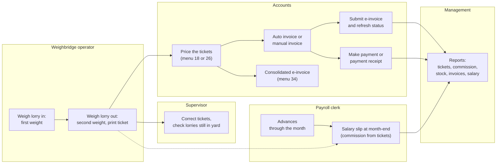
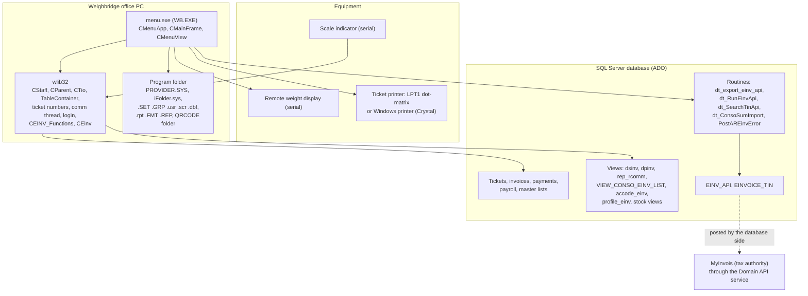
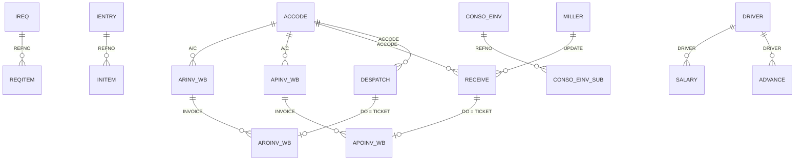
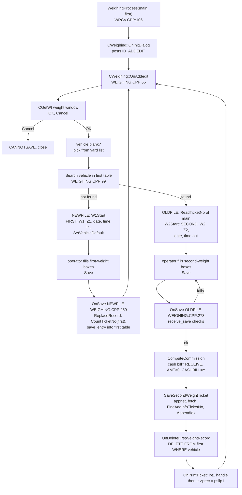
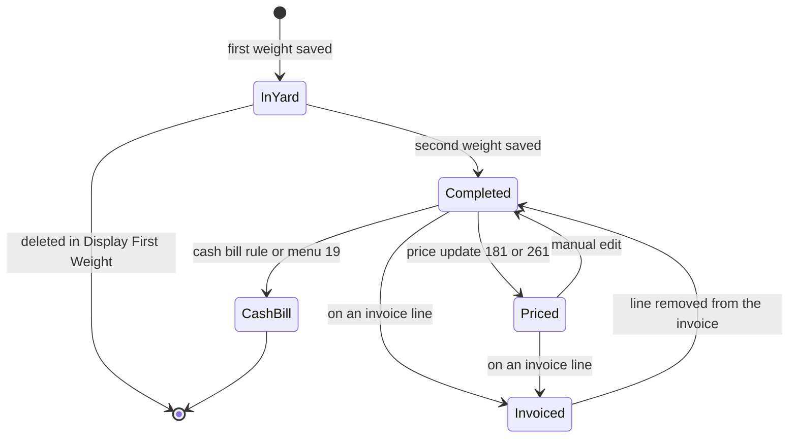
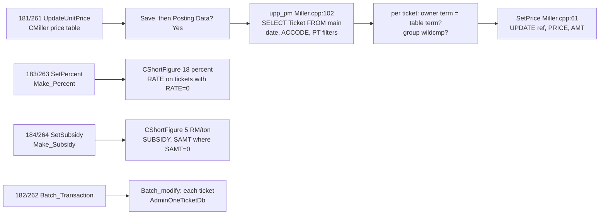
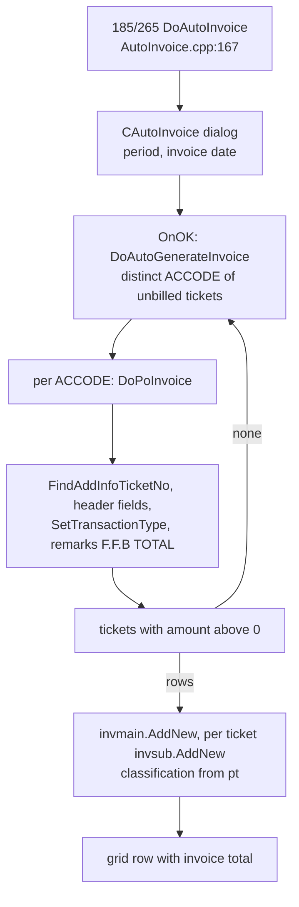
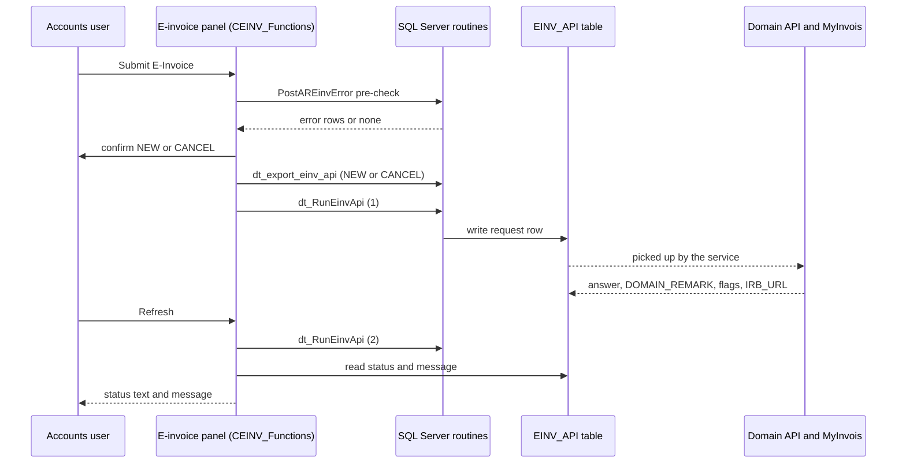
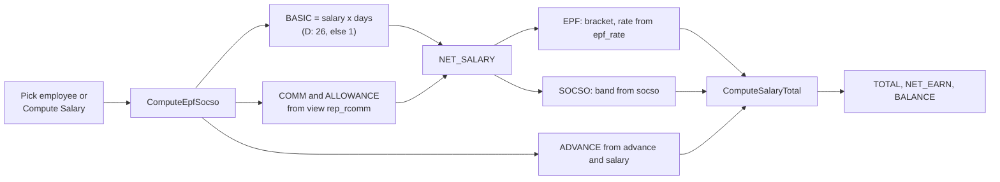
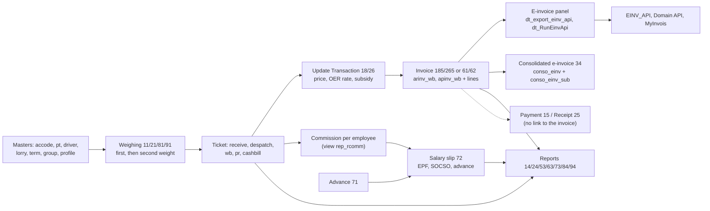

# Application_Syarikat_Seteguh - Module Reference

> English edition (authoritative). Last verified against commit `2af24e3` ("Fixed Customer code not allowed to create and unable to update einvoice profile and revised auto default transaction type", 2026-04-29).
> Translation status: zh-CN copy in [MODULE_REFERENCE.zh-CN.md](MODULE_REFERENCE.zh-CN.md), synced 2026-10-29 (commit 69b4bcc).
> Rule: any change to behaviour, tables, fields, screens, reports or calculations must update this reference in the same commit.
> This repository is the **base of a pair**: `Application_Nibong_Jaya` is a near copy of the same program (see the last section, [Related repository](#related-repository)).

**What this program is.** The weighbridge and trading program of **Syarikat Seteguh**, a buyer and seller of oil palm fruit (fresh fruit bunches, "FFB") and related products. It is a VC6 / MFC program on the shared wlib32 framework (the same family as the other weighbridge apps). One menu program does everything: it weighs lorries in and out (receiving, despatch, normal and public weighing), prices the loads, pays suppliers and receives money from buyers, raises purchase and sales invoices (including the Malaysian **MyInvois e-invoice**, with a consolidated e-invoice), books "other product" invoices, keeps stock reports and runs a small **payroll** for the drivers and harvesters who are paid commission on the tonnage they carry. The repository has no `User_Guide` folder, no other `docs` file and no SQL schema repository, so no screenshots exist and every database type below is marked as unverified unless an old dBASE header gives it.

## Contents

- [Menu map and coverage](#menu-map-and-coverage)
- [Part 1: Business view](#part-1-business-view)
  - [1.1 In plain words](#11-in-plain-words) / [1.2 Who uses what](#12-who-uses-what) / [1.3 A day in the life](#13-a-day-in-the-life) / [1.4 Worked example](#14-worked-example)
  - [1.5 Screen tour](#15-screen-tour) / [1.6 Where does this number come from?](#16-where-does-this-number-come-from) / [1.7 Status meanings](#17-status-meanings)
  - [1.8 What happens if...](#18-what-happens-if) / [1.9 Messages you may see](#19-messages-you-may-see) / [1.10 Do and don't](#110-do-and-dont)
  - [1.11 Before you start](#111-before-you-start) / [1.12 Glossary](#112-glossary) / [1.13 Ask the AI](#113-ask-the-ai)
- [Part 2: Technical view](#part-2-technical-view)
  - [2.1 Overview](#21-overview) / [2.2 Architecture and dependencies](#22-architecture-and-dependencies) / [2.3 Master data catalogue](#23-master-data-catalogue)
  - [2.4 Sub-table hierarchy](#24-sub-table-hierarchy) / [2.5 Modules and process flows](#25-modules-and-process-flows) / [2.6 End-to-end flows](#26-end-to-end-flows)
  - [2.7 Report catalogue](#27-report-catalogue) / [2.8 Integrations](#28-integrations) / [2.9 Configuration](#29-configuration) / [2.10 Maintenance](#210-maintenance)
- [Dormant code](#dormant-code) / [User rights](#user-rights) / [Not yet documented](#not-yet-documented) / [Code findings](#code-findings)
- [Related repository](#related-repository)

## Menu map and coverage

Menu resource `IDR_MAINMENU` in `MENU.RC:2270-2377` has 9 top-level entries and **63 leaf items**. The menu ID `ID000nn` is node `nn` (for example `ID00321` is node 321); `CMenuApp::SubProgram` (`MAIN.CPP:72`) switches on the node. Node numbers are built from `enum menu {M_RECEIVE=1, M_DESPATCH, M_CTRL, M_UTIL, M_OTHER, M_INV, M_SALARY, M_NORMAL, M_PUBLIC}` (`MAIN.CPP:12`) and the helper enums at `MAIN.CPP:13-20` (`M_UPDATE=18`, `M_UP_DES=26`, `M_CTRL1=31`, `M_CTRL2=32`, `M_CTRL3=33`, `M_EXPINV=65`). The wlib32 frame routes every `ID000nn` command to `On00001`, which calls `SubProgram`. Every item below is covered in this file. Menus 8 and 9 (Normal and Public Weighing) look like the standard weighing template but run the **same weighing engine as menus 1 and 2** with other tables (`WeighingProcess(&wb,&fwb)`, `WeighingProcess(&pr,&fpr)`), so they are documented here from this code, not from the standard template.

| Menu path | Node | Handler | Where documented |
|---|---|---|---|
| 1. Receiving Weighing > 11. Receiving Weighing | 11 | `WeighingProcess(&receive,&first)` (`MAIN.CPP:85`) | [2.5.2](#252-weighing-engine-menus-1-2-8-and-9) |
| 1 > 12. View Receiving Ticket | 12 | `AdminTicketDb(&receive)` (`MAIN.CPP:88`) | [2.5.3](#253-ticket-view-and-first-weight-view) |
| 1 > 13. Display First Weight | 13 | `AdminTicketDb(&first)` (`MAIN.CPP:91`) | [2.5.3](#253-ticket-view-and-first-weight-view) |
| 1 > 14. Receiving Report | 14 | `STCR=1; TableContainer("rcvctn")` (`MAIN.CPP:94`) | [2.5.14](#2514-report-picker-table-container) |
| 1 > 15. Make Payment | 15 | `AdminDbPayment(&payment)` (`MAIN.CPP:98`) | [2.5.6](#256-payments-and-receipts) |
| 1 > 16. Check Porla Licence Expired Report | 16 | `CheckPorlaLicenseExpiredDate()` (`MAIN.CPP:101`) | [2.5.14](#2514-report-picker-table-container) |
| 1 > 17. View Cash Bill Ticket | 17 | `AdminTicketDb(&cashbill)` (`MAIN.CPP:104`) | [2.5.3](#253-ticket-view-and-first-weight-view) |
| 1 > 18. Update Transaction > 181 Fast && Auto Update Process | 181 | `UpdateUnitPrice(&miller,&receive)` (`MAIN.CPP:110`) | [2.5.4](#254-update-transaction-menus-18-and-26) |
| 1 > 18 > 182 Manual Update Process | 182 | `Batch_Transaction(&receive)` (`MAIN.CPP:113`) | [2.5.4](#254-update-transaction-menus-18-and-26) |
| 1 > 18 > 183 Percent Update Process | 183 | `SetPercent(&receive)` (`MAIN.CPP:116`) | [2.5.4](#254-update-transaction-menus-18-and-26) |
| 1 > 18 > 184 Subsidy Update Process | 184 | `SetSubsidy(&receive)` (`MAIN.CPP:119`) | [2.5.4](#254-update-transaction-menus-18-and-26) |
| 1 > 18 > 185 Auto Purchase Invoice | 185 | `Purchase_Flag=TRUE; DoAutoInvoice(&receive,&apinv_wb,&apoinv_wb)` (`MAIN.CPP:122`) | [2.5.7](#257-invoices-menu-6-and-auto-invoice) |
| 1 > 19. Transfer To Cash Bill | 19 | `PostingToCashBill()` (`MAIN.CPP:107`) | [2.5.5](#255-transfer-to-cash-bill) |
| 2. Despatch Weighing > 21. Despatch Weighing | 21 | `WeighingProcess(&despatch,&fdes)` (`MAIN.CPP:126`) | [2.5.2](#252-weighing-engine-menus-1-2-8-and-9) |
| 2 > 22. View Despatch Ticket | 22 | `AdminTicketDb(&despatch)` (`MAIN.CPP:129`) | [2.5.3](#253-ticket-view-and-first-weight-view) |
| 2 > 23. Display First Weight | 23 | `AdminTicketDb(&fdes)` (`MAIN.CPP:132`) | [2.5.3](#253-ticket-view-and-first-weight-view) |
| 2 > 24. Despatch Report | 24 | `STCR=2; TableContainer("desctn")` (`MAIN.CPP:135`) | [2.5.14](#2514-report-picker-table-container) |
| 2 > 25. Payment Receipt | 25 | `STCR=2; AdminDbPayment(&receipt)` (`MAIN.CPP:140`) | [2.5.6](#256-payments-and-receipts) |
| 2 > 26. Update Transaction > 261 to 265 | 261-265 | `UpdateUnitPrice(&up_des,&despatch)`, `Batch_Transaction`, `SetPercent`, `SetSubsidy` on `&despatch`, `Purchase_Flag=FALSE; DoAutoInvoice(&despatch,&arinv_wb,&aroinv_wb)` (`MAIN.CPP:145-159`) | [2.5.4](#254-update-transaction-menus-18-and-26), [2.5.7](#257-invoices-menu-6-and-auto-invoice) |
| 3. Table > 31. Table 1 > 311 Set Product Code | 311 | `AdminDb(&prodtype)` (`MAIN.CPP:184`) | [2.5.12](#2512-master-tables-menu-3) |
| 3 > 31 > 312 Set Particular Code | 312 | `AdminDb(&particul)` (`MAIN.CPP:187`) | [2.5.12](#2512-master-tables-menu-3) |
| 3 > 31 > 313 Lorry Data Maintenance | 313 | `AdminDb(&lorry)` (`MAIN.CPP:190`) | [2.5.12](#2512-master-tables-menu-3) |
| 3 > 31 > 314 Unit Code | 314 | `AdminDb(&unit)` (`MAIN.CPP:193`) | [2.5.12](#2512-master-tables-menu-3) |
| 3 > 31 > 315 Location | 315 | `AdminDb(&locate)` (`MAIN.CPP:196`) | [2.5.12](#2512-master-tables-menu-3) |
| 3 > 31 > 316 Kod | 316 | `AdminDb(&kod)` (`MAIN.CPP:199`) | [2.5.12](#2512-master-tables-menu-3) |
| 3 > 31 > 317 Stock Adjustment Reason | 317 | `AdminDb(&reason)` (`MAIN.CPP:202`) | [2.5.12](#2512-master-tables-menu-3) |
| 3 > 32. Table 2 > 321 Set Customer Code | 321 | `CAccode h1(IDD_ACCODE,&accode,1); h1.DoModal()` (`MAIN.CPP:205-211`) | [2.5.12](#2512-master-tables-menu-3), [2.5.8](#258-e-invoice-on-the-invoice-and-customer-screens) |
| 3 > 32 > 322 Set Employee Code | 322 | `AdminDb(&driver)` (`MAIN.CPP:213`) | [2.5.12](#2512-master-tables-menu-3), [2.5.11](#2511-payroll-menu-7) |
| 3 > 32 > 323 Set Price Formula Code | 323 | `AdminDb(&term)` (`MAIN.CPP:216`) | [2.5.12](#2512-master-tables-menu-3) |
| 3 > 32 > 324 Set Customer Group | 324 | `AdminDb(&group)` (`MAIN.CPP:219`) | [2.5.12](#2512-master-tables-menu-3) |
| 3 > 32 > 325 Set Agent Code | 325 | `AdminDb(&agent)` (`MAIN.CPP:222`) | [2.5.12](#2512-master-tables-menu-3) |
| 3 > 32 > 326 Position Information | 326 | `AdminDb(&position)` (`MAIN.CPP:225`) | [2.5.12](#2512-master-tables-menu-3) |
| 3 > 33. Payroll Table > 331 EPF Rate Setting | 331 | `AdminDb_EPF_RATE(&epf_rate)` (`MAIN.CPP:228`) | [2.5.11](#2511-payroll-menu-7) |
| 3 > 33 > 332 SOCSO Table | 332 | `AdminDb(&socso)` (`MAIN.CPP:231`) | [2.5.11](#2511-payroll-menu-7) |
| 3 > 34. Consolidate E-invoice Entry | 34 | `Conso_Einv()` (`MAIN.CPP:234`) | [2.5.9](#259-consolidated-e-invoice-menu-34) |
| 4. Utility > 41 Set Password | 41 | frame `ON_COMMAND(ID00041,OnPassword)` (`MAINFRM.CPP:74`), library `OnPassword` | [2.5.13](#2513-utility-menu-4) |
| 4 > 42 Company Profile | 42 | `AdminProfileDb(&profile)` (`MAIN.CPP:161`) | [2.5.13](#2513-utility-menu-4) |
| 4 > 43 Operator Information | 43 | `SetUser()` (`MAIN.CPP:164`) | [2.5.13](#2513-utility-menu-4) |
| 4 > 44 System Update | 44 | `OnSystemUpgrade("WB.EXE",app->internetFolder)` (`MAIN.CPP:167`) | [2.5.13](#2513-utility-menu-4) |
| 4 > 45 Backup Data | 45 | `BackupProcess()` (`MAIN.CPP:170`) | [2.5.13](#2513-utility-menu-4) |
| 4 > 46 Reset Database | 46 | `CleanDatabase()` (`MAIN.CPP:173`) | [2.5.13](#2513-utility-menu-4) |
| 4 > 47 E-Invoice Profile | 47 | `ado(&adoTmp,"profile_einv"); AdminDb_CMProfile(&adoTmp)` (`MAIN.CPP:176-182`) | [2.5.13](#2513-utility-menu-4) |
| 5. Other Product > 51 Sales Invoice | 51 | `AdminDbIreq(&ireq,&reqitem)` (`MAIN.CPP:239`) | [2.5.10](#2510-other-product-menu-5) |
| 5 > 52 Purchase Invoice | 52 | `AdminDbIreq(&ientry,&initem)` (`MAIN.CPP:242`) | [2.5.10](#2510-other-product-menu-5) |
| 5 > 53 Other Product Report | 53 | `TableContainer("othctn")` (`MAIN.CPP:245`) | [2.5.14](#2514-report-picker-table-container) |
| 6. Invoice > 61 Purchase Invoice | 61 | `PurchaseInvoiceWb()` (`MAIN.CPP:251`) | [2.5.7](#257-invoices-menu-6-and-auto-invoice) |
| 6 > 62 Sales Invoice | 62 | `SalesInvoiceWb()` (`MAIN.CPP:254`) | [2.5.7](#257-invoices-menu-6-and-auto-invoice) |
| 6 > 63 Invoice Report | 63 | `TableContainer("invctn")` (`MAIN.CPP:257`) | [2.5.14](#2514-report-picker-table-container) |
| 7. Payroll > 71 Advance Data Entry | 71 | `AdminDbAdvance(&advance)` (`MAIN.CPP:76`) | [2.5.11](#2511-payroll-menu-7) |
| 7 > 72 Employee Salary Slip | 72 | `AdminDbSalary(&salary)` (`MAIN.CPP:79`) | [2.5.11](#2511-payroll-menu-7) |
| 7 > 73 Salary Report | 73 | `TableContainer("salctn")` (`MAIN.CPP:82`) | [2.5.14](#2514-report-picker-table-container) |
| 8. Normal Weighing > 81 Normal Weighing | 81 | `WeighingProcess(&wb,&fwb)` (`MAIN.CPP:266`) | [2.5.2](#252-weighing-engine-menus-1-2-8-and-9) |
| 8 > 82 View Normal Ticket / 83 Display First Weight | 82, 83 | `AdminTicketDb(&wb)`, `AdminTicketDb(&fwb)` (`MAIN.CPP:269`, `:272`) | [2.5.3](#253-ticket-view-and-first-weight-view) |
| 8 > 84 Normal Weighing Report | 84 | `STCR=1; TableContainer("wbctn")` (`MAIN.CPP:275`) | [2.5.14](#2514-report-picker-table-container) |
| 9. Public Weighing > 91 Public Weighing | 91 | `WeighingProcess(&pr,&fpr)` (`MAIN.CPP:279`) | [2.5.2](#252-weighing-engine-menus-1-2-8-and-9) |
| 9 > 92 View Public Ticket / 93 Display First Weight | 92, 93 | `AdminTicketDb(&pr)`, `AdminTicketDb(&fpr)` (`MAIN.CPP:282`, `:285`) | [2.5.3](#253-ticket-view-and-first-weight-view) |
| 9 > 94 Public Weighing Report | 94 | `STCR=1; TableContainer("prctn")` (`MAIN.CPP:288`) | [2.5.14](#2514-report-picker-table-container) |

**Code paths with no menu item** (all in `SubProgram`, see [Dormant code](#dormant-code)): node 54 `StatementOfAccount()` (`MAIN.CPP:248`), nodes 651 and 652 `ExportApinvTransactions()` / `ExportArinvTransactions()` (`MAIN.CPP:260`, `:263`). The frame still maps their command IDs (`MAINFRM.CPP:82`, `:92-93`) but `MENU.RC` has no menu entry for them. The toolbar `IDR_MAINFRAME` (`MENU.RC:2245-2262`) repeats nodes 11, 21, 12, 22, 17, 14, 24, 53, 321, 311 and Exit as shortcuts.

**Coverage statement.** The generated `_inventory/Application_Syarikat_Seteguh/inventory.md` listed the same 63 menu items. It was used as a lead only: its `p1.subN` line numbers for `ARINV_WB.CPP` (139 and 152) are stale (the real lines are 156 and 169), it shows no field types, and it lists dialogs and `.cpp` files that are not part of the build (see [2.1](#21-overview)).

---

# Part 1: Business view

*For people who do not know the program. No file, class or table names are used in this part. Menu names are written as they appear on screen, for example "11. Receiving Weighing".*

## 1.1 In plain words

- This program runs the **weighbridge office** of Syarikat Seteguh. The weighbridge is the large scale a lorry drives onto. The company buys oil palm fruit (called FFB, fresh fruit bunches) from estates and smallholders, sells fruit and other products to mills and buyers, and also weighs for outside parties.
- Every lorry is weighed twice, once with its load and once without (or the other way round). The program reads the scale, works out the **net weight** (the weight of the goods), prices it, and prints a **weighing ticket**. The same ticket then drives everything else: the payment to the supplier, the invoice, the commission of the drivers and harvesters, and the stock and sales reports.
- There are four kinds of weighing, each with its own tickets and reports: **Receiving** (goods bought), **Despatch** (goods sold), **Normal Weighing** and **Public Weighing** (simpler tickets for other uses, for example outside parties who only pay to use the scale).
- After weighing, the office **prices** the tickets, groups them into **purchase invoices** (for suppliers) and **sales invoices** (for buyers), pays suppliers, records money received, and sends the invoices to the tax authority as **e-invoices** (the Malaysian MyInvois system). Many invoices of one period can be combined into one **consolidated e-invoice**.
- The program also keeps **other product** invoices (goods that are not weighed, with stock reports) and a small **payroll** for the drivers and harvesters: monthly or daily pay, commission on the tonnes they carry, EPF and SOCSO (the two staff-benefit contributions required by law), and advances.
- If tickets are not weighed or saved correctly, nobody can prove how much was bought or sold. If the master lists (suppliers, products, vehicles, employees) are wrong, tickets, invoices, e-invoices and pay slips are wrong too.

## 1.2 Who uses what

| Department | Menus | Main tasks |
|---|---|---|
| Weighbridge operator | 1. Receiving Weighing, 2. Despatch Weighing, 8. Normal Weighing, 9. Public Weighing | Weigh lorries in and out, pick the supplier or buyer, drivers and product, print tickets |
| Weighbridge supervisor | View ticket screens (menus 12, 22, 82, 92), 18 and 26 Update Transaction | Correct tickets, set prices in bulk, enter the extraction rate and the subsidy, approve forced weights |
| Purchasing / Sales | 3. Table, 18 and 26 Update Transaction | Keep suppliers and buyers, price formulas, agents, locations, products |
| Accounts / Finance | 15. Make Payment, 25. Payment Receipt, 6. Invoice, 5. Other Product, 34. Consolidate E-invoice Entry, 47. E-Invoice Profile, reports | Pay suppliers, record receipts, raise invoices, submit and cancel e-invoices, month-end listings |
| Payroll clerk | 7. Payroll, 33. Payroll Table, 322. Set Employee Code | Employee records, advances, month-end salary slips, EPF and SOCSO reports |
| Management | The report entries of every menu | Daily and monthly totals, stock, driver commission, payment and invoice listings |
| IT / Admin | 4. Utility, 313. Lorry Data Maintenance | Company profile, operator accounts and levels, backup, system update, e-invoice profile, reset |

**Start here, by department**

- Operator: open **11. Receiving Weighing** (goods in) or **21. Despatch Weighing** (goods out). **81** and **91** are the same screen for Normal and Public tickets.
- Supervisor: **12. View Receiving Ticket** to correct a ticket; **13. Display First Weight** to see lorries that are still in the yard (weighed once, not yet finished).
- Purchasing / Sales: **3. Table**: customers and suppliers (321), price formulas (323), employees (322), products (311).
- Accounts: **18. Update Transaction** (price the tickets), **185. Auto Purchase Invoice** or **61. Purchase Invoice**, **62. Sales Invoice**, **15. Make Payment**, **25. Payment Receipt**, then the e-invoice buttons on the invoice screens.
- Payroll clerk: **71. Advance Data Entry** during the month, **72. Employee Salary Slip** at month-end, **73. Salary Report**.
- IT: **42. Company Profile**, **43. Operator Information**, **45. Backup Data**, **47. E-Invoice Profile**.

**Daily, weekly and month-end duties (typical, not fixed by the program)**

| When | Who | What |
|---|---|---|
| Every lorry | Operator | First weight, second weight, print the ticket |
| Every day | Supervisor | Check **13. Display First Weight** for lorries that never came back; fix wrong tickets |
| Weekly or month-end | Accounts / Supervisor | Price the tickets (menu 18 or 26), then create invoices (185 or 265, or 61 and 62) |
| After each invoice | Accounts | Submit the e-invoice and check its status; at month-end submit the consolidated e-invoice where it is used |
| When paying | Accounts | 15. Make Payment (suppliers), 25. Payment Receipt (buyers) |
| Month-end | Payroll clerk | Check advances, create one salary slip per employee, print EPF, SOCSO and salary reports |
| Daily or weekly | IT | 45. Backup Data |

### User levels and approvals

Each operator has a **level** (a number) and a list of menu items hidden for that person. The program uses these levels:

| Level | What it allows (as coded) |
|---|---|
| 99 and above | Can edit the **first and second weight** boxes while weighing (for everyone below 99 these two boxes are skipped); sees extra setup tools in the report picker |
| 9 and above | Can approve a forced weight on the weight window (as the supervisor); can change the **date of an invoice** |
| Below 9 | On a purchase or sales invoice the invoice date is locked; everything else follows the screen rules |

The level-99 rule applies to the **weighing screen only**. On the "View ... Ticket" screens the program does not lock the weight boxes, so anyone who is allowed to edit tickets there can change a weight (a ticket that is already on an invoice cannot be edited at all).

A supervisor can approve an action for an operator who does not have the level: a small box asks for the **supervisor's ID and password** and records who approved what and when.

## 1.3 A day in the life

**Receiving a load of fruit (goods bought).** The lorry drives onto the scale. The operator opens **11. Receiving Weighing**. A small window shows the live weight and the list of lorries already in the yard. The operator types the vehicle number and presses **OK** when the traffic light is green. The program does not know this vehicle is in the yard, so this is the **first weight**: it fills in the supplier, drivers and product that are stored for this vehicle, and the operator checks them, types the delivery note number and saves. The lorry unloads and comes back. The operator types the same vehicle number: the program finds it in the yard, so this is the **second weight**. The operator records any fruit that is unripe, rotten or wet (these weights are taken off the net weight), saves, and the program prints the ticket and removes the lorry from the yard list. The drivers and harvesters named on the ticket get their commission worked out from the supplier's record.

**Selling (goods out).** The same steps with **21. Despatch Weighing**. The ticket is a despatch ticket and the "other party" is the buyer.

**Cash purchases.** If the ticket is marked "Cash Bill" (it is copied from the supplier's record) and the ticket has an amount, the finished receiving ticket is saved as a **cash bill ticket** instead of an ordinary receiving ticket. A ticket that was saved as an ordinary receiving ticket can be moved later with **19. Transfer To Cash Bill**.

**Pricing.** Prices are not always known at the weighbridge. At the end of a period the office prices the tickets with **181. Fast && Auto Update Process** (a price table per supplier group and price formula), or one by one with **182**, or sets the **extraction rate** with **183** and the **subsidy** with **184**.

**Invoicing and e-invoice.** The office runs **185. Auto Purchase Invoice** (suppliers) or **265. Auto Sales Invoice** (buyers) for a period: the program builds one invoice per supplier or buyer from the tickets that are not yet invoiced. Invoices can also be made by hand in **61** and **62**. On each invoice screen the **Submit E-Invoice** panel sends the invoice to the tax authority; **Refresh** reads back the answer. Many invoices of a period can be combined into one consolidated e-invoice in **34. Consolidate E-invoice Entry**.

**Paying and receiving.** **15. Make Payment** records a payment to a supplier; **25. Payment Receipt** records money from a buyer.

**Month-end payroll.** The payroll clerk enters advances through the month in **71**. At month-end **72. Employee Salary Slip** adds up the pay, the commission and allowances earned from the tickets, takes off EPF and SOCSO, subtracts advances and shows the balance to pay. **73. Salary Report** prints EPF, SOCSO, salary and advance reports.



*Caption: read left to right. Everything starts from the ticket the operator prints; accounts price and invoice the tickets, and the same tickets feed the drivers' commission in the payroll.*

## 1.4 Worked example

All names and numbers are made up. The program rounds as shown. One load of fruit from a supplier is followed from the weighbridge to the pay slip.

**Master data already in place**

- Supplier (menu 321): code `D001`, name `DEMO ESTATE SDN BHD`, price formula `T` (a fixed price per tonne), driver commission 3.00, harvester commission 2.00 (RM per tonne), transporter fee 20.00, harvester fee 15.00, subsidy 0.00, **Cash Bill** = N.
- Product `01` `DEMO FFB`.
- Vehicle `WXX1234` (menu 313), with employees `E001` (position D, a driver) and `E002` (position H, a harvester) as the default crew.
- Price table (menu 181): period 1 to 31 October, supplier `D001`, product `01`, group `*` (all groups), price formula `T`, price 800.00 per tonne.
- Employee `E001` (menu 322): monthly pay 1,800.00, EPF number and SOCSO number present, "include commission" = N.
- EPF rate (menu 331): employee 11, employer 13 (percent). SOCSO band that holds 1,800.00: employee 9.00, employer 31.50 (demo values).

| Step | What happens | Typed or picked | Calculated | Status after |
|---|---|---|---|---|
| 1. First weight, 08:15:20 | **11. Receiving Weighing**, vehicle `WXX1234`, OK | Delivery note `DN-DEMO-1`; supplier `D001` and crew filled in by the vehicle record | First weight 18,500 kg, time in 08:15:20, date today | Lorry is **in the yard** (shown in 13) |
| 2. Second weight, 08:52:05 | Same vehicle again, OK | Unripe 100 kg, rotten 50 kg, wet 0 kg | Second weight 8,300 kg. Wastage 100 + 50 + 0 = 150 kg. **Net = 18,500 - 8,300 - 150 = 10,050 kg**. Commission rates copied from the supplier to the crew: E001 3.00, E002 2.00 | **Completed ticket**, lorry leaves the yard list, ticket printed |
| 3. Pricing | **181. Fast && Auto Update Process**, price table above, then OK and "Posting Data" | - | Price 800.00 (formula `T`). Amount = 10.05 x (800.00 - 20.00 - 15.00) = 10.05 x 765.00 = **7,688.25** | Ticket carries the price and the price-table reference |
| 4. Invoice | **185. Auto Purchase Invoice**, period 1 to 31 October | Invoice date (last day of the month is offered) | One purchase invoice for `D001` with the ticket as a line, remarks `F.F.B TOTAL`; transaction type `S` (self-billed) | Ticket is **invoiced**: it can no longer be edited |
| 5. E-invoice | On the invoice screen, **Submit E-Invoice**, answer Yes; later **Refresh** | - | Status shows `NEW`, then the answer from the tax authority | Invoice has an e-invoice status |
| 6. Payment | **15. Make Payment** | Supplier `D001`, bank or cash account, paid date, amount 7,688.25 | - | Payment recorded |
| 7. Advance | **71. Advance Data Entry** | Employee `E001`, amount 300.00 | - | Advance recorded |
| 8. Salary slip | **72. Employee Salary Slip**, date in October, employee `E001` | (the program fills the rest) | Commission for the month from all tickets, say 150.00; allowance for trips, say 30.00. **Net salary = 1,800.00 + 30.00 + 150.00 = 1,980.00**. EPF employee 11 percent of 1,800.00 = 198.00, employer 13 percent = 234.00. SOCSO 9.00 and 31.50. Company cost = 1,980.00 + 234.00 + 31.50 = **2,245.50**. Net paid = 1,980.00 - 198.00 - 9.00 = **1,773.00**. Less advance 300.00. **Balance to pay = 1,473.00** | Salary slip saved |

The step-by-step rules behind each number are in [1.6 Where does this number come from?](#16-where-does-this-number-come-from).

## 1.5 Screen tour

The repository has no screenshots and no user guide, and the program was not run for this document, so no pictures are shown. Field labels are the exact on-screen text from the program's screen definitions (spelling mistakes of the screens are kept, marked "sic").

### The main window and the menu bar

- The window title is the company name followed by "Weighing System Ver 2.00" (the version note in the program says "2.00 e-inv version"). The window itself shows only a background picture (when the picture file is present next to the program) and four text lines whose content is set by the program library. Everything is done from the menu bar and the toolbar.
- Menu bar: **1. Receiving Weighing**, **2. Despatch Weighing**, **3. Table**, **4. Utility**, **5. Other Product**, **6. Invoice**, **7. Payroll**, **8. Normal Weighing**, **9. Public Weighing**. Items an operator may not use can be hidden per operator (see 1.2).
- Toolbar shortcuts: Receiving Weighing, Despatch Weighing, View Receiving Ticket, View Despatch Ticket, View Cash Bill Ticket, Receiving Report, Despatch Report, Other Product Report, Set Customer Code, Set Product Code, Exit.
- Closing the main window also stops the connection to the scale.

### The weight window ("Please keyin vehicle no")

*Purpose:* read the live weight and say which vehicle is on the scale. It opens first whenever you start a weighing (menus 11, 21, 81, 91) and again after every save.

| Part of the window | Meaning | Where the value comes from |
|---|---|---|
| Big number | Live weight in kg, five digits | Automatic, from the scale. It shows the weight **after** any deduction preset you chose (see "Deduction presets" below) |
| Vehicle No | The lorry plate | Typed (capitals), or click a row of the yard list, or leave empty and press OK to pick from the yard list |
| Status | `stable` or `Unstable` | Automatic. Stable means the weight stayed within the company profile's variance for two readings in a row |
| Traffic light | Green when the weight is 500 kg or more and, if the company profile asks for it, the weight is stable and the scale has shown zero since the window opened. Red otherwise | Automatic |
| Yard list | Lorries weighed once and not finished: No, Vehicle No, Date, Time In, A/C Code, Product, Wt.In(kg) | Automatic. Click a row to fill the vehicle number; double-click to fill it and press OK |
| Total Vehicle In Yard | How many rows the list has | Automatic |

Buttons and keys:

- **OK** (or Enter in the vehicle box) accepts the weight. If the company profile requires a stable weight and the weight is not stable, the program refuses (message below). The same for the "weight must zero" rule.
- **Cancel** (or Esc) closes the window and stops weighing.
- **Force capture Wt** appears when a weight of 500 kg or more has stayed on the scale for the "Stable Time" (seconds) of the company profile without becoming stable, and it hides again as soon as the weight is stable. It asks a supervisor (level 9 or above) for ID and password, records the approval, and then accepts the current weight even though the rules were not met.
- The scale is read every 0.5 seconds unless the company profile sets another interval between 0.1 and 2.5 seconds.
- **Deduction presets.** With the cursor in the Vehicle No box, an operator can press Ctrl plus a letter to apply a preset deduction to the weight shown and stored: Ctrl+A to Ctrl+J apply a **percentage** (presets 1 to 10), Ctrl+K to Ctrl+Z apply a number of **kg** (presets 11 to 26). Pressing the space bar twice clears the deduction. The presets are typed in by IT with the **Set GWST** button of the company profile. A deduction is only applied when the scale weight is above 1,000 kg and is cleared when the scale returns to zero or below.

### Receiving ticket screen (menu 11 while weighing, menu 12 to view)

*Purpose:* the ticket itself. The same layout is used while weighing and when viewing or correcting old tickets. While weighing, the program steps through a fixed list of boxes; the other boxes are skipped. Boxes marked "automatic" cannot be typed.

| Field label | Meaning | Required? | Comes from |
|---|---|---|---|
| Receive Ticket No | Ticket number | Yes | Automatic, running number; skips numbers already used |
| Vehicle No | Lorry plate | Yes | From the weight window |
| Date | Date of the ticket | Yes | Automatic: today at the first weight, and set again to today at the second weight |
| Owner | The supplier (the party the fruit is bought from) | Yes at the second weight | Picked from the customer list; filled from the vehicle record when the vehicle has a default party |
| Agent, Commission, Allowance | An agent, and the agent's commission and allowance | No | Filled from the customer record when the owner is picked |
| Porla A/C | The licence holder's account (the Porla licence is the palm-oil trading licence) | No | Filled from the customer record |
| Sold To Mill | The mill the fruit is passed on to | No | Picked. Not part of the weighing steps: set it afterwards in the View Receiving Ticket screen. Saving a ticket that has a mill creates a matching despatch ticket (see 1.8) |
| Location | Where the fruit comes from | No | Filled from the customer record, or picked |
| Employee table (five rows): Employee ID, name, Commission (RM/MT), Allowance (RM/Trip) | The drivers and harvesters on this load. The small box beside the name shows the employee's position | No | Employee IDs are filled from the vehicle record (up to three, those marked as default). Commission is filled at the second weight from the owner's record by position: driver, harvester or transporter |
| Product | What is bought | Yes at the second weight | Picked from the product list. The program sets product `01` whenever an owner is picked, so check it |
| DN NO | The supplier's delivery note number | No | Typed |
| Cash Bill (Y/N) | Whether this purchase is a cash purchase | No | Filled from the customer record |
| Muda / Busuk / Hujan: pieces and weight (kg) | Fruit that is unripe (Muda), rotten (Busuk) or wet from rain (Hujan): a count of pieces for Muda and Busuk, and a weight for all three | No | Typed. Skipped when the company profile's "Grading Flag" is off |
| First (kg), Second (kg) | The two scale weights | Yes | Automatic from the scale. Only level 99 can type here |
| Time In / Time Out | Time of the first and second weight | Yes | Automatic |
| Less Wastage | Weight taken off for the unripe, rotten and wet fruit | No | Calculated as Muda + Busuk + Hujan weights when the Grading Flag is on, typed otherwise |
| Net Weight (kg) | The weight of the goods | - | Calculated, see 1.6 |
| OER Rate (%) | Oil extraction rate used by percentage price formulas | No | Typed, or set for many tickets at once by menu 183 |
| Transporter Fee, Harvester Fee (per MT) | Fees per tonne taken off the price | No | Filled from the customer record, can be changed |
| U/Price | Price per tonne | Yes when Cash Bill is Y | Typed, or set by the Update Transaction menus |
| Sub-Total (RM) | Weight in tonnes times (price minus the two fees) | - | Calculated |
| Less (RM) | A money deduction | No | Typed |
| Net Amount (RM) | Amount payable for the load | - | Calculated, see 1.6 |
| Subsidy/MT, Subsidy Amt | Subsidy per tonne and its amount | No | Typed; set for many tickets by menu 184 |
| Weighing Fee | A fee charged for weighing | No | Typed (last box) |
| Remarks | Free text | No | Typed |

On the weighing screen the Save button finishes the step. At the **first weight** nothing is checked. At the **second weight** the program checks the ticket (see 1.9) and then prints it.

**Despatch ticket (menu 21 / 22).** The same layout. The label of the first box is "Despatch Ticket No", the party box is also called "Owner" (the buyer), and the "Sold To Mill" box is called "Supplier". **Cash bill ticket (menu 17)** is the same layout with the title "Cash Bill Ticket No".

### Normal and Public weighing tickets (menus 8 and 9)

These use the same weighing steps and the same weight window as menus 1 and 2, with a **shorter ticket screen**: Ticket No, Vehicle No, Date, A/C Code, two employees (Driver 1 and Driver 2), Product, DN NO, First, Second, Less Wastage, Net Weight, Remarks and the two times. The price, fee, commission, grading and subsidy boxes are hidden on this screen. The ticket still has the same checks as a receiving ticket: both weights not zero, a product and an A/C code are required at the second weight. Normal and Public tickets are kept in their own tickets and have their own reports (one listing each).

### Display First Weight (menus 13, 23, 83, 93)

Shows the lorries that were weighed once and are still in the yard, on the same ticket layout. Use it to see who is in the yard, to correct a first weight, or to **delete** a lorry that left without a second weight.

### Update Transaction (menus 18 and 26)

Menu 18 works on receiving tickets, menu 26 on despatch tickets. Every update skips a ticket that is already on an invoice.

| Menu | Screen | What you enter | What it does |
|---|---|---|---|
| 181 / 261 Fast && Auto Update Process | Price table: Ref No, Date and To, A/C Code, Product, Group, Term (price formula), U/Price ($/Metric Ton), Remarks | One price line: the period, optional A/C Code, product, customer group (`*` means all groups), price formula and the price. Menu 261 has its own price table for sales | On Save the program asks "Posting Data". If you agree it sets the price and amount of every ticket in the period whose customer has the same price formula and group, see 1.6. Message "Update Completed" |
| 182 / 262 Manual Update Process | Filter box: Date, To, A/C No, MILL (sic), Product, Term | The filter. Product starts as `01` | Opens each matching ticket one after the other on the single-ticket screen so you can edit it by hand. The "MILL" box actually filters on the Porla A/C code |
| 183 / 263 Percent Update Process | Filter box: Date, To, From A/C No, To, Product, Group, Term, Page, Today; then the box "Set OER Rate" (Percentage(%), starts at 18) | The filter (the program fills the first and last A/C code, product `01`, term `P`) and the percentage | Sets the OER rate on matching tickets that have no rate yet. Does not change prices |
| 184 / 264 Subsidy Update Process | The same filter box; then "Set Subsidy Amount" (Subsidy(RM/TON), starts at 5) | The filter and the subsidy | Sets the subsidy and the subsidy amount (net tonnes times subsidy) on matching tickets whose subsidy amount is still zero. Only customers whose price formula equals the Term typed in the filter (it starts as `P`) are touched |
| 185 / 265 Auto Purchase / Sales Invoice | "Invoice Date", "Invoice Period" From and To | Dates | Creates invoices, see the Invoice section below |

The Term typed in the filter of 183 and 184 must exist in the price formula list (menu 323). The filter boxes check their input first and may show: "A/C Code From Not Found", "A/C Code To Not Found", "Product Not Found", "TERM Not Found".

### Transfer To Cash Bill (menu 19)

A small box (title "Transfer To Cash Bill") with Date, To and Page. The button moves every receiving ticket in the period that is marked as a cash bill into the cash bill tickets and removes it from the receiving tickets.

### Make Payment (menu 15) and Payment Receipt (menu 25)

*Purpose:* record money paid to a supplier (15) or money received from a buyer (25). Both screens have the same boxes; the party box is called "Supplier" on the payment and "Mill Buyer" on the receipt.

| Field label | Meaning | Required? | Comes from |
|---|---|---|---|
| Ref. No | Voucher number | Yes | Automatic |
| Supplier / Mill Buyer | The party | Yes ("Please assign 'A/C Code'") | Picked from the customer list |
| Paid Date | Date paid | Yes | Typed |
| Clear Date | Date the cheque cleared | No | Typed |
| Mode of Payment | The ledger account of the cash or bank used | Yes ("Please assign 'GLCODE A/C'") | Picked from the ledger code list |
| Paid Amount | Amount | Yes | Typed |
| Particular | Short description | No | Typed, or picked from the particular list when you leave it empty |
| Due Date, Cheque No | For post-dated cheques | No | Typed |
| Remarks | Free text | No | Typed |

### Check Porla Licence Expired Report (menu 16)

Asks "Check Porla Expiry Date?" (the default answer is No). On Yes it opens the period prompt and runs the "Porla Expiried" (sic) report. The report layout is a Crystal Reports file that was not opened for this document; it is meant to list customers by licence expiry date.

### Purchase Invoice (menu 61) and Sales Invoice (menu 62)

*Purpose:* one invoice per supplier (purchase) or buyer (sales), made of lines that each point at one weighing ticket. The two screens are the same, with "Supplier" instead of "Customer". Purchase invoices are made from **receiving** tickets, sales invoices from **despatch** tickets.

| Field label | Meaning | Required? | Comes from |
|---|---|---|---|
| Invoice No | Invoice number | Yes | Automatic, running number |
| Date of Invoice | Invoice date | Yes | Typed. Below level 9 this box is locked |
| Customer / Supplier | The party | Yes | Picked from the customer list. After lines exist this box cannot be changed ("Invoice Detail Existed.Not Allow to Edit this Field") |
| Terms | Payment terms | No | Filled from the customer record when the party is picked |
| Your Ref., Our Ref. | References | No | Typed |
| Remarks | Free text | No | Typed |
| Transaction Type | The e-invoice type, `IV` (invoice) or `S` (self-billed) | Yes for e-invoice | Filled automatically when the party is picked, see 1.6 |
| Line grid: No, Ticket No, Date, Vehicle No, DN No, Qty(kg), Amount, Classification Code | One row per ticket | - | Ticket data and the product's classification code |
| Total Amount boxes | Totals under the grid | - | Calculated |

Buttons:

- **Create New Invoice** lists the party's tickets that are not yet invoiced and are dated on or before the invoice date. Pick one; it is added as a line; the list opens again for the next one; leave the list (cancel) to stop. The header is saved first, so a header that cannot be saved stops the loop.
- Double-click a grid row to open the line (box "Detail Information": Ticket No, Quantity, Amount, Classification).
- **E-invoice panel** (right side): the status text, **Submit E-Invoice**, **Refresh**, **QRCODE**, **View Msg**; see the E-invoice section below.
- **Unlock Period** exists but is hidden and disabled in the screen definition.

### E-invoice panel (on the invoice screens and the Other Product screens)

| Item | What it does |
|---|---|
| Status text | Shows the latest answer for this invoice: `NEW` when nothing has been sent, otherwise the text returned by the e-invoice service (for example `SUBMITTED` or `VALID`) |
| **Submit E-Invoice** | First checks the invoice for known errors and, if there are any, shows "E-invoice error, please check error message !" with the list. If the invoice was already submitted and is neither cancelled nor rejected, it offers to **cancel** it ("You woule like to CANCEL this E-Invoice? ..." sic); otherwise it offers to submit a **new** e-invoice. A submit may take one to two minutes |
| **Refresh** | Reads the answer back from the e-invoice service. If the invoice is stuck in an invalid state it offers to reset the data and resubmit, to try again without changing the data, or to delete the submission data; finally it offers to show the message |
| **QRCODE** | Opens the QR code of an accepted e-invoice (needs the small QR program in a QRCODE folder next to the program) |
| **View Msg** | Shows the message before submission and after submission |
| Email | Defined but hidden and disabled on this program's screens |

### Customer screen and its e-invoice button (menu 321)

*Purpose:* the list of suppliers, buyers and other parties (they share one list). Since the last change a **new customer code can be added** from this screen, and the **E-Invoices** button saves what you entered.

| Field label | Meaning | Required? | Comes from |
|---|---|---|---|
| A/C No. | Customer code | Yes | Typed |
| FullL Name (sic) | Full name | Yes | Typed |
| Short Name | Short name | No | Suggested automatically from the full name |
| Address (3 lines), Tel, Fax, Email | Contact details | No | Typed |
| Agent, Comm., Allow. | Default agent and the agent's commission and allowance | No | Picked and typed |
| Porla A/C, Porla License No., Porla Expiry Date | The licence holder's account, licence number and expiry date | No | Typed |
| Kod, Keluasan (Hektar) | Customer type code and plantation area in hectares | No | Picked and typed |
| Location | Default location | No | Picked |
| Contact Person | A person to contact | No | Typed |
| Group | Customer group, used by the price update menus | No | Picked |
| Price Formula | How the price is worked out: `T` = fixed price per tonne, `P` = price times the ticket's OER rate | No | Picked from menu 323 |
| Terms | Payment terms text | No | Typed |
| Transporter Fee, Harvest fee, Subsidy Amt. | Defaults copied to every new ticket of this party (RM per tonne) | No | Typed |
| Driver's Comm., Harvest Comm., Transport Comm. | Commission per tonne for an employee whose position is driver, harvester or transporter | No | Typed |
| Remarks | Free text | No | Typed |
| Openning Balance (sic) | Balance brought forward (used by the old statement of account) | No | Typed |
| Trade Debtor G/L Code, Trade Creditor G/L Code, Bank Code | Ledger accounts (not used by the invoices) | No | Picked |
| Max. Qty. (MT/Mth) | Monthly quantity limit | No | Typed |
| Cash Bill (Y/N) | Purchases from this party are cash bills | No | Typed |

The **E-Invoices** button saves a new record first, then opens "Set E-invoice data" for this party:

| Field label | Meaning |
|---|---|
| Tin (*) | The tax identification number. The box shows the four general codes: without TIN `EI00000000010`, foreign buyer `EI00000000020`, self-billed foreign `EI00000000030`, exempt `EI00000000040` |
| New I/C No., Passport No., ROC No., Exempt No. | Identity of the party |
| No einv flag | Tick when this party must not be e-invoiced |
| State, City, Postcode, Country | Address; entering the postcode fills the state and the city; the country starts as `MYS` |
| Einv email | Email for the e-invoice |
| Not Self Bill (tick) | Tick when the supplier issues its own invoices. Then purchase invoices for this supplier get type `IV`; when not ticked they are self-billed (`S`) |
| **Search TIN** | Asks the e-invoice service for the TIN using the I/C number or the ROC number; waits up to five seconds |
| **Update** | Saves into the customer record |

### Consolidate E-invoice Entry (menu 34)

*Purpose:* combine many invoices of a period into one **consolidated e-invoice** (a single e-invoice that stands for a batch of small invoices). At most **100 invoices** are allowed per consolidated entry.

| Field label | Meaning | Required? | Comes from |
|---|---|---|---|
| Refno | Entry number | Yes | Automatic |
| Date | Entry date | Yes | Typed |
| Particukar (sic) | Description | No | Typed |
| From Date (*), To Date (*) | Period of the invoices to combine | Yes | Typed |
| Remark | Free text | No | Typed |
| Branch | Optional branch filter ("Select Branch to filter branch data") | No | Picked |
| Currency, Rate | Currency and exchange rate | Yes | Typed. The program contains start values (MYR and 1.00) but they are not switched on in this version |
| Classification(*) | The e-invoice classification code for the whole batch | Yes | Picked |
| Einv Type(*) | Which kind of invoices to combine | Yes | Picked |
| E-Invoice Submit Date, UUID, URL | Filled after submission | - | Automatic |
| Grid: No, Invoice, Amt Before Tax, Non Tax Amount, Taxable Amount, Taxcode, T%, Tax Amt, Exempt.Amt, Branch, Path, Net Amt | One row per invoice | - | Imported |
| Totals: Total Before Tax, Total Tax Amount, Total Net Amount, Total Taxable Amt, Total Non-taxable Amt, Total Exempt Amt | Sums of the grid | - | Calculated |

Buttons: **Import Invoice Data** (adds the invoices of the period, branch and type, up to 100), **Import Range Type Invoices** (only shown when the database holds the matching routine; imports by a range rule), **Submit E-Invoice**, **Refresh**, **QRCODE**, **Lock / Unlock**. In this version the Lock / Unlock button does nothing and the separate Unlock button is hidden.

### Other Product: Sales Invoice (menu 51) and Purchase Invoice (menu 52)

*Purpose:* invoices for goods that are **not weighed** (for example fertiliser or spare parts), with the same e-invoice panel, and with commission lines for up to three employees. Menu 51 raises a sales invoice ("Sales Invoice no"), menu 52 a purchase invoice ("GRN no").

| Field label | Meaning | Required? | Comes from |
|---|---|---|---|
| Sales Invoice no / GRN no | Document number | Yes | Automatic |
| Date | Date | Yes | Today |
| A/C Code / Supplier | The party | Yes | Picked. Picking it sets the e-invoice transaction type |
| Transaction Type | `S` for sales entries, `P` for purchase entries | Yes | Automatic |
| Particular | Description | No | Typed |
| Employee 1 to 3 with Commission/Trip | Employees who earn commission on this document | No | Picked and typed |
| Remarks (2 lines), Name | Free text; a name to print | No | Typed |
| Cashbill (tick) | Cash document | No | Ticked |
| Balance | Sum of the line amounts | - | Calculated |
| E-Invoice Transaction Type | `IV` or `S` | Yes for e-invoice | Automatic |
| Line grid: No, D/N No, Vehicle No, Item Code, Description, Quantity, Unit, U/Price, Amount, Driver, Comm., Classification Code | One row per item | - | See below |

In the line box: D/N No, Vehicle No, Product, Description, Qty, Unit, U/Price, Amount, Driver, Comm /Qty, Net Commission (RM), Classification. Picking the product fills Description, Unit and the classification code; on a **sales** line it also fills the product's sales price. Amount = Qty x U/Price; Net Commission = Qty x Comm /Qty. Known fault: on a **purchase** line the program fills the *sales* classification code of the product instead of the purchase one, so check the classification code before submitting a purchase e-invoice.

### Payroll: Advance Data Entry (menu 71)

*Purpose:* money given to an employee in advance. The screen has the same boxes as Make Payment, with "Employee" in place of the supplier: Ref. No, Employee, Paid Date, Clear Date, Mode of Payment (ledger account of the cash or bank), Paid Amount, Particular, Due Date, Cheque No, Remarks.

### Payroll: Employee Salary Slip (menu 72)

*Purpose:* one slip per employee per month. Use **Compute Salary** (shown while you add or edit) to let the program fill the slip, then adjust the typed boxes.

| Field label | Meaning | Required? | Comes from |
|---|---|---|---|
| Payroll Ref No | Slip number | Yes | Automatic |
| Date | A date in the month being paid | Yes | Typed. The month of this date decides which tickets and advances are used |
| Employee ID | The employee (name shown beside) | Yes | Picked from the employee list. Picking the employee fills the slip |
| Basic Salary | The employee's basic pay | - | Copied from the employee record |
| x Working Days | Number of days for a daily-paid employee, 1 for a monthly one | Yes | 26 for daily-paid, 1 for others; can be typed |
| Month Salary | Basic Salary times Working Days | - | Calculated |
| Allowance | Sum of the trip allowances of the month | - | Calculated from the tickets |
| Commission | Sum of the commission of the month | - | Calculated from the tickets |
| Deduction | A deduction | No | Typed |
| Addition | An extra payment | No | Typed |
| Three free lines (a name box and an amount box each) | Other extras or deductions, with a name you type | No | Typed (an amount can be negative) |
| Net salary | Pay before EPF and SOCSO | - | Calculated |
| EPF Boss, EPF staff | EPF paid by the company and by the employee | - | Calculated (see 1.6) |
| Socso Boss, Socso staff | SOCSO paid by the company and by the employee | - | Calculated (see 1.6) |
| Total Salary Paid | Net salary plus the company's EPF and SOCSO (the real cost of the employee to the company) | - | Calculated |
| Net Paid | What the employee earns after EPF and SOCSO | - | Calculated |
| Less Advance | Advances still to be taken back | - | Calculated |
| Balance | Net Paid less advance: the amount to hand over | - | Calculated |
| Remarks | Free text | No | Typed |

**View Salary Statement** shows the running list of pay and advance lines of the employee.

### Master lists (menu 3) and payroll tables

All master lists use the usual record screen of this program family (move between records, add, edit, save, delete, print, search). A record that is used elsewhere should not be deleted.

| Menu | Fields (label: meaning) |
|---|---|
| 311 Set Product Code | PRODUCT CODE; DESCRIPTION; UNIT (from the unit list); SALES PRICE (default price for other-product sales lines); REMARKS; GL Account PURCHASE and SALES (ledger codes); Stock Flag (tick); Purchase Invoice Classification and Sales Invoice Classification (e-invoice classification codes). Products coded `01` to `03` are treated as palm fruit |
| 312 Set Particular Code | Code; Particular (short description used in payments); Remarks |
| 313 Lorry Data Maintenance | VehicleNo; Shortcut Key; three rows of Default (Y/N) and Driver Code (the employees that fill a new ticket for this vehicle); a fourth default box; Vehicle Tare Weight(kg); Remarks. The vehicle's default party and default product are **not** on this screen (see Dormant code) |
| 314 Unit Code | Unit; Description; Remarks |
| 315 Location | Code; Location; Driver Commission (RM per metric ton, not used by the program's own calculations); Remarks |
| 316 Kod | Customer Type; Description |
| 317 Stock Adjustment Reason | Reason; Description; Remark |
| 321 Set Customer Code | see the Customer screen above |
| 322 Set Employee Code | Employee ID; Name; NRIC No.; Old I/C No; Address (3 lines); Basic Salary; Salary Type (`D` = daily-paid, anything else = monthly); EPF No.; Include Commission (Y/N, for EPF); SOCSO No.; Include commission (Y/N, for SOCSO); Remarks; G/L Code; Position (code from menu 326). Position code starting with `H` = harvester, `D` = driver, `T` = transporter decides which commission rate applies |
| 323 Set Price Formula Code | Term (the code, `T` or `P`); Description; Remarks |
| 324 Set Customer Group | Group; Description; Remarks |
| 325 Set Agent Code | Code; Name; Address (3 lines); Tel No.; Fax No.; Remark |
| 326 Position Information | Position; Description |
| 331 EPF Rate Setting | Ref No; EMPLOYER (percent); EMPLOYEE (percent); INCOME TAX (MAX EPF). One record |
| 332 SOCSO Table | Code; Salary from and to (the pay band); Type 1: Employee Amount and Employer Amount; Type 2: Employer Amount (not used). One row per pay band |

### Utility (menu 4)

| Menu | What it does |
|---|---|
| 41 Set Password | The signed-in operator changes their own password |
| 42 Company Profile | One record. **Company Code**; three address lines; **Capture weigh interval (ms)** (0.1 to 2.5 seconds, otherwise 0.5); **Variance (kg)** (how much the weight may move and still count as stable); **Stable Time (Seconds)**; **Weight must stable** (tick); **Purchase Ticket Title** and **Sales Ticket Title**; **Porla No**; **Grading Flag** (tick: unripe, rotten and wet fruit boxes are used and wastage is calculated); **Ticket in Text Mode** (tick: tickets print on the dot-matrix printer instead of as a Crystal report). Buttons: **Update Company No** (asks for the new company registration number), **Set GWST** (the 26 deduction presets: 10 percentages and 16 kg values), **Set Indicator** (asks the indicator password, then opens the scale indicator setup) |
| 43 Operator Information | Operator accounts, passwords, levels and hidden menu items |
| 44 System Update | Copies a newer program file from the update folder named in the program's settings |
| 45 Backup Data | Backs up the database |
| 46 Reset Database | Asks for the reset password and then deletes all tickets, invoices, payments, payroll and most lists and restarts the ticket numbers (see 1.8). Never use it on a live site |
| 47 E-Invoice Profile | The company's own e-invoice data: State, City, Postal Code, Country, Company Name (E-Invoice), ROC (New), SST No, MSIC, TIN Number, Tourism Tax Number, Email, Business Activity, Tel No, **Client ID, Secret ID 1 and Secret ID 2** (the sign-in details of the e-invoice service, shown on the screen). Keep this screen private |

### Report lists (menus 14, 24, 53, 63, 73, 84, 94)

Each report menu opens a report picker: a list of groups on the left, the reports of the chosen group, and a prompt for the period and filters. Tickets and invoices that were printed for a period can be listed again at any time.

| Menu | Group: reports |
|---|---|
| 14 Receiving Report | Receive Report: Receive Detail Weightbridge Listing; Driver Commission Detail and Summary; Driver Statement; Daily Purchase Porla Report (Owner Wise and A/C Wise); Monthly Purchase Summary; Summary Analysis by Supplier, by Day, by Vehicle, by Mill and A/C Mill Summary; Hourly Summary; Agent Detail; Detail Listing (Locate); A/C Summary; Supplier Daily Analysis; Receive Variance Detail; Gross Amount Detail Listing (two). Cash Bill Report: Cash Bill Detail Listing; Cash Bill Summary Analysis by Supplier, Mill, Day, Vehicle and A/C Mill Summary; Cash Bill Hourly Summary. Payment Report: Print Payment Voucher; Payment Summary; Payment Summary Analysis; Payment Check Due Date |
| 24 Despatch Report | Despatch Report: the same list for sales (Despatch Detail Listing, Driver Commission, Driver Statement, Daily Sales Porla Report, Monthly Sales Summary, Summary Analysis by Customer, Day, Vehicle and Mill, Hourly Summary, Buyer Daily Analysis, Despatch Variance Detail). Receipt Report: Print Receipt Voucher; Receipt Summary; Receipt Check Due Date; Receipt Summary Analysis |
| 53 Other Product Report | Other Product Report: Sales and Purchase Invoice Detail and Summary, Customer Summary, Supplier Summary. Stock Report: Monthly Stock (with and without value), Physical Stock (with and without value), Stock Flow (with and without value) |
| 63 Invoice Report | Invoice Report: Sales Invoice Detail; Customer Invoice Summary; Unbill Despatch Ticket; Purchase Invoice Detail; Supplier Invoice Summary; Unbill Receive Ticket; Statement Of Account |
| 73 Salary Report | Salary Report: Epf Report; Sosco Report; Salary Report. Advance Report: Advanced Report; Advanced Summary Analysis |
| 84 Normal Weighing Report | Normal Detail Listing Report |
| 94 Public Weighing Report | Public Detail Listing Report |

The full report list with the report files is in [2.7 Report catalogue](#27-report-catalogue).

## 1.6 Where does this number come from?

All weights are whole kilograms. Money is shown with two decimals. "MT" means metric tonne (1,000 kg).

### Weighing and ticket numbers

| Value | Plain formula | Worked number |
|---|---|---|
| Net weight | The difference between the two scale weights (the larger minus the smaller; it does not matter which came first), less the wastage. It is only calculated once the second weight is present; before that it is 0 | 18,500 - 8,300 - 150 = **10,050 kg** |
| Less Wastage | With the company's "Grading Flag" on: unripe weight + rotten weight + wet weight. With the flag off: typed. With the flag neither on nor off the boxes are all open and the program adds the three weights when you leave one of them | 100 + 50 + 0 = 150 kg |
| Weight shown in the weight window | Scale reading, less the preset deduction when one is active and the reading is above 1,000 kg. A percentage preset takes that percentage of the reading; a kg preset takes a fixed number of kg. The scale reading before the deduction is also kept on the ticket for audit | Reading 18,520, preset 100 kg, shown 18,420 |
| Green traffic light | Weight 500 kg or more, and (when switched on in the company profile) stable and zero seen since the window opened | - |
| Stable | Each new reading differs from the one before by no more than the profile's "Variance (kg)", twice in a row (three agreeing readings) | variance 20 kg: 18,500 then 18,490 then 18,495 is stable |
| Ticket number | The next number of the ticket's own running number. If that number is already used, the program tries the next one | 000123 |
| Date and time | Date: today at the first weight and again at the second weight. Time In at the first weight, Time Out at the second | - |
| Commission rate of an employee on a ticket | If you did not type one: the owner's driver, harvester or transporter commission, chosen by the first letter of the employee's position (`D`, `H`, `T`), copied when the second weight is saved | Driver 3.00, harvester 2.00 |

### Money on a ticket

| Value | Plain formula | Worked number |
|---|---|---|
| Sub-Total | Net weight in tonnes x (price - transporter fee - harvester fee). If the bracket is below zero it counts as zero | 10.05 x (800.00 - 20.00 - 15.00) = 10.05 x 765.00 = **7,688.25** |
| Net Amount | Sub-Total less the money "Less" box. This is the amount payable for the load | 7,688.25 - 100.00 = 7,588.25 |
| Subsidy Amt | Net weight in tonnes x subsidy per tonne | 10.05 x 5.00 = 50.25 |
| Weighing Fee | Only stored. The program itself does not add it to or take it off any amount | - |
| Gross amount on the dot-matrix ticket (the layout used when "Less" is 0) | Net tonnes x price, before the two fees | 10.05 x 800.00 = 8,040.00 |
| Transport fee and harvest fee on the dot-matrix ticket | Net tonnes x the fee per tonne | 10.05 x 20.00 = 201.00; 10.05 x 15.00 = 150.75 |
| FFB Amt on the dot-matrix ticket | Net Amount + Less (the amount before "Less") | 7,588.25 + 100.00 = 7,688.25 |
| Total Amt on the dot-matrix ticket | Net Amount + Subsidy Amt | 7,588.25 + 50.25 = 7,638.50 |

The dot-matrix ticket (used when "Ticket in Text Mode" is ticked) has four layouts: a cash bill layout, a layout without money when the amount is zero, a layout without "Less", and a layout with "Less". The Windows-printer ticket uses a Crystal Reports layout whose formulas were not opened.

### Price updates (menus 18 and 26)

| Value | Plain formula | Worked number |
|---|---|---|
| Price from the price table, formula `T` | The price of the table | 800.00 |
| Price from the price table, formula `P` | Price of the table x the ticket's OER rate. The program multiplies and does not divide by 100, so the table price is a price per OER point | 40.00 x 18 = 720.00 |
| Price for products other than `01` to `03` | Always the price of the table, whatever the formula | - |
| Amount after the update | Net tonnes x (price - fees, at least 0). The "Less" box is **not** taken off by this update, although it is taken off when you edit the ticket by hand | 10.05 x 765.00 = 7,688.25 |
| OER rate (menu 183) | The percentage you type (the box starts at 18), written only to tickets that have no rate yet | 18 |
| Subsidy (menu 184) | The RM per tonne you type (starts at 5), written only to tickets whose subsidy amount is zero | 5.00 |

### Invoices and e-invoice

| Value | Plain formula | Worked number |
|---|---|---|
| Auto invoice | One invoice per customer for the tickets in the period that are not on an invoice and have an amount above zero. Invoice date starts as the last day of this month. Remarks `F.F.B TOTAL`. Terms come from the customer | 3 tickets of 7,688.25, 5,100.00 and 2,000.00 give one invoice of 14,788.25 |
| E-invoice transaction type | Sales invoice: `IV`. Other-product sales and purchase documents: `IV`. Purchase invoice: `S` (self-billed) unless the supplier has "Not Self Bill" ticked, then `IV` | - |
| Other-product line | Amount = quantity x unit price; net commission = quantity x commission per quantity; the document's Balance = sum of the line amounts | 10 x 25.00 = 250.00 |
| Consolidated e-invoice row | Net amount = amount before tax + tax. The page total is the sum of these | 1,000.00 + 60.00 = 1,060.00 |

### Payroll

| Value | Plain formula | Worked number |
|---|---|---|
| Working days | 26 for a daily-paid employee (salary type `D`) the first time the slip is filled; 1 for everybody else | 26 |
| Month Salary | Basic Salary x Working Days | 1,800.00 x 1 = 1,800.00 |
| Commission and Allowance | The month's totals (first day to last day of the slip date's month) for this employee, taken from the commission list kept in the database | 150.00 and 30.00 |
| Net salary | Month Salary + Allowance + Commission - Deduction + Addition + the three free amounts | 1,800.00 + 30.00 + 150.00 = 1,980.00 |
| EPF base | Month Salary, plus the commission when "Include Commission" is Y. Only when the employee has an EPF number. Below RM 10.00 nothing is paid | 1,800.00 |
| EPF bracket | The EPF base is rounded **up** to the next RM 20 when it is RM 5,000.00 or less, and to the next RM 100 when it is more | 1,234.56 -> 1,240.00; 5,230.00 -> 5,300.00 |
| EPF staff and boss | Bracket x the employee rate (or employer rate) of the EPF table in percent, then rounded **up** to a whole ringgit | 1,240.00 x 11 percent = 136.40 -> 137.00; x 13 percent = 161.20 -> 162.00 |
| SOCSO | Base = Month Salary, plus commission when "Include commission" is Y. Only when the employee has a SOCSO number. The program finds the pay band that holds the base in the SOCSO table and takes its employee and employer amounts. A base outside every band gives 0 | band holding 1,800.00: 9.00 and 31.50 |
| Total Salary Paid | Net salary + EPF boss + SOCSO boss | 1,980.00 + 234.00 + 31.50 = 2,245.50 |
| Net Paid | Net salary - EPF staff - SOCSO staff | 1,980.00 - 198.00 - 9.00 = 1,773.00 |
| Less Advance | Advances dated in the slip's month, minus the "Total Salary Paid" of the same employee's other slips dated after the first day of the month | 300.00 - 0 = 300.00 |
| Balance | Net Paid - Less Advance | 1,773.00 - 300.00 = **1,473.00** |

EPF and SOCSO are worked out when you pick the employee and when you press **Compute Salary**. If you change Deduction, Addition or a free amount afterwards the totals move, but EPF and SOCSO are not recalculated unless you press Compute Salary again.

## 1.7 Status meanings

**Weighing tickets**

| Status | Meaning | Who or what changes it | What can still be edited |
|---|---|---|---|
| In the yard | First weight saved, lorry not yet weighed again. Appears in the yard list and in "Display First Weight" | Operator saves the first weight | Everything on the first-weight record; it can be deleted from "Display First Weight" |
| Completed ticket | Second weight saved; ticket number issued; ticket printed; the lorry is removed from the yard | Operator saves the second weight | Text boxes by users who may edit; the weights by anyone who may edit tickets on the View screens |
| Cash bill ticket | A receiving ticket marked Cash Bill that has an amount is saved as a cash bill ticket at the second weight, or moved later by menu 19 | The weighing, or menu 19 | Same as a completed ticket |
| Priced | A price update wrote the price and amount and stored the reference of the price table | Menu 181 or 261 | Editable again by hand; a later price update overwrites it |
| Invoiced | The ticket is a line of a purchase or sales invoice | Auto invoice (185, 265) or Create New Invoice | **Not editable**, and skipped by every update. Message "Ticket is issued to Invoice:..." |
| Mirrored despatch | A receiving ticket that names a mill (box "Sold To Mill") also creates a despatch ticket with the same number, the mill as the owner and the owner as the "Supplier" | Saving the receiving ticket | The mirrored ticket is a normal despatch ticket |

**Invoices**

| Status | Meaning | Who or what changes it |
|---|---|---|
| New invoice (status `U`) | Every new purchase or sales invoice starts with status `U`; the program has no other status value for it | Created by the screen |
| E-invoice `NEW` | Nothing has been sent for this invoice | Default text on the e-invoice panel |
| E-invoice `SUBMITTED`, `VALID` | Sent, and accepted by the e-invoice service | Submit E-Invoice, then Refresh |
| E-invoice invalid | The service refused the document (the invoice has a sent record but no document). The panel offers a reset and resubmit | Refresh |
| E-invoice cancelled or rejected | A cancel or a reject was recorded for the invoice; a new submit is possible | Submit E-Invoice (cancel) or the tax authority |
| Consolidated entry locked | Flag set on the consolidated e-invoice record | Lock flag (the screen's Lock button does nothing in this version) |

Other texts shown by the e-invoice service can appear in the status box; they are produced outside this program.

## 1.8 What happens if...

| Situation | What happens | What to do |
|---|---|---|
| The wrong owner, product or delivery note was saved | The ticket is wrong in every report | Open the ticket in the View screen and correct it, unless it is on an invoice (then take it off the invoice first: delete the invoice line, correct the ticket, and add the line again) |
| A lorry was weighed once and never came back | It stays in the yard list for ever | Menu 13, 23, 83 or 93: delete the first-weight record |
| Power or network is cut while saving the second weight | The ticket is saved first and the first-weight record is deleted afterwards, in two steps | After the restart check the View screen and the yard list. If the ticket exists and the lorry is still in the yard list, delete the yard record. If neither exists, weigh again |
| The same lorry is weighed twice by mistake | The second time the program treats it as the second weight | If the first weight is wrong, delete the yard record in "Display First Weight" and start again |
| Reprint a ticket | Tickets print automatically after the second weight | Open the ticket in the View screen and use its print button |
| Edit a ticket that is already on an invoice | Refused with "Ticket is issued to Invoice:...\nNot allow modify." | Remove the ticket's line from the invoice first |
| Run a price update over invoiced tickets | The tickets on invoices are skipped, the rest are updated | Nothing to do. Invoiced tickets keep the old price |
| Save a receiving ticket that names a mill | A despatch ticket with the same ticket number is created if there is none yet | Check the despatch tickets before you also weigh a separate despatch for the same load |
| Submit an e-invoice twice | If a valid submission exists the program offers to cancel it instead | Answer Yes only if you really want to cancel |
| An e-invoice stays `NEW` or invalid | The service did not accept it | Press **View Msg**, fix the data (for example the customer's TIN), then **Refresh** and reset and resubmit |
| The scale reading is unstable or the lorry does not settle | OK is refused when "Weight must stable" is on | Wait; if the reading will not settle, ask a supervisor to use **Force capture Wt** |
| Wrong master record picked (for example the wrong customer) | The prices, fees and commissions copied from it are wrong | Pick the right record again (the program refills the defaults), then re-run the price update |
| Duplicate entry of a master code | Typing a code that already exists opens the existing record for editing instead of making a second one | Check that you are editing the right record |
| Reset Database | Deletes all tickets, invoices, payments, payroll, receipts, price tables, other-product documents and most master lists, and restarts the ticket numbers at 1. The product, price formula, unit, customer type, position, reason, company profile, deduction preset, EPF, SOCSO and ledger lists are kept (the location list is deleted) | Never run it on a live site. Take a backup first (menu 45). Call IT |
| Cancel a payment, receipt or advance | The screens are plain record screens | Delete the record with the screen's delete button (needs the right to delete). There is no reversing entry |

## 1.9 Messages you may see

| Exact text | Meaning | What to do |
|---|---|---|
| `Current weight is unstable now` / `please wait` (box title `Error Message`) | OK was pressed while the weight was not stable and the profile requires it | Wait for the status to show `stable`, or ask a supervisor for Force capture Wt |
| `weight no zero` | The profile requires that the scale showed zero first and it has not | Clear the scale, or ask a supervisor |
| `Please ask supervisor to confirm this weight :<n>.` `Need Power  Level : 9` | A supervisor must approve a forced weight | The supervisor types ID and password |
| `User ID not found`, `Password incorrect`, `not authorised` | The supervisor box refused the person | Use a user with level 9 or above |
| `Can not save` | Save was pressed when the screen is read-only | Press the edit or new button first |
| `Zero weight can not save` | Both weights are zero at the second weight | Check the scale and weigh again |
| `Please key in 'Product'` | The product is missing or not in the list | Pick a product |
| `Please key in Customer/Supplier` | The owner is missing or not in the list | Pick a customer |
| `Please key in U/Price` | Cash Bill is Y but the price is 0 | Type the price |
| `Ticket is issued to Invoice:<no>` `Not allow modify.` | The ticket is on an invoice | Remove it from the invoice first |
| `Ticket <no> is issued to Invoice:<no>` `Not allow modify.` | The same, while a manual batch update was visiting tickets | Skip or remove from the invoice |
| `<vehicle> Vehicle not found` | The first-weight record to delete was not found | Check the yard list |
| `Printer I/O error` | The ticket printer port could not be opened | Check the printer connection; call IT |
| `Posting Data` (a box with a question) | Do you want to post the price table to the tickets? | Yes starts the update |
| `Update Completed` | The price update finished | - |
| `Update` (tab) `Completed` | A percent, subsidy or manual update finished | - |
| `Unit Price <= 0`, `Please key in product`, `Please specify term` | The price table line is incomplete | Fill the missing box |
| `A/C Code From Not Found`, `A/C Code To Not Found`, `Product Not Found`, `TERM Not Found` | The filter of a percent or subsidy update has a code that is not in its list | Correct the filter; the price formula code (for example `P`) must exist in menu 323 |
| `Please assign 'GLCODE A/C'`, `Please assign 'A/C Code'` | A payment, receipt or advance is missing its ledger account or its party | Fill the missing box |
| `Invoice Detail Existed.Not Allow to Edit this Field` | You tried to change the customer of an invoice that already has lines | Delete the lines first |
| `Check Porla Expiry Date?` | Confirm to run the licence expiry report | Yes to run |
| `E-invoice error, please check error message !` | The invoice failed the pre-check | Read the list that follows and fix the data |
| `You woule like to submit this NEW E-Invoice? Please be patience submit may take 1 to 2 mins!` (sic) | Confirm a new e-invoice submission | Yes, then wait |
| `You woule like to CANCEL this E-Invoice? Please be patience submit may take 1 to 2 mins!` (sic) | Confirm cancelling a submitted e-invoice | Yes only to cancel |
| `Do you want to reset data for submission! *Only Invalid Status*` | The e-invoice is invalid and can be reset | Yes to reset and resubmit |
| `You would like to try to submit this E-Invoice without data changed? Please be patience submit may take 1 to 2 mins!` | Retry the same data | Yes to retry |
| `Do you want to delete submission data of this invoice in Domain API?` / `Deleted!` | Offer to drop the failed submission record | Yes only if the invoice will be submitted again |
| `Do you want to view this invoice API Message?` | Offer to show the service message | Yes |
| `Done!` | An e-invoice step finished | - |
| `Only for Valid!` / `Without Email` | E-mailing an e-invoice needs a valid invoice and an e-mail address | - |
| `Confirm Search Tin? If TIN is not blank, please remove it!`, `TIN is not blank!`, `Pls key in IC or ROC no.!`, `Sorry, can't find the TIN!` | Messages of the Search TIN button | Clear the TIN box first, type the I/C or ROC number, retry |
| `Sorry over 100 invoices already!` | A consolidated entry already holds more than 100 invoices | Start a new entry |
| `Confirm to import invoices?` / `No Data!` / `Abort!` / `Done!` | Steps of Import Invoice Data | - |
| `Confirm to import invoices by range type?` | Step of Import Range Type Invoices | - |
| `At least Level 9 user!` | Locking needs level 9 | Use a level-9 user |
| `Incorret password` (sic) | Wrong password in Reset Database | Ask IT |
| `Completed` | Reset or clean-up finished | - |
| `Database not open` | A screen was opened while its table could not be opened | Restart; check the database connection; call IT |

## 1.10 Do and don't

- Do check the product and the owner on every ticket: picking an owner resets the product to `01`.
- Do press OK in the weight window only when the status says `stable` and the traffic light is green.
- Do run the price update (menu 18 or 26) before making invoices: auto invoices only take tickets that have an amount above zero.
- Do check "Display First Weight" every day and delete lorries that never came back.
- Do take a backup (menu 45) before a reset, a system update or a big update run.
- Do keep the e-invoice profile (menu 47) private: it shows the sign-in details of the e-invoice service.
- Do tick **Not Self Bill** on a supplier that issues its own invoices, so that its purchase invoices get type `IV`.
- Don't edit a weight on the View screens unless a supervisor approved it: the program does not lock it there.
- Don't run Reset Database on a live site.
- Don't expect the percent or subsidy update (183, 184) to change prices: run the price update afterwards.
- Don't let an invoice be e-invoiced both one by one and inside a consolidated e-invoice: the list of invoices that can be imported comes from the database, so ask IT how it excludes invoices already sent.
- Don't rely on the customer's Trade Debtor, Trade Creditor or Bank ledger codes: the invoices do not use them.

## 1.11 Before you start

- A **company profile** (menu 42) with the company code, address, scale settings and, if used, the grading flag and the deduction presets.
- **Operators** (menu 43) with their levels; at least one supervisor with level 9 and one level-99 administrator.
- **Master lists** in this order: units (314), products (311) with their classification codes, locations (315), price formulas (323: at least `T`, and `P` if used), groups (324), positions (326: codes starting with `D`, `H`, `T`), employees (322), agents (325), customers and suppliers (321) with their price formula, group, fees, commissions and e-invoice data, vehicles (313).
- **Price tables** (menu 181 and 261) for the period before you run price updates.
- For payroll: the **EPF rate** record (331), the **SOCSO bands** (332), employees with salary, salary type, EPF number and SOCSO number, and the ledger codes used for advances.
- For e-invoice: the **E-Invoice Profile** (menu 47), the customer's **TIN** and address data, the product **classification codes**, and the e-invoice service set up by IT (the QR code program and the database routines).
- The **scale** connected and its indicator set up (Set Indicator in the company profile).
- Printer set up for the ticket (dot-matrix when "Ticket in Text Mode" is ticked, otherwise a Windows printer).

## 1.12 Glossary

| Term | English meaning | Malay | Chinese |
|---|---|---|---|
| Weighbridge | Truck scale | Jambatan timbang | 地磅 |
| FFB | Fresh fruit bunches of the oil palm | Buah kelapa sawit segar | 棕榈鲜果串 |
| Receiving / Despatch | Goods bought / goods sold | Terimaan / Hantaran | 收货 / 发货 |
| First weight, second weight | The two weighings of a lorry | Timbangan pertama / kedua | 第一次称重 / 第二次称重 |
| Net weight | Weight of the goods | Berat bersih | 净重 |
| Wastage | Weight taken off for dirt, rubbish and bad fruit | Susutan | 扣重 |
| Muda | Unripe fruit | Muda | 生果 |
| Busuk | Rotten fruit | Busuk | 烂果 |
| Hujan | Fruit wet from rain | Hujan | 雨水果 |
| Porla / MPOB licence | Palm oil trading licence of a party (Porla was the old authority's name) | Lesen Porla / MPOB | 棕油牌照 |
| OER | Oil extraction rate (percent) | Kadar perahan minyak | 出油率 |
| Subsidy | Extra amount per tonne | Subsidi | 补贴 |
| Cash bill | A cash purchase document | Bil tunai | 现金单 |
| Owner / Agent | The party on the ticket / its agent | Pemilik / Ejen | 业主 / 代理 |
| Mill | Palm oil mill that receives the fruit | Kilang | 油厂 |
| Employee position D, H, T | Driver, harvester, transporter | Pemandu, Penuai, Pengangkut | 司机、采果工、运输 |
| Commission | Pay per tonne carried | Komisen | 佣金 |
| Advance | Money paid to an employee before pay day | Pendahuluan gaji | 预支 |
| EPF | Employees Provident Fund (retirement savings) | KWSP | 公积金 |
| SOCSO | Social security contribution | PERKESO | 社保 |
| E-invoice / MyInvois | Electronic invoice submitted to the tax authority | e-Invois | 电子发票 |
| TIN | Tax identification number | Nombor pengenalan cukai | 税号 |
| Self-billed invoice | An invoice that the buyer issues for the supplier | Invois layan diri | 自开发票 |
| Consolidated e-invoice | One e-invoice for a batch of invoices | e-Invois disatukan | 合并电子发票 |
| Classification code | E-invoice code that describes a line | Kod klasifikasi | 分类代码 |
| GWST preset | A saved deduction (percent or kg) applied to the scale reading | Potongan tetap | 预设扣重 |

## 1.13 Ask the AI

**Weighing and tickets**

1. "How do I weigh a lorry in and out in Receiving Weighing?"
2. "Why will the weight window not accept OK?"
3. "How is the net weight of a ticket calculated?"
4. "What do Muda, Busuk and Hujan mean and how do they change the net weight?"
5. "How do I delete a lorry that never came back?"
6. "Why did saving a ticket say Please key in Customer/Supplier?"
7. "How do I use the Ctrl+letter deduction presets in the weight window?"
8. "Why does the product change to 01 when I pick the owner?"
9. "What is the difference between Normal Weighing, Public Weighing, Receiving and Despatch?"
10. "When is a receiving ticket saved as a cash bill ticket?"

**Pricing, payments and invoices**

1. "How does Fast Auto Update Process price my tickets?"
2. "What is the difference between price formula T and P?"
3. "How do I set the OER rate and the subsidy for many tickets?"
4. "Why were some tickets skipped by the update?"
5. "How does Auto Purchase Invoice choose the tickets?"
6. "How do I add a ticket to an invoice by hand?"
7. "Why can I not edit a ticket?"
8. "How do I record a supplier payment and a buyer receipt?"
9. "What is Transfer To Cash Bill?"
10. "Which report shows the tickets that are not yet invoiced?"

**E-invoice**

1. "How do I submit an e-invoice for a sales invoice?"
2. "What does the e-invoice status NEW mean, and what comes after it?"
3. "What does Not Self Bill do on the customer's e-invoice screen?"
4. "How is the e-invoice transaction type IV or S chosen?"
5. "How do I find a customer's TIN?"
6. "The e-invoice is invalid. What do I do?"
7. "How do I cancel a submitted e-invoice?"
8. "What is the Consolidate E-invoice Entry and how many invoices can it hold?"
9. "Where do I enter the company's own e-invoice details?"
10. "How do I show the QR code of an e-invoice?"

**Other Product**

1. "What are Other Product sales and purchase invoices for?"
2. "How is the amount and the commission of a line worked out?"
3. "Where does the classification code of a line come from?"
4. "Which reports show other-product stock?"
5. "How do I give an employee a commission on an other-product document?"

**Payroll**

1. "How is an employee's salary slip calculated?"
2. "How is EPF worked out, and why is it rounded up?"
3. "How does the program choose the SOCSO amount?"
4. "Who is paid commission, and at what rate?"
5. "What is the difference between a daily-paid and a monthly employee?"
6. "Where do the allowance and the commission on the slip come from?"
7. "How does Less Advance work?"
8. "How do I record an advance?"
9. "Which reports show EPF, SOCSO and advances?"
10. "Why did EPF not change after I changed the Deduction box?"

**Setup, utility and reports**

1. "Where do I set the weight stability rules and the scale capture interval?"
2. "What does Set GWST do?"
3. "How do I add a new customer code and its e-invoice data?"
4. "Which positions earn which commission?"
5. "How do I back up and update the program?"
6. "What does Reset Database delete?"
7. "Which reports exist for receiving, despatch, payment and invoices?"
8. "How do I hide a menu item for an operator?"
9. "How do I check which Porla licences are about to expire?"
10. "What is the price formula list and the group list used for?"

---

# Part 2: Technical view

*For programmers and support. File and line references are to this repository; library files (wlib32, winlib, wtlib32) are named without line numbers. SQL types: no `.sql` script, schema repository or `docs/DATA_MODEL_NOTES.md` exists for this program, so a type is given only when a legacy dBASE header in the repository defines the field (written `DBF C(8) ... SQL type unverified`); everything else says `type: unverified`.*

## 2.1 Overview

| Item | Value |
|---|---|
| What it is | The weighbridge and trading program of Syarikat Seteguh (oil palm fruit): receiving, despatch, normal and public weighing; price update; purchase and sales invoices with MyInvois e-invoice and a consolidated e-invoice; other-product invoices with stock reports; payroll for employees paid by commission |
| Customer | Syarikat Seteguh. The scrambled `company` string is at `MENU.CPP:88` with the comment "SYARIKAT SETEGUH 2025-10-08". Earlier customers of the same source remain as commented lines (`MENU.CPP:84-86`: PARIT YAANI OIL PALM SDN BHD, BAKTI JAWA TRADING, GAYA WARIS HOLDINGS SDN BHD) and as the folder `ParitYaani/` (see 2.10 and the Code findings) |
| Build | VC6 project `menu.dsp` / `Menu.dsw` (project name `menu`, exe `menu.exe`), MFC as a shared DLL (`_AFXDLL`), precompiled header `stdafx.h`. Release links `wlib32.lib wininet.lib` (`menu.dsp:56`), Debug links `dlib32.lib` (`menu.dsp:83`). The program is delivered as `WB.EXE` (`MAIN.CPP:168`; the 2012 bundle `update.zip` holds `wb120308.exe`). The version resource is the VC6 default (1.0.0.1, `MENU.RC:2415-2450`); the visible version text is "Ver 2.00" with the note "2.00 e-inv version" (`MAINFRM.CPP:104`). Not built for this document |
| Libraries | wlib32 (framework and dialogs: `res/MENU.RC2:12-13` includes `wlib32.rc` and `einv.rc`), `Tan.h` (shared field enums and IDs). winlib and wtlib32 are not named on the link line |
| Database | SQL Server through ADO. The connection line is read from `PROVIDER.SYS` (first usable line; see 2.9). The database name on the first line is `seteguh`; a second line points to a database `kencana` and a commented third line to `bakti_jawa`. The lines use integrated security, so the file holds no password |
| Source files | 55 `.cpp` files on disk, **39 listed in `menu.dsp`** (the real build) and 16 not built; 29 headers; 53 dialog templates in `MENU.RC` plus the wlib32 and e-invoice dialogs. The generated inventory counted 82 DB objects (60 are declared in `MENU.CPP:21-73`) |
| Reports | 130 distinct Crystal `.rpt` files in the root (a second copy of each in `ParitYaani/`), dot-matrix ticket forms (`SLIP*.FMT`, `SLIP*.REP`), and nine report-container sets (`*.SET`, `*.GRP`, `*.usr`) |
| Git | 4 commits: `2447208` first commit (2025-10-24), `6f05776` Initial E-invoice enhancement (2025-12-04), `b7ddd48` remove einvmsg and add missing showinformation for ireq.cpp (2025-12-09), `2af24e3` Fixed Customer code not allowed to create... (2026-04-29) |
| Pair | `Application_Nibong_Jaya` shares 54 of its 55 `.cpp` names with this repository (only `Conso_Einv.cpp` here against `CLEAN.CPP` there differ), but 36 files differ in content: it is the older, e-invoice-free code line, not a verbatim copy (see the last section) |
| Standard template | 18 `.cpp` files (and 7 headers) are byte-identical with `Application_Standard_Weighing_Modern`: `CATEGORY.CPP`, `CUST.CPP`, `Chkvar.cpp`, `DETAIL.CPP`, `DETGTN.CPP`, `Daily.cpp`, `GST.CPP`, `PASS.CPP`, `PFORM.CPP`, `PRODTYPE.CPP`, `PT.CPP`, `PTYPE.CPP`, `STDAFX.CPP`, `STDSHOW.CPP`, `SV.CPP`, `Slip2.cpp`, `Tscr.cpp`, `UNIT.CPP`. Only five of them (`CATEGORY.CPP`, `DETAIL.CPP`, `GST.CPP`, `PASS.CPP`, `STDAFX.CPP`) are built here. The weighing, ticket, price-update, invoice, payroll and e-invoice code differs from the standard template |

### File status (all 55 `.cpp` files)

| Group | Files | Status |
|---|---|---|
| **Built, application core** (39 in `menu.dsp`) | `MENU.CPP` (application class, tables, login), `MAIN.CPP` (menu dispatch), `MAINFRM.CPP` (frame), `MENUVIEW.CPP` (main form), `STDAFX.CPP`, `LOGO.CPP` (company logo text), `TITLE.CPP` (dot-matrix headings), `PASS.CPP` and `LOGERR.CPP` (supervisor approval), `ResetPassword.cpp` (reset), `PROFILE.CPP` (company profile), `ShortFigure.cpp` (one-number prompt) | In `menu.dsp` |
| **Built, weighing** | `GETWT.CPP` (weight window), `GwEdit.cpp` (deduction preset keys), `WB.CPP` (ticket base class, weight and amount rules), `WEIGHING.CPP` (weighing engine), `WRCV.CPP` (receiving fields and `WeighingProcess`), `SLIP.CPP` (ticket print), `ToCash.cpp` (transfer to cash bill) | In `menu.dsp` |
| **Built, pricing and updates** | `Miller.cpp` (price table and posting), `Scr_Update.cpp` (percent and subsidy), `BatchScr.cpp` (manual update), `AutoInvoice.cpp` | In `menu.dsp` |
| **Built, invoices and e-invoice** | `ARINV_WB.CPP` (purchase and sales invoices, `SetTransactionType`), `IREQ.CPP` (other product), `Conso_Einv.cpp` (consolidated e-invoice), `ACCODE.CPP` (customer and e-invoice button), `PAYMENT.CPP` (payment and receipt), `Exp_inv.cpp` and `Exp_Pinv.cpp` (export to accounting, unreachable) | In `menu.dsp` |
| **Built, payroll, statement and small files** | `SALARY.CPP`, `ADVANCE.CPP`, `STATE.CPP` (old statement of account, unreachable), `Month.cpp`, `RENEW.CPP` (Porla expiry report), `Category.cpp`, `gst.cpp`, `detail.cpp` (report launcher, unused), `Public.cpp` (empty) | In `menu.dsp` |
| **Not built** (16) | `Chkvar.cpp`, `CUST.CPP`, `Daily.cpp`, `DETGTN.CPP`, `Fc.cpp`, `Fchange.cpp`, `MASTER.CPP`, `PFORM.CPP`, `PRODTYPE.CPP`, `PT.CPP`, `PTYPE.CPP`, `Slip2.cpp`, `STDSHOW.CPP`, `SV.CPP`, `Tscr.cpp`, `UNIT.CPP` | Not in `menu.dsp`. They reference objects, enums and dialogs that this program does not define (for example `PFORM.CPP` uses `form1` to `form5`, `customer`, `custom`; `SV.CPP` uses `DP_` fields). Inherited from the standard template. Documented only by name |

Other tracked files: the legacy dBASE field files `*.SCR` (`ONE.SCR`, `TWO.SCR`, `BATCH.SCR`, `INVOICE.SCR`, `ADD.SCR`, `GRID.SCR`, `wbsetup.scr`, `tso.scr`; opened with `dopen`), `STRUN_NO.DBF`, `LOGO.DBF`, `ACCODE.DBF`, `RECEIVE.DBF`, `STATE.DBF`, `STO.DBF`, `FCHANGE.DBF`, `TRANSP.DBF` (old dBASE headers and sample rows), `*.VIW` view files, `DLL1.dll` and `DLL1.lib` (a small DLL; purpose not verified, not referenced by any source), `INVOICE.RC`, `test.rc` and `res.h1` (snippets and notes, not part of the build), `Menu.ncb` (IDE cache), three junk files `A`, `AA`, `TT` (a few binary bytes each), `update.zip` (a 2012 update bundle), `data/BEGITU.zip` (a SQL Server backup `BEGITU.bak` dated 2018, 3.7 MB), `bg.jpg` (main window background), `res/` (icons and bitmaps), and the `ParitYaani/` folder (203 files; 202 are identical to the root copies, plus an older `PROVIDER.SYS` for a database `BEGITU`). `.gitignore` excludes `*.txt`, `*.sql`, `*.bat`, `*.xml`, `*.dat` and similar, which is why `ReadMe.txt` (named in `menu.dsp:342`), `win.ini` and SQL scripts are not in the repository.

## 2.2 Architecture and dependencies



*Caption: the program never talks to the tax authority directly. It writes a request through database routines; a service on the database side posts it and the answer comes back through the `EINV_API` table.*

**Libraries and what this program uses from them** (library files named without line numbers)

| Need | From | Used by |
|---|---|---|
| Application and frame classes `CMyApp`, `CMyFrame` (menu routing `On00001`, login `CStart`, `OnPassword`, `OnSystemUpgrade`, `BackupProcess`, `SetUser`) | wlib32 `MYAPP.CPP`, `MYFRM.CPP`, `START.CPP`, `USER.CPP` | `MENU.CPP`, `MAINFRM.CPP`, `MAIN.CPP` |
| Single-record screen `CStaff` (record toolbar, add, edit, delete, print, search) | wlib32 `STAFF.CPP` | `CAccode`, `CWb`, `CMiller`, `CPayment`, `CAdvance`, `CSalary`, `CProfile` |
| Header plus grid screen `CParent` with popup line editor | wlib32 `PARENT.CPP`, `CHILD.CPP` | `CArinvWb`, `CIreq`, `CConso_Einv` |
| Period and filter prompt `CTio` | wlib32 `TIO.CPP` | `CBatchScr`, `CScr_Update`, `CMonth` |
| Report picker `TableContainer`, `PeriodCrystalRpt` | wlib32 `TABCTN.CPP`, `TABCTNREPORT.CPP` | `MAIN.CPP`, `RENEW.CPP` |
| Running numbers `FindAddInfoTicketNo`, `ReadTicketNo`, `CountTicketNo` | wlib32 `TICKET.CPP`, `DB_ADO.CPP` | `WEIGHING.CPP`, `AutoInvoice.cpp` |
| Table open, default Crystal listing `SetDefaultCrystalListingReport` (a file named `<table>.rpt` in the report folder becomes that table's print) | wlib32 `DB_ADO.CPP`, `DBOPEN.CPP` | every `ado` / `tado` call in `OpenAllDataFile` |
| Scale reading `SetCommThread`, `GetCurrenctCommWeight`, `CloseCommThread` | wlib32 `COMM.CPP`, `THREAD.CPP` | `MAINFRM.CPP:111`, `GETWT.CPP:115` |
| Indicator setup `CIndicatorSetting`, `CIndicatorPassword`; one-field prompt `CKeyin1Fld` | wlib32 | `PROFILE.CPP:93-133` |
| E-invoice panel `CEINV_Functions`, e-invoice data `CEinv`, company e-invoice profile `CCmprofile`, message box `CEinvMsg` | wlib32 `EINV_Functions.cpp`, `EINV.CPP`, `Cmprofile.cpp`, `EinvMsg.cpp` | `ARINV_WB.CPP`, `IREQ.CPP`, `ACCODE.CPP`, `MAIN.CPP`, `Conso_Einv.cpp` |
| Grid helper `MGRID`, supervisor box `CAskPassword`, print progress `CPrintProgress` | wlib32 | `GETWT.CPP`, `SLIP.CPP`, grids |
| Dot-matrix print (`mprint`, `plan`, `ropen`) | wlib32 | `SLIP.CPP`, `MENU.CPP:185-189` |

**External services and relations.** SQL Server (ADO); the e-invoice database routines and the `EINV_API` table, which the "Domain API" service (named in the program's own message, `Conso_Einv.cpp:450`) reads and posts to the MyInvois system; `QR.exe` in a `QRCODE` folder next to the program (`Conso_Einv.cpp:340`); the scale indicator on a serial port; a remote weight display on a serial port (`MENU.CPP:191-227`); the dot-matrix printer on `LPT1` (`WEIGHING.CPP:147`). The program that fills the price tables, views and routines on the database side is not part of this repository.

## 2.3 Master data catalogue

**How to read the type columns.** Field order is the enum order in `MENU.H`; the framework reads the real column names and types from the database when the table is opened (`tado` / `ado`, `DB_ADO.CPP`), so the program itself never lists them. Where one of the old dBASE headers in the repository (`ACCODE.DBF`, `RECEIVE.DBF`, `LOGO.DBF`, ...) has the same field order, the DBF name and type are given as `DBF C(8) ... SQL type unverified`. Field 1 is the key of every master list; the screen search and the `Search(...)` calls use it.

### 2.3.1 All tables the program opens (`CMenuApp::OpenAllDataFile`, `MENU.CPP:229-305`)

| DB object | SQL table | Dialog | Opened (line, init function) | Menu / screen | Role |
|---|---|---|---|---|---|
| `accode` | `accode` | `IDD_ACCODE` | `MENU.CPP:282`, `init_accode` | 321 | Customers, suppliers, buyers, mills |
| `prodtype` | `pt` | `IDD_PT` | `:283`, `init_stdlist` | 311 | Products |
| `driver` | `driver` | `IDD_DRIVER` | `:284`, `init_stdlist` | 322 | Employees (drivers, harvesters, transporters) |
| `transp` | `transp` | `IDD_TRANSP` | `:285`, `init_stdlist` | none | Transporter list; no menu item |
| `lorry` | `lorry` | `IDD_LORRY` | `:252` | 313 | Vehicles |
| `locate` | `locate` | `IDD_LOCATE` | `:256` | 315 | Locations |
| `particul` | `particul` | `IDD_PARTICUL` | `:253` | 312 | Particulars (text for payments) |
| `unit` | `unit` | `IDD_UNIT` | `:251` | 314 | Units |
| `group` | `group` | `IDD_GROUP` | `:254` | 324 | Customer groups |
| `kod` | `kod` | `IDD_KOD` | `:255` | 316 | Customer types |
| `term` | `term` | `IDD_TERM` | `:250` | 323 | Price formula codes |
| `agent` | `agent` | `IDD_AGENT` | `:257` | 325 | Agents |
| `position` | `position` | `IDD_POSITION` | `:268` | 326 | Employee positions |
| `reason` | `reason` | `IDD_REASON` | `:269` | 317 | Stock adjustment reasons |
| `tt` | `tt` | `IDD_TT` | `:249` | none | Transaction type lookup (code, name) behind the e-invoice transaction type box |
| `stype`, `Status` | `stype`, `status` | none, `IDD_STATUS` | `:293-294` | none | Opened, never used by this program's code |
| `glgroup`, `glcode` | `glgroup`, `glcode` | `IDD_GLGROUP`, `IDD_GLCODE` | `:270-271` | none | Ledger groups and codes; looked up by payments, advances and the product screen; **no menu item maintains them** |
| `socso` | `socso` | `IDD_SOCSO` | `:231` | 332 | SOCSO pay bands |
| `epf_rate` | `epf_rate` | `IDD_EPF_RATE` | `:232` (+ `readrec(1,...)`) | 331 | EPF rates (one record) |
| `profile` | `profile` | `IDD_PROFILE` | `:277-280` (`readrec(1,...)`, `profile.ID = IDD_PROFILE`) | 42 | Company profile (one record) |
| `gst` | `gst` | `IDD_GWST` | `:290-292` | button in 42 | The 26 deduction presets (one record) |
| `logo` | `logo` | none | `:296-299` | none | Printing header record; filled from the profile by `SetStdCompanyLogo` (`LOGO.CPP:6-13`) |
| `malaysia_state`, `malaysia_city`, `postcode`, `classification` | same names | wlib32 e-invoice dialogs | `:237-239`, `:242` | none | E-invoice lookups (state, city, postcode, classification code) |
| `receive`, `first` | `receive`, `first` | `IDD_RECEIVE` | `:261`, `:262` | 11, 12, 13 | Receiving tickets and their first-weight (yard) records |
| `despatch`, `fdes` | `despatch`, `fdes` | `IDD_DESPATCH` | `:259`, `:260` | 21, 22, 23 | Despatch tickets and yard records |
| `cashbill` | `cashbill` | `IDD_CASHBILL` | `:258` | 17 | Cash bill tickets |
| `wb`, `fwb` | `wb`, `fwb` | `IDD_PR` | `:288`, `:289` | 81, 82, 83 | Normal weighing tickets and yard records |
| `pr`, `fpr` | `pr`, `fpr` | `IDD_PR` | `:287`, `:286` | 91, 92, 93 | Public weighing tickets and yard records |
| `arinv_wb`, `aroinv_wb` | same | `IDD_ARINV_WB`, `IDD_AROINV_WB` | `:244`, `:243` | 62 | Sales invoice header and lines |
| `apinv_wb`, `apoinv_wb` | same | `IDD_APINV_WB`, `IDD_APOINV_WB` | `:246`, `:245` | 61 | Purchase invoice header and lines |
| `ireq`, `reqitem` | same | `IDD_IREQ`, `IDD_REQITEM` | `:267`, `:266` | 51 | Other-product sales document and lines |
| `ientry`, `initem` | same | `IDD_IENTRY`, `IDD_INITEM` | `:265`, `:264` | 52 | Other-product purchase document and lines |
| `conso_einv`, `conso_einv_sub` | same | `IDD_CONSO_EINV`, `IDD_CONSO_EINV_SUB` | `:240-241` | 34 | Consolidated e-invoice and its invoice list |
| `payment`, `receipt` | same | `IDD_PAYMENT`, `IDD_RECEIPT` | `:274`, `:275` (`init_payment`) | 15, 25 | Supplier payments and buyer receipts |
| `advance` | `advance` | `IDD_ADVANCE` | `:273` | 71 | Employee advances |
| `salary` | `salary` | `IDD_SALARY` | `:272` (`init_salary`) | 72 | Salary slips |
| `miller`, `up_des` | same | `IDD_MILLER` | `:247`, `:248` (`init_miller`) | 181, 261 | Price tables for receiving and for despatch |

The accounting tables `arinv`, `apinv`, `aroinv`, `apoinv` are declared (`MENU.CPP:39`) but their open calls are commented out (`MENU.CPP:235-236`); `accpf`, `stkbal`, `bal`, `porla` are only declared as externs in `MENU.H`. Local files opened with `dopen`: `one.scr`, `two.scr`, `wbsetup.scr`, `strun_no.dbf` (`MENU.CPP:301-304`); `batch.scr`, `invoice.scr` and `tso.scr` are opened by the update and statement screens.

**Library tables this program also uses** (defined by wlib32, column names from the library): `user` (login, level `UR_LEVEL`, per-user hidden menu numbers `UR_N01` to `UR_N110`, password column `UR_ACCESS`), `login` (sign-in log), `ticketno` (running numbers per record set: next number, length, prefix, minimum and maximum), `logerr` (supervisor approvals), `runbutton` (button captions of the main form), `rptlog` (report log, cleaned by the hidden "Clean Report Files Only" button), `logsqlcmd`, `EINV_API`, `EINVOICE_TIN`, and the views `profile_einv` and `accode_einv` (columns from `TIN` to the e-invoice e-mail, `ACCODE.CPP:132`).

### 2.3.2 Customer, supplier, buyer (`accode`)

| | |
|---|---|
| Purpose | One list for every party on a ticket, invoice, payment or receipt (owner, supplier, buyer, mill, Porla holder). Carries the default fees, commissions, price formula, group and e-invoice data |
| Maintained by | Purchasing / Sales, Accounts |
| Screen | Menu 321: `CAccode h1(IDD_ACCODE,&accode,1); h1.DoModal()` (`MAIN.CPP:205-211`); class `CAccode : CStaff` (`ACCODE.h`, `ACCODE.CPP:65-78`); browse grid columns Code ID, Name, Tel. No, Fax. No (`ACCODE.CPP:22-50`) |
| Rules | `tell_accode` fills Short Name from the full name (`ACCODE.CPP:52-63`). Since commit `2af24e3` the constructor no longer sets `m_CannotAdd`, so new codes can be created (`ACCODE.CPP:65-68`). The E-Invoices button (`IDC_BUTTON1`, `ACCODE.CPP:77`) saves a new record first (`OnEinv`, `ACCODE.CPP:123-155`), opens the view `accode_einv` for the code, shows `CEinv` with `isFFBProgram = TRUE` (caption "Not Self Bill"), and on OK copies the view row into the customer record and calls `df->Update()` (the call added in `2af24e3`, `ACCODE.CPP:151`). If the view returns no row for the code the button silently does nothing |
| Used by | Every ticket (`ACCODE`, `PORLA_AC`, `MILL`, `AGENT` fields), invoices, payments, receipts, price updates (term, group), statements |

| # | Field (enum `accode`, `MENU.H:177-183`) | DBF field and type (`ACCODE.DBF`) | Meaning on screen |
|---|---|---|---|
| 1 | `CU_CODENO` | `CODENO` C(8) | A/C No. (key) |
| 2 | `CU_NAME` | `NAME` C(40) | Full name |
| 3 | `CU_SNAME` | `SNAME` C(20) | Short name |
| 4-6 | `CU_ADD1..3` | `ADD1..3` C(40) | Address |
| 7, 8 | `CU_TEL`, `CU_FAX` | `TEL`, `FAX` C(11) | Tel, Fax |
| 9 | `CU_ICNO` (enum name is stale) | `EMAIL` C(40) | Email |
| 10 | `CU_AGENT` | `AGENT` C(8) | Default agent (list `agent`) |
| 11, 12 | `CU_COMM0`, `CU_ALLOW0` | `COMM0`, `ALLOW` N(5,2) | Agent commission and allowance copied to tickets (`WB.CPP:188-189`) |
| 13 | `CU_PORLA_AC` | `ACCODE9` C(8) | Porla A/C (licence holder account; copied to `PORLA_AC`, `WB.CPP:185`) |
| 14 | `CU_POLAR` | `POLAR` C(15) | Porla licence number |
| 15 | `CU_EXPIRY` | `EXPIRED` D | Porla expiry date |
| 16 | `CU_KOD` | `KOD` C(2) | Customer type (list `kod`) |
| 17 | `CU_HEKTAR` | `HEKTAR` C(5) | Area in hectares |
| 18 | `CU_LOCATE` | `LOCATE` C(5) | Default location (copied to tickets, `WB.CPP:186`) |
| 19 | `CU_CONTACT` | `CONTACT` C(20) | Contact person |
| 20 | `CU_GROUP` | `GROUP` C(3) | Customer group (tested by `wildcmp` in price updates) |
| 21 | `CU_TERM` | `TERM` C(1) | Price formula code: `T` or `P` (`Miller.cpp:69-76`) |
| 22 | `CU_TERMS` | `TERMS` C(15) | Payment terms text (copied to invoices, `ARINV_WB.CPP:233`) |
| 23 | `CU_TFEE` | `FEE` N(5,2) | Transporter fee per tonne (`WB.CPP:190`) |
| 24 | `CU_HFEE` | `HFEE` N(5,2) | Harvester fee per tonne |
| 25 | `CU_SUBSIDY` | `SUBSIDY` N(5,2) | Subsidy per tonne |
| 26 | `CU_DCOMM` | `COMM` N(5,2) | Driver commission per tonne (position `D`, `WEIGHING.CPP:208-210`) |
| 27 | `CU_HCOMM` | `HCOMM` N(5,2) | Harvester commission per tonne (position `H`) |
| 28 | `CU_TCOMM` | `TCOMM` N(5,2) | Transporter commission per tonne (position `T`) |
| 29 | `CU_REMARKS` | `REMARKS` C(40) | Remarks |
| 30 | `CU_BALANCE` | `BAL` N(9,2) | Opening balance (read by the old statement, `STATE.CPP:308`) |
| 31-33 | `CU_BANK_AC`, `CU_DEBTOR_AC`, `CU_CREDITOR_AC` (enum names do not match the screen labels) | `GLCODE0..2` C(8) | The screen labels field 31 "Trade Debtor G/L Code", 32 "Trade Creditor G/L Code", 33 "Bank Code". The old statement filters on field 31 as "Bank" (`STATE.CPP:463`). No invoice code reads them |
| 34 | `CU_MAXQTY` | `MTHQTY` N(8,2) | Maximum quantity per month (not read by any code here) |
| 35 | `CU_CASHBILL` | `CASHBILL` C(1) | Cash bill Y/N (copied to tickets, `WB.CPP:193`) |
| view | `TIN`, NIC no, ROC no, passport, exempt no, no-einv flag, `MALAYSIA_STATE`, `MALAYSIA_CITY`, `POSTCODE`, `COUNTRY`, e-invoice e-mail, `SELFBILL` | not in the DBF; columns of the table, edited through the view `accode_einv` (names from `ACCODE.CPP:107-108` and the library `EINV.CPP`); all `type: unverified` | E-invoice identity and address; the postcode fills state and city (`tell_einv_view`, `ACCODE.CPP:101-116`) |

Nested sub-tables: none.

### 2.3.3 Product (`prodtype`, SQL table `pt`)

| | |
|---|---|
| Purpose | Products bought and sold, with their ledger codes and e-invoice classification codes |
| Screen | Menu 311: `AdminDb(&prodtype)` (`MAIN.CPP:184`), dialog `IDD_PT` (caption "Product Data Entry", `MENU.RC:1682-1723`); object opened with index 4 (`MENU.CPP:26`) and `init_stdlist` (`MENU.CPP:283`) |
| Rules | Product codes `01` to `03` are treated as palm fruit: only they take part in percent pricing (`Miller.cpp:77-82`, `Scr_Update.cpp`) and in the old statement (`STATE.CPP:80`). Picking a product on an other-product line copies description, unit, sales price (sales lines only, `IREQ.CPP:162-164`) and the classification code (`IREQ.CPP:165-174`) |

| # | Field | Meaning | Type |
|---|---|---|---|
| 1 `PT_CODE` | Product code (key) | unverified |
| 2 `PT_DECRIPT` (sic) | Description | unverified |
| 3 `PT_UNIT` | Unit code (list `unit`) | unverified |
| 4 `PT_SPRICE` | Sales price | unverified |
| 5 `PT_REMARKS` | Remarks | unverified |
| 6, 7 `PT_GL1`, `PT_GL2` | Ledger code for purchase and for sales | unverified |
| 8 | "Stock Flag" tick box (`IDC_EDIT8`) | unverified |
| 9 | not on the dialog | unverified |
| 10, 11 | `CLASSIFICATION` (purchase invoice classification) and `CLASSIFICATION1` (sales invoice classification): looked up by name with `GetDbFieldNo` (`IREQ.CPP:166-172`, `ARINV_WB.CPP:279-288`, `AutoInvoice.cpp:128-136`) | unverified |

Nested sub-tables: none.

### 2.3.4 Employee (`driver`)

| | |
|---|---|
| Purpose | Employees who appear on tickets and on salary slips: drivers, harvesters, transporters and office staff |
| Screen | Menu 322: `AdminDb(&driver)` (`MAIN.CPP:213`), dialog `IDD_DRIVER` (`MENU.RC:981-1025`), `init_stdlist` |
| Used by | Tickets (five employee slots), vehicle defaults, other-product lines, advances, salary |

| # | Field (enum `driver`, `MENU.H:220-221`) | Meaning | Where used |
|---|---|---|---|
| 1 | `DR_CODE` | Employee ID (key) | all |
| 2 | `DR_NAME` | Name | lookups |
| 3 | `DR_NEWIC` | NRIC No. | screen only |
| 4 | `DR_NRIC` | Old I/C No | screen only |
| 5-7 | `DR_ADD1..3` | Address | screen only |
| 8 | `DR_SALARY` | Basic Salary | `SALARY.CPP:218` |
| 9 | `DR_TYPE` | Salary type: `D`/`d` = daily-paid, anything else monthly | `SALARY.CPP:221` |
| 10 | `DR_EPF` | EPF No. (blank = no EPF) | `SALARY.CPP:244` |
| 11 | `DR_EPF_COMM` | Include commission in the EPF base (Y/N) | `SALARY.CPP:241` |
| 12 | `DR_SOCSO` | SOCSO No. (blank = no SOCSO) | `SALARY.CPP:259` |
| 13 | `DR_SOCSO_COMM` | Include commission in the SOCSO base (Y/N) | `SALARY.CPP:256` |
| 14 | `DR_REMARKS` | Remarks | screen only |
| 15 | `DR_GLCODE` | G/L code | not read by this program |
| 16 | `DR_POSITION` | Position code (list `position`); first letter `H`, `D` or `T` selects the commission rate | `WEIGHING.CPP:205-213`, `WB.CPP:135` |

All types unverified. Nested sub-tables: none.

### 2.3.5 Vehicle (`lorry`)

| # | Field (enum `lorry`, `MENU.H:201-202`) | Meaning |
|---|---|---|
| 1 | `LO_VEHICLE` | Vehicle number (key) |
| 2 | `LO_SHORTCUT` | Shortcut key |
| 3, 5, 7 | `LO_FLAG1..3` | Default flag (Y/N) of employee 1 to 3 |
| 4, 6, 8 | `LO_DRIVER1..3` | Employee code of default employee 1 to 3 (copied to the ticket when the flag is `Y`, `WB.CPP:196-213`) |
| 9 | `LO_FLAG4` | A fourth flag box beside the tare weight; not read by any code here |
| 10 | `LO_TARE` | Vehicle tare weight (kg); not read by this program (the older Nibong code uses it for single weighing) |
| 11 | `LO_REMARKS` | Remarks |
| 12 | `LO_ACCODE` | Default party; **no box on the dialog**, read by `SetVehicleDefault` (`WB.CPP:206`) |
| 13 | `LO_PT` | Default product; **no box on the dialog**, read at `WB.CPP:207` and then overwritten by `SetDefaultAc` (`WB.CPP:187`) |

The lorry table is opened with `m_ignoreNonExistedData` by the library, so a vehicle that is not in the list is not rejected on a ticket. Types unverified. Nested sub-tables: none.

### 2.3.6 Small code lists

| Table (menu) | Enum (`MENU.H`) | Fields |
|---|---|---|
| `locate` (315) | `locate` (`:203`) | `LOCATE_CODE`, `LOCATE_NAME`, `LOCATE_COMM` (driver commission, RM per MT, not read by any code here), `LOCATE_REMARKS` |
| `particul` (312) | `particul` (`:200`) | `PAR_SPEC` (code), `PAR_TITLE` (the text copied into payments, `PAYMENT.CPP:81-85`), `PAR_REMARKS` |
| `unit` (314) | `unit` (`:202`) | `UNIT_UNIT`, `UNIT_NAME`, `UNIT_REMARKS` |
| `kod` (316) | `kod` (`:204`) | `KOD_VTTYPE`, `KOD_VTNAME` |
| `reason` (317) | `reason` (`:205`) | `REASON_CODE`, `REASON_NAME`, `REASON_REMARKS` |
| `term` (323), `group` (324) | none | Code, Description, Remarks (dialogs `IDD_TERM`, `IDD_GROUP`) |
| `agent` (325) | none | Code, Name, Address 1-3, Tel, Fax, Remark (dialog `IDD_AGENT`) |
| `position` (326) | none | Position, Description (dialog `IDD_POSITION`) |
| `tt` | none | Code, Name (dialog `IDD_TT`); the e-invoice transaction type lookup |
| `transp` | none | Code No, Name, Tel, Address 1-3, Remarks (dialog `IDD_TRANSP`); `DBF` header `TRANSP.DBF` has `TR_NO` C(5), `TR_NAME` C(40), `TR_SNAME` C(20), `TR_TEL` C(10), `TR_FAX` C(10), `TR_ADD1..3` C(30), `CONTACT` C(30), `REM` C(30), SQL type unverified |

All types unverified. Nested sub-tables: none.

### 2.3.7 Company profile (`profile`), deduction presets (`gst`), payroll tables

| Table | Enum | Fields |
|---|---|---|
| `profile` (one record, menu 42, `CProfile : CStaff`, `PROFILE.CPP`) | `profile` (`MENU.H:191-193`): `Pro_CODE`, `Pro_ADD1..3`, `Pro_CWTIME`, `Pro_VW`, `Pro_STTIME`, `Pro_AUTOGREEN`, `Pro_STABLE`, `Pro_ZERO`, `Pro_CAPTION1`, `Pro_CAPTION2`, `Pro_PORLA_NO`, `Pro_GRADING`, `Pro_TEXTMODE` | Company code; three address lines; capture interval in ms (`GETWT.CPP:81-82`: 100 to 2,500, else 500); stability variance in kg (`:184-185`); stable time in seconds (`:225`); `AUTOGREEN` (hidden box, not read); "Weight must stable" flag (`dBfldLogic`, `GETWT.CPP:146`, `:201`); "Weight must zero" (hidden box, still read at `:152`, `:206`); purchase and sales ticket titles (not read by this program's code); Porla No; Grading flag (`WB.CPP:226`, `:236`); "Ticket in Text Mode" (`SLIP.CPP:190`) |
| `gst` (one record, button `Set GWST`, `PROFILE.CPP:112-120`) | none | 26 integer fields: 1 to 10 percentages, 11 to 26 kg (`GwEdit.cpp:54-64`, dialog `IDD_GWST`) |
| `epf_rate` (menu 331, `AdminDb_EPF_RATE`, `MAIN.CPP:60-69`) | `epf_rate` (`MENU.H:258`): `EPFRATE_CODE`, `EPFRATE_BOSS`, `EPFRATE_STAFF`, `EPFRATE_EPFMAX` | Reference no, employer percent, employee percent, "INCOME TAX (MAX EPF)" (not read). Record 1 is read at start-up (`MENU.CPP:232-234`) and the salary code reads the rates from the same in-memory object (`SALARY.CPP:179`, `:186`) |
| `socso` (menu 332) | `socso` (`MENU.H:255-256`): `SOCSO_CODE`, `SOCSO_BSALARY`, `SOCSO_RANGE`, `SOCSO_ESALARY`, `SOCSO_EMPLOYEE`, `SOCSO_EMPLOYER`, `SOCSO_EMPLOYER2` | Band start, separator, band end, employee amount, employer amount; `SOCSO_EMPLOYER2` (type 2) is not read (`SALARY.CPP:194-206`) |
| `logo` | `logo` (`MENU.H:195-198`) and `LOGO.DBF` | The print-header record: code, name, 4 address lines, dates, times, selection text, report title, group, user, user name, program ID, condition, print flag. Filled from the profile at start-up (`MENU.CPP:296-299`) |

Types unverified (the `LOGO.DBF` header has `CODE` C(7), `NAME` C(50), `ADD1..4` C(50), `DATE`, `DATE1`, `DATE2` D, `TIME1`, `TIME2` C(8), `SELECT1..3` C(80), `RTITLE` C(50), `GROUP` C(20), `USER` C(5), `UNAME` C(35), `PROGRAM_ID` C(6), `CONDITION` M, `PRINT_RC1` L). Nested sub-tables: none.

### 2.3.8 Price tables (`miller`, `up_des`)

| | |
|---|---|
| Purpose | One line per price: period, party filter, product, group, price formula and price |
| Screen | Menus 181 (`miller`) and 261 (`up_des`): `UpdateUnitPrice(&miller,&receive)` / `UpdateUnitPrice(&up_des,&despatch)` (`MAIN.CPP:110`, `:145`), `CMiller : CStaff` (`Miller.cpp:18-24`), dialog `IDD_MILLER` for both (`MENU.CPP:44`) |
| Rules | `start_miller` sets Date to today, To to the last day of the month and product to `01` (`Miller.cpp:168-176`); `tell_miller` resets To to the last day of the month when Date changes (`:178-187`); `miller_save` requires a price above 0, a valid product and a term (`:150-166`); after save the program offers "Posting Data" (`Miller.cpp:142-148`) |

| # | Field (enum `miller`, `MENU.H:222-223`) | Meaning | Type |
|---|---|---|---|
| 1 | `ML_REFNO` | Ref No (key); stored on each priced ticket in `UPDATE` | unverified |
| 2, 3 | `ML_DATE1`, `ML_DATE2` | Period | unverified |
| 4 | `ML_ACCODE` | A/C Code filter (blank = all) | unverified |
| 5 | `ML_PRODUCT` | Product | unverified |
| 6 | `ML_GROUP` | Group filter (wildcard; blank only matches blank groups) | unverified |
| 7 | `ML_TERM` | Price formula, `T` or `P` | unverified |
| 8 | `ML_PRICE` | U/Price ($/Metric Ton) | unverified |
| 9 | `ML_REMARKS` | Remarks | unverified |

Nested sub-tables: none.

## 2.4 Sub-table hierarchy

Links come from `CMenuApp::SetDBRelations` (`MENU.CPP:159-164`: `arinv_wb.sub`, `apinv_wb.sub`, `ientry.sub`, `ireq.sub`), from the code that opens each screen (`p1.sub = ...`, `ARINV_WB.CPP:156`, `:169`, `IREQ.CPP:147`, `Conso_Einv.cpp:179`) and from the grids of each screen. The generated inventory showed the same four links plus the consolidated e-invoice one.

```
arinv_wb  (sales invoice header)               menu 62
  aroinv_wb  (one row per despatch ticket)         Nested sub-tables: none
apinv_wb  (purchase invoice header)            menu 61
  apoinv_wb  (one row per receiving ticket)        Nested sub-tables: none
ireq      (other-product sales document)       menu 51
  reqitem    (one row per item)                    Nested sub-tables: none
ientry    (other-product purchase document)    menu 52
  initem     (one row per item)                    Nested sub-tables: none
conso_einv (consolidated e-invoice)            menu 34
  conso_einv_sub (one row per imported invoice)    Nested sub-tables: none
```

All other transaction tables (`receive`, `despatch`, `cashbill`, `wb`, `pr`, `payment`, `receipt`, `advance`, `salary`, `miller`, `up_des`) have **no sub-table**: "Nested sub-tables: none". The first-weight tables (`first`, `fdes`, `fwb`, `fpr`) are a staging area, not children: a row is copied to the main ticket table at the second weight and then deleted (2.5.2).



*Caption: solid lines are real parent and child links; the ticket-to-invoice-line link is a plain reference (one ticket on at most one invoice line).*

### 2.4.1 Sales and purchase invoice: `arinv_wb` / `aroinv_wb`, `apinv_wb` / `apoinv_wb`

| | |
|---|---|
| Purpose | Header and ticket lines of the sales (62) and purchase (61) invoices; the e-invoice is submitted per header |
| Screen | `CArinvWb : CParent` (`ARINV_WB.h`, `ARINV_WB.CPP:21-27`), dialogs `IDD_ARINV_WB` / `IDD_APINV_WB` (header) and `IDD_AROINV_WB` / `IDD_APOINV_WB` (line popup); opened by `SalesInvoiceWb` / `PurchaseInvoiceWb` (`ARINV_WB.CPP:151-175`), which set `Purchase_Flag`, `p1.sub`, `p1.IDD_SUB` and `m_WinPrint = TRUE` |
| Link key | Line field 1 (`VIWB_INVOICE`) = header field 1 (`IVWB_INVOICE`). The library filters the lines with `SQL_Where(sub,1,df)`; the header uses `interval(&irec,df->dat[1],df->e->chain,1)` (`ARINV_WB.CPP:224`). One header, 1 to n lines |
| Saved | Each line is its own row, appended with `sub->AddNew()` (`ARINV_WB.CPP:293`, `AutoInvoice.cpp:137`). The header must exist first: `SaveMainInformation()` (`ARINV_WB.CPP:270`). Manual lines get a line number with `Find_SequenceNo()` (`:275`); the auto invoice does not set it |
| Rules | `start_arinv_wb`: default values and status `U` (`ARINV_WB.CPP:202-207`); below level 9 the date is read-only (`arinv_wb_initial`, `:209-216`); the customer box is locked once lines exist (`tell_arinv_wb`, `:218-239`); `IsCannotEdit` is a commented-out accounting-posting check (`:66-87`) |

| # | Header field (enum `arinv_wb`, `MENU.H:226`) | On screen | Type |
|---|---|---|---|
| 1 | `IVWB_INVOICE` | Invoice No (key) | unverified |
| 2 | `IVWB_DATE` | Date of Invoice | unverified |
| 3 | `IVWB_ACCODE` | Customer / Supplier | unverified |
| 4 | `IVWB_TERMS` | Terms | unverified |
| 5, 6 | `IVWB_YOUR_REP`, `IVWB_OUR_REF` | Your Ref., Our Ref. | unverified |
| 7 | `IVWB_REMARKS` | Remarks | unverified |
| 8-11 | `IVWB_PAYDATE`, `IVWB_STATUS` (starts as `U`), `IVWB_CURRENCY`, `IVWB_RATE` | not on the dialog | unverified |
| 12 | column `einv_tt` (by name, `ARINV_WB.CPP:181-185`) | Transaction Type | unverified |
| by name | `DEBTOR`, `SUB_ACCODE` (read by the e-invoice pre-check, wlib32 `EINV_Functions.cpp`) | not on the dialog | unverified |

| # | Line field (enum `aroinv_wb`, `MENU.H:227`) | Meaning | Type |
|---|---|---|---|
| 1 | `VIWB_INVOICE` | Invoice no | unverified |
| 2 | `VIWB_SQNO` | Line number | unverified |
| 3 | `VIWB_DO` | Ticket number (despatch ticket for sales, receiving ticket for purchase); `tell_aroinv_wb` skips it (`ARINV_WB.CPP:189-200`) | unverified |
| 4, 5 | `VIWB_QTY`, `VIWB_AMOUNT` | Quantity and amount from the unbilled-ticket list | unverified |
| by name | `CLASSIFICATION` | E-invoice classification code, copied from the product (`ARINV_WB.CPP:291`) | unverified |

Grid columns: No, Ticket No, Date, Vehicle No, DN No, Qty(kg), Amount, Classification Code (`ARINV_WB.CPP:99-111`); `ReplaceSubGrid` reads the date, vehicle and DN from the ticket (`:113-133`). Unbilled tickets come from the views `dsinv` (purchase) and `dpinv` (sales) (`ARINV_WB.CPP:257`, `AutoInvoice.cpp:109`, `:145`), whose definitions are not in the repository. Nested sub-tables: none.

### 2.4.2 Other product: `ireq` / `reqitem`, `ientry` / `initem`

| | |
|---|---|
| Purpose | Documents for goods that are not weighed, with commission for up to three employees |
| Screen | `CIreq : CParent` (`IREQ.H`, `IREQ.CPP:19-25`), dialogs `IDD_IREQ` / `IDD_IENTRY` (header) and `IDD_REQITEM` / `IDD_INITEM` (line popup); `AdminDbIreq(df,sub)` (`IREQ.CPP:140-149`) |
| Link key | Line field 1 (`PI_REFNO`) = header field 1 (`IQ_REFNO`); the balance uses `select sum(AMOUNT) from [sub] where refno = ...` (`IREQ.CPP:106-111`) |
| Saved | Lines through the line popup of `CParent`; the header's Balance (`IQ_BAL`, read-only through `ireq_initial`, `:212-217`) is recalculated in `OnDetail` and the screen redrawn (`:102-112`) |
| Rules | `start_ireq` sets Date to today and `IQ_ISSUED` to `S` (`:205-210`); `start_ientry` sets `P` (`:237-242`); `ireq_tell` sets the e-invoice transaction type when the party is picked (`:219-227`); `tell_reqitem` (`:153-190`): picking the item fills name, unit, and (for `reqitem` only, because the table name starts with `r`) the sales price and the classification; Amount = Qty x Price; Net commission = Qty x Comm; the amount and the net commission boxes are skipped |

| # | Header field (enum `ireq`, `MENU.H:206-208`) | On screen |
|---|---|---|
| 1-2 | `IQ_REFNO`, `IQ_DATE` | Sales Invoice no (purchase: GRN no), Date |
| 3 | `IQ_ACCODE` | A/C Code (purchase: Supplier) |
| 4 | `IQ_ISSUED` | Transaction Type (`S` / `P`) |
| 5 | `IQ_PARTICULAR` | Particular |
| 6-11 | `IQ_DRIVER1`, `IQ_COMM1`, `IQ_DRIVER2`, `IQ_COMM2`, `IQ_DRIVER3`, `IQ_COMM3` | Employee 1 to 3 and Commission/Trip |
| 12 | `IQ_BAL` | Balance (sum of the line amounts) |
| 13, 14 | `IQ_REM1`, `IQ_REM2` | Remarks (two lines; the dialog boxes 13 and 14) |
| 15 | `IQ_CASHBILL` | Cashbill tick (`ireq_save` reads it and does nothing, `:197-203`) |
| 16 | `IQ_NAME` | Name |
| by name | `einv_tt` (dialog box 18) | E-Invoice Transaction Type |

| # | Line field (enum `reqitem`, `MENU.H:209-212`) | Meaning |
|---|---|---|
| 1, 2 | `PI_REFNO`, `PI_SQNO` | Document no, line no |
| 3, 4 | `PI_DN`, `PI_LORRY` | D/N No, Vehicle No |
| 5 | `PI_PT` (`PI_ITEM`) | Item code (product) |
| 6-8 | `PI_NAME`, `PI_QTY`, `PI_UNIT` | Description, quantity, unit |
| 9, 10 | `PI_PRICE`, `PI_AMOUNT` | Unit price, amount |
| 11-13 | `PI_DRIVER`, `PI_COMM`, `PI_NETCOMM` | Employee, commission per quantity, net commission |
| by name | `CLASSIFICATION` | E-invoice classification (`IREQ.CPP:136`) |

All types unverified. The grid shows No, D/N No, Vehicle No, Item Code, Description, Quantity, Unit, U/Price, Amount, Driver, Comm. (net commission), Classification Code (`IREQ.CPP:114-137`). Nested sub-tables: none.

### 2.4.3 Consolidated e-invoice: `conso_einv` / `conso_einv_sub`

| | |
|---|---|
| Purpose | One consolidated e-invoice with up to 100 imported invoices |
| Screen | `CConso_Einv : CParent` (`Conso_Einv.h`, `Conso_Einv.cpp:19-25`), dialogs `IDD_CONSO_EINV` and `IDD_CONSO_EINV_SUB`; opened by `Conso_Einv()` (`Conso_Einv.cpp:174-184`) which sets `p1.sub` and `p1.IDD_SUB` |
| Link key | `CEINVS_REFNO` (field 1) = `CEINV_REFNO` (field 1). The totals use `WHERE REFNO='...'` (`:74`, `:243`) |
| Saved | Rows are appended one by one with `sub->AddNew()` while importing (`:282-301`); the header is saved first by `SaveMainInformation()` (`:234`). `CEINVS_SQNO` is not set by the import |

| # | Header field (enum, `MENU.H:26-28`) | On screen |
|---|---|---|
| 1 | `CEINV_REFNO` | Refno (key) |
| 2 | `CEINV_DATE` | Date |
| 3, 4 | `CEINV_D1`, `CEINV_D2` | From Date (*), To Date (*) |
| 5, 6 | `CEINV_PARTICULAR`, `CEINV_REMARK` | Particukar (sic), Remark |
| 7 | `CEINV_PCCODE` | Branch |
| 8, 9 | `CEINV_CURRENCY`, `CEINV_RATE` | Currency, Rate |
| 10 | `CEINV_CLASS` | Classification(*) |
| 11-13 | `CEINV_SUBMITDATE`, `CEINV_UUID`, `CEINV_URL` | E-Invoice Submit Date, UUID, URL |
| 14, 15 | `CEINV_APPROVE_USER`, `CEINV_APPROVE_DATE` | not on the dialog |
| 16 | `CEINV_TYPE` | Einv Type(*) |
| by name | `REC_STATUS` (`1` = locked, `Conso_Einv.cpp:204-218`) | not on the dialog |

| # | Line field (enum, `MENU.H:29-30`) | Meaning |
|---|---|---|
| 1, 2 | `CEINVS_REFNO`, `CEINVS_SQNO` | Entry no, line no |
| 3 | `CEINVS_INVOICE` | Invoice number |
| 4-6 | `CEINVS_AMT`, `CEINVS_NONTAX_AMT`, `CEINVS_TAXABLE_AMT` | Amount before tax, non-taxable amount, taxable amount |
| 7, 8 | `CEINVS_TAXCODE`, `CEINVS_PERCEN` | Tax code, percent |
| 9 | `CEINVS_GST` | Tax amount |
| 10 | `CEINVS_EXEMPT_AMT` | Exempt amount |
| 11 | `CEINVS_PCCODE` | Branch |
| 12 | `CEINVS_PATH` | Path |
| 13 | `CEINVS_INVKEY` | Invoice key (not shown) |

The import reads `VIEW_CONSO_EINV_LIST` (columns `REFNO`, `DATE`, `PCCODE`, `AMT`, `NON_TAX_AMT`, `TAXABLE_AMT`, `GST`, `EXEMPT_AMT`, `TAXCODE`, `PERCEN`, `PATH`, `EINV_TYPE`; `Conso_Einv.cpp:258-263`), whose definition is not in the repository. All types unverified. Nested sub-tables: none.

### 2.4.4 Ticket tables (`receive`, `despatch`, `cashbill`, `wb`, `pr` and the staging tables `first`, `fdes`, `fwb`, `fpr`)

All nine tables are driven with the one field enum `receive` (`MENU.H:160-168`) and the same callbacks (`init_wb` for the five ticket tables, `init_first` for the four staging tables, `WB.CPP:398-420`). The staging tables use the dialog of their main table (`first` and `receive`: `IDD_RECEIVE`; `fdes` and `despatch`: `IDD_DESPATCH`; `fwb`, `fpr`, `wb`, `pr`: `IDD_PR`; `cashbill`: `IDD_CASHBILL`).

| | |
|---|---|
| Key | Field 1 `TICKET`. Main tables: next number of the table's own record in `ticketno`, checked for gaps by `FindAddInfoTicketNo`. Staging tables: their own running number (`CountTicketNo(df,1)`, `WEIGHING.CPP:264`) |
| Link keys used elsewhere | `ACCODE` (4), `PORLA_AC` (8) and `MILL` (9) -> `accode`; `AGENT` (5) -> `agent`; `LOCATE` (10) -> `locate`; `DRIVER1..5` (11, 14, 17, 20, 23) -> `driver`; `PT` (26) -> `pt`; `LORRY` (2) -> `lorry`; `UPDATE` (51) -> price table `miller` / `up_des` ref no; invoice lines point back with `VIWB_DO` = `TICKET` |
| Saved | Staging: `save_entry` at the first weight; main: appended at the second weight (2.5.2) |

| # | Field (enum `receive`) | DBF field and type (`RECEIVE.DBF`) | Meaning |
|---|---|---|---|
| 1 | `TICKET` | `TICKET` C(8) | Ticket number |
| 2 | `LORRY` | `LORRY` C(10) | Vehicle number |
| 3 | `Date` | `DATE` D | Date |
| 4 | `ACCODE` (alias `CUST`) | `ACCODE` C(8) | Owner (customer or supplier) |
| 5 | `AGENT` | `AGENT` C(8) | Agent |
| 6, 7 | `COMM0`, `ALLOW0` | `COMM0`, `ALLOW0` N(6,2) | Agent commission and allowance |
| 8 | `PORLA_AC` (alias `SHIPTO`) | `ACCODE9` C(8) | Porla A/C |
| 9 | `MILL` | `ACCODE3` C(8) | Sold-to mill (despatch screen: Supplier) |
| 10 | `LOCATE` | `LOCATE` C(5) | Location |
| 11-25 | `DRIVER1`, `COMM1`, `ALLOW1`, ... `DRIVER5`, `COMM5`, `ALLOW5` | `DRIVERn` C(5), `COMMn`, `ALLOWn` N(6,2) | Employee n, commission per tonne, allowance per trip |
| 26 | `PT` | `PT` C(5) | Product |
| 27 | `DN` | `DN` C(15) | Delivery note number |
| 28 | `CASHBILL` | `CASHBILL` C(1) | Cash bill Y/N (SQL column name unverified; `ToCash.cpp:13` queries `CASHBILL_FLAG`) |
| 29, 30 | `MUDA1`, `MUDA2` | N(3), N(5) | Unripe: pieces, weight |
| 31, 32 | `BUSUK1`, `BUSUK2` | N(3), N(5) | Rotten: pieces, weight |
| 33 | `HUJAN2` | N(5) | Wet: weight |
| 34, 35 | `FIRST`, `SECOND` | N(5) | First and second weight (kg) |
| 36 | `WASTAGE` | N(5) | Wastage (kg) |
| 37 | `NET` | N(5) | Net weight (kg) |
| 38 | `RATE` | N(5,2) | OER rate (%) |
| 39, 40 | `TFEE`, `HFEE` | N(5,2) | Transporter and harvester fee per tonne |
| 41 | `PRICE` | N(7,2) | Unit price per tonne |
| 42 | `LESS` | N(7,2) | Money deduction |
| 43 | `AMT` | N(9,2) | Net amount |
| 44 | `SUBSIDY` | N(7,2) | Subsidy per tonne |
| 45 | `SAMT` | N(9,2) | Subsidy amount |
| 46, 47 | `TIMEIN`, `TIMEOUT` | C(8) | Times (mask `2#:5#:5#`, `MENU.CPP:166-175`) |
| 48 | `REM` | C(50) | Remarks |
| 49 | `WFEE` | not in the DBF | Weighing fee |
| 50 | `PORLA_NO` | not in the DBF | Porla no (not read by any code here) |
| 51 | `UPDATE` | `UPDATE` C(6) | Reference of the price-table line that priced this ticket |
| 52, 53 | `W1`, `W2` | N(6) | Raw indicator weights (before a deduction preset), first and second |
| 54, 55 | `Z1`, `Z2` | N(6) | Copies of the weights as saved (`WRCV.CPP:64-84`); `chkvar.rpt` compares `W` and `Z` with `FIRST`/`SECOND` |

All SQL types unverified. The enum has 55 fields; the 2012-era DBF has 53 (no `WFEE`, no `PORLA_NO`), so the SQL tables carry at least two newer columns. The aliases `TDATE`, `PGROSS`, `PTARE`, `CUST` are in `MENU.H:169-176`. Nested sub-tables: none.

### 2.4.5 Payment, receipt, advance, salary (no sub-tables)

| Table | Enum | Fields (all types unverified) |
|---|---|---|
| `payment`, `receipt`, `advance` | `payment` (`MENU.H:213-214`) | 1 `PY_REFNO` ref no; 2 `PY_ACCODE` party (advance: employee code); 3 `PY_DATE` paid date; 4 `PY_BANKIN` clear date; 5 `PY_AC` (= `PY_GLCODE`) ledger code of the cash or bank; 6 `PY_TOTAL` paid amount; 7 `PY_PARTICULAR`; 8 `PY_DUE` due date; 9 `PY_CHEQUE` cheque no; 10 `PY_REM` remarks. The code also reads the SQL columns `DRIVER`, `TOTAL` and `DATE` of `advance` (`SALARY.CPP:106`) |
| `salary` | `salary` (`SALARY.H:12-17`) | 1 `Sl_REFNO`, 2 `Sl_DATE`, 3 `Sl_DRIVER`, 4 `Sl_BASICPAY`, 5 `Sl_RATE` (working days), 6 `Sl_BASIC` (month salary), 7 `Sl_ALLOWANCE`, 8 `Sl_COMM`, 9 `Sl_DEDUCTION`, 10 `Sl_ADDITION`, 11-16 `Sl_N1`, `Sl_A1`, `Sl_N2`, `Sl_A2`, `Sl_N3`, `Sl_A3` (three free lines: name and amount), 17 `Sl_NET_SALARY`, 18 `Sl_EPF_BOSS`, 19 `Sl_EPF_STAFF`, 20 `Sl_SOCSO_B`, 21 `Sl_SOCSO_S`, 22 `Sl_TOTAL`, 23 `Sl_NET_EARN`, 24 `Sl_ADVANCE`, 25 `Sl_BALANCE`, 26 `Sl_REMARKS`. The code also reads the columns `DRIVER`, `TOTAL`, `DATE` of `salary` (`SALARY.CPP:111`) |

Both are plain header-only records. Nested sub-tables: none.

## 2.5 Modules and process flows

### 2.5.1 Start-up, login and menu dispatch

- **Where.** `CMenuApp` (`MENU.H:265-283`, `MENU.CPP:76-305`), `CMainFrame` (`MAINFRM.CPP`), `CMenuView` (`MENUVIEW.CPP`), `SubProgram` (`MAIN.CPP:72-298`). Department: all (IT supports it).
- **Steps.**
  1. The constructor (`MENU.CPP:76-94`) resets the weighing globals, sets `IsSqlFile = TRUE`, assigns the scrambled company name (`:88`), reads `PROVIDER.SYS` (`GetSystemProviderString`, `:91`) and the update folder file `iFolder.sys` (`GetInternetFolderString`, `:92`). `Profile()` sets the registry key from `title` (`:96-102`).
  2. `Domain()` (`MENU.CPP:104-133`) shows the library login `CStart` with the flags `0x0002 | INIT_ADO_USER | INIT_ENCRYPT_PROGRAM_PASSWORD | INIT_ADO_PROGRAM_PASSWORD`; a cancelled login ends the program; `UserLogin(p1.UserID)` records the sign-in; a single-document template (`IDR_MAINMENU`, `CMenuDoc`, `CMainFrame`, `CMenuView`) is created.
  3. The library calls `OpenAllDataFile` (`MENU.CPP:229-305`, list in 2.3.1) and `SetDBRelations` (`:159-177`: sub-table links and the time masks `2#:5#:5#` for `TIMEIN` and `TIMEOUT` of `first`, `receive`, `fdes`, `despatch`, `cashbill`).
  4. The frame title is `"<title> Weighing System Ver 2.00"` (`MAINFRM.CPP:104`); `OnOpenOtherFiles` starts the scale thread with `SetCommThread` (`:108-114`); `OnClose` stops it (`:116-120`). `AddProfileHiddenPoint` is an empty override (`:122-131`).
  5. `CMenuView::OnInitialUpdate` (`MENUVIEW.CPP:63-127`) loads `bg.jpg` if present, reads the button captions from `runbutton`, and hides the form buttons named in the user's hidden-menu columns. The form template `IDD_MENU_FORM` has only four label controls (`MENU.RC:1598-1612`), so no button is created and the loops find nothing: the real navigation is the menu bar.
  6. Every menu command `ID000nn` arrives in the library's `On00001`, which calls `SubProgram(nn)`. `SubProgram` zeroes `ProgramMenuNo`, switches on the node, and at the end sets `WeighingMode = 0` and returns 1; an unknown node returns 0 (`MAIN.CPP:74-75`, `:293-297`). Menu 44 returns directly (`:167-168`).
- **Global `STCR`** (`MAIN.CPP:23`): 1 = receiving side, 2 = despatch side. `CMenuApp::RptResetFiles` and `ConfirmCrystalTableFile` (`MENU.CPP:135-157`) use it: when `STCR == 2`, a Crystal report written against `receive` is switched to `despatch`. Menus 14, 24, 25, 84 and 94 set it around the call (`MAIN.CPP:95`, `:136-138`, `:141-143`, `:276`, `:289`).
- **Remote display.** `CMenuApp::ToDisplay` (`MENU.CPP:191-227`) formats the (deducted) weight as `STX + sign + 6 digits + "kg" + CR LF` and writes 14 bytes to the display port; it applies the preset deduction (`GwstWeight` or `GwstPercent`) in the same way as the weight window.

### 2.5.2 Weighing engine (menus 1, 2, 8 and 9)

- **Where.** `WeighingProcess(main, first)` (`WRCV.CPP:106-137`), `CWrcv : CWeighing : CWb : CStaff` (`WRCV.H`, `WEIGHING.H`, `WB.H`), weight window `CGetWt` (`GETWT.CPP`), key presets `CGwEdit` (`GwEdit.cpp`), callbacks `init_wb` / `init_first` (`WB.CPP:398-420`). Department: weighbridge operator.
- **Pairs of tables.** 11: `receive` + `first`; 21: `despatch` + `fdes`; 81: `wb` + `fwb`; 91: `pr` + `fpr` (`MAIN.CPP:85`, `:126`, `:266`, `:279`). Menu 1 additionally diverts finished tickets to `cashbill`.
- **Editable field lists** (`WRCV.CPP:92-100`). First weight (`FirstBasicArray`): `ACCODE, AGENT, COMM0, ALLOW0, PORLA_AC, LOCATE, DRIVER1-5 with COMM and ALLOW, PT, DN, FIRST, RATE, TFEE, HFEE, PRICE, WFEE, MUDA1, MUDA2, BUSUK1, BUSUK2, HUJAN2, TIMEIN, Date`. Second weight (`BasicArray`): `SECOND, WASTAGE, NET, RATE, TFEE, HFEE, PRICE, LESS, SUBSIDY, WFEE, PT, DN, CASHBILL, MUDA1, MUDA2, BUSUK1, BUSUK2, HUJAN2, REM`. `FIRST` and `SECOND` are removed from both lists when `UserLevel() < 99` (`:113-124`). `MILL` is in neither list.



*Caption: the loop returns to the weight window after every save. The first-weight table is a yard list; the main ticket is created only at the second weight.*

- **Key behaviour, step by step.**
  1. `CWeighing::OnInitDialog` refuses to open unless the vehicle field, the main table, the first table and both field lists are assigned (`WEIGHING.CPP:315-351`; messages `Please assign vehicle field no`, `Please assign ticket DB pointer`, `Please assign first weight DB pointer`, `Please assign first weight array`, `Please assign second weight array`).
  2. `OnAddedit` blanks the record, runs `df->e->start` (`start_receive`: today's date and `TIMEIN`, `WB.CPP:353-358`), then runs the weight window with the vehicle typed so far (`WEIGHING.CPP:74-77`). Cancel sets `SaveFlag = CANNOTSAVE` and closes (`:79-83`). A blank vehicle calls `ShowField1Table` (the yard list) and cancels if nothing is picked (`:85-94`); `CheckVehicleNo` normalises the plate (`:95`).
  3. The vehicle is searched in the first-weight table (`:99`). Not found: `NEWFILE`, first-weight list, `W1Start`. Found: `OLDFILE`, `ReadTicketNo(m_mfile,1)` previews the next main ticket number, `lset(df->dat[1], m_mfile->dat[1])`, second-weight list, `W2Start` (`:101-114`).
  4. `W1Start` (`WRCV.CPP:64-75`): date, time in, `FIRST = weight`, `W1 = weight + GwstWeight` (raw reading), `Z1 = weight`, and, if the plate exists in `lorry`, `SetVehicleDefault` (`WB.CPP:196-213`: employees whose flag is `Y`, party and product of the vehicle, then `SetDefaultAc` when the party exists). `W2Start` (`:77-84`): `SECOND`, date, `TIMEOUT`, `W2`, `Z2`.
  5. While the boxes are edited, `tell_receive` (`WB.CPP:215-351`) runs after each box: grading rules (`MUDA/BUSUK/HUJAN` and `WASTAGE` depend on the profile Grading flag, `:221-242`), vehicle defaults (`LORRY`), `SetDefaultAc` on `ACCODE` (agent, Porla A/C, location, product `01`, commission, allowance, fees, subsidy, cash bill from `accode`, `WB.CPP:182-194`), skipping the dependent employee boxes when the earlier ones are empty (`:259-329`), and stamping `TIMEIN` / `TIMEOUT`. After every box it recomputes `AMT = NET/1000 * max(PRICE - TFEE - HFEE, 0) - LESS` and `SAMT = NET/1000 * SUBSIDY` (`:337-348`).
  6. `compute_weight` (`WB.CPP:37-61`): `NET = |SECOND - FIRST| - WASTAGE`, stored only when `SECOND <> 0`.
  7. First-weight save (`WEIGHING.CPP:259-272`): `ReplaceRecord`, `save_first_wb` (always returns 1, `WB.CPP:360-364`), `waitflock`, `CountTicketNo(df,1)`, `save_entry(NONEXIST,...)`, `W1Saved`, `unflock`, `WaitUntilZero` (disabled, `return;` at `:187`), then `OnAddedit` again.
  8. Second-weight save (`WEIGHING.CPP:273-312`): `ReplaceRecord`; `receive_save` (`WB.CPP:366-390`) checks: `m[2]==0 && m[5]==0` -> "Zero weight can not save"; product exists in `pt`; owner exists in `accode`; for `CASHBILL=='Y'` a non-zero `AMT` ("Please key in U/Price"); then both locks, `ComputeCommission` (`:195-249`: for each of the five employees whose commission is not typed, `H`, `D` or `T` selects `CU_HCOMM`, `CU_DCOMM` or `CU_TCOMM` of the owner), then:
     - if the main table is `RECEIVE`, `AMT > 0` and `CASHBILL == 'Y'`: save into `cashbill` instead (`:280-299`);
     - otherwise `SaveSecondWeightTicket(df, m_mfile)` (`:130-140`): `appnet(mfile)` appends a blank row, `fetch(mfile,fdes)` copies the fields, `FindAddInfoTicketNo(mfile)` takes the next unused number, `AppendIdx` indexes it, `fetch(df,mfile)`.
     Then `W2Saved`, `OnDeleteFirstWeightRecord` (`DELETE FROM [first] WHERE [<vehicle col>]='<plate>'`, `:168-183`), unlock, print (`if(m_mfile->e->prec != unprint) OnPrintTicket(m_mfile)`, `:307-309`), and `OnAddedit`.
  9. `CWb::after_save` (`WB.CPP:86-110`) runs after every ticket save, including edits on the view screens: if the ticket has a valid `MILL` and no `despatch` row with the same ticket number exists, it appends a copy to `despatch` (owner = mill, `MILL` = old owner, `PORLA_AC` from the mill, employee commissions and allowances cleared).
- **Print.** `OnPrintTicket` opens `lpt1` and calls `(*mainfile->e->prec)(rec,ptr,mainfile)` (`WEIGHING.CPP:143-157`); `init_wb` sets `prec = pslip1` (`WB.CPP:404`). `pslip1` (`SLIP.CPP:209-217`) shows `CPrintProgress` and calls `prec_slip` (`:188-206`): if the profile flag "Ticket in Text Mode" is `T` or `Y` it calls `prec` (`:60-185`), which writes the dot-matrix ticket (in a Debug build to `slip.txt` and shows it, otherwise to `lpt1`); otherwise it prints the Crystal file `<TABLE>.rpt` with `PrintOneFormOnly` (`:202-204`: direct print in Release, preview in Debug). Dot-matrix layouts are chosen at `SLIP.CPP:133-146`: `slip0` for a cash bill (`df->name[0]=='C'`), `slip2` when `AMT == 0`, `slip3` when `LESS == 0`, otherwise `slip1`; `PrintTicketSlip` (`TITLE.CPP:69-88`) prints the company header from `profile`.
- **Weight window** (`CGetWt`, `GETWT.CPP`): timer every `cwTime` ms (`:81-83`); `OnGw` reads `GetCurrenctCommWeight(1)` (`:115`), clears the deduction when the weight is 0 or below (`:116-118`), computes a percentage deduction rounded by `radix` (`:119-122`), subtracts it above 1,000 kg (`:124-130`) and shows the five-digit weight (`:132-134`); `OnTimer` (`:168-228`) keeps the stable counter (`SwCount >= 2`), the zero flag, the traffic light (green icon only when the weight is 500 kg or more and the profile rules hold, `:201-221`) and the "Force capture Wt" counter (`:224-227`); `OnOK` (`:139-160`) enforces the stable and zero rules; `OnButton1` (`:296-310`) asks `UserPasswordLoginAccepted(df, 9, ...)` and accepts the weight on success. `CGwEdit::OnChar` (`GwEdit.cpp:52-74`) maps Ctrl+A to Ctrl+J to `GwstPercent = gst.dat[n]` and Ctrl+K to Ctrl+Z to `GwstWeight = gst.dat[n]`, and two spaces to clear.
- **Tables read and written.** Read: `lorry`, `accode`, `driver`, `pt`, `profile`, `gst`, `user`. Written: first-weight table (insert, delete), main ticket table (insert), `cashbill` (insert), `despatch` (mirror), `ticketno` (running numbers), `logerr` (forced weights).
- **Running numbers.** Staging table: `CountTicketNo(df,1)` at the first weight; main table: `FindAddInfoTicketNo` at the second weight. The library keeps one record per record set in `ticketno` (`TICKET.CPP`, `DB_ADO.CPP`).
- **Reports.** Ticket print as above; listings in 2.7.
- **Status transitions.**



- **Dependencies.** Masters (2.3), scale thread, printer; downstream: price update (2.5.4), invoices (2.5.7), payroll commission (2.5.11), reports (2.7).

### 2.5.3 Ticket view and first-weight view

- **Where.** `AdminTicketDb(df)` (`MAIN.CPP:37-47`): `CWb p1(df->ID, df, df->f[1].idx & 0x01); p1.LptNo = 1; p1.DoModal();`. Menus 12, 13, 17, 22, 23, 82, 83, 92, 93 (`MAIN.CPP:88-105`, `:129-134`, `:269-274`, `:282-287`). Department: supervisor.
- **Behaviour.** The library `CStaff` record screen with the ticket dialog of the table. `CWb::IsCannotEdit` (`WB.CPP:63-83`) searches the invoice lines (`aroinv_wb` for `despatch`, `apoinv_wb` for every other table) with `Search(df->dat[1], VIWB_DO, TRUE)`; if a line exists it shows `Ticket is issued to Invoice:<no>\nNot allow modify.` and refuses the edit. `CWb::ShowInformation` (`WB.CPP:116-138`) recomputes the net weight and the sub-total, and shows each employee's position beside the name. The browse grid shows Date, owner, vehicle, product, first employee and Net Weight (`ReplaceReceiveGrid` / `SetReceiveGridTitle`, `WB.CPP:149-165`). `WB_initial` (`:167-178`) returns an empty read-only list, so the weights are editable here.
- **Note (finding 1).** `IsCannotEdit` tests the sales-invoice lines for the table `despatch` and the **purchase**-invoice lines for every other table, including `wb`, `pr`, `cashbill` and the yard tables, and it matches on the ticket number alone. Each table has its own running number, so a normal or public ticket can be locked by a purchase-invoice line of a receiving ticket that happens to have the same number.
- **Tables.** Read and written: the table of the menu item. Running number: none (existing tickets).

### 2.5.4 Update Transaction (menus 18 and 26)

- **Where.** `Miller.cpp`, `Scr_Update.cpp`, `BatchScr.cpp`; handlers `MAIN.CPP:110-125` (receiving) and `:145-160` (despatch). The despatch side uses `up_des` and `despatch`. Department: accounts and supervisor. Each routine skips a ticket for which `IsTicketAlreadyBilled` (`Miller.cpp:44-59`; the same test in `isInvoiceExisted`, `BatchScr.cpp:67-86`) finds an invoice line.



- **Price posting** (`upp_pm`, `Miller.cpp:102-140`): builds `Select Ticket From [<main>] where [date] >= d1 AND [date] <= d2` plus optional `[ACCODE]` and `[PT]` filters; for each ticket it looks up the owner and calls `SetPrice` when `strcmp(accode TERM, table TERM) == 0` and `wildcmp(accode GROUP, table GROUP) == 0` (`:128-134`). `SetPrice` (`:61-100`): `UPDATE = table ref no`; term `T`: `price = ML_PRICE`; term `P`: `price = ML_PRICE * RATE`; for products outside `01` to `03`: `price = ML_PRICE` (`:77-82`); `PRICE = price`; `AMT = NET/1000 * max(PRICE - TFEE - HFEE, 0)` (the `LESS` box is not subtracted, unlike `tell_receive`); `main->Update()`.
- **Percent and subsidy** (`Scr_Update.cpp`). `CScr_Update::OnSetWild` (`:46-56`) fills first and last A/C code, product `01`, term `P`, today. `Make_Percent` (`:61-132`) validates A/C code from and to, product and term against their lists (messages at `:65`, `:70`, `:75`, `:80`), asks `CShortFigure(IDD_OER_PERCENT)` with default 18 (`:84-86`), selects tickets in the period and A/C range and product, skips `RATE > 0` (`:116`), requires `accode TERM == term` and group match and not invoiced, then `RATE = percent`. `Make_Subsidy` (`:145-219`) is the same with `IDD_SET_SUBSIDY`, default 5, skips `SAMT > 0` (`:200`), and sets `SUBSIDY` and `SAMT = NET/1000 * subsidy` (`:206-210`).
- **Manual update** (`BatchScr.cpp`). `Batch_Transaction` opens `batch.scr` and `CBatchScr` (`:133-141`); `Batch_modify` (`:88-131`) filters by date, `ACCODE`, `ACCODE9` (the box labelled MILL) and `PT`, then for each ticket whose owner term matches (`wildcmp`) and that is not invoiced opens `AdminOneTicketDb` (`:48-58`, a one-record `CWb`). `CBatchScr::OnSetWild` sets product `01` (`:60-65`).
- **Tables.** Read: `receive` or `despatch`, `accode`, `pt`, `term`, `miller` or `up_des`, invoice lines. Written: `receive` or `despatch` (`UPDATE`, `PRICE`, `AMT`, `RATE`, `SUBSIDY`, `SAMT`). No running number. **Reports:** none. **Dependencies:** price tables (2.3.8), customer term and group (2.3.2).

### 2.5.5 Transfer to cash bill

- **Where.** `PostingToCashBill` (`ToCash.cpp:30-37`) opens `CTio(IDD_TWO, &two, 0, DoPostingCashBillTicket)` with the process button; `DoPostingCashBillTicket` (`:8-28`) selects `Select TICKET from receive where [date]>='d1' and [date]<='d2' AND CASHBILL_FLAG ='Y' order by ticket`, then for each ticket `receive.Search(...)`, `fetch(&cashbill,&receive)`, `cashbill.AddNew()` and `receive.Delete(...)`.
- **Notes.** The SQL names the column `CASHBILL_FLAG`; every other place reads the ticket field `CASHBILL` by position. No invoice check is made before the delete. Tables written: `cashbill` (insert), `receive` (delete). Department: accounts.

### 2.5.6 Payments and receipts

- **Where.** `AdminDbPayment(df)` (`PAYMENT.CPP:114-122`): `CPayment p1(...)`, `DoModal`. Menu 15 passes `&payment`; menu 25 sets `STCR = 2` and passes `&receipt` (`MAIN.CPP:98`, `:140-143`). `CPayment : CStaff` (`PAYMENT.H`, `PAYMENT.CPP:18-74`); callbacks `init_payment` (`:107-112`): `tell_payment` (blank Particular opens the `particul` list and copies its title, `:76-90`) and `payment_save` (needs a valid G/L code and a valid A/C code, messages `Please assign 'GLCODE A/C'` and `Please assign 'A/C Code'`, `:92-105`).
- **Tables.** `payment` and `receipt` (insert), read `accode`, `glcode`, `particul`. Running number: the table's own `ticketno` record. Reports: `payment2.rpt`, `payrep.rpt`, `paysum.rpt`, `duerec.rpt` (payments) and `receipt2.rpt`, `recrep.rpt`, `rduerec.rpt`, `recsum.rpt` (receipts). The payment is **not** linked to invoices or tickets: there is no allocation field. Department: accounts.

### 2.5.7 Invoices (menu 6) and auto invoice

- **Where.** `ARINV_WB.CPP`, `AutoInvoice.cpp`; handlers `MAIN.CPP:122-125`, `:157-160`, `:251-259`. Department: accounts.
- **Manual invoice** (`SalesInvoiceWb` / `PurchaseInvoiceWb`, `ARINV_WB.CPP:151-175`). `CArinvWb` creates the e-invoice panel before the base dialog (`OnCreate_Einv_UI`, `:29-49`: a `CEINV_Functions` child dialog placed on the placeholder `IDC_EINV_FUNCTIONS`, sharing `df` and `sub`); `ShowInformation` refreshes the panel and the line grid (`:89-97`); **Create New Invoice** (`OnCreateNewInvoice`, `:255-298`) runs `select * from [dsinv|dpinv] where [accode]='...' and [date] <= <invoice date> and [DO] IS NULL`, lets the user pick one row with `viewidx`, saves the header (`SaveMainInformation`), takes a line number (`Find_SequenceNo`), copies ticket, quantity (view column 5) and amount (column 6), copies the product's classification (`CLASSIFICATION` for `dsinv`, `CLASSIFICATION1` for `dpinv`, `:279-292`), `sub->AddNew()`, refreshes, and repeats until the pick list is cancelled. The `Unlock Period` button (`OnUnlock`, `:300-305`) only redraws and closes the dialog (`CDialog::OnCancel`); it is created hidden and disabled (`MENU.RC:81-82`).
- **Auto invoice** (`DoAutoInvoice`, `AutoInvoice.cpp:167-175`): `CAutoInvoice` (dialog `IDD_AUTOINV`) has the invoice date (default: last day of the current month, `GetLastDayOfCurrentMonth`, `:17-40`, `:49`), the period (both dates start as today) and a result grid. `OnOK` (`:76-91`) hides the button, copies the dates into `two` and calls `DoAutoGenerateInvoice` (`:143-159`): `Select [accode] from [dsinv|dpinv] where [date] between d1 and d2 and [DO] IS NULL group by [accode]`. For each party `DoPoInvoice` (`:93-141`) looks the party up, blanks the header, takes the next invoice number (`FindAddInfoTicketNo`), sets date, party, terms (`CU_TERMS`), the e-invoice transaction type (`SetTransactionType`), remarks `F.F.B TOTAL` (also on sales invoices), then reads `[ticket],[qty],[amount],[pt]` of that party's unbilled tickets with `[amount] > 0` (`:111-112`); if there are rows it appends the header (`:117`) and one line per ticket (`:119-138`, classification as above); `SetActiveStatus` adds the result row with the invoice total `Select sum(amount) from [sub] where invoice = ...` (`:231-245`). The global `report` object is borrowed for the party list (`:150-157`).
- **Transaction type** (`SetTransactionType`, `ARINV_WB.CPP:177-187`): `IV` when the table is `ARINV_WB`, `IREQ` or `IENTRY`, or when it is `APINV_WB` and the party's `SELFBILL` flag is true; otherwise `S`. Called from `tell_arinv_wb` when the party is typed (`:235`), from the auto invoice (`AutoInvoice.cpp:105`) and from `ireq_tell` (`IREQ.CPP:223`). This is the commit `2af24e3` change (it added `IREQ` and `IENTRY`).
- **Tables.** Read: tickets through `dsinv` / `dpinv`, `accode`, `pt`, invoice lines. Written: `arinv_wb` / `apinv_wb` and their lines. Running number: the header table's own `ticketno` record. Reports: `arinv_wb.rpt`, `apinv_wb.rpt` (record print), `arlist.rpt`, `arsum.rpt`, `aplist.rpt`, `apsum.rpt`, `unbill_des.rpt`, `unbill_rcv.rpt`.



### 2.5.8 E-invoice on the invoice and customer screens

- **Where.** Library `EINV_Functions.cpp` (panel), `EINV.CPP` (customer e-invoice data), `Cmprofile.cpp` (company e-invoice profile), `EinvMsg.cpp` (message box); app side `ARINV_WB.CPP`, `IREQ.CPP`, `ACCODE.CPP`, `MAIN.CPP:25-35`, `:176-182`. Department: accounts.
- **Panel behaviour** (library `CEINV_Functions`). Status label = `SELECT TOP 1 ISNULL(DOMAIN_REMARK,'NEW') FROM EINV_API WHERE REFNO='<invoice>' ORDER BY PKKEY DESC`. **Submit E-Invoice** returns at once when the invoice number is blank or `NEW`; counts `dbo.PostAREinvError(<invoice>,<DEBTOR>,<SUB_ACCODE>)` rows and, if there are any, shows the error browse; counts active `EINV_API` rows (`CANCEL_USER IS NULL AND REJECT_USER IS NULL`); asks to cancel or to submit; runs `EXEC DBO.dt_export_einv_api '<refno>','<table>','CANCEL'|'NEW','<user>'` then `EXEC DBO.dt_RunEinvApi '<refno>','1'`, sleeps one second and refreshes. **Refresh** runs `dt_RunEinvApi '<refno>','2'`, then, depending on the flags (`API_FLAG`, `DOCUMENT_FLAG`, `DOMAIN_REMARK`, `MSG`), offers a reset-and-resubmit (`DELETE FROM EINV_API ... API_FLAG=1 and DOCUMENT_FLAG=0`, then a new export), a retry (`UPDATE EINV_API SET API_DATE=NULL ...` then `dt_RunEinvApi ...,'1'`) or deletion of the submission data. **QRCODE** reads `IRB_URL` and starts `\QRCODE\QR.exe "<url>"` from the current directory when it exists. **Email** (hidden and disabled here) would render `arinv_e3.rpt` to a PDF and start `\EMAIL\DomainMail.exe`; neither file is in this repository. **View Msg** shows `EINV_API.MSG` and `DOCUMENT_MSG`.
- **Customer e-invoice data** (`CAccode::OnEinv`, `ACCODE.CPP:123-155`; `CEinv`, library). The view name is `<table>_einv` (`accode_einv`); `CEinv` defaults `COUNTRY` to `MYS`, shows the caption "Not Self Bill" because `isFFBProgram` is set, and **Search Tin** (`OnSearchTinNo`) runs `EXEC DBO.dt_SearchTinApi '<number>','1'` (ROC) or `'2'` (NRIC), then polls `EINVOICE_TIN` ten times at half-second steps (`ACCOUNT_TYPE='BRN'` or `'NRIC'`).
- **Company e-invoice profile** (menu 47): `ado(&adoTmp,"profile_einv")` then `AdminDb_CMProfile` (`MAIN.CPP:25-35`): `CCmprofile p1(IDD_CMPROFILE,df,...)`, `LptNo = 0`, `OneRecordOnly = TRUE`. The dialog (library `EINV.RC`) holds the company data and **Client ID, Secret ID 1 and Secret ID 2** as plain edit boxes.



### 2.5.9 Consolidated e-invoice (menu 34)

- **Where.** `Conso_Einv.cpp` (`CConso_Einv : CParent`, `IDD_CONSO_EINV`, `IDD_CONSO_EINV_SUB`); `Conso_Einv()` (`:174-184`). Department: accounts.
- **Handlers** (`BEGIN_MESSAGE_MAP`, `:37-47`).
  - `OnInitDialog` (`:52-66`) hides **Import Range Type Invoices** unless `OBJECT_ID(N'[dbo].[dt_ConsoSumImport]')` exists.
  - `ShowInformation` (`:70-83`): Net amount `SELECT SUM(ISNULL(AMT,0)+ISNULL(GST,0)) FROM CONSO_EINV_SUB WHERE REFNO=...`; status label from `EINV_API` as on the other screens.
  - `OnImportData` (`:232-311`): saves the header, refuses when more than 100 lines already exist, asks `Confirm to import invoices?`, selects from `VIEW_CONSO_EINV_LIST` by period, optional branch (`PCCODE`) and `EINV_TYPE`, **cuts the result to the first 100 rows** (`:270-274`), and appends one line per row (`:282-301`).
  - `OnImportRangeInv` (`:514-554`): `EXEC dbo.dt_ConsoSumImport '<refno>','<branch>','<type>','<from>','<to>'`.
  - `OnSubmitEinv` (`:357-404`): active `EINV_API` row -> confirm cancel, else confirm new; runs `dt_export_einv_api` (**the CANCEL call is commented out**, `:371-373`), then `dt_RunEinvApi '<refno>','1'`.
  - `OnRefreshmsg` (`:406-512`): the same reset, retry, delete and message logic as the library panel, with an embedded `CEinvMsg` box.
  - `OnGetQRCODE` (`:313-355`): URL from `EINV_API.IRB_URL` (or the header's `EINV_URL`), starts `\QRCODE\QR.exe`.
  - `OnLock` is empty (`:189-193`); `OnUnLock` (`:195-230`) needs level 9 and toggles `REC_STATUS` between `1` and `NULL`, but its button `IDC_LOCK2` is hidden in the dialog (`MENU.RC:3504-3505`).
  - `ReplaceSubGrid` (`:110-124`) shows Net Amt = amount + tax per row.
  - `init_ceinv`, `start_ceinv` and `tell_ceinv` (`:128-170`: classification `004`, currency `MYR`, rate `1.00`, period = previous month, date = today) are **never attached**: `tado(&conso_einv,"conso_einv")` has no init function (`MENU.CPP:240`).
- **Tables.** Read: `VIEW_CONSO_EINV_LIST`, `EINV_API`. Written: `conso_einv`, `conso_einv_sub`, `EINV_API` (through the routines). Running number: `ticketno` record of `conso_einv`.

### 2.5.10 Other Product (menu 5)

- **Where.** `IREQ.CPP` (`CIreq`, `AdminDbIreq`), callbacks `init_ireq`, `init_ientry`, `init_reqitem` (`MENU.CPP:264-267`); handlers `MAIN.CPP:239-250`. Department: accounts and stock.
- **Behaviour.** Opening: `AdminDbIreq(df,sub)` (`IREQ.CPP:140-149`). `CIreq::OnInitDialog` creates the e-invoice panel first (`:46-80`). `ShowDetail` and `OnDetail` recompute `IQ_BAL` from the line amounts (`:97-112`). Header callbacks: `start_ireq` / `start_ientry`, `ireq_initial` (balance read-only), `ireq_save` (empty), `ireq_tell` (sets the e-invoice transaction type for `IQ_ACCODE`). Line callback `tell_reqitem` (`:153-190`): see 2.4.2. The purchase-line classification defect is finding 3.
- **Tables.** Read: `pt`, `accode`, `driver`. Written: `ireq` + `reqitem`, `ientry` + `initem`. Running number: each header's own `ticketno` record. Reports: `othctn` container (2.7): `porep.rpt`, `sumpo.rpt`, `csr.rpt`, `pporep.rpt`, `psumpo.rpt`, `ssr.rpt`, stock reports `imon.rpt`, `imonnv.rpt`, `physical.rpt`, `physicalnv.rpt`, `stkcard.rpt`, `stkflow.rpt`; record prints `ireq.rpt`, `ientry.rpt`.
- **Stock.** The program has no stock table of its own: the stock reports read the database view `stkflow` (a string scan of the `.rpt` files finds `stkflow` in the stock reports); the "Stock Flag" tick on the product marks stocked items.

### 2.5.11 Payroll (menu 7)

- **Where.** `SALARY.CPP`, `SALARY.H`, `ADVANCE.CPP`, handlers `MAIN.CPP:76-84`, `AdminDb_EPF_RATE` (`MAIN.CPP:60-69`). Department: payroll clerk.
- **Advance** (`CAdvance : CStaff`, `ADVANCE.CPP:18-74`, `AdminDbAdvance` `:77-85`): a plain record screen over `advance` with the `payment` field layout (no callbacks: `tado(&advance,"advance")` has no init function, `MENU.CPP:273`; so unlike payment there is no check on the ledger code).
- **Salary slip** (`CSalary : CStaff`, `SALARY.CPP:20-45`, `AdminDbSalary` `:91-99`). `init_salary` (`:305-309`) sets `tell_salary` and `salary_initial` (Month Salary read-only). `tell_salary` (`:270-297`): the boxes Commission, Allowance, Advance, Total Salary Paid, Net Paid, Balance and Net salary are skipped (`DO`); picking the employee (`Sl_DRIVER`, with `sq`) calls `ComputeEpfSocso`; after every box `Sl_BASIC = Sl_BASICPAY * Sl_RATE` and `ComputeSalaryTotal` run. **Compute Salary** (`IDC_BUTTON1`, shown while editing, `SetAttribute` `:49-58`) calls `ComputeEpfSocso` (`OnComputeSalary`, `:311-315`).
- **`ComputeEpfSocso`** (`:208-267`): saves `two` and sets it to the first and last day of the slip's month; `bs = driver.DR_SALARY` into `Sl_BASICPAY`; salary type `D`/`d`: `Sl_RATE` becomes 26 only if it is 0, any other type forces `Sl_RATE = 1`; `Sl_BASIC = bs * Sl_RATE`; `ComputeCommissionAllowance`; `ComputeAdvance`; `Sl_NET_SALARY`; EPF base `BASIC` (+ `COMM` when `DR_EPF_COMM == 'Y'`), `Epf` only when `DR_EPF` is not blank; SOCSO base `BASIC` (+ `COMM` when `DR_SOCSO_COMM == 'Y'`), `Socso` only when `DR_SOCSO` is not blank; `ComputeSalaryTotal`; restores `two`.
- **`Epf`** (`:165-192`) works in sen: below RM 10 both amounts are 0; the base is rounded up to the next RM 20 (up to and including RM 5,000.00, `WEPF<500001L`) or the next RM 100; `rate` is `epf_rate.dat[EPFRATE_STAFF]` or `[EPFRATE_BOSS]` taken as a percent (`WEPF / 100 * rate`); the result is rounded up to a whole ringgit. **`Socso`** (`:194-206`): scans `socso` and takes `SOCSO_EMPLOYEE` and `SOCSO_EMPLOYER` of the first band with `SOCSO_BSALARY <= base <= SOCSO_ESALARY`.
- **Commission and allowance** (`ComputeCommissionAllowance`, `:152-163`): `Select sum(comm_amt),sum(allow1) from rep_rcomm where DRIVER1='<emp>' AND [date]>='<d1>' and [DATE]<='<d2>'`; the first value goes to `Sl_COMM`, the second to `Sl_ALLOWANCE`. The view `rep_rcomm` is not in the repository; the commission reports (`rcomm.rpt`, `RCSUM.rpt`, `dr_state.rpt`) read it too (string scan).
- **Advance** (`ComputeAdvance`, `:102-135`): `sum(total)` of `advance` for the employee with `[date]>=d1 and <=d2`, minus `sum(total)` of `salary` of the employee with `[date]>d1 and <=d2` (finding 7).
- **Totals** (`ComputeSalaryTotal`, `:137-150`): `NET_SALARY = BASIC + ALLOWANCE + COMM - DEDUCTION + ADDITION + A1 + A2 + A3`; `TOTAL = NET_SALARY + EPF_BOSS + SOCSO_B`; `NET_EARN = NET_SALARY - EPF_STAFF - SOCSO_S`; `BALANCE = NET_EARN - ADVANCE`.
- **Statement** (`ViewSalaryFlow`, `:317-336`): `select * from [salaryflow] where [driver]=<emp> order by [date],[sqno],[refno]`, shown with `salflow.rep` and a running balance (`AutoDebitCreditBalance`, column 4). The view `salaryflow` is not in the repository.



- **Tables.** Read: `driver`, `epf_rate`, `socso`, `advance`, `salary`, view `rep_rcomm`, view `salaryflow`. Written: `advance`, `salary`. Running numbers: their own `ticketno` records. Reports: `salctn` container (2.7); record prints `salary.rpt`, `advance.rpt`.

### 2.5.12 Master tables (menu 3)

- **Where.** `AdminDb(&table)` (library) for 311 to 317 and 322 to 326 and 332 (`MAIN.CPP:184-233`); `CAccode` for 321; `AdminDb_EPF_RATE` for 331. `init_stdlist` (library `STDLIST.CPP`) is the init function of `pt`, `driver` and `transp` (`MENU.CPP:283-285`); the other lists have no init function. The default record print of a table is the Crystal file `<table>.rpt` in the report folder when that file exists (`SetDefaultCrystalListingReport`, library `DBOPEN.CPP`): `accode.rpt`, `driver.rpt`, `lorry.rpt`, `agent.rpt`, `group.rpt`, `kod.rpt`, `locate.rpt`, `particul.rpt`, `position.rpt`, `reason.rpt`, `term.rpt`, `transp.rpt`, `unit.rpt`, `Pt.rpt`, `gst.rpt`, `logerr.rpt`.
- **Tables.** One per screen (2.3). No sub-tables.

### 2.5.13 Utility (menu 4)

- **41 Set Password**: `ON_COMMAND(ID00041,OnPassword)` (`MAINFRM.CPP:74`), library.
- **42 Company Profile**: `AdminProfileDb(&profile)` (`MAIN.CPP:49-58`): `CProfile p1(...)` with `OneRecordOnly`. Buttons (`PROFILE.CPP:95-133`): **Update Company No** (`CKeyin1Fld`, title "Company Reg. No:", then `Update profile set [<first field>] = <value>`, `df->ReOpen()`, closes the dialog); **Set GWST** (`gst.ReOpen(); gst.read(1); gst.fedit()` then `gst.SqlUpdate()`); **Set Indicator** (`CIndicatorPassword`, then `CIndicatorSetting`).
- **43 Operator Information**: `SetUser()` (library). **44 System Update**: `OnSystemUpgrade("WB.EXE", app->internetFolder)`. **45 Backup Data**: `BackupProcess()`.
- **46 Reset Database** (`CleanDatabase`, `ResetPassword.cpp:179-184`): `CResetPassword::OnOK` (`:50-177`) compares the typed text with a string built from a fixed prefix and today's date (`:56-60`; value not repeated here), then runs `delete from` on `Fwb`, `wb`, `pr`, `fpr`, `RECEIVE`, `first`, `FDES`, `DESPATCH`, `cashbill`, `reqitem`, `ireq`, `initem`, `ientry`, `aroinv_wb`, `arinv_wb`, `apoinv_wb`, `apinv_wb`, `receipt`, `payment`, `miller`, `PARTICUL`, `SALARY`, `advance`, `up_des`, `ACCODE`, `driver`, `transp`, `lorry`, `locate`, `group`, `agent`; `truncate TABLE` on `login`, `logsqlcmd`, `logerr`; and `update [ticketno] set [next no] = 1` (all running numbers back to 1). There is no transaction around the statements and no confirmation after the password. The hidden second button `OnButton1` (`:186-201`) only deletes `rptlog`. `pt`, `term`, `unit`, `kod`, `position`, `reason`, `profile`, `socso`, `epf_rate`, `gst`, `glcode`, `glgroup` and the e-invoice tables (`conso_einv`, `conso_einv_sub`, `EINV_API`) are **not** cleared.
- **47 E-Invoice Profile**: see 2.5.8.

### 2.5.14 Report picker (Table Container)

- **Where.** `TableContainer("<name>")` (library `TABCTN.CPP`): reads `<name>.set` (report entries), `<name>.grp` (groups) and `<name>.usr` (per-user visibility) from the program folder. Entries are dBASE files with the fields `REFNO, NAME, REPORT, MODE, PREF, GROUP, FILETYPE`; `FILETYPE` `Report` entries open the Crystal file named in `REPORT` through `PeriodCrystalRpt` (period and filter prompt, then preview or print); the group file has `GROUP, NAME, USER_LEVEL, ADD, EDIT, DELETE`. Users with level 99 or more see extra tools in the container. `tabCTN.SET` / `TABCTN.GRP` define an unused container with two sample rows (`Goods Receiving`, `Receiving Ticket`).
- **STCR.** Receiving (14) and the other menus set `STCR = 1`; despatch (24) sets `STCR = 2`, so the shared reports (`detail.rpt`, `rcomm.rpt`, `rcsum.rpt`, `dr_state.rpt`, `sawit.rpt`, `itemised.rpt`, `item2.rpt` to `item4.rpt`, `rdmill.rpt`, `tsum.rpt`, `sdar.rpt`, `chkvar.rpt`) run over `despatch` instead of `receive` (`MENU.CPP:135-157`).
- **Porla expiry** (`CheckPorlaLicenseExpiredDate`, `RENEW.CPP:42-57`): `AfxMessageBox("Check Porla Expiry Date?", MB_YESNO | MB_ICONQUESTION | MB_DEFBUTTON2)` then `PeriodCrystalRpt("renew.rpt","Porla Expiried")`. The old dBASE routine `Put_renewal` (`RENEW.CPP:8-26`) is unused.
- Lists of reports: 2.7.

### 2.5.15 Legacy statement of account (not reachable)

`StatementOfAccount()` (`STATE.CPP:500-509`, node 54, no menu item) opens `tso.scr` and `CMonth(IDD_TSO)`; `CMonth::OnPrint` (`:441-478`) loops over the customers in the A/C range whose term, group and "bank" (field 31) match, builds the work tables `state` and `sto` (`:409-410`) with `rep_state`, `rep_despatch`, `rep_bf` (opening balance = customer balance + receiving amounts + subsidy - despatch amounts - subsidy - other-product sales + other-product purchases - payments + receipts before the period), `rep_payment`, `rep_receipt`, `rep_ireq`, `rep_ientry`, `rep_other`, numbers each statement `mm/yyyy-<code>` and stores it in `strun_no.dbf` (`:465-473`), and prints `state.rpt` (`PrintRPT_withScr`). The current **Statement Of Account** entry of the Invoice Report container runs `state.rpt` directly (string scan: views `rep_state`, `rep_acc`, `rep_ledger`).

### 2.5.16 Screen class map

| Class (file) | Base | Dialog | Opened from |
|---|---|---|---|
| `CMenuApp` (`MENU.CPP`) | `CMyApp` | - | start-up |
| `CMainFrame` (`MAINFRM.CPP`) | `CMyFrame` | `IDR_MAINMENU` | start-up |
| `CMenuView` (`MENUVIEW.CPP`) | `CFormView` | `IDD_MENU_FORM` | start-up |
| `CWrcv` -> `CWeighing` -> `CWb` (`WRCV.CPP`, `WEIGHING.CPP`, `WB.CPP`) | `CStaff` | `IDD_RECEIVE`, `IDD_DESPATCH`, `IDD_PR` | menus 11, 21, 81, 91 (`WeighingProcess`); `CWb` alone for 12, 13, 17, 22, 23, 82, 83, 92, 93 and manual update |
| `CGetWt` (`GETWT.CPP`) | `CDialog` | `IDD_GW` | `CWeighing::OnAddedit` |
| `CGwEdit` (`GwEdit.cpp`) | `CEdit` | the vehicle box of `IDD_GW` | `CGetWt::OnInitDialog` |
| `CLogerr` (`LOGERR.CPP`) | `CDialog` | `IDD_LOGERR` | `UserPasswordLoginAccepted` (`PASS.CPP`), used by the force-capture button |
| `CMiller` (`Miller.cpp`) | `CStaff` | `IDD_MILLER` | 181, 261 |
| `CBatchScr` (`BatchScr.cpp`) | `CTio` | `IDD_SCR_BATCH` | 182, 262 |
| `CScr_Update` (`Scr_Update.cpp`) | `CTio` | `IDD_SCR_UPDATE` | 183, 184, 263, 264 |
| `CShortFigure` (`ShortFigure.cpp`) | `CDialog` | `IDD_OER_PERCENT`, `IDD_SET_SUBSIDY` | the two above |
| `CAutoInvoice` (`AutoInvoice.cpp`) | `CDialog` | `IDD_AUTOINV` | 185, 265 |
| `CArinvWb` (`ARINV_WB.CPP`) | `CParent` | `IDD_ARINV_WB`, `IDD_APINV_WB` | 62, 61 |
| `CIreq` (`IREQ.CPP`) | `CParent` | `IDD_IREQ`, `IDD_IENTRY` | 51, 52 |
| `CConso_Einv` (`Conso_Einv.cpp`) | `CParent` | `IDD_CONSO_EINV` | 34 |
| `CAccode` (`ACCODE.CPP`) | `CStaff` | `IDD_ACCODE` | 321 |
| `CPayment` (`PAYMENT.CPP`) | `CStaff` | `IDD_PAYMENT`, `IDD_RECEIPT` | 15, 25 |
| `CAdvance` (`ADVANCE.CPP`) | `CStaff` | `IDD_ADVANCE` | 71 |
| `CSalary` (`SALARY.CPP`) | `CStaff` | `IDD_SALARY` | 72 |
| `CProfile` (`PROFILE.CPP`) | `CStaff` | `IDD_PROFILE` | 42 |
| `CResetPassword` (`ResetPassword.cpp`) | `CDialog` | `IDD_RESET_DATABASE` | 46 |
| `CMonth` (`Month.cpp`) | `CTio` | `IDD_TSO` | unreachable statement (2.5.15) |
| `CDaily`, `CTscr`, `CFChange` (not built) | `CTio` | not defined here | not used |
| Library dialogs reached from here | | `CEINV_Functions`, `CEinv`, `CCmprofile`, `CEinvMsg`, `CKeyin1Fld`, `CIndicatorSetting`, `CIndicatorPassword`, `CPrintProgress`, `CAskPassword` | see 2.2 |

Dialogs with no code path in the build: `IDD_TT`, `IDD_STATUS`, `IDD_TRANSP`, `IDD_GLGROUP`, `IDD_GLCODE`, `IDD_FC` (the file-change filter, only for the unbuilt `Fc.cpp`).

## 2.6 End-to-end flows



*Caption: the ticket is the hub. The hand-off keys are the ticket number (`TICKET` = invoice line `VIWB_DO`), the price-table ref no (`UPDATE`), the employee code (`DRIVERn` on the ticket = `DRIVER` on advance and salary) and the invoice number (`REFNO` of `EINV_API`).*

| Hand-off | From | To | Key | Where |
|---|---|---|---|---|
| Yard record to ticket | first-weight table | main ticket table | vehicle number, then a new ticket number | `WEIGHING.CPP:130-183` |
| Customer defaults to ticket | `accode` | ticket | `ACCODE` | `WB.CPP:182-194` |
| Price to ticket | `miller` / `up_des` | ticket `PRICE`, `AMT`, `UPDATE` | term, group, period | `Miller.cpp:61-140` |
| Ticket to invoice line | `dsinv` / `dpinv` views | `apoinv_wb` / `aroinv_wb` | ticket number in `VIWB_DO` | `ARINV_WB.CPP:255-298`, `AutoInvoice.cpp:93-141` |
| Invoice to e-invoice | invoice header | `EINV_API` | invoice number as `REFNO` | library `EINV_Functions.cpp` |
| Invoice to consolidated entry | `VIEW_CONSO_EINV_LIST` | `conso_einv_sub` | invoice number | `Conso_Einv.cpp:232-311` |
| Ticket to commission | ticket employee slots | view `rep_rcomm` | employee code, date | `SALARY.CPP:152-163` |
| Advance and commission to salary | `advance`, `rep_rcomm` | `salary` | employee code, month | `SALARY.CPP:102-163` |

## 2.7 Report catalogue

**How reports are found.** Seven report containers (`TableContainer`, 2.5.14) list 77 report entries; the Crystal files are in the program folder (and are repeated in `ParitYaani/`). A report opens through `PeriodCrystalRpt` with a period and filter prompt. The binary `.rpt` files were not opened; where "Source" is given it comes from a string scan of the file (table and view names that appear in it), which is a hint, not a parse. Hints: the commission and driver reports (`rcomm.rpt`, `RCSUM.rpt`, `dr_state.rpt`) read the view `rep_rcomm`; the eight stock reports read the view `stkflow` (the two old ones, `physicalold.rpt` and `physicalnvold.rpt`, read `stkinout`); the statement `state.rpt` reads `rep_state`, `rep_acc` and `rep_ledger`; invoice reports read `arinv_wb` / `aroinv_wb` or `apinv_wb` / `apoinv_wb` with `despatch` or `receive`; the payment and receipt reports read `payment` / `receipt`; the other-product reports read `ireq` / `reqitem` or `ientry` / `initem`; the payroll reports read `salary`, `advance` and `driver`.

### 2.7.1 Report containers

#### 14 Receiving Report (`TableContainer("rcvctn")`, STCR=1)

Groups (`rcvctn.GRP`): `1RCV` "Receive Report" (level 9); `2CASH` "Cash Bill Report" (level 9); `3PAYMENT` "Payment Report" (level 9)

| REFNO | Report name | File | Group |
|---|---|---|---|
| 000001 | Receive Detail Weightbridge Listing Report | `detail.rpt` | 1RCV |
| 000002 | Driver Commission Detail Report | `rcomm.rpt` | 1RCV |
| 000003 | Driver Commission Summary Report | `rcsum.rpt` | 1RCV |
| 000004 | Driver Statement | `dr_state.rpt` | 1RCV |
| 000005 | Daily Purchase Porla Report (Owner Wise) | `a_daily.rpt` | 1RCV |
| 000006 | Daily Purchase Porla Report (A/C Wise) | `a_daily2.rpt` | 1RCV |
| 000007 | Cash Bill Detail Weightbridge Listing Report | `detail_cash.rpt` | 2CASH |
| 000009 | Monthly Purchase Summary Report | `sawit.rpt` | 1RCV |
| 000010 | Summary Analysis Report - Itemised By Supplier | `itemised.rpt` | 1RCV |
| 000011 | Summary Analysis Report - Itemised By Day | `item3.rpt` | 1RCV |
| 000012 | Summary Analysis Report - Itemised By Vehicle | `item4.rpt` | 1RCV |
| 000013 | Summary Analysis Report - Itemised By Mill | `item2.rpt` | 1RCV |
| 000014 | Print Payment Voucher | `payment2.rpt` | 3PAYMENT |
| 000015 | Payment Summary Report | `payrep.rpt` | 3PAYMENT |
| 000016 | Payment Summary Analysis | `paysum.rpt` | 3PAYMENT |
| 000017 | Payment Check Due Date Report | `duerec.rpt` | 3PAYMENT |
| 000018 | Summary Analysis Report - A/C Mill Summary | `rdmill.rpt` | 1RCV |
| 000019 | Hourly Summary Report | `tsum.rpt` | 1RCV |
| 000020 | Agent Detail Report | `agrep.rpt` | 1RCV |
| 000021 | Receive Detail Weightbridge Listing (Locate) Report | `detailloc.rpt` | 1RCV |
| 000022 | Cash Bill Summary Analysis Report - Itemised By Supplier | `itemised_cash.rpt` | 2CASH |
| 000023 | Cash Bill Summary Analysis Report - Itemised By Mill | `item2_cash.rpt` | 2CASH |
| 000024 | Cash Bill Summary Analysis Report - Itemised By Day | `item3_cash.rpt` | 2CASH |
| 000025 | Cash Bill Summary Analysis Report - Itemised By Vehicle | `item4_cash.rpt` | 2CASH |
| 000026 | Cash Bill Summary Analysis Report - A/C Mill Summary | `rdmill_cash.rpt` | 2CASH |
| 000027 | Cash Bill Hourly Summary Report | `tsum_cash.rpt` | 2CASH |
| 000028 | A/C Summary | `acsum.rpt` | 1RCV |
| 000029 | Supplier Daily Analysis Report | `sdar.rpt` | 1RCV |
| 000030 | Receive Variance Detail Report | `chkvar.rpt` | 1RCV |
| 000031 | Gross Amount Detail Weightbridge Listing Report | `grossamt.rpt` | 1RCV |
| 000032 | Gross Amount Detail Weightbridge Listing | `gross.rpt` | 1RCV |
| 000033 | l | (none) | 1RCV |

#### 24 Despatch Report (`TableContainer("desctn")`, STCR=2: `receive` in the .rpt is replaced by `despatch`)

Groups (`desctn.GRP`): `DES` "Despatch Report" (level 9); `REC` "Receipt Report" (level 9)

| REFNO | Report name | File | Group |
|---|---|---|---|
| 000003 | Despatch Detail Weightbridge Listing Report | `detail.rpt` | DES |
| 000004 | Driver Commission Detail Report | `rcomm.rpt` | DES |
| 000005 | Driver Commission Summary Report | `rcsum.rpt` | DES |
| 000006 | Driver Statement | `dr_state.rpt` | DES |
| 000007 | Daily Sales Porla Report (Owner Wise) | `a_daily_des.rpt` | DES |
| 000008 | Daily Sales Porla Report (A/C Wise) | `a_daily2_des.rpt` | DES |
| 000009 | Monthly Sales Summary Report | `sawit.rpt` | DES |
| 000010 | Summary Analysis Report - Itemised By Customer | `itemised.rpt` | DES |
| 000011 | Sales Summary Analysis Report - Itemised By Day | `item3.rpt` | DES |
| 000012 | Sales Summary Analysis Report - Itemised By Vehicle | `item4.rpt` | DES |
| 000013 | Sales Summary Analysis Report - Itemised By Mill | `item2.rpt` | DES |
| 000014 | Print Receipt Voucher | `receipt2.rpt` | REC |
| 000015 | Receipt Summary Report | `recrep.rpt` | REC |
| 000016 | Receipt Check Due Date Report | `rduerec.rpt` | REC |
| 000017 | Receipt Summary Analysis | `recsum.rpt` | REC |
| 000018 | Summary Analysis Report - A/C Mill Summary | `rdmill.rpt` | DES |
| 000019 | Hourly Summary Report | `tsum.rpt` | DES |
| 000020 | Buyer Daily Analysis Report | `sdar.rpt` | DES |
| 000021 | Despatch Variance Detail Report | `chkvar.rpt` | DES |

#### 53 Other Product Report (`TableContainer("othctn")`)

Groups (`othctn.GRP`): `OTH` "Other Product Report" (level 9); `STOCK` "STOCK REPORT" (level 9)

| REFNO | Report name | File | Group |
|---|---|---|---|
| 000003 | Sales Invoice Detail Report | `porep.rpt` | OTH |
| 000004 | Sales Invoice Summary Report | `sumpo.rpt` | OTH |
| 000005 | Customer Summary Report | `csr.rpt` | OTH |
| 000006 | Purchase Invoice Detail Report | `pporep.rpt` | OTH |
| 000007 | Purchase Invoice Summary Report | `psumpo.rpt` | OTH |
| 000008 | Supplier Summary Report | `ssr.rpt` | OTH |
| 000009 | Monthly Stock Report (with value) | `imon.rpt` | STOCK |
| 000010 | Monthly Stock Report (Without Value) | `imonnv.rpt` | STOCK |
| 000011 | Physical Stock Report (Without Value) | `physical.rpt` | STOCK |
| 000012 | Physical Stock Report (With Value) | `physicalnv.rpt` | STOCK |
| 000013 | Stock Flow | `stkcard.rpt` | STOCK |
| 000014 | Stock Flow (Without Value) | `stkflow.rpt` | STOCK |

#### 63 Invoice Report (`TableContainer("invctn")`)

Groups (`invctn.GRP`): `INV` "Invoice Report" (level 9)

| REFNO | Report name | File | Group |
|---|---|---|---|
| 000001 | Sales Invoice Detail Report | `arlist.rpt` | INV |
| 000002 | Customer Invoice Summary Report | `arsum.rpt` | INV |
| 000003 | Unbill Despatch Ticket | `unbill_des.rpt` | INV |
| 000004 | Purchase Invoice Detail Report | `aplist.rpt` | INV |
| 000005 | Supplier Invoice Summary Report | `apsum.rpt` | INV |
| 000007 | Unbill Receive Ticket | `unbill_rcv.rpt` | INV |
| 000017 | Statement Of Account | `state.rpt` | INV |

#### 73 Salary Report (`TableContainer("salctn")`)

Groups (`salctn.GRP`): `ADVANCE` "Advance Report" (level 9); `SALARY` "Salary Report" (level 9)

| REFNO | Report name | File | Group |
|---|---|---|---|
| 000009 | Epf Report | `erep.rpt` | SALARY |
| 000010 | Sosco Report | `srep.rpt` | SALARY |
| 000011 | Salary Report | `csrep.rpt` | SALARY |
| 000012 | Advanced Report | `advrep.rpt` | ADVANCE |
| 000013 | Advanced Summary Analysis | `advsum.rpt` | ADVANCE |

#### 84 Normal Weighing Report (`TableContainer("wbctn")`, STCR=1)

Groups (`wbctn.GRP`): `Normal` "Normal Weighing Module" (level 1)

| REFNO | Report name | File | Group |
|---|---|---|---|
| 000001 | Normal Detail Listing Report | `detail_wb.rpt` | Normal |

#### 94 Public Weighing Report (`TableContainer("prctn")`, STCR=1)

Groups (`prctn.GRP`): `Normal` "Normal Weighing Module" (level 1)

| REFNO | Report name | File | Group |
|---|---|---|---|
| 000001 | Public Detail Listing Report | `detail_pr.rpt` | Normal |

### 2.7.2 Ticket print forms

| Ticket | Windows printer (Crystal) | Dot-matrix (profile "Ticket in Text Mode") |
|---|---|---|
| Receiving | `receive.rpt` | `SLIP1.FMT` / `SLIP2.FMT` / `SLIP3.FMT` with field files `SLIP1.REP`, `SLIP2.REP`, `SLIP3.REP` |
| Despatch | `despatch.rpt` | same forms |
| Cash bill | `cashbill.rpt` | `SLIP0.FMT` / `SLIP0.REP` |
| Normal | `wb.rpt` | same forms as receiving |
| Public | `pr.rpt` | same forms as receiving |

The form is chosen at `SLIP.CPP:133-146`: cash bill -> `slip0`; amount 0 -> `slip2` (weights only); no "Less" -> `slip3` (gross amount, fees, subsidy, total); otherwise `slip1`. `SLIP.FMT`, `SLIP_RCV.FMT` and `slip.rpt`, `slipamt.rpt` belong to the older ticket layouts and are not referenced by the code.

### 2.7.3 Record prints by table name

A file `<table>.rpt` in the report folder becomes the default print of that table (`SetDefaultCrystalListingReport`): `accode.rpt`, `advance.rpt`, `agent.rpt`, `arinv_wb.rpt`, `apinv_wb.rpt`, `driver.rpt`, `gst.rpt`, `group.rpt`, `ientry.rpt`, `ireq.rpt`, `kod.rpt`, `locate.rpt`, `logerr.rpt`, `logo.rpt`, `lorry.rpt`, `particul.rpt`, `payment.rpt`, `position.rpt`, `Pt.rpt`, `reason.rpt`, `receipt.rpt`, `salary.rpt`, `term.rpt`, `transp.rpt`, `unit.rpt`. The file-change reports (`fc.rpt`, `fc_wb.rpt`, `fc_pr.rpt`, `fcwb.rpt`) are used by the library's file-change report (`fc_<TABLE>.RPT`) and are not reachable from the menu. `renew.rpt` is the Porla expiry report (menu 16).

### 2.7.4 Report files not referenced by the code or the containers (32)

`30112010state.rpt`, `bdrep.rpt`, `bsum.rpt`, `customer.rpt`, `detail2.rpt` (named only in `DetailListingReport`, `DETAIL.CPP:7-15`, which nothing calls), `detail_des.rpt`, `detvar.rpt`, `DETVAR2.RPT`, `drsum.rpt`, `dsum.rpt`, `Fchange.rpt`, `imonnvold.rpt`, `imonold.rpt`, `logo2.rpt`, `master.rpt`, `packing.rpt`, `Payrepold.rpt`, `pbdrep.rpt`, `physicalnvold.rpt`, `physicalold.rpt`, `pksum.rpt`, `psum.rpt`, `ptsum.rpt`, `RptSelectionTitle.rpt`, `sbsum.rpt`, `slip.rpt`, `slipamt.rpt`, `stateOLD.rpt`, `Swbd.rpt`, `swbdet.rpt`, `trsum.rpt`, `vsum.rpt`. They are kept from older customers or versions.

## 2.8 Integrations

| Trigger | System or endpoint | Payload | Audit tables | Failure handling |
|---|---|---|---|---|
| **Submit E-Invoice** on an invoice or other-product screen | SQL routines `dt_export_einv_api` and `dt_RunEinvApi` (mode `1`), service "Domain API", MyInvois | Invoice number, table name, `NEW` or `CANCEL`, user code | `EINV_API` (`REFNO`, `PKKEY`, `DOMAIN_REMARK`, `API_FLAG`, `DOCUMENT_FLAG`, `DOCUMENT_ID`, `API_DATE`, `MSG`, `DOCUMENT_MSG`, `IRB_URL`, `CANCEL_USER`, `REJECT_USER`, `Buyer_MailAddress`, `Supplier_MailAddress`) | Pre-check function `PostAREinvError`; messages; Refresh offers reset, retry or delete; no automatic retry |
| **Refresh** | `dt_RunEinvApi` (mode `2`) | Invoice number | same | same |
| **Search TIN** | `dt_SearchTinApi` (mode `1` = ROC, `2` = NRIC) | ROC or I/C number | `EINVOICE_TIN` (`ACCOUNT_TYPE`, `ACCOUNT_NUMBER`, `TIN_NUMBER`) | Polls ten times at 0.5 s; message "Sorry, can't find the TIN!" |
| **QRCODE** | `\QRCODE\QR.exe` next to the program | `IRB_URL` from `EINV_API` | none | Nothing happens when the file is missing |
| **Import Range Type Invoices** | `dt_ConsoSumImport` | Entry no, branch, type, period | `conso_einv_sub` | Button hidden when the routine does not exist |
| **Import Invoice Data** | view `VIEW_CONSO_EINV_LIST` | period, branch, type | `conso_einv_sub` | "No Data!", 100-row limit |
| Scale reading | serial port through the wlib32 comm thread, parameters in `win.ini` | weight integer | none | "no signal" handling is in the library |
| Remote weight display | serial port | text `STX + weight + kg` | none | write result ignored (`MENU.CPP:221-223`) |
| Ticket print | `LPT1` or Windows printer | ticket | none | `Printer I/O error` |
| Update | `OnSystemUpgrade("WB.EXE", <folder from iFolder.sys>)` | new exe | none | library |
| Backup | `BackupProcess` | database | none | library |

The program does **not** call any other vendor API, the accounting package (the export code in `Exp_inv.cpp` / `Exp_Pinv.cpp` is unreachable) or e-mail (the e-mail button is hidden).

## 2.9 Configuration

| Place | What it holds | Names only |
|---|---|---|
| `PROVIDER.SYS` (program folder) | ADO connection lines. The first line that is not blank and does not start with `-` is used (`GetSystemProviderString`, library `MYAPP.CPP`); later lines are tried when the connection fails; a line that starts with `}` is stored scrambled. This file uses integrated security: no password in it (lines 1 and 4 are active, line 6 is commented with a leading `-`) | line numbers only |
| `iFolder.sys` | Folder from which **44 System Update** copies the new `WB.EXE` | not in the repository |
| `win.ini` | Scale indicator parameters (device mask) and printer settings read by the library | not in the repository |
| Table `profile` | `Pro_CWTIME`, `Pro_VW`, `Pro_STTIME`, `Pro_STABLE`, `Pro_ZERO`, `Pro_GRADING`, `Pro_TEXTMODE`, `Pro_PORLA_NO`, `Pro_CAPTION1/2`, `Pro_AUTOGREEN` (2.3.7) | |
| Table `gst` | the 26 deduction presets | |
| Table `ticketno` | next number, length, prefix, minimum and maximum per record set | |
| Table `user` | level, per-user hidden menu numbers, password | |
| `company` string (`MENU.CPP:88`) | the scrambled company name; the window titles and tickets use it (`title`) | |
| Registry | `SetRegistryKey(_T(title))` (`MENU.CPP:99`) | |
| `*.SET`, `*.GRP`, `*.usr` | report containers (2.5.14) | |
| Profile flags `PF_*` | The `accpf` enum (`PF_*`, `MENU.H:240-252`) is declared but its table is never opened by this program, so none of those flags has any effect here | |

There are no `PF_*` switches in this build. The only build-time switches are `_DEBUG` (ticket print to `slip.txt` and Crystal preview, `SLIP.CPP:68-70`, `:195-201`) and `_AFXDLL`.

## 2.10 Maintenance

- **Update rule.** Any change to behaviour, tables, fields, screens, reports or calculations must update this file in the same commit. Re-verify the `file:line` references of the changed area; run `check_doc.py` and `check_mermaid.mjs` (skill `domain-module-reference`).
- **Last verified against commit** `2af24e3` (2026-04-29). Translation status: zh-CN written, synced 2026-10-29.

| Date | Commit | Who | What changed |
|---|---|---|---|
| 2026-10-23 | not committed | Claude (module-reference run) | first English edition |

Repository history for reference: `2447208` first commit (2025-10-24); `6f05776` Initial E-invoice enhancement (2025-12-04); `b7ddd48` removed `EinvMsg.cpp/.h` from the project (the box now comes from wlib32) and added a missing `ShowInformation` call in `IREQ.CPP` (2025-12-09); `2af24e3` allowed new customer codes, saved the e-invoice view back into the customer (`df->Update()`), and widened `SetTransactionType` to `IREQ` and `IENTRY` (2026-04-29).

## Dormant code

Code that is built but cannot be reached, or files that are not built:

- **Not built (16 `.cpp`)**: see the table in 2.1.
- **Unreachable nodes**: `StatementOfAccount` (node 54), `ExportApinvTransactions` and `ExportArinvTransactions` (nodes 651 and 652). `Exp_inv.cpp` and `Exp_Pinv.cpp` write to `arinv`, `aroinv`, `apinv`, `apoinv`, which are never opened (`MENU.CPP:235-236` commented out); they also read the views `IREQ_GLCODE`, `IENTRY_GLCODE`, `DES_GLCODE`.
- **Built but never called**: `Put_renewal` (`RENEW.CPP:8-26`; its calls are inside comments), `ViewStatmentOfAccountByRunningNo` (`STATE.CPP:480-498`), `PrintLogo` and `PrintTicket` (with its helper `PrintAddress2`) in `TITLE.CPP`, `DetailListingReport` (`DETAIL.CPP:7-15`), `init_category` and `init_gst` (`CATEGORY.CPP:15`, `GST.CPP:15`; `gst` is opened without an init function), `CAutoInvoice::IsInvoiceExist` and `FindLastDate` (`AutoInvoice.cpp:161-201`), `CWeighing::WaitUntilZero` (returns at once, `WEIGHING.CPP:185-193`), `PSlip1` (declared in `SALARY.H:11`, never defined), the form buttons of `CMenuView` (the form has none).
- **Hidden or disabled controls**: **Unlock Period** (`MENU.RC:81-82`, `:144-145`), the panel's **Email** button, the consolidated screen's **Unlock** button, `IDD_PROFILE`'s "Weight must zero" and the autogreen box (hidden but still read), `IDD_RESET_DATABASE` "Clean Report Files Only".
- **Fields no code reads**: `LO_TARE`, `LO_FLAG4`, `LOCATE_COMM`, `CU_MAXQTY`, `CU_BALANCE` (only the dormant statement), `CU_DEBTOR_AC`, `CU_CREDITOR_AC`, `CU_BANK_AC` (only the dormant statement), `PT_GL1`, `PT_GL2`, `DR_GLCODE`, `SOCSO_EMPLOYER2`, `EPFRATE_EPFMAX`, `Pro_CAPTION1`, `Pro_CAPTION2`, `Pro_AUTOGREEN`, `PORLA_NO`, `WFEE` (except as an input), `CEINV_APPROVE_USER`, `CEINV_APPROVE_DATE`, `CEINVS_INVKEY`.
- **Tables opened and never used**: `stype`, `Status`, `transp`, `tt` as a table (it is only a lookup list), `glgroup`, `glcode` (lookups only), `logo` beyond the header, `wbsetup.scr`, `one.scr`, `two.scr` (used by the update and transfer dialogs).
- **Obsolete material**: `ParitYaani/`, `update.zip`, `data/BEGITU.zip`, `*old.rpt`, `DLL1.dll`, `test.rc`, `res.h1`, `INVOICE.RC`, `A`, `AA`, `TT`.

## User rights

- Login: `CStart` with the ADO user table and the program-password flags (`MENU.CPP:107-109`). Passwords are checked by the library; this program reads the level with `UserLevel()` and `user.dat[UR_LEVEL]`.
- Level checks in this repository: `UserLevel() < 99` removes `FIRST` and `SECOND` from the weighing screens (`WRCV.CPP:113`, `:120`); supervisor approval at level 9 for a forced weight (`GETWT.CPP:303`, `LOGERR.CPP:75`); invoice date read-only below 9 (`ARINV_WB.CPP:209-216`); the `Unlock Period` button can be shown only for level 99 and above (`ARINV_WB.CPP:135-149`; it is still disabled in the dialog); consolidated unlock needs level 9 (`Conso_Einv.cpp:195-201`); the level check on weights in `WB_initial` is commented out (`WB.CPP:167-178`).
- Hidden menu items per operator come from the user columns `UR_N01` to `UR_N110` (library; `MENUVIEW.CPP:100-123` shows the same logic for form buttons, of which there are none). Report groups declare a minimum level (`USER_LEVEL` in the `.GRP` files: 9, or 1 for the normal and public groups); how the library enforces it was not verified.
- The reset password is derived from fixed text and the date (`ResetPassword.cpp:56-60`).

## Not yet documented

| Item | Reason |
|---|---|
| wlib32 internals (`CStaff`, `CParent`, `CTio`, `TableContainer`, `CEINV_Functions` apart from what is quoted, login, backup, update, user screen, indicator thread, `ShowField1Table`) | Shared library; summarised only. See the `wlib32-kb` documents |
| Live table contents, views and routines (`dsinv`, `dpinv`, `rep_rcomm`, `salaryflow`, `stkflow`, `VIEW_CONSO_EINV_LIST`, `accode_einv`, `profile_einv`, `dt_*`, `PostAREinvError`, `EINV_API`) | Database side; not in this repository or in a schema repository |
| Column names and SQL types of every table except through the old DBF headers (`ACCODE.DBF`, `RECEIVE.DBF`, `LOGO.DBF`, `TRANSP.DBF`); in particular whether the invoice headers have the columns `DEBTOR` and `SUB_ACCODE` that the library's e-invoice pre-check reads by name (`EINV_Functions.cpp`) | No `.sql` file and no `SQL_Syarikat_Seteguh` repository; the `SQL_*` repositories of other apps do not cover these tables |
| Crystal layouts of the 130 `.rpt` files | Binary; names, groups and string-scan hints only |
| `win.ini` device mask, `iFolder.sys`, `QRCODE\QR.exe`, e-mail and update tools | Not in the repository |
| The Domain API / MyInvois service | Outside this repository |
| Screenshots | None in the repository; the program was not run |
| Exact behaviour of the report-group `USER_LEVEL` and the `.usr` files | Inside the library |
| zh-CN translation | Done, synced 2026-10-29 |

## Code findings

None of these was changed. **CONFIRMED** = read directly in the code (and the library where noted); **PLAUSIBLE** = read, but it depends on data or runtime behaviour that was not run.

1. **CONFIRMED - the ticket edit lock matches across tables.** `CWb::IsCannotEdit` (`WB.CPP:63-83`) searches `aroinv_wb` when the table is `despatch` and `apoinv_wb` for **every** other table (receive, wb, pr, cashbill, the yard tables), by ticket number only. Each table has its own number sequence, so a normal or public ticket can be refused with "Ticket is issued to Invoice" because a receiving ticket with the same number is on a purchase invoice. It also means a `wb` or `pr` ticket is never protected by its own invoice.
2. **CONFIRMED - the price update ignores "Less".** `SetPrice` (`Miller.cpp:93-98`) sets `AMT = NET/1000 * max(PRICE - TFEE - HFEE, 0)`; the ticket screen (`WB.CPP:339-345`) also subtracts `LESS`. Running menu 181 or 261 over tickets that have a "Less" amount silently overstates their amount by `LESS`.
3. **CONFIRMED - purchase lines get the sales classification.** `tell_reqitem` tests `!strcmp(df->name,"initem")` (`IREQ.CPP:166`), but `ado` / `tado` upper-case `df->name` (library `DB_ADO.CPP`, `_strupr(df->name)`), so the test is never true and `initem` lines read `CLASSIFICATION1` (the sales code). The invoice screens compare a separate `CString` (`ARINV_WB.CPP:281`, `AutoInvoice.cpp:128`) and are not affected.
4. **CONFIRMED - cancelling a consolidated e-invoice does nothing.** In `OnSubmitEinv` the CANCEL branch builds `dt_export_einv_api ... 'CANCEL'` but its `RunSql` is commented out (`Conso_Einv.cpp:371-373`), while the NEW branch runs it (`:384`). The routine `dt_RunEinvApi` then runs anyway (`:391-393`) and "Done!" is shown.
5. **CONFIRMED - weights are only locked on the weighing screen.** `WB_initial` returns an empty read-only list and its level test is commented out (`WB.CPP:167-178`); the lock in `tell_receive` is commented out (`:259-265`). The 99 rule exists only in `WeighingProcess` (`WRCV.CPP:113`, `:120`). Anyone who may edit a ticket on the View screens can change its weights (the file-change log in the library may record it; not verified).
6. **CONFIRMED - the vehicle's default product is overwritten.** `SetVehicleDefault` sets `PT` from the vehicle (`WB.CPP:207`) and then calls `SetDefaultAc`, which sets `PT` to `01` (`WB.CPP:187`); the same happens every time an owner is picked (`:253-258`). Product `01` must be re-checked on every ticket.
7. **CONFIRMED (as coded) - "Less Advance" mixes advances and pay slips.** `ComputeAdvance` (`SALARY.CPP:102-135`) takes the advances of the slip's month (`>=` first day) minus the **`TOTAL`** (net salary plus employer EPF and SOCSO) of the employee's other slips of the same month (`>` first day). Older advances are not carried forward, the comparison operators differ on the first day, and `TOTAL` is not what was paid. Check the business rule before relying on the balance.
8. **CONFIRMED - the consolidated import drops rows silently.** `OnImportData` refuses only when 100 lines already exist (`Conso_Einv.cpp:243-250`), then cuts the new rows to the first 100 (`:270-274`) without a message, and does not check whether an invoice was imported before.
9. **CONFIRMED - the consolidated defaults are not applied.** `init_ceinv` (`Conso_Einv.cpp:165-170`) is never attached (`MENU.CPP:240`), so classification `004`, currency `MYR`, rate `1.00` and the previous-month period are not filled in.
10. **CONFIRMED - export and statement code is unreachable and unsafe if enabled.** Nodes 54, 651 and 652 have no menu item (`MAIN.CPP:248-264`), and the export writes to tables that are never opened (`MENU.CPP:235-236`).
11. **PLAUSIBLE - the second-weight save is not one transaction.** The main ticket is appended and indexed (`WEIGHING.CPP:130-140`), then the yard row is deleted by a separate SQL statement (`:168-183`). A power or network cut between them leaves a finished ticket and a lorry still in the yard.
12. **PLAUSIBLE - closing a null file handle.** `OnPrintTicket` calls `fclose(ptr)` after printing `Printer I/O error` when `fopen("lpt1","w")` failed (`WEIGHING.CPP:147-155`).
13. **PLAUSIBLE - the Tab key picks a deduction preset.** `CGwEdit::OnChar` treats every character from 1 to 10 as "percent preset n" except Backspace (`GwEdit.cpp:54-58`); Tab (9) is delivered to the box (`OnGetDlgCode` wants all keys) and selects percent preset 9.
14. **PLAUSIBLE - transfer to cash bill queries `CASHBILL_FLAG`.** `ToCash.cpp:12-13` names the column `CASHBILL_FLAG`, while the ticket field is read by position as `CASHBILL`; if the SQL column is named `CASHBILL` the menu 19 query fails.
15. **CONFIRMED - dead lock buttons.** The consolidated screen's **Lock / Unlock** handler is empty (`Conso_Einv.cpp:189-193`) and the working **Unlock** is hidden (`MENU.RC:3504-3505`); **Unlock Period** on the invoice screens only redraws and closes the dialog (`ARINV_WB.CPP:300-305`) and is hidden and disabled (`MENU.RC:81-82`).
16. **CONFIRMED - the vehicle screen cannot set the default party and product.** `IDD_LORRY` has no boxes for fields 12 and 13 (`MENU.RC:1739-1788`), but the weighing code reads them (`WB.CPP:206-207`).
17. **CONFIRMED - reset password built from fixed text and the date.** `ResetPassword.cpp:56-60`. Anyone who knows the rule can wipe the database; there is no transaction and no second confirmation (`:50-177`). Replace it with a real secret or remove the menu item from non-admin operators.
18. **CONFIRMED - data and binaries are committed.** `data/BEGITU.zip` holds a 2018 SQL Server backup (`BEGITU.bak`, 3.7 MB) that may contain real customer data; `update.zip` holds a 2012 executable; `ParitYaani/` is a copy of an older customer's report and form files plus a `PROVIDER.SYS` for another database; `Menu.ncb` and `DLL1.dll` are build or binary files. `PROVIDER.SYS` uses integrated security and holds no password; no credential was found in any source file. The e-invoice profile screen (library) shows the service client ID and two secrets in clear text, and these are stored in the database, not in the repository. Remove the backup and the old customer folder from the repository.
19. **CONFIRMED - hard-coded wording.** The remark `F.F.B TOTAL` is written on every auto invoice, also on sales invoices (`AutoInvoice.cpp:107`); the manual-update box labelled "MILL" filters on the Porla A/C column (`BatchScr.cpp:100-103`, dialog `IDD_SCR_BATCH`); misspelt on-screen texts: "FullL Name", "Openning Balance", "Particukar", "Subsudy Amt", "Incorret password", "You woule like to ...", "Porla Expiried", "Detail Information" captions that still say `REQITEM`, `aroinv_wb`, `apoinv_wb`.
20. **CONFIRMED - no corrupted source file.** A scan of every `.cpp`, `.h`, `.rc`, `.rc2`, `.dsp`, `.dsw` and `PROVIDER.SYS` for bytes above 0x7F or NUL found none.

---

## Related repository

`Application_Nibong_Jaya` is a sister program: an older code line of the same program: no e-invoice, a switch for several customers, SIP payroll. Its own reference, `docs/MODULE_REFERENCE.md` in that repository, has a section "Differences from Application_Syarikat_Seteguh" listing every change. When this reference changes, check whether that section is affected.
