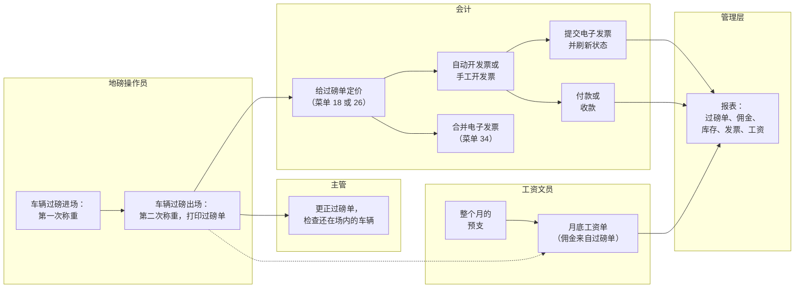
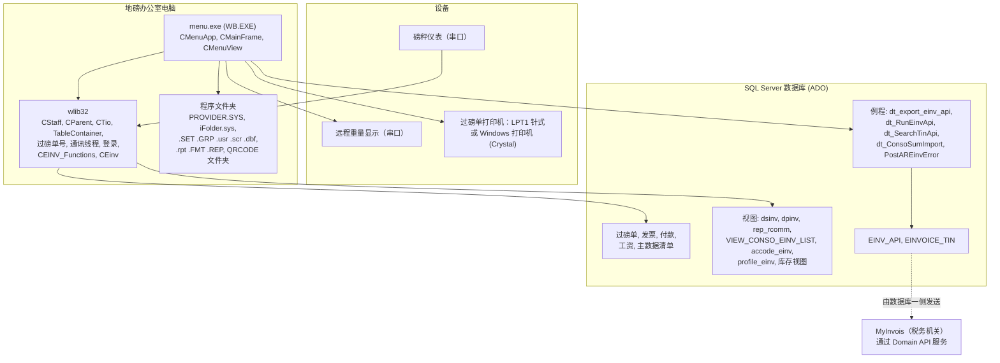
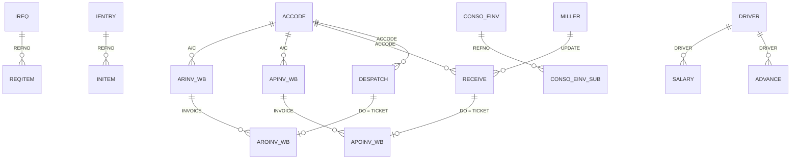
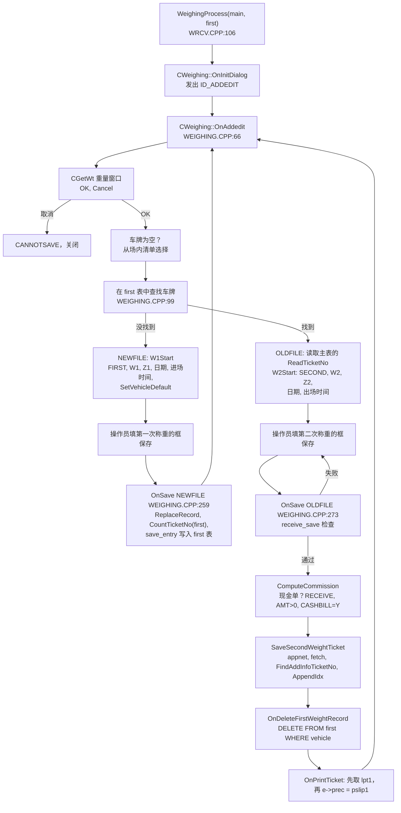
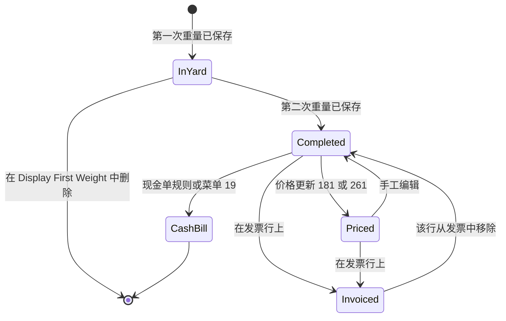
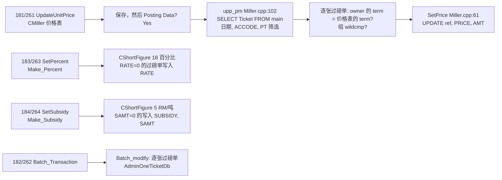
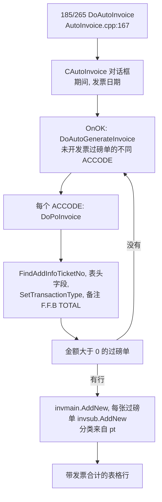
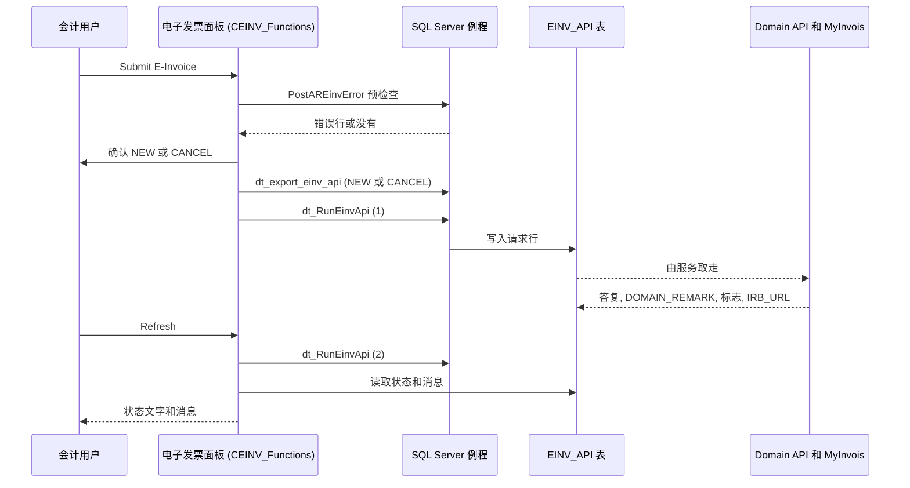
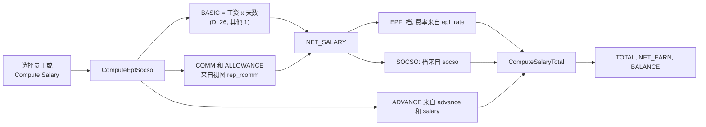
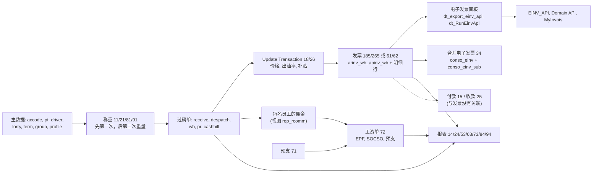

# Application_Syarikat_Seteguh - 模块参考

> 英文版为准。同步自英文版 commit 69b4bcc（2026-10-29）。

> 英文版（以英文为准）。最后核对的 commit 为 `2af24e3`（"Fixed Customer code not allowed to create and unable to update einvoice profile and revised auto default transaction type"，2026-04-29）。
> 翻译状态：英文版见 [MODULE_REFERENCE.md](MODULE_REFERENCE.md)；本中文版同步于 2026-10-29（commit 69b4bcc）。
> 规则：任何改变行为、表、字段、屏幕、报表或计算的修改，都必须在同一个 commit 里更新本文件。
> 本仓库是**一对程序中的基础版**：`Application_Nibong_Jaya` 是同一个程序的近似副本（见最后一节 [相关仓库](#相关仓库)）。

**这个程序是什么。** **Syarikat Seteguh** 的地磅和贸易程序。该公司买卖油棕榈鲜果串（新鲜果串，"FFB"）和相关产品。它是基于共用的 wlib32 框架的 VC6 / MFC 程序（和其他地磅程序同一个家族）。一个菜单程序管理所有事情：车辆进出过磅（收货、发货、普通称重和公众称重）、给每车货定价、付款给供应商、向买家收款、开采购发票和销售发票（包括马来西亚的 **MyInvois 电子发票**，以及合并电子发票）、登记"其他产品"发票、保存库存报表，还有一个小型**工资**程序，给按所运吨数拿佣金的司机和采果工发工资。本仓库没有 `User_Guide` 文件夹，没有其他 `docs` 文件，也没有 SQL 结构仓库，所以没有截图；下面所有数据库类型都标为未核实，除非旧 dBASE 文件头给出了类型。

## 目录

- [菜单图和覆盖范围](#菜单图和覆盖范围)
- [第一部分：业务视图](#第一部分业务视图)
  - [1.1 简单说明](#11-简单说明) / [1.2 谁用什么](#12-谁用什么) / [1.3 一天的工作](#13-一天的工作) / [1.4 实例演示](#14-实例演示)
  - [1.5 界面导览](#15-界面导览) / [1.6 这个数字从哪里来](#16-这个数字从哪里来) / [1.7 状态含义](#17-状态含义)
  - [1.8 如果发生以下情况](#18-如果发生以下情况) / [1.9 你可能看到的消息](#19-你可能看到的消息) / [1.10 该做和不该做](#110-该做和不该做)
  - [1.11 开始之前](#111-开始之前) / [1.12 词汇表](#112-词汇表) / [1.13 问 AI](#113-问-ai)
- [第二部分：技术视图](#第二部分技术视图)
  - [2.1 概览](#21-概览) / [2.2 架构和依赖](#22-架构和依赖) / [2.3 主数据目录](#23-主数据目录)
  - [2.4 子表层级](#24-子表层级) / [2.5 模块和处理流程](#25-模块和处理流程) / [2.6 端到端流程](#26-端到端流程)
  - [2.7 报表目录](#27-报表目录) / [2.8 集成](#28-集成) / [2.9 配置](#29-配置) / [2.10 维护](#210-维护)
- [休眠代码](#休眠代码) / [用户权限](#用户权限) / [尚未记录](#尚未记录) / [代码发现](#代码发现)
- [相关仓库](#相关仓库)

## 菜单图和覆盖范围

菜单资源 `IDR_MAINMENU` 在 `MENU.RC:2270-2377`，有 9 个顶层项和 **63 个叶子项**。菜单 ID `ID000nn` 对应节点 `nn`（例如 `ID00321` 是节点 321）；`CMenuApp::SubProgram`（`MAIN.CPP:72`）按节点号做分派。节点号由 `enum menu {M_RECEIVE=1, M_DESPATCH, M_CTRL, M_UTIL, M_OTHER, M_INV, M_SALARY, M_NORMAL, M_PUBLIC}`（`MAIN.CPP:12`）和 `MAIN.CPP:13-20` 的辅助枚举组成（`M_UPDATE=18`、`M_UP_DES=26`、`M_CTRL1=31`、`M_CTRL2=32`、`M_CTRL3=33`、`M_EXPINV=65`）。wlib32 框架把每个 `ID000nn` 命令都转到 `On00001`，由它调用 `SubProgram`。下面每一项本文件都有说明。菜单 8 和 9（普通称重和公众称重）看起来像标准称重模板，但它们用其他表运行**和菜单 1、2 相同的称重引擎**（`WeighingProcess(&wb,&fwb)`、`WeighingProcess(&pr,&fpr)`），所以这里按本程序的代码说明，不按标准模板。

| 菜单路径 | 节点 | 处理函数 | 说明位置 |
|---|---|---|---|
| 1. Receiving Weighing > 11. Receiving Weighing | 11 | `WeighingProcess(&receive,&first)` (`MAIN.CPP:85`) | [2.5.2](#252-称重引擎菜单-128-和-9) |
| 1 > 12. View Receiving Ticket | 12 | `AdminTicketDb(&receive)` (`MAIN.CPP:88`) | [2.5.3](#253-过磅单查看和第一次称重查看) |
| 1 > 13. Display First Weight | 13 | `AdminTicketDb(&first)` (`MAIN.CPP:91`) | [2.5.3](#253-过磅单查看和第一次称重查看) |
| 1 > 14. Receiving Report | 14 | `STCR=1; TableContainer("rcvctn")` (`MAIN.CPP:94`) | [2.5.14](#2514-报表选择器table-container) |
| 1 > 15. Make Payment | 15 | `AdminDbPayment(&payment)` (`MAIN.CPP:98`) | [2.5.6](#256-付款和收款) |
| 1 > 16. Check Porla Licence Expired Report | 16 | `CheckPorlaLicenseExpiredDate()` (`MAIN.CPP:101`) | [2.5.14](#2514-报表选择器table-container) |
| 1 > 17. View Cash Bill Ticket | 17 | `AdminTicketDb(&cashbill)` (`MAIN.CPP:104`) | [2.5.3](#253-过磅单查看和第一次称重查看) |
| 1 > 18. Update Transaction > 181 Fast && Auto Update Process | 181 | `UpdateUnitPrice(&miller,&receive)` (`MAIN.CPP:110`) | [2.5.4](#254-update-transaction菜单-18-和-26) |
| 1 > 18 > 182 Manual Update Process | 182 | `Batch_Transaction(&receive)` (`MAIN.CPP:113`) | [2.5.4](#254-update-transaction菜单-18-和-26) |
| 1 > 18 > 183 Percent Update Process | 183 | `SetPercent(&receive)` (`MAIN.CPP:116`) | [2.5.4](#254-update-transaction菜单-18-和-26) |
| 1 > 18 > 184 Subsidy Update Process | 184 | `SetSubsidy(&receive)` (`MAIN.CPP:119`) | [2.5.4](#254-update-transaction菜单-18-和-26) |
| 1 > 18 > 185 Auto Purchase Invoice | 185 | `Purchase_Flag=TRUE; DoAutoInvoice(&receive,&apinv_wb,&apoinv_wb)` (`MAIN.CPP:122`) | [2.5.7](#257-发票菜单-6和自动发票) |
| 1 > 19. Transfer To Cash Bill | 19 | `PostingToCashBill()` (`MAIN.CPP:107`) | [2.5.5](#255-转为现金单) |
| 2. Despatch Weighing > 21. Despatch Weighing | 21 | `WeighingProcess(&despatch,&fdes)` (`MAIN.CPP:126`) | [2.5.2](#252-称重引擎菜单-128-和-9) |
| 2 > 22. View Despatch Ticket | 22 | `AdminTicketDb(&despatch)` (`MAIN.CPP:129`) | [2.5.3](#253-过磅单查看和第一次称重查看) |
| 2 > 23. Display First Weight | 23 | `AdminTicketDb(&fdes)` (`MAIN.CPP:132`) | [2.5.3](#253-过磅单查看和第一次称重查看) |
| 2 > 24. Despatch Report | 24 | `STCR=2; TableContainer("desctn")` (`MAIN.CPP:135`) | [2.5.14](#2514-报表选择器table-container) |
| 2 > 25. Payment Receipt | 25 | `STCR=2; AdminDbPayment(&receipt)` (`MAIN.CPP:140`) | [2.5.6](#256-付款和收款) |
| 2 > 26. Update Transaction > 261 to 265 | 261-265 | `UpdateUnitPrice(&up_des,&despatch)`、对 `&despatch` 的 `Batch_Transaction`、`SetPercent`、`SetSubsidy`，以及 `Purchase_Flag=FALSE; DoAutoInvoice(&despatch,&arinv_wb,&aroinv_wb)` (`MAIN.CPP:145-159`) | [2.5.4](#254-update-transaction菜单-18-和-26), [2.5.7](#257-发票菜单-6和自动发票) |
| 3. Table > 31. Table 1 > 311 Set Product Code | 311 | `AdminDb(&prodtype)` (`MAIN.CPP:184`) | [2.5.12](#2512-主数据表菜单-3) |
| 3 > 31 > 312 Set Particular Code | 312 | `AdminDb(&particul)` (`MAIN.CPP:187`) | [2.5.12](#2512-主数据表菜单-3) |
| 3 > 31 > 313 Lorry Data Maintenance | 313 | `AdminDb(&lorry)` (`MAIN.CPP:190`) | [2.5.12](#2512-主数据表菜单-3) |
| 3 > 31 > 314 Unit Code | 314 | `AdminDb(&unit)` (`MAIN.CPP:193`) | [2.5.12](#2512-主数据表菜单-3) |
| 3 > 31 > 315 Location | 315 | `AdminDb(&locate)` (`MAIN.CPP:196`) | [2.5.12](#2512-主数据表菜单-3) |
| 3 > 31 > 316 Kod | 316 | `AdminDb(&kod)` (`MAIN.CPP:199`) | [2.5.12](#2512-主数据表菜单-3) |
| 3 > 31 > 317 Stock Adjustment Reason | 317 | `AdminDb(&reason)` (`MAIN.CPP:202`) | [2.5.12](#2512-主数据表菜单-3) |
| 3 > 32. Table 2 > 321 Set Customer Code | 321 | `CAccode h1(IDD_ACCODE,&accode,1); h1.DoModal()` (`MAIN.CPP:205-211`) | [2.5.12](#2512-主数据表菜单-3), [2.5.8](#258-发票和客户界面上的电子发票) |
| 3 > 32 > 322 Set Employee Code | 322 | `AdminDb(&driver)` (`MAIN.CPP:213`) | [2.5.12](#2512-主数据表菜单-3), [2.5.11](#2511-工资菜单-7) |
| 3 > 32 > 323 Set Price Formula Code | 323 | `AdminDb(&term)` (`MAIN.CPP:216`) | [2.5.12](#2512-主数据表菜单-3) |
| 3 > 32 > 324 Set Customer Group | 324 | `AdminDb(&group)` (`MAIN.CPP:219`) | [2.5.12](#2512-主数据表菜单-3) |
| 3 > 32 > 325 Set Agent Code | 325 | `AdminDb(&agent)` (`MAIN.CPP:222`) | [2.5.12](#2512-主数据表菜单-3) |
| 3 > 32 > 326 Position Information | 326 | `AdminDb(&position)` (`MAIN.CPP:225`) | [2.5.12](#2512-主数据表菜单-3) |
| 3 > 33. Payroll Table > 331 EPF Rate Setting | 331 | `AdminDb_EPF_RATE(&epf_rate)` (`MAIN.CPP:228`) | [2.5.11](#2511-工资菜单-7) |
| 3 > 33 > 332 SOCSO Table | 332 | `AdminDb(&socso)` (`MAIN.CPP:231`) | [2.5.11](#2511-工资菜单-7) |
| 3 > 34. Consolidate E-invoice Entry | 34 | `Conso_Einv()` (`MAIN.CPP:234`) | [2.5.9](#259-合并电子发票菜单-34) |
| 4. Utility > 41 Set Password | 41 | 框架 `ON_COMMAND(ID00041,OnPassword)` (`MAINFRM.CPP:74`)，库里的 `OnPassword` | [2.5.13](#2513-工具菜单-4) |
| 4 > 42 Company Profile | 42 | `AdminProfileDb(&profile)` (`MAIN.CPP:161`) | [2.5.13](#2513-工具菜单-4) |
| 4 > 43 Operator Information | 43 | `SetUser()` (`MAIN.CPP:164`) | [2.5.13](#2513-工具菜单-4) |
| 4 > 44 System Update | 44 | `OnSystemUpgrade("WB.EXE",app->internetFolder)` (`MAIN.CPP:167`) | [2.5.13](#2513-工具菜单-4) |
| 4 > 45 Backup Data | 45 | `BackupProcess()` (`MAIN.CPP:170`) | [2.5.13](#2513-工具菜单-4) |
| 4 > 46 Reset Database | 46 | `CleanDatabase()` (`MAIN.CPP:173`) | [2.5.13](#2513-工具菜单-4) |
| 4 > 47 E-Invoice Profile | 47 | `ado(&adoTmp,"profile_einv"); AdminDb_CMProfile(&adoTmp)` (`MAIN.CPP:176-182`) | [2.5.13](#2513-工具菜单-4) |
| 5. Other Product > 51 Sales Invoice | 51 | `AdminDbIreq(&ireq,&reqitem)` (`MAIN.CPP:239`) | [2.5.10](#2510-other-product菜单-5) |
| 5 > 52 Purchase Invoice | 52 | `AdminDbIreq(&ientry,&initem)` (`MAIN.CPP:242`) | [2.5.10](#2510-other-product菜单-5) |
| 5 > 53 Other Product Report | 53 | `TableContainer("othctn")` (`MAIN.CPP:245`) | [2.5.14](#2514-报表选择器table-container) |
| 6. Invoice > 61 Purchase Invoice | 61 | `PurchaseInvoiceWb()` (`MAIN.CPP:251`) | [2.5.7](#257-发票菜单-6和自动发票) |
| 6 > 62 Sales Invoice | 62 | `SalesInvoiceWb()` (`MAIN.CPP:254`) | [2.5.7](#257-发票菜单-6和自动发票) |
| 6 > 63 Invoice Report | 63 | `TableContainer("invctn")` (`MAIN.CPP:257`) | [2.5.14](#2514-报表选择器table-container) |
| 7. Payroll > 71 Advance Data Entry | 71 | `AdminDbAdvance(&advance)` (`MAIN.CPP:76`) | [2.5.11](#2511-工资菜单-7) |
| 7 > 72 Employee Salary Slip | 72 | `AdminDbSalary(&salary)` (`MAIN.CPP:79`) | [2.5.11](#2511-工资菜单-7) |
| 7 > 73 Salary Report | 73 | `TableContainer("salctn")` (`MAIN.CPP:82`) | [2.5.14](#2514-报表选择器table-container) |
| 8. Normal Weighing > 81 Normal Weighing | 81 | `WeighingProcess(&wb,&fwb)` (`MAIN.CPP:266`) | [2.5.2](#252-称重引擎菜单-128-和-9) |
| 8 > 82 View Normal Ticket / 83 Display First Weight | 82, 83 | `AdminTicketDb(&wb)`、`AdminTicketDb(&fwb)` (`MAIN.CPP:269`, `:272`) | [2.5.3](#253-过磅单查看和第一次称重查看) |
| 8 > 84 Normal Weighing Report | 84 | `STCR=1; TableContainer("wbctn")` (`MAIN.CPP:275`) | [2.5.14](#2514-报表选择器table-container) |
| 9. Public Weighing > 91 Public Weighing | 91 | `WeighingProcess(&pr,&fpr)` (`MAIN.CPP:279`) | [2.5.2](#252-称重引擎菜单-128-和-9) |
| 9 > 92 View Public Ticket / 93 Display First Weight | 92, 93 | `AdminTicketDb(&pr)`、`AdminTicketDb(&fpr)` (`MAIN.CPP:282`, `:285`) | [2.5.3](#253-过磅单查看和第一次称重查看) |
| 9 > 94 Public Weighing Report | 94 | `STCR=1; TableContainer("prctn")` (`MAIN.CPP:288`) | [2.5.14](#2514-报表选择器table-container) |

**没有菜单项的代码路径**（都在 `SubProgram` 里，见 [休眠代码](#休眠代码)）：节点 54 `StatementOfAccount()`（`MAIN.CPP:248`），节点 651 和 652 `ExportApinvTransactions()` / `ExportArinvTransactions()`（`MAIN.CPP:260`、`:263`）。框架仍然映射了它们的命令 ID（`MAINFRM.CPP:82`、`:92-93`），但 `MENU.RC` 里没有对应的菜单项。工具栏 `IDR_MAINFRAME`（`MENU.RC:2245-2262`）把节点 11、21、12、22、17、14、24、53、321、311 和 Exit 作为快捷键重复了一遍。

**覆盖范围说明。** 生成的 `_inventory/Application_Syarikat_Seteguh/inventory.md` 列出了同样的 63 个菜单项。它只当作线索使用：它给出的 `ARINV_WB.CPP` 的 `p1.subN` 行号（139 和 152）已过时（实际行号是 156 和 169），它不显示字段类型，并且列出了不属于构建的对话框和 `.cpp` 文件（见 [2.1](#21-概览)）。

---

# 第一部分：业务视图

*写给不了解本程序的人。本部分不使用文件名、类名或表名。菜单名按屏幕上显示的写，例如 "11. Receiving Weighing"。*

## 1.1 简单说明

- 本程序管理 Syarikat Seteguh 的**地磅办公室**。地磅是车辆开上去称重的大磅秤。公司从园丘和小农户那里买油棕榈鲜果串（称为 FFB，新鲜果串），把果和其他产品卖给油厂和买家，也为外部客户过磅。
- 每辆车要称两次，一次带货，一次不带货（或者反过来）。程序读取磅秤，算出**净重**（货物的重量），定价，并打印**过磅单**。同一张过磅单接着带动其他所有工作：付款给供应商、开发票、司机和采果工的佣金，以及库存和销售报表。
- 称重有四种，各有自己的过磅单和报表：**Receiving**（买进的货）、**Despatch**（卖出的货）、**Normal Weighing** 和 **Public Weighing**（较简单的过磅单，用于其他用途，例如只付钱使用磅秤的外部客户）。
- 称重之后，办公室给过磅单**定价**，把它们归入**采购发票**（给供应商）和**销售发票**（给买家），付款给供应商，记录收到的款项，并把发票作为**电子发票**（马来西亚的 MyInvois 系统）发给税务机关。同一时期的许多发票可以合并成一张**合并电子发票**。
- 程序还管理**其他产品**发票（不过磅的货，带库存报表），以及给司机和采果工的小型**工资**程序：月薪或日薪、按所运吨数计的佣金、EPF 和 SOCSO（法律要求的两项员工福利供款），还有预支。
- 如果过磅单没有正确称重或保存，就没人能证明买了多少、卖了多少。如果主数据清单（供应商、产品、车辆、员工）有错，过磅单、发票、电子发票和工资单也会错。

## 1.2 谁用什么

| 部门 | 菜单 | 主要工作 |
|---|---|---|
| 地磅操作员 | 1. Receiving Weighing, 2. Despatch Weighing, 8. Normal Weighing, 9. Public Weighing | 车辆进出过磅，选供应商或买家、司机和产品，打印过磅单 |
| 地磅主管 | 查看过磅单界面（菜单 12、22、82、92），18 和 26 Update Transaction | 更正过磅单，批量定价，输入出油率和补贴，批准强制取重 |
| 采购 / 销售 | 3. Table, 18 和 26 Update Transaction | 维护供应商和买家、价格公式、代理、地点、产品 |
| 会计 / 财务 | 15. Make Payment, 25. Payment Receipt, 6. Invoice, 5. Other Product, 34. Consolidate E-invoice Entry, 47. E-Invoice Profile, 报表 | 付款给供应商，记录收款，开发票，提交和取消电子发票，月底清单 |
| 工资文员 | 7. Payroll, 33. Payroll Table, 322. Set Employee Code | 员工资料、预支、月底工资单、EPF 和 SOCSO 报表 |
| 管理层 | 每个菜单里的报表项 | 每日和每月合计、库存、司机佣金、付款和发票清单 |
| IT / 管理员 | 4. Utility, 313. Lorry Data Maintenance | 公司资料、操作员账号和级别、备份、系统更新、电子发票资料、重置 |

**按部门从哪里开始**

- 操作员：打开 **11. Receiving Weighing**（进货）或 **21. Despatch Weighing**（出货）。**81** 和 **91** 是同一个界面，用于 Normal 和 Public 过磅单。
- 主管：**12. View Receiving Ticket** 用来更正过磅单；**13. Display First Weight** 用来查看还在场内的车辆（只称过一次，还没完成）。
- 采购 / 销售：**3. Table**：客户和供应商（321）、价格公式（323）、员工（322）、产品（311）。
- 会计：**18. Update Transaction**（给过磅单定价）、**185. Auto Purchase Invoice** 或 **61. Purchase Invoice**、**62. Sales Invoice**、**15. Make Payment**、**25. Payment Receipt**，然后是发票界面上的电子发票按钮。
- 工资文员：月中用 **71. Advance Data Entry**，月底用 **72. Employee Salary Slip**，再用 **73. Salary Report**。
- IT：**42. Company Profile**、**43. Operator Information**、**45. Backup Data**、**47. E-Invoice Profile**。

**每日、每周和月底的工作（典型情况，程序并不强制）**

| 什么时候 | 谁 | 做什么 |
|---|---|---|
| 每辆车 | 操作员 | 第一次称重、第二次称重、打印过磅单 |
| 每天 | 主管 | 检查 **13. Display First Weight** 里一直没回来的车辆；修正错误的过磅单 |
| 每周或月底 | 会计 / 主管 | 给过磅单定价（菜单 18 或 26），再开发票（185 或 265，或 61 和 62） |
| 每张发票之后 | 会计 | 提交电子发票并检查状态；月底在使用的地方提交合并电子发票 |
| 付款时 | 会计 | 15. Make Payment（供应商）、25. Payment Receipt（买家） |
| 月底 | 工资文员 | 检查预支，每位员工开一张工资单，打印 EPF、SOCSO 和工资报表 |
| 每天或每周 | IT | 45. Backup Data |

### 用户级别和批准

每个操作员有一个**级别**（一个数字）和一份对其隐藏的菜单项清单。程序使用以下级别：

| 级别 | 允许什么（按代码） |
|---|---|
| 99 及以上 | 称重时可以编辑**第一次和第二次重量**框（低于 99 的用户会跳过这两个框）；在报表选择器里看到额外的设置工具 |
| 9 及以上 | 可以在称重窗口批准强制取重（作为主管）；可以修改**发票日期** |
| 低于 9 | 在采购或销售发票上，发票日期被锁定；其余按界面规则 |

99 级规则**只适用于称重界面**。在 "View ... Ticket" 界面，程序不锁定重量框，所以只要有权编辑那里的过磅单，就能修改重量（已经开了发票的过磅单则完全不能编辑）。

主管可以为没有级别的操作员批准某个操作：弹出的小框要求输入**主管的 ID 和密码**，并记录谁在何时批准了什么。

## 1.3 一天的工作

**收一车果（买进的货）。** 车开上磅秤。操作员打开 **11. Receiving Weighing**。一个小窗口显示实时重量和场内已有车辆的清单。操作员输入车牌，在红绿灯变绿时按 **OK**。程序不知道这辆车在场内，所以这是**第一次称重**：它填入这辆车记录里保存的供应商、司机和产品，操作员核对，输入送货单号并保存。车卸完货回来。操作员输入同样的车牌：程序在场内找到它，所以这是**第二次称重**。操作员记录任何生果、烂或湿的果（这些重量会从净重里扣掉），保存，程序打印过磅单，并把这辆车从场内清单中移除。过磅单上写的司机和采果工，按供应商记录算出各自的佣金。

**卖出（出货）。** 步骤相同，用 **21. Despatch Weighing**。过磅单是发货过磅单，"对方"是买家。

**现金采购。** 如果过磅单标记为 "Cash Bill"（从供应商记录复制而来）并且有金额，完成的收货过磅单会被保存为**现金单过磅单**，而不是普通收货过磅单。已经保存为普通收货过磅单的，之后可以用 **19. Transfer To Cash Bill** 转移。

**定价。** 价格在地磅处不一定知道。期末，办公室用 **181. Fast && Auto Update Process**（按供应商组和价格公式的价格表）给过磅单定价，或者用 **182** 逐张定价，或者用 **183** 设置**出油率**、用 **184** 设置**补贴**。

**开发票和电子发票。** 办公室为一个期间运行 **185. Auto Purchase Invoice**（供应商）或 **265. Auto Sales Invoice**（买家）：程序用还没开发票的过磅单，为每个供应商或买家建一张发票。发票也可以在 **61** 和 **62** 里手工开。在每个发票界面，**Submit E-Invoice** 面板把发票发给税务机关；**Refresh** 读回答复。一个期间的许多发票可以在 **34. Consolidate E-invoice Entry** 里合并成一张合并电子发票。

**付款和收款。** **15. Make Payment** 记录付给供应商的款项；**25. Payment Receipt** 记录从买家收到的款项。

**月底工资。** 工资文员月中在 **71** 输入预支。月底 **72. Employee Salary Slip** 把工资、过磅单产生的佣金和津贴加起来，扣除 EPF 和 SOCSO，减去预支，显示应付余额。**73. Salary Report** 打印 EPF、SOCSO、工资和预支报表。



*图注：从左往右读。一切从操作员打印的过磅单开始；会计给过磅单定价并开发票，同样的过磅单也为工资里司机和采果工的佣金提供数据。*

## 1.4 实例演示

所有名字和数字都是编造的。程序按所示方式取整。下面跟踪一车来自供应商的果，从地磅一直到工资单。

**已经设好的主数据**

- 供应商（菜单 321）：代码 `D001`，名称 `DEMO ESTATE SDN BHD`，价格公式 `T`（每吨固定价格），司机佣金 3.00，采果工佣金 2.00（每吨令吉），运输费 20.00，采果费 15.00，补贴 0.00，**Cash Bill** = N。
- 产品 `01` `DEMO FFB`。
- 车辆 `WXX1234`（菜单 313），默认班组员工为 `E001`（职位 D，司机）和 `E002`（职位 H，采果工）。
- 价格表（菜单 181）：期间 10 月 1 日至 31 日，供应商 `D001`，产品 `01`，组 `*`（所有组），价格公式 `T`，价格每吨 800.00。
- 员工 `E001`（菜单 322）：月薪 1,800.00，有 EPF 号和 SOCSO 号，"include commission" = N。
- EPF 费率（菜单 331）：员工 11，雇主 13（百分比）。包含 1,800.00 的 SOCSO 档：员工 9.00，雇主 31.50（演示数值）。

| 步骤 | 发生什么 | 输入或选择 | 计算 | 之后的状态 |
|---|---|---|---|---|
| 1. 第一次称重，08:15:20 | **11. Receiving Weighing**，车牌 `WXX1234`，OK | 送货单 `DN-DEMO-1`；供应商 `D001` 和班组由车辆记录填入 | 第一次重量 18,500 kg，进场时间 08:15:20，日期为今天 | 车辆**在场内**（在 13 里可见） |
| 2. 第二次称重，08:52:05 | 同一辆车再次称重，OK | 生果 100 kg，烂 50 kg，湿 0 kg | 第二次重量 8,300 kg。扣重 100 + 50 + 0 = 150 kg。**净重 = 18,500 - 8,300 - 150 = 10,050 kg**。佣金费率从供应商复制到班组：E001 3.00，E002 2.00 | **已完成的过磅单**，车辆离开场内清单，过磅单已打印 |
| 3. 定价 | **181. Fast && Auto Update Process**，上面的价格表，然后 OK 和 "Posting Data" | - | 价格 800.00（公式 `T`）。金额 = 10.05 x (800.00 - 20.00 - 15.00) = 10.05 x 765.00 = **7,688.25** | 过磅单带有价格和价格表引用 |
| 4. 发票 | **185. Auto Purchase Invoice**，期间 10 月 1 日至 31 日 | 发票日期（程序建议月底最后一天） | 为 `D001` 开一张采购发票，过磅单作为一行，备注 `F.F.B TOTAL`；交易类型 `S`（自开发票） | 过磅单已**开发票**：不能再编辑 |
| 5. 电子发票 | 在发票界面按 **Submit E-Invoice**，回答 Yes；之后按 **Refresh** | - | 状态先显示 `NEW`，然后是税务机关的答复 | 发票有了电子发票状态 |
| 6. 付款 | **15. Make Payment** | 供应商 `D001`，银行或现金账户，付款日期，金额 7,688.25 | - | 付款已记录 |
| 7. 预支 | **71. Advance Data Entry** | 员工 `E001`，金额 300.00 | - | 预支已记录 |
| 8. 工资单 | **72. Employee Salary Slip**，10 月内的日期，员工 `E001` | （其余由程序填写） | 本月所有过磅单的佣金，比如 150.00；行程津贴，比如 30.00。**净工资 = 1,800.00 + 30.00 + 150.00 = 1,980.00**。EPF 员工 1,800.00 的 11% = 198.00，雇主 13% = 234.00。SOCSO 9.00 和 31.50。公司成本 = 1,980.00 + 234.00 + 31.50 = **2,245.50**。实发 = 1,980.00 - 198.00 - 9.00 = **1,773.00**。减预支 300.00。**应付余额 = 1,473.00** | 工资单已保存 |

每个数字背后的逐步规则见 [1.6 这个数字从哪里来](#16-这个数字从哪里来)。

## 1.5 界面导览

本仓库没有截图，也没有用户指南，写本文件时也没有运行过程序，所以不放图片。字段标签是程序界面定义里的原文（界面上的拼写错误照原样保留，标注 "sic"）。

### 主窗口和菜单栏

- 窗口标题是公司名称后面跟着 "Weighing System Ver 2.00"（程序里的版本说明写的是 "2.00 e-inv version"）。窗口本身只显示一张背景图（如果图片文件在程序旁边）和四行文字，文字内容由程序库设置。所有操作都通过菜单栏和工具栏完成。
- 菜单栏：**1. Receiving Weighing**、**2. Despatch Weighing**、**3. Table**、**4. Utility**、**5. Other Product**、**6. Invoice**、**7. Payroll**、**8. Normal Weighing**、**9. Public Weighing**。操作员不能用的项可以按操作员隐藏（见 1.2）。
- 工具栏快捷键：Receiving Weighing、Despatch Weighing、View Receiving Ticket、View Despatch Ticket、View Cash Bill Ticket、Receiving Report、Despatch Report、Other Product Report、Set Customer Code、Set Product Code、Exit。
- 关闭主窗口时，也会停止与磅秤的连接。

### 重量窗口（"Please keyin vehicle no"）

*用途：* 读取实时重量，并说明磅秤上是哪辆车。每次开始称重（菜单 11、21、81、91）时它最先打开，每次保存之后又会再打开。

| 窗口部分 | 含义 | 值从哪里来 |
|---|---|---|
| 大数字 | 实时重量，单位 kg，五位数 | 自动，来自磅秤。它显示的是你所选扣除预设**之后**的重量（见下面的 "Deduction presets"） |
| Vehicle No | 车牌 | 输入（大写），或点击场内清单的一行，或留空后按 OK 从场内清单中选择 |
| Status | `stable` 或 `Unstable` | 自动。稳定表示重量连续两次读数都保持在公司资料的波动范围内 |
| 红绿灯 | 重量达到 500 kg 或以上时为绿色；如果公司资料要求，还要重量稳定，并且窗口打开后磅秤出现过零。否则为红色 | 自动 |
| 场内清单 | 称过一次还没完成的车辆：No、Vehicle No、Date、Time In、A/C Code、Product、Wt.In(kg) | 自动。点击一行填入车牌；双击填入并按 OK |
| Total Vehicle In Yard | 清单有多少行 | 自动 |

按钮和按键：

- **OK**（或在车牌框按 Enter）接受重量。如果公司资料要求稳定重量而重量不稳定，程序会拒绝（消息见下）。"重量必须归零" 的规则也一样。
- **Cancel**（或 Esc）关闭窗口并停止称重。
- **Force capture Wt** 在重量达到 500 kg 或以上、并在公司资料的 "Stable Time"（秒）内一直在磅秤上但没有变稳定时出现，重量一稳定就再次隐藏。它要求主管（9 级或以上）输入 ID 和密码，记录批准，然后即使规则没有满足也接受当前重量。
- 磅秤每 0.5 秒读取一次，除非公司资料设置了 0.1 到 2.5 秒之间的其他间隔。
- **扣除预设（Deduction presets）。** 光标在 Vehicle No 框时，操作员可以按 Ctrl 加一个字母，对显示和保存的重量应用预设扣除：Ctrl+A 到 Ctrl+J 应用**百分比**（预设 1 到 10），Ctrl+K 到 Ctrl+Z 应用 **kg** 数（预设 11 到 26）。连按两次空格键清除扣除。预设由 IT 用公司资料的 **Set GWST** 按钮输入。只有磅秤重量高于 1,000 kg 时才会应用扣除，磅秤回到零或以下时扣除被清除。

### 收货过磅单界面（称重时用菜单 11，查看用菜单 12）

*用途：* 过磅单本身。称重时和查看、更正旧过磅单时用同一个版面。称重时，程序按固定顺序逐个跳过各框；其他框被跳过。标为 "automatic" 的框不能输入。

| 字段标签 | 含义 | 必填？ | 来源 |
|---|---|---|---|
| Receive Ticket No | 过磅单号 | 是 | 自动，流水号；跳过已用的号码 |
| Vehicle No | 车牌 | 是 | 来自重量窗口 |
| Date | 过磅单日期 | 是 | 自动：第一次称重时为今天，第二次称重时再次设为今天 |
| Owner | 供应商（果的买入对象） | 第二次称重时必填 | 从客户清单选择；车辆有默认对方时由车辆记录填入 |
| Agent, Commission, Allowance | 代理，以及代理的佣金和津贴 | 否 | 选了 owner 后从客户记录填入 |
| Porla A/C | 执照持有人的账户（Porla 执照是棕油贸易执照） | 否 | 从客户记录填入 |
| Sold To Mill | 果转给的油厂 | 否 | 选择。不属于称重步骤：之后在 View Receiving Ticket 界面设置。保存带油厂的过磅单会生成一张对应的发货过磅单（见 1.8） |
| Location | 果的来源地 | 否 | 从客户记录填入，或选择 |
| 员工表（五行）：Employee ID、姓名、Commission (RM/MT)、Allowance (RM/Trip) | 这车货的司机和采果工。姓名旁的小框显示员工的职位 | 否 | 员工 ID 从车辆记录填入（最多三个，只填标记为默认的）。佣金在第二次称重时按职位（司机、采果工或运输商）从 owner 的记录填入 |
| Product | 买的是什么 | 第二次称重时必填 | 从产品清单选择。每次选了 owner，程序都会把产品设为 `01`，所以要检查 |
| DN NO | 供应商的送货单号 | 否 | 输入 |
| Cash Bill (Y/N) | 这次采购是否为现金采购 | 否 | 从客户记录填入 |
| Muda / Busuk / Hujan: pieces and weight (kg) | 生果（Muda）、烂（Busuk）或被雨淋湿（Hujan）的果：Muda 和 Busuk 有个数，三者都有重量 | 否 | 输入。公司资料的 "Grading Flag" 关闭时跳过 |
| First (kg), Second (kg) | 两次磅秤重量 | 是 | 自动，来自磅秤。只有 99 级才能在这里输入 |
| Time In / Time Out | 第一次和第二次称重的时间 | 是 | 自动 |
| Less Wastage | 因生果、烂和湿果而扣除的重量 | 否 | Grading Flag 开启时按 Muda + Busuk + Hujan 的重量计算，否则输入 |
| Net Weight (kg) | 货物的重量 | - | 计算，见 1.6 |
| OER Rate (%) | 百分比价格公式使用的出油率 | 否 | 输入，或用菜单 183 一次为许多过磅单设置 |
| Transporter Fee, Harvester Fee (per MT) | 每吨从价格中扣除的费用 | 否 | 从客户记录填入，可以修改 |
| U/Price | 每吨价格 | Cash Bill 为 Y 时必填 | 输入，或由 Update Transaction 菜单设置 |
| Sub-Total (RM) | 吨数乘以（价格减去两项费用） | - | 计算 |
| Less (RM) | 一笔金钱扣除 | 否 | 输入 |
| Net Amount (RM) | 这车货的应付金额 | - | 计算，见 1.6 |
| Subsidy/MT, Subsidy Amt | 每吨补贴及其金额 | 否 | 输入；用菜单 184 一次为许多过磅单设置 |
| Weighing Fee | 过磅收取的费用 | 否 | 输入（最后一个框） |
| Remarks | 自由文字 | 否 | 输入 |

在称重界面，Save 按钮完成这一步。**第一次称重**时什么都不检查。**第二次称重**时程序检查过磅单（见 1.9），然后打印。

**发货过磅单（菜单 21 / 22）。** 版面相同。第一个框的标签是 "Despatch Ticket No"，对方框也叫 "Owner"（买家），"Sold To Mill" 框叫 "Supplier"。**现金单过磅单（菜单 17）** 版面相同，标题为 "Cash Bill Ticket No"。

### Normal 和 Public 过磅单（菜单 8 和 9）

它们使用和菜单 1、2 相同的称重步骤和相同的重量窗口，但**过磅单界面更短**：Ticket No、Vehicle No、Date、A/C Code、两名员工（Driver 1 和 Driver 2）、Product、DN NO、First、Second、Less Wastage、Net Weight、Remarks 和两个时间。价格、费用、佣金、分级和补贴框在这个界面上是隐藏的。过磅单的检查仍和收货过磅单相同：两次重量都不为零，第二次称重时要有产品和 A/C code。Normal 和 Public 过磅单保存在各自的表中，有各自的报表（各一份清单）。

### Display First Weight（菜单 13、23、83、93）

在同样的过磅单版面上显示称过一次、还在场内的车辆。用它来查看谁在场内，更正第一次重量，或者**删除**一辆没称第二次就离开的车。

### Update Transaction（菜单 18 和 26）

菜单 18 处理收货过磅单，菜单 26 处理发货过磅单。每种更新都会跳过已经开了发票的过磅单。

| 菜单 | 界面 | 你输入什么 | 它做什么 |
|---|---|---|---|
| 181 / 261 Fast && Auto Update Process | 价格表：Ref No、Date 和 To、A/C Code、Product、Group、Term（价格公式）、U/Price ($/Metric Ton)、Remarks | 一行价格：期间、可选的 A/C Code、产品、客户组（`*` 表示所有组）、价格公式和价格。菜单 261 有自己的销售价格表 | 保存时程序问 "Posting Data"。如果同意，就为期间内所有客户价格公式和组相同的过磅单设置价格和金额，见 1.6。消息 "Update Completed" |
| 182 / 262 Manual Update Process | 筛选框：Date、To、A/C No、MILL (sic)、Product、Term | 筛选条件。Product 开始时为 `01` | 在单张过磅单界面逐个打开每张符合的过磅单，让你手工编辑。"MILL" 框实际上按 Porla A/C 代码筛选 |
| 183 / 263 Percent Update Process | 筛选框：Date、To、From A/C No、To、Product、Group、Term、Page、Today；然后是 "Set OER Rate" 框（Percentage(%)，开始为 18） | 筛选条件（程序填入第一个和最后一个 A/C code、产品 `01`、term `P`）和百分比 | 为还没有出油率的符合过磅单设置出油率。不改变价格 |
| 184 / 264 Subsidy Update Process | 同一个筛选框；然后是 "Set Subsidy Amount"（Subsidy(RM/TON)，开始为 5） | 筛选条件和补贴 | 为补贴金额仍为零的符合过磅单设置补贴和补贴金额（净吨数乘以补贴）。只处理价格公式等于筛选框里所输 Term（开始为 `P`）的客户 |
| 185 / 265 Auto Purchase / Sales Invoice | "Invoice Date"、"Invoice Period" From 和 To | 日期 | 开发票，见下面的发票一节 |

183 和 184 筛选框里输入的 Term 必须存在于价格公式清单中（菜单 323）。筛选框先检查输入，可能显示："A/C Code From Not Found"、"A/C Code To Not Found"、"Product Not Found"、"TERM Not Found"。

### Transfer To Cash Bill（菜单 19）

一个小框（标题 "Transfer To Cash Bill"），有 Date、To 和 Page。按钮把期间内所有标记为现金单的收货过磅单移到现金单过磅单，并从收货过磅单里删除。

### Make Payment（菜单 15）和 Payment Receipt（菜单 25）

*用途：* 记录付给供应商的款项（15）或从买家收到的款项（25）。两个界面的框相同；对方框在付款界面叫 "Supplier"，在收款界面叫 "Mill Buyer"。

| 字段标签 | 含义 | 必填？ | 来源 |
|---|---|---|---|
| Ref. No | 凭单号 | 是 | 自动 |
| Supplier / Mill Buyer | 对方 | 是（"Please assign 'A/C Code'"） | 从客户清单选择 |
| Paid Date | 付款日期 | 是 | 输入 |
| Clear Date | 支票兑现日期 | 否 | 输入 |
| Mode of Payment | 所用现金或银行的总账账户 | 是（"Please assign 'GLCODE A/C'"） | 从总账代码清单选择 |
| Paid Amount | 金额 | 是 | 输入 |
| Particular | 简短说明 | 否 | 输入，或留空时从 particular 清单选择 |
| Due Date, Cheque No | 用于远期支票 | 否 | 输入 |
| Remarks | 自由文字 | 否 | 输入 |

### Check Porla Licence Expired Report（菜单 16）

问 "Check Porla Expiry Date?"（默认答案是 No）。选 Yes 时，打开期间提示并运行 "Porla Expiried"（sic）报表。报表版面是一个 Crystal Reports 文件，写本文件时没有打开；它的用途是按执照到期日列出客户。

### Purchase Invoice（菜单 61）和 Sales Invoice（菜单 62）

*用途：* 每个供应商（采购）或买家（销售）一张发票，由多行组成，每行指向一张过磅单。两个界面相同，只是 "Supplier" 换成 "Customer"。采购发票由**收货**过磅单生成，销售发票由**发货**过磅单生成。

| 字段标签 | 含义 | 必填？ | 来源 |
|---|---|---|---|
| Invoice No | 发票号 | 是 | 自动，流水号 |
| Date of Invoice | 发票日期 | 是 | 输入。低于 9 级时这个框被锁定 |
| Customer / Supplier | 对方 | 是 | 从客户清单选择。有了明细行之后，这个框不能再改（"Invoice Detail Existed.Not Allow to Edit this Field"） |
| Terms | 付款条款 | 否 | 选了对方后从客户记录填入 |
| Your Ref., Our Ref. | 参考号 | 否 | 输入 |
| Remarks | 自由文字 | 否 | 输入 |
| Transaction Type | 电子发票类型，`IV`（发票）或 `S`（自开发票） | 电子发票时必填 | 选了对方后自动填入，见 1.6 |
| 明细表格：No、Ticket No、Date、Vehicle No、DN No、Qty(kg)、Amount、Classification Code | 每张过磅单一行 | - | 过磅单数据和产品的分类代码 |
| Total Amount 框 | 表格下方的合计 | - | 计算 |

按钮：

- **Create New Invoice** 列出对方还没开发票、日期在发票日期当天或之前的过磅单。选一张；它被加为一行；清单再次打开让你选下一张；离开清单（取消）即可停止。先保存表头，所以表头保存不了就会停止循环。
- 双击表格一行打开该行（框 "Detail Information"：Ticket No、Quantity、Amount、Classification）。
- **电子发票面板**（右侧）：状态文字、**Submit E-Invoice**、**Refresh**、**QRCODE**、**View Msg**；见下面的电子发票一节。
- **Unlock Period** 存在，但在界面定义里被隐藏并禁用。

### 电子发票面板（在发票界面和 Other Product 界面上）

| 项目 | 它做什么 |
|---|---|
| 状态文字 | 显示这张发票的最新答复：什么都没发送时为 `NEW`，否则是电子发票服务返回的文字（例如 `SUBMITTED` 或 `VALID`） |
| **Submit E-Invoice** | 先检查发票有没有已知错误，有的话显示 "E-invoice error, please check error message !" 和错误清单。如果发票已经提交，并且既没有被取消也没有被拒绝，就提供**取消**选项（"You woule like to CANCEL this E-Invoice? ..." sic）；否则提供提交**新**电子发票的选项。提交可能要一到两分钟 |
| **Refresh** | 从电子发票服务读回答复。如果发票卡在无效状态，它提供重置数据并重新提交、不改数据再试一次、或删除提交数据的选项；最后提供显示消息的选项 |
| **QRCODE** | 打开已被接受的电子发票的二维码（需要程序旁边的 QRCODE 文件夹里有小的二维码程序） |
| **View Msg** | 显示提交前和提交后的消息 |
| Email | 已定义，但在本程序的界面上隐藏并禁用 |

### 客户界面及其电子发票按钮（菜单 321）

*用途：* 供应商、买家和其他对方的清单（共用一个清单）。自上次修改起，可以在这个界面**新增客户代码**，**E-Invoices** 按钮会保存你输入的内容。

| 字段标签 | 含义 | 必填？ | 来源 |
|---|---|---|---|
| A/C No. | 客户代码 | 是 | 输入 |
| FullL Name (sic) | 全名 | 是 | 输入 |
| Short Name | 简称 | 否 | 根据全名自动建议 |
| Address (3 lines), Tel, Fax, Email | 联系资料 | 否 | 输入 |
| Agent, Comm., Allow. | 默认代理，以及代理的佣金和津贴 | 否 | 选择并输入 |
| Porla A/C, Porla License No., Porla Expiry Date | 执照持有人的账户、执照号和到期日 | 否 | 输入 |
| Kod, Keluasan (Hektar) | 客户类型代码和园丘面积（公顷） | 否 | 选择并输入 |
| Location | 默认地点 | 否 | 选择 |
| Contact Person | 联系人 | 否 | 输入 |
| Group | 客户组，价格更新菜单使用 | 否 | 选择 |
| Price Formula | 价格的算法：`T` = 每吨固定价格，`P` = 价格乘以过磅单的出油率 | 否 | 从菜单 323 选择 |
| Terms | 付款条款文字 | 否 | 输入 |
| Transporter Fee, Harvest fee, Subsidy Amt. | 复制到这个对方每张新过磅单的默认值（每吨令吉） | 否 | 输入 |
| Driver's Comm., Harvest Comm., Transport Comm. | 职位为司机、采果工或运输商的员工每吨的佣金 | 否 | 输入 |
| Remarks | 自由文字 | 否 | 输入 |
| Openning Balance (sic) | 承前余额（旧的对账单使用） | 否 | 输入 |
| Trade Debtor G/L Code, Trade Creditor G/L Code, Bank Code | 总账账户（发票不使用） | 否 | 选择 |
| Max. Qty. (MT/Mth) | 每月数量上限 | 否 | 输入 |
| Cash Bill (Y/N) | 向这个对方的采购为现金单 | 否 | 输入 |

**E-Invoices** 按钮先保存新记录，然后为这个对方打开 "Set E-invoice data"：

| 字段标签 | 含义 |
|---|---|
| Tin (*) | 税务识别号。这个框显示四个通用代码：没有 TIN 为 `EI00000000010`，外国买家为 `EI00000000020`，外国自开发票为 `EI00000000030`，豁免为 `EI00000000040` |
| New I/C No., Passport No., ROC No., Exempt No. | 对方的身份资料 |
| No einv flag | 这个对方不需要开电子发票时勾选 |
| State, City, Postcode, Country | 地址；输入邮编会填入州和城市；国家开始为 `MYS` |
| Einv email | 电子发票的电邮 |
| Not Self Bill (tick) | 供应商自己开发票时勾选。这时这个供应商的采购发票类型为 `IV`；不勾选时为自开发票（`S`） |
| **Search TIN** | 用身份证号或 ROC 号向电子发票服务查询 TIN；最多等待五秒 |
| **Update** | 保存到客户记录 |

### Consolidate E-invoice Entry（菜单 34）

*用途：* 把一个期间的许多发票合并成一张**合并电子发票**（一张代表一批小额发票的电子发票）。每个合并条目最多允许 **100 张发票**。

| 字段标签 | 含义 | 必填？ | 来源 |
|---|---|---|---|
| Refno | 条目号 | 是 | 自动 |
| Date | 条目日期 | 是 | 输入 |
| Particukar (sic) | 说明 | 否 | 输入 |
| From Date (*), To Date (*) | 要合并的发票期间 | 是 | 输入 |
| Remark | 自由文字 | 否 | 输入 |
| Branch | 可选的分行筛选（"Select Branch to filter branch data"） | 否 | 选择 |
| Currency, Rate | 货币和汇率 | 是 | 输入。程序里有起始值（MYR 和 1.00），但在这个版本里没有启用 |
| Classification(*) | 整批的电子发票分类代码 | 是 | 选择 |
| Einv Type(*) | 合并哪一类发票 | 是 | 选择 |
| E-Invoice Submit Date, UUID, URL | 提交后填入 | - | 自动 |
| 表格：No、Invoice、Amt Before Tax、Non Tax Amount、Taxable Amount、Taxcode、T%、Tax Amt、Exempt.Amt、Branch、Path、Net Amt | 每张发票一行 | - | 导入 |
| 合计：Total Before Tax、Total Tax Amount、Total Net Amount、Total Taxable Amt、Total Non-taxable Amt、Total Exempt Amt | 表格的合计 | - | 计算 |

按钮：**Import Invoice Data**（加入该期间、分行和类型的发票，最多 100 张）、**Import Range Type Invoices**（只在数据库里有对应的例程时才显示；按范围规则导入）、**Submit E-Invoice**、**Refresh**、**QRCODE**、**Lock / Unlock**。在这个版本里 Lock / Unlock 按钮什么都不做，单独的 Unlock 按钮是隐藏的。

### Other Product: Sales Invoice（菜单 51）和 Purchase Invoice（菜单 52）

*用途：* 为**不过磅**的货（例如肥料或零件）开发票，带同样的电子发票面板，并且为最多三名员工设有佣金行。菜单 51 开销售发票（"Sales Invoice no"），菜单 52 开采购发票（"GRN no"）。

| 字段标签 | 含义 | 必填？ | 来源 |
|---|---|---|---|
| Sales Invoice no / GRN no | 单据号 | 是 | 自动 |
| Date | 日期 | 是 | 今天 |
| A/C Code / Supplier | 对方 | 是 | 选择。选择后会设置电子发票的交易类型 |
| Transaction Type | 销售条目为 `S`，采购条目为 `P` | 是 | 自动 |
| Particular | 说明 | 否 | 输入 |
| Employee 1 to 3 with Commission/Trip | 在这张单据上赚取佣金的员工 | 否 | 选择并输入 |
| Remarks (2 lines), Name | 自由文字；要打印的姓名 | 否 | 输入 |
| Cashbill (tick) | 现金单据 | 否 | 勾选 |
| Balance | 各行金额之和 | - | 计算 |
| E-Invoice Transaction Type | `IV` 或 `S` | 电子发票时必填 | 自动 |
| 明细表格：No、D/N No、Vehicle No、Item Code、Description、Quantity、Unit、U/Price、Amount、Driver、Comm.、Classification Code | 每个项目一行 | - | 见下 |

在明细框里：D/N No、Vehicle No、Product、Description、Qty、Unit、U/Price、Amount、Driver、Comm /Qty、Net Commission (RM)、Classification。选了产品会填入 Description、Unit 和分类代码；在**销售**行上还会填入产品的销售价。Amount = Qty x U/Price；Net Commission = Qty x Comm /Qty。已知缺陷：在**采购**行上，程序填的是产品的*销售*分类代码，而不是采购分类代码，所以提交采购电子发票之前要检查分类代码。

### Payroll: Advance Data Entry（菜单 71）

*用途：* 预先给员工的钱。界面的框和 Make Payment 一样，只是用 "Employee" 代替供应商：Ref. No、Employee、Paid Date、Clear Date、Mode of Payment（现金或银行的总账账户）、Paid Amount、Particular、Due Date、Cheque No、Remarks。

### Payroll: Employee Salary Slip（菜单 72）

*用途：* 每位员工每月一张工资单。用 **Compute Salary**（添加或编辑时显示）让程序填写工资单，然后调整需要输入的框。

| 字段标签 | 含义 | 必填？ | 来源 |
|---|---|---|---|
| Payroll Ref No | 工资单号 | 是 | 自动 |
| Date | 所发工资那个月里的一个日期 | 是 | 输入。这个日期所在的月份决定用哪些过磅单和预支 |
| Employee ID | 员工（姓名显示在旁边） | 是 | 从员工清单选择。选了员工会填入工资单 |
| Basic Salary | 员工的基本工资 | - | 从员工记录复制 |
| x Working Days | 日薪员工的天数，月薪员工为 1 | 是 | 日薪为 26，其他为 1；可以输入 |
| Month Salary | Basic Salary 乘以 Working Days | - | 计算 |
| Allowance | 本月行程津贴之和 | - | 从过磅单计算 |
| Commission | 本月佣金之和 | - | 从过磅单计算 |
| Deduction | 一笔扣除 | 否 | 输入 |
| Addition | 一笔额外付款 | 否 | 输入 |
| 三个自由行（各有一个名称框和一个金额框） | 其他额外项或扣除项，名称自己输入 | 否 | 输入（金额可以是负数） |
| Net salary | EPF 和 SOCSO 之前的工资 | - | 计算 |
| EPF Boss, EPF staff | 公司和员工各自缴的 EPF | - | 计算（见 1.6） |
| Socso Boss, Socso staff | 公司和员工各自缴的 SOCSO | - | 计算（见 1.6） |
| Total Salary Paid | 净工资加上公司的 EPF 和 SOCSO（员工给公司带来的真实成本） | - | 计算 |
| Net Paid | 员工扣除 EPF 和 SOCSO 后所得 | - | 计算 |
| Less Advance | 仍要扣回的预支 | - | 计算 |
| Balance | 实发减去预支：要交给员工的金额 | - | 计算 |
| Remarks | 自由文字 | 否 | 输入 |

**View Salary Statement** 显示该员工工资和预支行的流水清单。

### 主数据清单（菜单 3）和工资表

所有主数据清单都使用这个程序家族常见的记录界面（在记录间移动、添加、编辑、保存、删除、打印、搜索）。在其他地方用到的记录不应该删除。

| 菜单 | 字段（标签：含义） |
|---|---|
| 311 Set Product Code | PRODUCT CODE；DESCRIPTION；UNIT（来自单位清单）；SALES PRICE（其他产品销售行的默认价格）；REMARKS；GL Account PURCHASE 和 SALES（总账代码）；Stock Flag（勾选）；Purchase Invoice Classification 和 Sales Invoice Classification（电子发票分类代码）。代码 `01` 到 `03` 的产品被视为棕榈鲜果串 |
| 312 Set Particular Code | Code；Particular（付款里用的简短说明）；Remarks |
| 313 Lorry Data Maintenance | VehicleNo；Shortcut Key；三行 Default (Y/N) 和 Driver Code（为这辆车填入新过磅单的员工）；第四个 default 框；Vehicle Tare Weight(kg)；Remarks。车辆的默认对方和默认产品**不在**这个界面上（见 休眠代码） |
| 314 Unit Code | Unit；Description；Remarks |
| 315 Location | Code；Location；Driver Commission（每公吨令吉，程序自己的计算不使用）；Remarks |
| 316 Kod | Customer Type；Description |
| 317 Stock Adjustment Reason | Reason；Description；Remark |
| 321 Set Customer Code | 见上面的客户界面 |
| 322 Set Employee Code | Employee ID；Name；NRIC No.；Old I/C No；Address (3 lines)；Basic Salary；Salary Type（`D` = 日薪，其他 = 月薪）；EPF No.；Include Commission（Y/N，用于 EPF）；SOCSO No.；Include commission（Y/N，用于 SOCSO）；Remarks；G/L Code；Position（菜单 326 的代码）。职位代码以 `H` 开头 = 采果工，`D` = 司机，`T` = 运输商，由此决定适用哪个佣金费率 |
| 323 Set Price Formula Code | Term（代码，`T` 或 `P`）；Description；Remarks |
| 324 Set Customer Group | Group；Description；Remarks |
| 325 Set Agent Code | Code；Name；Address (3 lines)；Tel No.；Fax No.；Remark |
| 326 Position Information | Position；Description |
| 331 EPF Rate Setting | Ref No；EMPLOYER（百分比）；EMPLOYEE（百分比）；INCOME TAX (MAX EPF)。一条记录 |
| 332 SOCSO Table | Code；Salary from 和 to（工资档）；Type 1：Employee Amount 和 Employer Amount；Type 2：Employer Amount（未使用）。每个工资档一行 |

### 工具（菜单 4）

| 菜单 | 它做什么 |
|---|---|
| 41 Set Password | 已登录的操作员修改自己的密码 |
| 42 Company Profile | 一条记录。**Company Code**；三行地址；**Capture weigh interval (ms)**（0.1 到 2.5 秒，否则为 0.5）；**Variance (kg)**（重量可以波动多少仍算稳定）；**Stable Time (Seconds)**；**Weight must stable**（勾选）；**Purchase Ticket Title** 和 **Sales Ticket Title**；**Porla No**；**Grading Flag**（勾选：使用生果、烂和湿果的框并计算扣重）；**Ticket in Text Mode**（勾选：过磅单在针式打印机上打印，而不是作为 Crystal 报表）。按钮：**Update Company No**（询问新的公司注册号）、**Set GWST**（26 个扣除预设：10 个百分比和 16 个 kg 值）、**Set Indicator**（询问称重仪表密码，然后打开磅秤仪表设置） |
| 43 Operator Information | 操作员账号、密码、级别和隐藏的菜单项 |
| 44 System Update | 从程序设置里指定的更新文件夹复制较新的程序文件 |
| 45 Backup Data | 备份数据库 |
| 46 Reset Database | 询问重置密码，然后删除所有过磅单、发票、付款、工资和大部分清单，并重新开始过磅单号（见 1.8）。绝不要在正在使用的现场使用 |
| 47 E-Invoice Profile | 公司自己的电子发票资料：State、City、Postal Code、Country、Company Name (E-Invoice)、ROC (New)、SST No、MSIC、TIN Number、Tourism Tax Number、Email、Business Activity、Tel No，以及 **Client ID、Secret ID 1 和 Secret ID 2**（电子发票服务的登录信息，显示在屏幕上）。要保持这个界面私密 |

### 报表清单（菜单 14、24、53、63、73、84、94）

每个报表菜单都打开一个报表选择器：左边是组清单，然后是所选组的报表，以及期间和筛选条件的提示。某个期间打印过的过磅单和发票，随时可以再次列出。

| 菜单 | 组：报表 |
|---|---|
| 14 Receiving Report | Receive Report: Receive Detail Weightbridge Listing; Driver Commission Detail and Summary; Driver Statement; Daily Purchase Porla Report (Owner Wise and A/C Wise); Monthly Purchase Summary; Summary Analysis by Supplier, by Day, by Vehicle, by Mill and A/C Mill Summary; Hourly Summary; Agent Detail; Detail Listing (Locate); A/C Summary; Supplier Daily Analysis; Receive Variance Detail; Gross Amount Detail Listing (two). Cash Bill Report: Cash Bill Detail Listing; Cash Bill Summary Analysis by Supplier, Mill, Day, Vehicle and A/C Mill Summary; Cash Bill Hourly Summary. Payment Report: Print Payment Voucher; Payment Summary; Payment Summary Analysis; Payment Check Due Date |
| 24 Despatch Report | Despatch Report：销售的同样清单（Despatch Detail Listing, Driver Commission, Driver Statement, Daily Sales Porla Report, Monthly Sales Summary, Summary Analysis by Customer, Day, Vehicle and Mill, Hourly Summary, Buyer Daily Analysis, Despatch Variance Detail）。Receipt Report: Print Receipt Voucher; Receipt Summary; Receipt Check Due Date; Receipt Summary Analysis |
| 53 Other Product Report | Other Product Report: Sales and Purchase Invoice Detail and Summary, Customer Summary, Supplier Summary. Stock Report: Monthly Stock (with and without value), Physical Stock (with and without value), Stock Flow (with and without value) |
| 63 Invoice Report | Invoice Report: Sales Invoice Detail; Customer Invoice Summary; Unbill Despatch Ticket; Purchase Invoice Detail; Supplier Invoice Summary; Unbill Receive Ticket; Statement Of Account |
| 73 Salary Report | Salary Report: Epf Report; Sosco Report; Salary Report. Advance Report: Advanced Report; Advanced Summary Analysis |
| 84 Normal Weighing Report | Normal Detail Listing Report |
| 94 Public Weighing Report | Public Detail Listing Report |

带报表文件的完整报表清单见 [2.7 报表目录](#27-报表目录)。

## 1.6 这个数字从哪里来

所有重量都是整公斤。金额显示两位小数。"MT" 指公吨（1,000 kg）。

### 称重和过磅单号

| 数值 | 简单公式 | 演算数字 |
|---|---|---|
| 净重 | 两次磅秤重量的差（大的减小的，哪个先称都没关系），再减去扣重。只有有了第二次重量才会计算；在那之前为 0 | 18,500 - 8,300 - 150 = **10,050 kg** |
| Less Wastage | 公司的 "Grading Flag" 开启时：生果重量 + 烂果重量 + 雨水果重量。标志关闭时：输入。标志既不是开也不是关时，所有框都开放，你离开其中一个框时程序把三个重量加起来 | 100 + 50 + 0 = 150 kg |
| 重量窗口里显示的重量 | 磅秤读数，在有预设扣除生效且读数高于 1,000 kg 时减去预设扣除。百分比预设取读数的那个百分比；kg 预设取固定的 kg 数。扣除之前的磅秤读数也会保存在过磅单上以备审计 | 读数 18,520，预设 100 kg，显示 18,420 |
| 绿灯 | 重量 500 kg 或以上，并且（公司资料里开启时）稳定，且窗口打开后出现过零 | - |
| 稳定 | 每个新读数与前一个读数之差不超过资料里的 "Variance (kg)"，连续两次（三个读数一致） | 波动 20 kg：18,500，然后 18,490，然后 18,495 为稳定 |
| 过磅单号 | 该过磅单自己流水号的下一个号。如果这个号已被使用，程序会试下一个 | 000123 |
| 日期和时间 | 日期：第一次称重时为今天，第二次称重时再次设为今天。Time In 在第一次称重，Time Out 在第二次称重 | - |
| 过磅单上员工的佣金费率 | 如果你没有输入：用 owner 的司机、采果工或运输佣金，按员工职位的第一个字母（`D`、`H`、`T`）选择，在保存第二次称重时复制 | 司机 3.00，采果工 2.00 |

### 过磅单上的金额

| 数值 | 简单公式 | 演算数字 |
|---|---|---|
| Sub-Total | 净重吨数 x（价格 - 运输费 - 采果费）。括号内小于零时按零算 | 10.05 x (800.00 - 20.00 - 15.00) = 10.05 x 765.00 = **7,688.25** |
| Net Amount | Sub-Total 减去金额框 "Less"。这是这车货的应付金额 | 7,688.25 - 100.00 = 7,588.25 |
| Subsidy Amt | 净重吨数 x 每吨补贴 | 10.05 x 5.00 = 50.25 |
| Weighing Fee | 只保存。程序本身不会把它加进或扣出任何金额 | - |
| 针式过磅单上的总金额（"Less" 为 0 时使用的版面） | 净吨数 x 价格，在扣两项费用之前 | 10.05 x 800.00 = 8,040.00 |
| 针式过磅单上的运输费和采果费 | 净吨数 x 每吨费用 | 10.05 x 20.00 = 201.00；10.05 x 15.00 = 150.75 |
| 针式过磅单上的 FFB Amt | Net Amount + Less（"Less" 之前的金额） | 7,588.25 + 100.00 = 7,688.25 |
| 针式过磅单上的 Total Amt | Net Amount + Subsidy Amt | 7,588.25 + 50.25 = 7,638.50 |

针式过磅单（勾选 "Ticket in Text Mode" 时使用）有四种版面：现金单版面、金额为零时不带金额的版面、不带 "Less" 的版面，以及带 "Less" 的版面。Windows 打印机的过磅单使用 Crystal Reports 版面，其中的公式没有打开过。

### 价格更新（菜单 18 和 26）

| 数值 | 简单公式 | 演算数字 |
|---|---|---|
| 来自价格表的价格，公式 `T` | 价格表的价格 | 800.00 |
| 来自价格表的价格，公式 `P` | 价格表的价格 x 过磅单的出油率。程序是乘，不除以 100，所以价格表的价格是每个出油率点的价格 | 40.00 x 18 = 720.00 |
| `01` 到 `03` 以外产品的价格 | 不管公式是什么，永远是价格表的价格 | - |
| 更新后的金额 | 净吨数 x（价格 - 费用，至少为 0）。这个更新**不会**扣 "Less" 框，而手工编辑过磅单时会扣 | 10.05 x 765.00 = 7,688.25 |
| 出油率（菜单 183） | 你输入的百分比（框开始为 18），只写入还没有出油率的过磅单 | 18 |
| 补贴（菜单 184） | 你输入的每吨令吉（开始为 5），只写入补贴金额为零的过磅单 | 5.00 |

### 发票和电子发票

| 数值 | 简单公式 | 演算数字 |
|---|---|---|
| 自动发票 | 期间内没有开发票并且金额大于零的过磅单，每个客户一张发票。发票日期开始为本月最后一天。备注 `F.F.B TOTAL`。付款条款来自客户 | 三张过磅单 7,688.25、5,100.00 和 2,000.00 得出一张 14,788.25 的发票 |
| 电子发票交易类型 | 销售发票：`IV`。其他产品的销售和采购单据：`IV`。采购发票：`S`（自开发票），除非供应商勾选了 "Not Self Bill"，则为 `IV` | - |
| 其他产品明细行 | 金额 = 数量 x 单价；净佣金 = 数量 x 每数量佣金；单据的 Balance = 各行金额之和 | 10 x 25.00 = 250.00 |
| 合并电子发票行 | 净额 = 税前金额 + 税。页面合计是这些之和 | 1,000.00 + 60.00 = 1,060.00 |

### 工资

| 数值 | 简单公式 | 演算数字 |
|---|---|---|
| 工作天数 | 日薪员工（工资类型 `D`）第一次填写工资单时为 26；其他人为 1 | 26 |
| Month Salary | Basic Salary x Working Days | 1,800.00 x 1 = 1,800.00 |
| Commission 和 Allowance | 该员工这个月的合计（工资单日期所在月的第一天到最后一天），取自数据库里保存的佣金清单 | 150.00 和 30.00 |
| Net salary | Month Salary + Allowance + Commission - Deduction + Addition + 三个自由金额 | 1,800.00 + 30.00 + 150.00 = 1,980.00 |
| EPF 基数 | Month Salary，当 "Include Commission" 为 Y 时再加佣金。只在员工有 EPF 号时计算。低于 RM 10.00 时不缴 | 1,800.00 |
| EPF 档 | EPF 基数在 RM 5,000.00 或以下时**向上**取整到下一个 RM 20，高于时取整到下一个 RM 100 | 1,234.56 -> 1,240.00；5,230.00 -> 5,300.00 |
| EPF staff 和 boss | 档 x EPF 表里的员工费率（或雇主费率）百分比，再**向上**取整到整数令吉 | 1,240.00 x 11% = 136.40 -> 137.00；x 13% = 161.20 -> 162.00 |
| SOCSO | 基数 = Month Salary，当 "Include commission" 为 Y 时再加佣金。只在员工有 SOCSO 号时计算。程序在 SOCSO 表里找到包含该基数的工资档，取它的员工和雇主金额。基数不在任何档内则为 0 | 包含 1,800.00 的档：9.00 和 31.50 |
| Total Salary Paid | Net salary + EPF boss + SOCSO boss | 1,980.00 + 234.00 + 31.50 = 2,245.50 |
| Net Paid | Net salary - EPF staff - SOCSO staff | 1,980.00 - 198.00 - 9.00 = 1,773.00 |
| Less Advance | 日期在工资单所在月的预支，减去同一员工其他日期在该月第一天之后的工资单的 "Total Salary Paid" | 300.00 - 0 = 300.00 |
| Balance | Net Paid - Less Advance | 1,773.00 - 300.00 = **1,473.00** |

EPF 和 SOCSO 在你选择员工和按 **Compute Salary** 时计算。如果你之后修改 Deduction、Addition 或自由金额，合计会变，但 EPF 和 SOCSO 不会重新计算，除非你再次按 Compute Salary。

## 1.7 状态含义

**过磅单**

| 状态 | 含义 | 谁或什么改变它 | 还能编辑什么 |
|---|---|---|---|
| 在场内 | 第一次重量已保存，车辆还没再次称重。出现在场内清单和 "Display First Weight" 里 | 操作员保存第一次重量 | 第一次重量记录上的所有内容；可以在 "Display First Weight" 里删除 |
| 已完成的过磅单 | 第二次重量已保存；已发过磅单号；过磅单已打印；车辆已从场内移除 | 操作员保存第二次重量 | 有权编辑的用户可以改文字框；任何有权在 View 界面编辑过磅单的人可以改重量 |
| 现金单过磅单 | 标记为 Cash Bill 并且有金额的收货过磅单，在第二次称重时被保存为现金单过磅单，或之后由菜单 19 转移 | 称重，或菜单 19 | 与已完成的过磅单相同 |
| 已定价 | 价格更新写入了价格和金额，并保存了价格表的引用 | 菜单 181 或 261 | 可以再次手工编辑；之后的价格更新会覆盖它 |
| 已开发票 | 过磅单是采购或销售发票的一行 | 自动发票（185、265）或 Create New Invoice | **不能编辑**，并被所有更新跳过。消息 "Ticket is issued to Invoice:..." |
| 镜像发货 | 指明了油厂（框 "Sold To Mill"）的收货过磅单，同时会生成一张同号的发货过磅单，油厂作为 owner，原 owner 作为 "Supplier" | 保存收货过磅单 | 镜像过磅单是普通的发货过磅单 |

**发票**

| 状态 | 含义 | 谁或什么改变它 |
|---|---|---|
| 新发票（状态 `U`） | 每张新的采购或销售发票都以状态 `U` 开始；程序对此没有其他状态值 | 由界面创建 |
| 电子发票 `NEW` | 这张发票还没有发送任何内容 | 电子发票面板的默认文字 |
| 电子发票 `SUBMITTED`、`VALID` | 已发送，并被电子发票服务接受 | Submit E-Invoice，然后 Refresh |
| 电子发票无效 | 服务拒绝了该文件（发票有发送记录但没有文件）。面板提供重置并重新提交 | Refresh |
| 电子发票已取消或被拒绝 | 为该发票记录了取消或拒绝；可以再次提交 | Submit E-Invoice（取消）或税务机关 |
| 合并条目已锁定 | 合并电子发票记录上设置了标志 | 锁定标志（在这个版本里界面的 Lock 按钮什么都不做） |

电子发票服务显示的其他文字可能出现在状态框里；它们由本程序之外产生。

## 1.8 如果发生以下情况

| 情况 | 会怎样 | 怎么办 |
|---|---|---|
| 保存了错误的 owner、产品或送货单 | 过磅单在所有报表里都是错的 | 在 View 界面打开过磅单并更正，除非它已在发票上（那就先把它从发票里拿掉：删除发票行，更正过磅单，再把这一行加回去） |
| 一辆车称过一次后再没回来 | 它会永远留在场内清单里 | 菜单 13、23、83 或 93：删除第一次称重记录 |
| 保存第二次重量时断电或断网 | 过磅单先保存，之后才删除第一次称重记录，分两步 | 重启后检查 View 界面和场内清单。如果过磅单存在而车辆仍在场内清单里，就删除场内记录。如果两者都不存在，重新称重 |
| 同一辆车被误称了两次 | 第二次程序把它当作第二次称重 | 如果第一次重量不对，在 "Display First Weight" 里删除场内记录，重新开始 |
| 重印过磅单 | 过磅单在第二次称重后自动打印 | 在 View 界面打开过磅单，使用它的打印按钮 |
| 编辑已经在发票上的过磅单 | 被拒绝，显示 "Ticket is issued to Invoice:...\nNot allow modify." | 先把过磅单的这一行从发票里去掉 |
| 对已开发票的过磅单运行价格更新 | 发票上的过磅单被跳过，其余被更新 | 不用处理。已开发票的过磅单保持旧价格 |
| 保存指明了油厂的收货过磅单 | 如果还没有，会生成一张同号的发货过磅单 | 在你为同一车货另外称发货之前，先检查发货过磅单 |
| 两次提交电子发票 | 如果存在有效的提交，程序会提供取消选项 | 只有真的想取消时才回答 Yes |
| 电子发票一直是 `NEW` 或无效 | 服务没有接受它 | 按 **View Msg**，修正数据（例如客户的 TIN），然后 **Refresh**，再重置并重新提交 |
| 磅秤读数不稳定或车辆停不稳 | "Weight must stable" 开启时 OK 被拒绝 | 等待；如果读数一直不稳，请主管使用 **Force capture Wt** |
| 选错了主数据记录（例如选错客户） | 从它复制来的价格、费用和佣金都是错的 | 重新选对记录（程序会重新填入默认值），然后再次运行价格更新 |
| 主数据代码重复输入 | 输入已存在的代码，会打开现有记录进行编辑，而不是新建第二条 | 确认你编辑的是正确的记录 |
| Reset Database | 删除所有过磅单、发票、付款、工资、收款、价格表、其他产品单据和大部分主数据清单，并把过磅单号重新从 1 开始。产品、价格公式、单位、客户类型、职位、原因、公司资料、扣除预设、EPF、SOCSO 和总账清单会保留（地点清单被删除） | 绝不要在正在使用的现场运行。先备份（菜单 45）。联系 IT |
| 取消一笔付款、收款或预支 | 这些界面是普通的记录界面 | 用界面的删除按钮删除该记录（需要删除权限）。没有冲销分录 |

## 1.9 你可能看到的消息

| 原文 | 含义 | 怎么办 |
|---|---|---|
| `Current weight is unstable now` / `please wait`（框标题 `Error Message`） | 重量不稳定时按了 OK，而资料要求稳定 | 等状态显示 `stable`，或请主管使用 Force capture Wt |
| `weight no zero` | 资料要求磅秤先显示过零，而它没有 | 清空磅秤，或请主管处理 |
| `Please ask supervisor to confirm this weight :<n>.` `Need Power  Level : 9` | 必须由主管批准强制取重 | 主管输入 ID 和密码 |
| `User ID not found`、`Password incorrect`、`not authorised` | 主管框拒绝了这个人 | 使用 9 级或以上的用户 |
| `Can not save` | 界面是只读时按了保存 | 先按编辑或新增按钮 |
| `Zero weight can not save` | 第二次称重时两次重量都是零 | 检查磅秤并重新称重 |
| `Please key in 'Product'` | 产品缺失或不在清单里 | 选择产品 |
| `Please key in Customer/Supplier` | owner 缺失或不在清单里 | 选择客户 |
| `Please key in U/Price` | Cash Bill 为 Y 但价格为 0 | 输入价格 |
| `Ticket is issued to Invoice:<no>` `Not allow modify.` | 过磅单在发票上 | 先从发票里去掉 |
| `Ticket <no> is issued to Invoice:<no>` `Not allow modify.` | 同上，发生在手工批量更新逐张访问过磅单时 | 跳过，或从发票里去掉 |
| `<vehicle> Vehicle not found` | 要删除的第一次称重记录没找到 | 检查场内清单 |
| `Printer I/O error` | 打不开过磅单打印机的端口 | 检查打印机连接；联系 IT |
| `Posting Data`（带问题的框） | 要把价格表过账到过磅单吗？ | Yes 开始更新 |
| `Update Completed` | 价格更新已完成 | - |
| `Update`（标签）`Completed` | 百分比、补贴或手工更新已完成 | - |
| `Unit Price <= 0`、`Please key in product`、`Please specify term` | 价格表这一行不完整 | 填入缺少的框 |
| `A/C Code From Not Found`、`A/C Code To Not Found`、`Product Not Found`、`TERM Not Found` | 百分比或补贴更新的筛选条件里有清单中不存在的代码 | 更正筛选条件；价格公式代码（例如 `P`）必须存在于菜单 323 |
| `Please assign 'GLCODE A/C'`、`Please assign 'A/C Code'` | 付款、收款或预支缺少总账账户或对方 | 填入缺少的框 |
| `Invoice Detail Existed.Not Allow to Edit this Field` | 你试图修改已有明细行的发票的客户 | 先删除明细行 |
| `Check Porla Expiry Date?` | 确认是否运行执照到期报表 | Yes 运行 |
| `E-invoice error, please check error message !` | 发票未通过预检查 | 阅读随后的清单并修正数据 |
| `You woule like to submit this NEW E-Invoice? Please be patience submit may take 1 to 2 mins!`（sic） | 确认提交新的电子发票 | Yes，然后等待 |
| `You woule like to CANCEL this E-Invoice? Please be patience submit may take 1 to 2 mins!`（sic） | 确认取消已提交的电子发票 | 只有要取消时才选 Yes |
| `Do you want to reset data for submission! *Only Invalid Status*` | 电子发票无效，可以重置 | Yes 重置并重新提交 |
| `You would like to try to submit this E-Invoice without data changed? Please be patience submit may take 1 to 2 mins!` | 用相同数据重试 | Yes 重试 |
| `Do you want to delete submission data of this invoice in Domain API?` / `Deleted!` | 提供删除失败的提交记录 | 只有这张发票将再次提交时才选 Yes |
| `Do you want to view this invoice API Message?` | 提供显示服务消息 | Yes |
| `Done!` | 电子发票的一个步骤已完成 | - |
| `Only for Valid!` / `Without Email` | 用电邮发送电子发票需要有效的发票和电邮地址 | - |
| `Confirm Search Tin? If TIN is not blank, please remove it!`、`TIN is not blank!`、`Pls key in IC or ROC no.!`、`Sorry, can't find the TIN!` | Search TIN 按钮的消息 | 先清空 TIN 框，输入身份证或 ROC 号，再试 |
| `Sorry over 100 invoices already!` | 一个合并条目已经有超过 100 张发票 | 新建一个条目 |
| `Confirm to import invoices?` / `No Data!` / `Abort!` / `Done!` | Import Invoice Data 的步骤 | - |
| `Confirm to import invoices by range type?` | Import Range Type Invoices 的步骤 | - |
| `At least Level 9 user!` | 锁定需要 9 级 | 使用 9 级用户 |
| `Incorret password`（sic） | Reset Database 里密码错误 | 请 IT 处理 |
| `Completed` | 重置或清理已完成 | - |
| `Database not open` | 打开界面时它的表打不开 | 重启；检查数据库连接；联系 IT |

## 1.10 该做和不该做

- 要检查每张过磅单上的产品和 owner：选择 owner 会把产品重置为 `01`。
- 只有状态显示 `stable` 并且红绿灯为绿色时，才在重量窗口按 OK。
- 开发票之前要先运行价格更新（菜单 18 或 26）：自动发票只取金额大于零的过磅单。
- 每天检查 "Display First Weight"，删除一直没回来的车辆。
- 在重置、系统更新或大批量更新之前要先备份（菜单 45）。
- 要保持电子发票资料（菜单 47）私密：它显示电子发票服务的登录信息。
- 对自己开发票的供应商，要勾选 **Not Self Bill**，这样它的采购发票类型为 `IV`。
- 不要在 View 界面编辑重量，除非主管批准：程序在那里不锁定它。
- 不要在正在使用的现场运行 Reset Database。
- 不要指望百分比或补贴更新（183、184）会改变价格：之后要运行价格更新。
- 不要让一张发票既单独开电子发票，又包含在合并电子发票里：可以导入的发票清单来自数据库，请问 IT 它怎样排除已发送的发票。
- 不要依赖客户的 Trade Debtor、Trade Creditor 或 Bank 总账代码：发票不使用它们。

## 1.11 开始之前

- 一份**公司资料**（菜单 42），有公司代码、地址、磅秤设置，以及（如果使用）分级标志和扣除预设。
- **操作员**（菜单 43）及其级别；至少一名 9 级主管和一名 99 级管理员。
- 按以下顺序建立**主数据清单**：单位（314）、带分类代码的产品（311）、地点（315）、价格公式（323：至少 `T`，如果使用则加 `P`）、组（324）、职位（326：代码以 `D`、`H`、`T` 开头）、员工（322）、代理（325）、带价格公式、组、费用、佣金和电子发票资料的客户和供应商（321）、车辆（313）。
- 运行价格更新之前，要有该期间的**价格表**（菜单 181 和 261）。
- 工资方面：**EPF 费率**记录（331）、**SOCSO 档**（332）、有工资、工资类型、EPF 号和 SOCSO 号的员工，以及预支使用的总账代码。
- 电子发票方面：**E-Invoice Profile**（菜单 47）、客户的 **TIN** 和地址资料、产品的**分类代码**，以及由 IT 设置好的电子发票服务（二维码程序和数据库例程）。
- 已连接**磅秤**，并设置好它的仪表（公司资料里的 Set Indicator）。
- 为过磅单设置好打印机（勾选 "Ticket in Text Mode" 时用针式打印机，否则用 Windows 打印机）。

## 1.12 词汇表

| 术语 | 英文含义 | 马来语 | 中文 |
|---|---|---|---|
| Weighbridge | Truck scale | Jambatan timbang | 地磅 |
| FFB | Fresh fruit bunches of the oil palm | Buah kelapa sawit segar | 棕榈鲜果串 |
| Receiving / Despatch | Goods bought / goods sold | Terimaan / Hantaran | 收货 / 发货 |
| First weight, second weight | The two weighings of a lorry | Timbangan pertama / kedua | 第一次称重 / 第二次称重 |
| Net weight | Weight of the goods | Berat bersih | 净重 |
| Wastage | Weight taken off for dirt, rubbish and bad fruit | Susutan | 扣重 |
| Muda | Unripe fruit | Muda | 生果 |
| Busuk | Rotten fruit | Busuk | 烂果 |
| Hujan | Fruit wet from rain | Hujan | 雨水果 |
| Porla / MPOB licence | Palm oil trading licence of a party (Porla was the old authority's name) | Lesen Porla / MPOB | 棕油牌照 |
| OER | Oil extraction rate (percent) | Kadar perahan minyak | 出油率 |
| Subsidy | Extra amount per tonne | Subsidi | 补贴 |
| Cash bill | A cash purchase document | Bil tunai | 现金单 |
| Owner / Agent | The party on the ticket / its agent | Pemilik / Ejen | 业主 / 代理 |
| Mill | Palm oil mill that receives the fruit | Kilang | 油厂 |
| Employee position D, H, T | Driver, harvester, transporter | Pemandu, Penuai, Pengangkut | 司机、采果工、运输 |
| Commission | Pay per tonne carried | Komisen | 佣金 |
| Advance | Money paid to an employee before pay day | Pendahuluan gaji | 预支 |
| EPF | Employees Provident Fund (retirement savings) | KWSP | 公积金 |
| SOCSO | Social security contribution | PERKESO | 社保 |
| E-invoice / MyInvois | Electronic invoice submitted to the tax authority | e-Invois | 电子发票 |
| TIN | Tax identification number | Nombor pengenalan cukai | 税号 |
| Self-billed invoice | An invoice that the buyer issues for the supplier | Invois layan diri | 自开发票 |
| Consolidated e-invoice | One e-invoice for a batch of invoices | e-Invois disatukan | 合并电子发票 |
| Classification code | E-invoice code that describes a line | Kod klasifikasi | 分类代码 |
| GWST preset | A saved deduction (percent or kg) applied to the scale reading | Potongan tetap | 预设扣重 |

## 1.13 问 AI

**称重和过磅单**

1. "在 Receiving Weighing 里，我怎样让一辆车过磅进出？"
2. "为什么重量窗口不接受 OK？"
3. "过磅单的净重是怎样计算的？"
4. "Muda、Busuk 和 Hujan 是什么意思，它们怎样改变净重？"
5. "我怎样删除一辆一直没回来的车？"
6. "为什么保存过磅单时提示 Please key in Customer/Supplier？"
7. "在重量窗口里怎样使用 Ctrl+字母的扣除预设？"
8. "为什么我选 owner 时产品会变成 01？"
9. "Normal Weighing、Public Weighing、Receiving 和 Despatch 有什么不同？"
10. "收货过磅单什么时候被保存为现金单过磅单？"

**定价、付款和发票**

1. "Fast Auto Update Process 是怎样给我的过磅单定价的？"
2. "价格公式 T 和 P 有什么不同？"
3. "我怎样为许多过磅单设置出油率和补贴？"
4. "为什么有些过磅单被更新跳过了？"
5. "Auto Purchase Invoice 是怎样选过磅单的？"
6. "我怎样手工把一张过磅单加到发票上？"
7. "为什么我不能编辑一张过磅单？"
8. "我怎样记录供应商付款和买家收款？"
9. "Transfer To Cash Bill 是什么？"
10. "哪份报表显示还没开发票的过磅单？"

**电子发票**

1. "我怎样为销售发票提交电子发票？"
2. "电子发票状态 NEW 是什么意思，之后是什么？"
3. "客户的电子发票界面上 Not Self Bill 有什么作用？"
4. "电子发票交易类型 IV 或 S 是怎样选择的？"
5. "我怎样查客户的 TIN？"
6. "电子发票无效。我该怎么办？"
7. "我怎样取消已提交的电子发票？"
8. "Consolidate E-invoice Entry 是什么，它最多能放多少张发票？"
9. "我在哪里输入公司自己的电子发票资料？"
10. "我怎样显示电子发票的二维码？"

**其他产品**

1. "Other Product 的销售和采购发票是做什么用的？"
2. "一行的金额和佣金是怎样算出来的？"
3. "一行的分类代码从哪里来？"
4. "哪些报表显示其他产品的库存？"
5. "我怎样在其他产品单据上给员工佣金？"

**工资**

1. "员工的工资单是怎样计算的？"
2. "EPF 是怎样算出来的，为什么向上取整？"
3. "程序怎样选择 SOCSO 金额？"
4. "谁拿佣金，费率是多少？"
5. "日薪员工和月薪员工有什么不同？"
6. "工资单上的津贴和佣金从哪里来？"
7. "Less Advance 是怎样运作的？"
8. "我怎样记录一笔预支？"
9. "哪些报表显示 EPF、SOCSO 和预支？"
10. "为什么我改了 Deduction 框之后 EPF 没有变？"

**设置、工具和报表**

1. "我在哪里设置重量稳定规则和磅秤读取间隔？"
2. "Set GWST 有什么作用？"
3. "我怎样新增客户代码及其电子发票资料？"
4. "哪些职位拿哪种佣金？"
5. "我怎样备份和更新程序？"
6. "Reset Database 会删除什么？"
7. "收货、发货、付款和发票有哪些报表？"
8. "我怎样为某个操作员隐藏菜单项？"
9. "我怎样检查哪些 Porla 执照快到期了？"
10. "价格公式清单和组清单是做什么用的？"

---

# 第二部分：技术视图

*写给程序员和技术支持。文件和行号引用指本仓库；库文件（wlib32、winlib、wtlib32）只写文件名，不写行号。SQL 类型：本程序没有 `.sql` 脚本、结构仓库或 `docs/DATA_MODEL_NOTES.md`，所以只有在仓库里的旧 dBASE 文件头定义了该字段时才给出类型（写成 `DBF C(8) ... SQL type unverified`）；其余都写 `type: unverified`（未核实）。*

## 2.1 概览

| 项目 | 内容 |
|---|---|
| 它是什么 | Syarikat Seteguh（油棕榈鲜果串）的地磅和贸易程序：收货、发货、普通称重和公众称重；价格更新；带 MyInvois 电子发票和合并电子发票的采购和销售发票；带库存报表的其他产品发票；按佣金发放的员工工资 |
| 客户 | Syarikat Seteguh。被打乱的 `company` 字符串在 `MENU.CPP:88`，注释为 "SYARIKAT SETEGUH 2025-10-08"。同一份源码的早期客户保留为注释行（`MENU.CPP:84-86`：PARIT YAANI OIL PALM SDN BHD、BAKTI JAWA TRADING、GAYA WARIS HOLDINGS SDN BHD），以及文件夹 `ParitYaani/`（见 2.10 和代码发现） |
| 构建 | VC6 项目 `menu.dsp` / `Menu.dsw`（项目名 `menu`，exe 为 `menu.exe`），MFC 用共享 DLL（`_AFXDLL`），预编译头 `stdafx.h`。Release 链接 `wlib32.lib wininet.lib`（`menu.dsp:56`），Debug 链接 `dlib32.lib`（`menu.dsp:83`）。程序以 `WB.EXE` 交付（`MAIN.CPP:168`；2012 年的包 `update.zip` 里是 `wb120308.exe`）。版本资源是 VC6 默认值（1.0.0.1，`MENU.RC:2415-2450`）；可见的版本文字是 "Ver 2.00"，带说明 "2.00 e-inv version"（`MAINFRM.CPP:104`）。写本文件时没有构建 |
| 库 | wlib32（框架和对话框：`res/MENU.RC2:12-13` 包含 `wlib32.rc` 和 `einv.rc`）、`Tan.h`（共用的字段枚举和 ID）。winlib 和 wtlib32 没有出现在链接行上 |
| 数据库 | 通过 ADO 访问 SQL Server。连接行从 `PROVIDER.SYS` 读取（第一条可用的行；见 2.9）。第一行的数据库名为 `seteguh`；第二行指向数据库 `kencana`，被注释的第三行指向 `bakti_jawa`。这些行使用集成安全，所以文件里没有密码 |
| 源文件 | 磁盘上有 55 个 `.cpp` 文件，**`menu.dsp` 列出 39 个**（真正的构建），16 个没有构建；29 个头文件；`MENU.RC` 里有 53 个对话框模板，另有 wlib32 和电子发票的对话框。生成的清单统计了 82 个数据库对象（其中 60 个在 `MENU.CPP:21-73` 声明） |
| 报表 | 根目录里有 130 个不同的 Crystal `.rpt` 文件（`ParitYaani/` 里每个有第二份副本）、针式过磅单格式（`SLIP*.FMT`、`SLIP*.REP`），以及九组报表容器文件（`*.SET`、`*.GRP`、`*.usr`） |
| Git | 4 个 commit：`2447208` first commit（2025-10-24）、`6f05776` Initial E-invoice enhancement（2025-12-04）、`b7ddd48` remove einvmsg and add missing showinformation for ireq.cpp（2025-12-09）、`2af24e3` Fixed Customer code not allowed to create...（2026-04-29） |
| 姊妹程序 | `Application_Nibong_Jaya` 与本仓库有 55 个 `.cpp` 文件中的 54 个同名（只有这里的 `Conso_Einv.cpp` 对应那边的 `CLEAN.CPP` 不同），但有 36 个文件内容不同：它是较旧的、没有电子发票的代码线，不是逐字复制（见最后一节） |
| 标准模板 | 有 18 个 `.cpp` 文件（和 7 个头文件）与 `Application_Standard_Weighing_Modern` 逐字节相同：`CATEGORY.CPP`、`CUST.CPP`、`Chkvar.cpp`、`DETAIL.CPP`、`DETGTN.CPP`、`Daily.cpp`、`GST.CPP`、`PASS.CPP`、`PFORM.CPP`、`PRODTYPE.CPP`、`PT.CPP`、`PTYPE.CPP`、`STDAFX.CPP`、`STDSHOW.CPP`、`SV.CPP`、`Slip2.cpp`、`Tscr.cpp`、`UNIT.CPP`。其中只有五个（`CATEGORY.CPP`、`DETAIL.CPP`、`GST.CPP`、`PASS.CPP`、`STDAFX.CPP`）在这里被构建。称重、过磅单、价格更新、发票、工资和电子发票的代码与标准模板不同 |

### 文件状态（全部 55 个 `.cpp` 文件）

| 组 | 文件 | 状态 |
|---|---|---|
| **已构建，应用核心**（`menu.dsp` 中的 39 个） | `MENU.CPP`（应用类、表、登录）、`MAIN.CPP`（菜单分派）、`MAINFRM.CPP`（框架）、`MENUVIEW.CPP`（主窗体）、`STDAFX.CPP`、`LOGO.CPP`（公司标志文字）、`TITLE.CPP`（针式打印标题）、`PASS.CPP` 和 `LOGERR.CPP`（主管批准）、`ResetPassword.cpp`（重置）、`PROFILE.CPP`（公司资料）、`ShortFigure.cpp`（单个数字提示） | 在 `menu.dsp` 中 |
| **已构建，称重** | `GETWT.CPP`（重量窗口）、`GwEdit.cpp`（扣除预设按键）、`WB.CPP`（过磅单基类、重量和金额规则）、`WEIGHING.CPP`（称重引擎）、`WRCV.CPP`（收货字段和 `WeighingProcess`）、`SLIP.CPP`（过磅单打印）、`ToCash.cpp`（转为现金单） | 在 `menu.dsp` 中 |
| **已构建，定价和更新** | `Miller.cpp`（价格表和过账）、`Scr_Update.cpp`（百分比和补贴）、`BatchScr.cpp`（手工更新）、`AutoInvoice.cpp` | 在 `menu.dsp` 中 |
| **已构建，发票和电子发票** | `ARINV_WB.CPP`（采购和销售发票、`SetTransactionType`）、`IREQ.CPP`（其他产品）、`Conso_Einv.cpp`（合并电子发票）、`ACCODE.CPP`（客户和电子发票按钮）、`PAYMENT.CPP`（付款和收款）、`Exp_inv.cpp` 和 `Exp_Pinv.cpp`（导出到会计，无法到达） | 在 `menu.dsp` 中 |
| **已构建，工资、对账单和小文件** | `SALARY.CPP`、`ADVANCE.CPP`、`STATE.CPP`（旧对账单，无法到达）、`Month.cpp`、`RENEW.CPP`（Porla 到期报表）、`Category.cpp`、`gst.cpp`、`detail.cpp`（报表启动器，未使用）、`Public.cpp`（空） | 在 `menu.dsp` 中 |
| **未构建**（16 个） | `Chkvar.cpp`、`CUST.CPP`、`Daily.cpp`、`DETGTN.CPP`、`Fc.cpp`、`Fchange.cpp`、`MASTER.CPP`、`PFORM.CPP`、`PRODTYPE.CPP`、`PT.CPP`、`PTYPE.CPP`、`Slip2.cpp`、`STDSHOW.CPP`、`SV.CPP`、`Tscr.cpp`、`UNIT.CPP` | 不在 `menu.dsp` 中。它们引用本程序没有定义的对象、枚举和对话框（例如 `PFORM.CPP` 用 `form1` 到 `form5`、`customer`、`custom`；`SV.CPP` 用 `DP_` 字段）。继承自标准模板。只记录名称 |

其他被跟踪的文件：旧的 dBASE 字段文件 `*.SCR`（`ONE.SCR`、`TWO.SCR`、`BATCH.SCR`、`INVOICE.SCR`、`ADD.SCR`、`GRID.SCR`、`wbsetup.scr`、`tso.scr`；用 `dopen` 打开）、`STRUN_NO.DBF`、`LOGO.DBF`、`ACCODE.DBF`、`RECEIVE.DBF`、`STATE.DBF`、`STO.DBF`、`FCHANGE.DBF`、`TRANSP.DBF`（旧 dBASE 文件头和示例行）、`*.VIW` 视图文件、`DLL1.dll` 和 `DLL1.lib`（一个小 DLL；用途未核实，没有任何源码引用它）、`INVOICE.RC`、`test.rc` 和 `res.h1`（片段和笔记，不属于构建）、`Menu.ncb`（IDE 缓存）、三个垃圾文件 `A`、`AA`、`TT`（各有几个二进制字节）、`update.zip`（2012 年的更新包）、`data/BEGITU.zip`（一个 2018 年的 SQL Server 备份 `BEGITU.bak`，3.7 MB）、`bg.jpg`（主窗口背景）、`res/`（图标和位图），以及 `ParitYaani/` 文件夹（203 个文件；其中 202 个与根目录的副本相同，另有一个给数据库 `BEGITU` 的较旧 `PROVIDER.SYS`）。`.gitignore` 排除了 `*.txt`、`*.sql`、`*.bat`、`*.xml`、`*.dat` 等，所以 `ReadMe.txt`（在 `menu.dsp:342` 里提到）、`win.ini` 和 SQL 脚本不在仓库里。

## 2.2 架构和依赖



*图注：程序从不直接和税务机关通信。它通过数据库例程写入请求；数据库一侧的服务发送请求，答复通过 `EINV_API` 表回来。*

**库以及本程序从中用到什么**（库文件只写文件名，不写行号）

| 需要 | 来自 | 使用者 |
|---|---|---|
| 应用和框架类 `CMyApp`、`CMyFrame`（菜单路由 `On00001`、登录 `CStart`、`OnPassword`、`OnSystemUpgrade`、`BackupProcess`、`SetUser`） | wlib32 `MYAPP.CPP`、`MYFRM.CPP`、`START.CPP`、`USER.CPP` | `MENU.CPP`、`MAINFRM.CPP`、`MAIN.CPP` |
| 单记录界面 `CStaff`（记录工具栏、添加、编辑、删除、打印、搜索） | wlib32 `STAFF.CPP` | `CAccode`、`CWb`、`CMiller`、`CPayment`、`CAdvance`、`CSalary`、`CProfile` |
| 表头加表格界面 `CParent`，带弹出的明细行编辑器 | wlib32 `PARENT.CPP`、`CHILD.CPP` | `CArinvWb`、`CIreq`、`CConso_Einv` |
| 期间和筛选提示 `CTio` | wlib32 `TIO.CPP` | `CBatchScr`、`CScr_Update`、`CMonth` |
| 报表选择器 `TableContainer`、`PeriodCrystalRpt` | wlib32 `TABCTN.CPP`、`TABCTNREPORT.CPP` | `MAIN.CPP`、`RENEW.CPP` |
| 流水号 `FindAddInfoTicketNo`、`ReadTicketNo`、`CountTicketNo` | wlib32 `TICKET.CPP`、`DB_ADO.CPP` | `WEIGHING.CPP`、`AutoInvoice.cpp` |
| 打开表、默认 Crystal 清单 `SetDefaultCrystalListingReport`（报表文件夹里名为 `<table>.rpt` 的文件成为该表的打印） | wlib32 `DB_ADO.CPP`、`DBOPEN.CPP` | `OpenAllDataFile` 里的每个 `ado` / `tado` 调用 |
| 磅秤读取 `SetCommThread`、`GetCurrenctCommWeight`、`CloseCommThread` | wlib32 `COMM.CPP`、`THREAD.CPP` | `MAINFRM.CPP:111`、`GETWT.CPP:115` |
| 仪表设置 `CIndicatorSetting`、`CIndicatorPassword`；单字段提示 `CKeyin1Fld` | wlib32 | `PROFILE.CPP:93-133` |
| 电子发票面板 `CEINV_Functions`、电子发票数据 `CEinv`、公司电子发票资料 `CCmprofile`、消息框 `CEinvMsg` | wlib32 `EINV_Functions.cpp`、`EINV.CPP`、`Cmprofile.cpp`、`EinvMsg.cpp` | `ARINV_WB.CPP`、`IREQ.CPP`、`ACCODE.CPP`、`MAIN.CPP`、`Conso_Einv.cpp` |
| 表格辅助 `MGRID`、主管框 `CAskPassword`、打印进度 `CPrintProgress` | wlib32 | `GETWT.CPP`、`SLIP.CPP`、各表格 |
| 针式打印（`mprint`、`plan`、`ropen`） | wlib32 | `SLIP.CPP`、`MENU.CPP:185-189` |

**外部服务和关系。** SQL Server（ADO）；电子发票数据库例程和 `EINV_API` 表，由 "Domain API" 服务（程序自己的消息里提到，`Conso_Einv.cpp:450`）读取并发送到 MyInvois 系统；程序旁边 `QRCODE` 文件夹里的 `QR.exe`（`Conso_Einv.cpp:340`）；串口上的磅秤仪表；串口上的远程重量显示（`MENU.CPP:191-227`）；`LPT1` 上的针式打印机（`WEIGHING.CPP:147`）。在数据库一侧填写价格表、视图和例程的程序不属于本仓库。

## 2.3 主数据目录

**怎样读类型列。** 字段顺序是 `MENU.H` 里的枚举顺序；框架在打开表时从数据库读取真正的列名和类型（`tado` / `ado`，`DB_ADO.CPP`），所以程序本身从不列出它们。仓库里旧的 dBASE 文件头（`ACCODE.DBF`、`RECEIVE.DBF`、`LOGO.DBF` 等）字段顺序相同时，给出 DBF 名称和类型，写成 `DBF C(8) ... SQL type unverified`。字段 1 是每个主数据清单的键；界面搜索和 `Search(...)` 调用使用它。

### 2.3.1 程序打开的所有表（`CMenuApp::OpenAllDataFile`，`MENU.CPP:229-305`）

| DB object | SQL table | Dialog | 打开位置（行，初始化函数） | 菜单 / 界面 | 作用 |
|---|---|---|---|---|---|
| `accode` | `accode` | `IDD_ACCODE` | `MENU.CPP:282`, `init_accode` | 321 | 客户、供应商、买家、油厂 |
| `prodtype` | `pt` | `IDD_PT` | `:283`, `init_stdlist` | 311 | 产品 |
| `driver` | `driver` | `IDD_DRIVER` | `:284`, `init_stdlist` | 322 | 员工（司机、采果工、运输） |
| `transp` | `transp` | `IDD_TRANSP` | `:285`, `init_stdlist` | 无 | 运输商清单；没有菜单项 |
| `lorry` | `lorry` | `IDD_LORRY` | `:252` | 313 | 车辆 |
| `locate` | `locate` | `IDD_LOCATE` | `:256` | 315 | 地点 |
| `particul` | `particul` | `IDD_PARTICUL` | `:253` | 312 | Particular（付款用的文字） |
| `unit` | `unit` | `IDD_UNIT` | `:251` | 314 | 单位 |
| `group` | `group` | `IDD_GROUP` | `:254` | 324 | 客户组 |
| `kod` | `kod` | `IDD_KOD` | `:255` | 316 | 客户类型 |
| `term` | `term` | `IDD_TERM` | `:250` | 323 | 价格公式代码 |
| `agent` | `agent` | `IDD_AGENT` | `:257` | 325 | 代理 |
| `position` | `position` | `IDD_POSITION` | `:268` | 326 | 员工职位 |
| `reason` | `reason` | `IDD_REASON` | `:269` | 317 | 库存调整原因 |
| `tt` | `tt` | `IDD_TT` | `:249` | 无 | 交易类型查找表（代码、名称），在电子发票交易类型框后面 |
| `stype`, `Status` | `stype`, `status` | 无, `IDD_STATUS` | `:293-294` | 无 | 已打开，本程序代码从不使用 |
| `glgroup`, `glcode` | `glgroup`, `glcode` | `IDD_GLGROUP`, `IDD_GLCODE` | `:270-271` | 无 | 总账组和代码；由付款、预支和产品界面查询；**没有菜单项维护它们** |
| `socso` | `socso` | `IDD_SOCSO` | `:231` | 332 | SOCSO 工资档 |
| `epf_rate` | `epf_rate` | `IDD_EPF_RATE` | `:232` (+ `readrec(1,...)`) | 331 | EPF 费率（一条记录） |
| `profile` | `profile` | `IDD_PROFILE` | `:277-280` (`readrec(1,...)`, `profile.ID = IDD_PROFILE`) | 42 | 公司资料（一条记录） |
| `gst` | `gst` | `IDD_GWST` | `:290-292` | 42 里的按钮 | 26 个扣除预设（一条记录） |
| `logo` | `logo` | 无 | `:296-299` | 无 | 打印表头记录；由 `SetStdCompanyLogo` 从公司资料填入（`LOGO.CPP:6-13`） |
| `malaysia_state`, `malaysia_city`, `postcode`, `classification` | 同名 | wlib32 电子发票对话框 | `:237-239`, `:242` | 无 | 电子发票查找表（州、城市、邮编、分类代码） |
| `receive`, `first` | `receive`, `first` | `IDD_RECEIVE` | `:261`, `:262` | 11, 12, 13 | 收货过磅单及其第一次称重（场内）记录 |
| `despatch`, `fdes` | `despatch`, `fdes` | `IDD_DESPATCH` | `:259`, `:260` | 21, 22, 23 | 发货过磅单和场内记录 |
| `cashbill` | `cashbill` | `IDD_CASHBILL` | `:258` | 17 | 现金单过磅单 |
| `wb`, `fwb` | `wb`, `fwb` | `IDD_PR` | `:288`, `:289` | 81, 82, 83 | 普通称重过磅单和场内记录 |
| `pr`, `fpr` | `pr`, `fpr` | `IDD_PR` | `:287`, `:286` | 91, 92, 93 | 公众称重过磅单和场内记录 |
| `arinv_wb`, `aroinv_wb` | 同名 | `IDD_ARINV_WB`, `IDD_AROINV_WB` | `:244`, `:243` | 62 | 销售发票表头和明细行 |
| `apinv_wb`, `apoinv_wb` | 同名 | `IDD_APINV_WB`, `IDD_APOINV_WB` | `:246`, `:245` | 61 | 采购发票表头和明细行 |
| `ireq`, `reqitem` | 同名 | `IDD_IREQ`, `IDD_REQITEM` | `:267`, `:266` | 51 | 其他产品销售单据和明细行 |
| `ientry`, `initem` | 同名 | `IDD_IENTRY`, `IDD_INITEM` | `:265`, `:264` | 52 | 其他产品采购单据和明细行 |
| `conso_einv`, `conso_einv_sub` | 同名 | `IDD_CONSO_EINV`, `IDD_CONSO_EINV_SUB` | `:240-241` | 34 | 合并电子发票及其发票清单 |
| `payment`, `receipt` | 同名 | `IDD_PAYMENT`, `IDD_RECEIPT` | `:274`, `:275` (`init_payment`) | 15, 25 | 供应商付款和买家收款 |
| `advance` | `advance` | `IDD_ADVANCE` | `:273` | 71 | 员工预支 |
| `salary` | `salary` | `IDD_SALARY` | `:272` (`init_salary`) | 72 | 工资单 |
| `miller`, `up_des` | 同名 | `IDD_MILLER` | `:247`, `:248` (`init_miller`) | 181, 261 | 收货和发货的价格表 |

会计表 `arinv`、`apinv`、`aroinv`、`apoinv` 已声明（`MENU.CPP:39`），但它们的打开调用被注释掉了（`MENU.CPP:235-236`）；`accpf`、`stkbal`、`bal`、`porla` 只在 `MENU.H` 里声明为 extern。用 `dopen` 打开的本地文件：`one.scr`、`two.scr`、`wbsetup.scr`、`strun_no.dbf`（`MENU.CPP:301-304`）；`batch.scr`、`invoice.scr` 和 `tso.scr` 由更新和对账单界面打开。

**本程序还使用的库表**（由 wlib32 定义，列名来自库）：`user`（登录、级别 `UR_LEVEL`、每个用户隐藏的菜单号 `UR_N01` 到 `UR_N110`、密码列 `UR_ACCESS`）、`login`（登录日志）、`ticketno`（每个记录集的流水号：下一个号、长度、前缀、最小和最大值）、`logerr`（主管批准）、`runbutton`（主窗体的按钮标题）、`rptlog`（报表日志，由隐藏的 "Clean Report Files Only" 按钮清理）、`logsqlcmd`、`EINV_API`、`EINVOICE_TIN`，以及视图 `profile_einv` 和 `accode_einv`（从 `TIN` 到电子发票电邮的列，`ACCODE.CPP:132`）。

### 2.3.2 客户、供应商、买家（`accode`）

| | |
|---|---|
| 用途 | 过磅单、发票、付款或收款上每个对方（owner、供应商、买家、油厂、Porla 持有人）共用的一个清单。带有默认费用、佣金、价格公式、组和电子发票资料 |
| 维护者 | 采购 / 销售、会计 |
| 界面 | 菜单 321：`CAccode h1(IDD_ACCODE,&accode,1); h1.DoModal()`（`MAIN.CPP:205-211`）；类 `CAccode : CStaff`（`ACCODE.h`，`ACCODE.CPP:65-78`）；浏览表格的列为 Code ID、Name、Tel. No、Fax. No（`ACCODE.CPP:22-50`） |
| 规则 | `tell_accode` 根据全名填入 Short Name（`ACCODE.CPP:52-63`）。自 commit `2af24e3` 起构造函数不再设置 `m_CannotAdd`，所以可以新建代码（`ACCODE.CPP:65-68`）。E-Invoices 按钮（`IDC_BUTTON1`，`ACCODE.CPP:77`）先保存新记录（`OnEinv`，`ACCODE.CPP:123-155`），为该代码打开视图 `accode_einv`，显示 `isFFBProgram = TRUE` 的 `CEinv`（标题 "Not Self Bill"），点 OK 时把视图行复制到客户记录并调用 `df->Update()`（`2af24e3` 加入的调用，`ACCODE.CPP:151`）。如果视图没有返回该代码的行，按钮静默地什么都不做 |
| 使用者 | 每张过磅单（`ACCODE`、`PORLA_AC`、`MILL`、`AGENT` 字段）、发票、付款、收款、价格更新（term、组）、对账单 |

| # | 字段（枚举 `accode`，`MENU.H:177-183`） | DBF 字段和类型（`ACCODE.DBF`） | 屏幕上的含义 |
|---|---|---|---|
| 1 | `CU_CODENO` | `CODENO` C(8) | A/C No.（键） |
| 2 | `CU_NAME` | `NAME` C(40) | 全名 |
| 3 | `CU_SNAME` | `SNAME` C(20) | 简称 |
| 4-6 | `CU_ADD1..3` | `ADD1..3` C(40) | 地址 |
| 7, 8 | `CU_TEL`, `CU_FAX` | `TEL`, `FAX` C(11) | Tel、Fax |
| 9 | `CU_ICNO`（枚举名已过时） | `EMAIL` C(40) | Email |
| 10 | `CU_AGENT` | `AGENT` C(8) | 默认代理（清单 `agent`） |
| 11, 12 | `CU_COMM0`, `CU_ALLOW0` | `COMM0`, `ALLOW` N(5,2) | 复制到过磅单的代理佣金和津贴（`WB.CPP:188-189`） |
| 13 | `CU_PORLA_AC` | `ACCODE9` C(8) | Porla A/C（执照持有人账户；复制到 `PORLA_AC`，`WB.CPP:185`） |
| 14 | `CU_POLAR` | `POLAR` C(15) | Porla 执照号 |
| 15 | `CU_EXPIRY` | `EXPIRED` D | Porla 到期日 |
| 16 | `CU_KOD` | `KOD` C(2) | 客户类型（清单 `kod`） |
| 17 | `CU_HEKTAR` | `HEKTAR` C(5) | 面积（公顷） |
| 18 | `CU_LOCATE` | `LOCATE` C(5) | 默认地点（复制到过磅单，`WB.CPP:186`） |
| 19 | `CU_CONTACT` | `CONTACT` C(20) | 联系人 |
| 20 | `CU_GROUP` | `GROUP` C(3) | 客户组（价格更新里用 `wildcmp` 测试） |
| 21 | `CU_TERM` | `TERM` C(1) | 价格公式代码：`T` 或 `P`（`Miller.cpp:69-76`） |
| 22 | `CU_TERMS` | `TERMS` C(15) | 付款条款文字（复制到发票，`ARINV_WB.CPP:233`） |
| 23 | `CU_TFEE` | `FEE` N(5,2) | 每吨运输费（`WB.CPP:190`） |
| 24 | `CU_HFEE` | `HFEE` N(5,2) | 每吨采果费 |
| 25 | `CU_SUBSIDY` | `SUBSIDY` N(5,2) | 每吨补贴 |
| 26 | `CU_DCOMM` | `COMM` N(5,2) | 每吨司机佣金（职位 `D`，`WEIGHING.CPP:208-210`） |
| 27 | `CU_HCOMM` | `HCOMM` N(5,2) | 每吨采果工佣金（职位 `H`） |
| 28 | `CU_TCOMM` | `TCOMM` N(5,2) | 每吨运输佣金（职位 `T`） |
| 29 | `CU_REMARKS` | `REMARKS` C(40) | 备注 |
| 30 | `CU_BALANCE` | `BAL` N(9,2) | 期初余额（由旧对账单读取，`STATE.CPP:308`） |
| 31-33 | `CU_BANK_AC`, `CU_DEBTOR_AC`, `CU_CREDITOR_AC`（枚举名与界面标签不符） | `GLCODE0..2` C(8) | 界面把字段 31 标为 "Trade Debtor G/L Code"，32 标为 "Trade Creditor G/L Code"，33 标为 "Bank Code"。旧对账单把字段 31 当作 "Bank" 来筛选（`STATE.CPP:463`）。没有发票代码读取它们 |
| 34 | `CU_MAXQTY` | `MTHQTY` N(8,2) | 每月最大数量（这里没有代码读取） |
| 35 | `CU_CASHBILL` | `CASHBILL` C(1) | Cash bill Y/N（复制到过磅单，`WB.CPP:193`） |
| 视图 | `TIN`、NIC no、ROC no、passport、exempt no、no-einv flag、`MALAYSIA_STATE`、`MALAYSIA_CITY`、`POSTCODE`、`COUNTRY`、电子发票电邮、`SELFBILL` | 不在 DBF 里；是该表的列，通过视图 `accode_einv` 编辑（名称来自 `ACCODE.CPP:107-108` 和库 `EINV.CPP`）；全部 `type: unverified` | 电子发票身份和地址；邮编会填入州和城市（`tell_einv_view`，`ACCODE.CPP:101-116`） |

嵌套子表：无。

### 2.3.3 产品（`prodtype`，SQL 表 `pt`）

| | |
|---|---|
| 用途 | 买卖的产品，带总账代码和电子发票分类代码 |
| 界面 | 菜单 311：`AdminDb(&prodtype)`（`MAIN.CPP:184`），对话框 `IDD_PT`（标题 "Product Data Entry"，`MENU.RC:1682-1723`）；对象以索引 4 打开（`MENU.CPP:26`）并用 `init_stdlist`（`MENU.CPP:283`） |
| 规则 | 产品代码 `01` 到 `03` 被视为棕榈鲜果串：只有它们参加百分比定价（`Miller.cpp:77-82`、`Scr_Update.cpp`）和旧对账单（`STATE.CPP:80`）。在其他产品明细行上选择产品，会复制描述、单位、销售价（只限销售行，`IREQ.CPP:162-164`）和分类代码（`IREQ.CPP:165-174`） |

| # | 字段 | 含义 | 类型 |
|---|---|---|---|
| 1 `PT_CODE` | 产品代码（键） | unverified |
| 2 `PT_DECRIPT` (sic) | 描述 | unverified |
| 3 `PT_UNIT` | 单位代码（清单 `unit`） | unverified |
| 4 `PT_SPRICE` | 销售价 | unverified |
| 5 `PT_REMARKS` | 备注 | unverified |
| 6, 7 `PT_GL1`, `PT_GL2` | 采购和销售的总账代码 | unverified |
| 8 | "Stock Flag" 勾选框（`IDC_EDIT8`） | unverified |
| 9 | 不在对话框上 | unverified |
| 10, 11 | `CLASSIFICATION`（采购发票分类）和 `CLASSIFICATION1`（销售发票分类）：用 `GetDbFieldNo` 按名称查找（`IREQ.CPP:166-172`、`ARINV_WB.CPP:279-288`、`AutoInvoice.cpp:128-136`） | unverified |

嵌套子表：无。

### 2.3.4 员工（`driver`）

| | |
|---|---|
| 用途 | 出现在过磅单和工资单上的员工：司机、采果工、运输和办公室职员 |
| 界面 | 菜单 322：`AdminDb(&driver)`（`MAIN.CPP:213`），对话框 `IDD_DRIVER`（`MENU.RC:981-1025`），`init_stdlist` |
| 使用者 | 过磅单（五个员工位）、车辆默认值、其他产品明细行、预支、工资 |

| # | 字段（枚举 `driver`，`MENU.H:220-221`） | 含义 | 使用位置 |
|---|---|---|---|
| 1 | `DR_CODE` | Employee ID（键） | 全部 |
| 2 | `DR_NAME` | 姓名 | 查找 |
| 3 | `DR_NEWIC` | NRIC No. | 仅界面 |
| 4 | `DR_NRIC` | Old I/C No | 仅界面 |
| 5-7 | `DR_ADD1..3` | 地址 | 仅界面 |
| 8 | `DR_SALARY` | Basic Salary | `SALARY.CPP:218` |
| 9 | `DR_TYPE` | 工资类型：`D`/`d` = 日薪，其他为月薪 | `SALARY.CPP:221` |
| 10 | `DR_EPF` | EPF No.（空白 = 没有 EPF） | `SALARY.CPP:244` |
| 11 | `DR_EPF_COMM` | EPF 基数是否包含佣金 (Y/N) | `SALARY.CPP:241` |
| 12 | `DR_SOCSO` | SOCSO No.（空白 = 没有 SOCSO） | `SALARY.CPP:259` |
| 13 | `DR_SOCSO_COMM` | SOCSO 基数是否包含佣金 (Y/N) | `SALARY.CPP:256` |
| 14 | `DR_REMARKS` | 备注 | 仅界面 |
| 15 | `DR_GLCODE` | G/L code | 本程序不读取 |
| 16 | `DR_POSITION` | 职位代码（清单 `position`）；第一个字母 `H`、`D` 或 `T` 选择佣金费率 | `WEIGHING.CPP:205-213`、`WB.CPP:135` |

所有类型未核实。嵌套子表：无。

### 2.3.5 车辆（`lorry`）

| # | 字段（枚举 `lorry`，`MENU.H:201-202`） | 含义 |
|---|---|---|
| 1 | `LO_VEHICLE` | 车牌（键） |
| 2 | `LO_SHORTCUT` | 快捷键 |
| 3, 5, 7 | `LO_FLAG1..3` | 员工 1 到 3 的默认标志 (Y/N) |
| 4, 6, 8 | `LO_DRIVER1..3` | 默认员工 1 到 3 的员工代码（标志为 `Y` 时复制到过磅单，`WB.CPP:196-213`） |
| 9 | `LO_FLAG4` | 车辆自重旁边的第四个标志框；这里没有代码读取 |
| 10 | `LO_TARE` | 车辆自重 (kg)；本程序不读取（较旧的 Nibong 代码用它做单次称重） |
| 11 | `LO_REMARKS` | 备注 |
| 12 | `LO_ACCODE` | 默认对方；**对话框上没有这个框**，由 `SetVehicleDefault` 读取（`WB.CPP:206`） |
| 13 | `LO_PT` | 默认产品；**对话框上没有这个框**，在 `WB.CPP:207` 读取，然后被 `SetDefaultAc` 覆盖（`WB.CPP:187`） |

库以 `m_ignoreNonExistedData` 打开 lorry 表，所以不在清单里的车辆在过磅单上不会被拒绝。类型未核实。嵌套子表：无。

### 2.3.6 小型代码清单

| 表（菜单） | 枚举（`MENU.H`） | 字段 |
|---|---|---|
| `locate` (315) | `locate` (`:203`) | `LOCATE_CODE`、`LOCATE_NAME`、`LOCATE_COMM`（司机佣金，每公吨令吉，这里没有代码读取）、`LOCATE_REMARKS` |
| `particul` (312) | `particul` (`:200`) | `PAR_SPEC`（代码）、`PAR_TITLE`（复制到付款的文字，`PAYMENT.CPP:81-85`）、`PAR_REMARKS` |
| `unit` (314) | `unit` (`:202`) | `UNIT_UNIT`、`UNIT_NAME`、`UNIT_REMARKS` |
| `kod` (316) | `kod` (`:204`) | `KOD_VTTYPE`、`KOD_VTNAME` |
| `reason` (317) | `reason` (`:205`) | `REASON_CODE`、`REASON_NAME`、`REASON_REMARKS` |
| `term` (323)、`group` (324) | 无 | Code、Description、Remarks（对话框 `IDD_TERM`、`IDD_GROUP`） |
| `agent` (325) | 无 | Code、Name、Address 1-3、Tel、Fax、Remark（对话框 `IDD_AGENT`） |
| `position` (326) | 无 | Position、Description（对话框 `IDD_POSITION`） |
| `tt` | 无 | Code、Name（对话框 `IDD_TT`）；电子发票交易类型查找表 |
| `transp` | 无 | Code No、Name、Tel、Address 1-3、Remarks（对话框 `IDD_TRANSP`）；`DBF` 文件头 `TRANSP.DBF` 有 `TR_NO` C(5)、`TR_NAME` C(40)、`TR_SNAME` C(20)、`TR_TEL` C(10)、`TR_FAX` C(10)、`TR_ADD1..3` C(30)、`CONTACT` C(30)、`REM` C(30)，SQL 类型未核实 |

所有类型未核实。嵌套子表：无。

### 2.3.7 公司资料（`profile`）、扣除预设（`gst`）、工资表

| 表 | 枚举 | 字段 |
|---|---|---|
| `profile`（一条记录，菜单 42，`CProfile : CStaff`，`PROFILE.CPP`） | `profile`（`MENU.H:191-193`）：`Pro_CODE`、`Pro_ADD1..3`、`Pro_CWTIME`、`Pro_VW`、`Pro_STTIME`、`Pro_AUTOGREEN`、`Pro_STABLE`、`Pro_ZERO`、`Pro_CAPTION1`、`Pro_CAPTION2`、`Pro_PORLA_NO`、`Pro_GRADING`、`Pro_TEXTMODE` | 公司代码；三行地址；读取间隔（毫秒）（`GETWT.CPP:81-82`：100 到 2,500，否则 500）；稳定波动 kg（`:184-185`）；稳定时间秒（`:225`）；`AUTOGREEN`（隐藏框，不读取）；"Weight must stable" 标志（`dBfldLogic`，`GETWT.CPP:146`、`:201`）；"Weight must zero"（隐藏框，仍在 `:152`、`:206` 读取）；采购和销售过磅单标题（本程序代码不读取）；Porla No；Grading 标志（`WB.CPP:226`、`:236`）；"Ticket in Text Mode"（`SLIP.CPP:190`） |
| `gst`（一条记录，按钮 `Set GWST`，`PROFILE.CPP:112-120`） | 无 | 26 个整数字段：1 到 10 为百分比，11 到 26 为 kg（`GwEdit.cpp:54-64`，对话框 `IDD_GWST`） |
| `epf_rate`（菜单 331，`AdminDb_EPF_RATE`，`MAIN.CPP:60-69`） | `epf_rate`（`MENU.H:258`）：`EPFRATE_CODE`、`EPFRATE_BOSS`、`EPFRATE_STAFF`、`EPFRATE_EPFMAX` | 参考号、雇主百分比、员工百分比、"INCOME TAX (MAX EPF)"（不读取）。记录 1 在启动时读取（`MENU.CPP:232-234`），工资代码从同一个内存对象读取费率（`SALARY.CPP:179`、`:186`） |
| `socso`（菜单 332） | `socso`（`MENU.H:255-256`）：`SOCSO_CODE`、`SOCSO_BSALARY`、`SOCSO_RANGE`、`SOCSO_ESALARY`、`SOCSO_EMPLOYEE`、`SOCSO_EMPLOYER`、`SOCSO_EMPLOYER2` | 档的起点、分隔符、档的终点、员工金额、雇主金额；`SOCSO_EMPLOYER2`（类型 2）不读取（`SALARY.CPP:194-206`） |
| `logo` | `logo`（`MENU.H:195-198`）和 `LOGO.DBF` | 打印表头记录：代码、名称、4 行地址、日期、时间、选择文字、报表标题、组、用户、用户名、程序 ID、条件、打印标志。在启动时由公司资料填入（`MENU.CPP:296-299`） |

类型未核实（`LOGO.DBF` 的文件头有 `CODE` C(7)、`NAME` C(50)、`ADD1..4` C(50)、`DATE`、`DATE1`、`DATE2` D、`TIME1`、`TIME2` C(8)、`SELECT1..3` C(80)、`RTITLE` C(50)、`GROUP` C(20)、`USER` C(5)、`UNAME` C(35)、`PROGRAM_ID` C(6)、`CONDITION` M、`PRINT_RC1` L）。嵌套子表：无。

### 2.3.8 价格表（`miller`、`up_des`）

| | |
|---|---|
| 用途 | 每个价格一行：期间、对方筛选、产品、组、价格公式和价格 |
| 界面 | 菜单 181（`miller`）和 261（`up_des`）：`UpdateUnitPrice(&miller,&receive)` / `UpdateUnitPrice(&up_des,&despatch)`（`MAIN.CPP:110`、`:145`），`CMiller : CStaff`（`Miller.cpp:18-24`），两者都用对话框 `IDD_MILLER`（`MENU.CPP:44`） |
| 规则 | `start_miller` 把 Date 设为今天，To 设为本月最后一天，产品设为 `01`（`Miller.cpp:168-176`）；`tell_miller` 在 Date 改变时把 To 重设为本月最后一天（`:178-187`）；`miller_save` 要求价格大于 0、有效的产品和 term（`:150-166`）；保存后程序提供 "Posting Data"（`Miller.cpp:142-148`） |

| # | 字段（枚举 `miller`，`MENU.H:222-223`） | 含义 | 类型 |
|---|---|---|---|
| 1 | `ML_REFNO` | Ref No（键）；保存在每张已定价过磅单的 `UPDATE` 里 | unverified |
| 2, 3 | `ML_DATE1`, `ML_DATE2` | 期间 | unverified |
| 4 | `ML_ACCODE` | A/C Code 筛选（空白 = 全部） | unverified |
| 5 | `ML_PRODUCT` | 产品 | unverified |
| 6 | `ML_GROUP` | 组筛选（通配符；空白只匹配空白的组） | unverified |
| 7 | `ML_TERM` | 价格公式，`T` 或 `P` | unverified |
| 8 | `ML_PRICE` | U/Price ($/Metric Ton) | unverified |
| 9 | `ML_REMARKS` | 备注 | unverified |

嵌套子表：无。

## 2.4 子表层级

关联来自 `CMenuApp::SetDBRelations`（`MENU.CPP:159-164`：`arinv_wb.sub`、`apinv_wb.sub`、`ientry.sub`、`ireq.sub`）、打开每个界面的代码（`p1.sub = ...`，`ARINV_WB.CPP:156`、`:169`、`IREQ.CPP:147`、`Conso_Einv.cpp:179`），以及每个界面的表格。生成的清单显示了同样的四个关联，外加合并电子发票那一个。

```
arinv_wb  (销售发票表头)                         menu 62
  aroinv_wb  (每张发货过磅单一行)                    嵌套子表：无
apinv_wb  (采购发票表头)                         menu 61
  apoinv_wb  (每张收货过磅单一行)                    嵌套子表：无
ireq      (其他产品销售单据)                      menu 51
  reqitem    (每个项目一行)                          嵌套子表：无
ientry    (其他产品采购单据)                      menu 52
  initem     (每个项目一行)                          嵌套子表：无
conso_einv (合并电子发票)                        menu 34
  conso_einv_sub (每张导入的发票一行)                嵌套子表：无
```

所有其他交易表（`receive`、`despatch`、`cashbill`、`wb`、`pr`、`payment`、`receipt`、`advance`、`salary`、`miller`、`up_des`）都**没有子表**："嵌套子表：无"。第一次称重表（`first`、`fdes`、`fwb`、`fpr`）是暂存区，不是子表：一行在第二次称重时被复制到主过磅单表，然后被删除（2.5.2）。



*图注：实线是真正的父子关联；过磅单到发票行的关联只是普通引用（一张过磅单最多出现在一条发票行上）。*

### 2.4.1 销售和采购发票：`arinv_wb` / `aroinv_wb`、`apinv_wb` / `apoinv_wb`

| | |
|---|---|
| 用途 | 销售（62）和采购（61）发票的表头和过磅单明细行；电子发票按表头提交 |
| 界面 | `CArinvWb : CParent`（`ARINV_WB.h`，`ARINV_WB.CPP:21-27`），对话框 `IDD_ARINV_WB` / `IDD_APINV_WB`（表头）和 `IDD_AROINV_WB` / `IDD_APOINV_WB`（明细行弹窗）；由 `SalesInvoiceWb` / `PurchaseInvoiceWb`（`ARINV_WB.CPP:151-175`）打开，它们设置 `Purchase_Flag`、`p1.sub`、`p1.IDD_SUB` 和 `m_WinPrint = TRUE` |
| 关联键 | 明细行字段 1（`VIWB_INVOICE`）= 表头字段 1（`IVWB_INVOICE`）。库用 `SQL_Where(sub,1,df)` 筛选明细行；表头用 `interval(&irec,df->dat[1],df->e->chain,1)`（`ARINV_WB.CPP:224`）。一个表头，1 到 n 行 |
| 保存 | 每个明细行是自己的一行，用 `sub->AddNew()` 追加（`ARINV_WB.CPP:293`、`AutoInvoice.cpp:137`）。表头必须先存在：`SaveMainInformation()`（`ARINV_WB.CPP:270`）。手工明细行用 `Find_SequenceNo()` 取得行号（`:275`）；自动发票不设置它 |
| 规则 | `start_arinv_wb`：默认值和状态 `U`（`ARINV_WB.CPP:202-207`）；低于 9 级时日期只读（`arinv_wb_initial`，`:209-216`）；有了明细行之后客户框被锁定（`tell_arinv_wb`，`:218-239`）；`IsCannotEdit` 是被注释掉的会计过账检查（`:66-87`） |

| # | 表头字段（枚举 `arinv_wb`，`MENU.H:226`） | 屏幕上 | 类型 |
|---|---|---|---|
| 1 | `IVWB_INVOICE` | Invoice No（键） | unverified |
| 2 | `IVWB_DATE` | Date of Invoice | unverified |
| 3 | `IVWB_ACCODE` | Customer / Supplier | unverified |
| 4 | `IVWB_TERMS` | Terms | unverified |
| 5, 6 | `IVWB_YOUR_REP`, `IVWB_OUR_REF` | Your Ref., Our Ref. | unverified |
| 7 | `IVWB_REMARKS` | Remarks | unverified |
| 8-11 | `IVWB_PAYDATE`, `IVWB_STATUS`（开始为 `U`）, `IVWB_CURRENCY`, `IVWB_RATE` | 不在对话框上 | unverified |
| 12 | 列 `einv_tt`（按名称，`ARINV_WB.CPP:181-185`） | Transaction Type | unverified |
| 按名称 | `DEBTOR`, `SUB_ACCODE`（由电子发票预检查读取，wlib32 `EINV_Functions.cpp`） | 不在对话框上 | unverified |

| # | 明细行字段（枚举 `aroinv_wb`，`MENU.H:227`） | 含义 | 类型 |
|---|---|---|---|
| 1 | `VIWB_INVOICE` | 发票号 | unverified |
| 2 | `VIWB_SQNO` | 行号 | unverified |
| 3 | `VIWB_DO` | 过磅单号（销售为发货过磅单，采购为收货过磅单）；`tell_aroinv_wb` 跳过它（`ARINV_WB.CPP:189-200`） | unverified |
| 4, 5 | `VIWB_QTY`, `VIWB_AMOUNT` | 来自未开发票过磅单清单的数量和金额 | unverified |
| 按名称 | `CLASSIFICATION` | 电子发票分类代码，从产品复制（`ARINV_WB.CPP:291`） | unverified |

表格的列：No、Ticket No、Date、Vehicle No、DN No、Qty(kg)、Amount、Classification Code（`ARINV_WB.CPP:99-111`）；`ReplaceSubGrid` 从过磅单读取日期、车牌和 DN（`:113-133`）。未开发票的过磅单来自视图 `dsinv`（采购）和 `dpinv`（销售）（`ARINV_WB.CPP:257`、`AutoInvoice.cpp:109`、`:145`），它们的定义不在仓库里。嵌套子表：无。

### 2.4.2 其他产品：`ireq` / `reqitem`、`ientry` / `initem`

| | |
|---|---|
| 用途 | 不过磅货物的单据，带最多三名员工的佣金 |
| 界面 | `CIreq : CParent`（`IREQ.H`，`IREQ.CPP:19-25`），对话框 `IDD_IREQ` / `IDD_IENTRY`（表头）和 `IDD_REQITEM` / `IDD_INITEM`（明细行弹窗）；`AdminDbIreq(df,sub)`（`IREQ.CPP:140-149`） |
| 关联键 | 明细行字段 1（`PI_REFNO`）= 表头字段 1（`IQ_REFNO`）；余额使用 `select sum(AMOUNT) from [sub] where refno = ...`（`IREQ.CPP:106-111`） |
| 保存 | 明细行通过 `CParent` 的明细行弹窗保存；表头的 Balance（`IQ_BAL`，通过 `ireq_initial` 只读，`:212-217`）在 `OnDetail` 里重新计算并重绘界面（`:102-112`） |
| 规则 | `start_ireq` 把 Date 设为今天，`IQ_ISSUED` 设为 `S`（`:205-210`）；`start_ientry` 设为 `P`（`:237-242`）；`ireq_tell` 在选了对方时设置电子发票交易类型（`:219-227`）；`tell_reqitem`（`:153-190`）：选了项目会填入名称、单位，以及（只对 `reqitem`，因为表名以 `r` 开头）销售价和分类；Amount = Qty x Price；Net commission = Qty x Comm；金额框和净佣金框被跳过 |

| # | 表头字段（枚举 `ireq`，`MENU.H:206-208`） | 屏幕上 |
|---|---|---|
| 1-2 | `IQ_REFNO`, `IQ_DATE` | Sales Invoice no（采购：GRN no）、Date |
| 3 | `IQ_ACCODE` | A/C Code（采购：Supplier） |
| 4 | `IQ_ISSUED` | Transaction Type (`S` / `P`) |
| 5 | `IQ_PARTICULAR` | Particular |
| 6-11 | `IQ_DRIVER1`, `IQ_COMM1`, `IQ_DRIVER2`, `IQ_COMM2`, `IQ_DRIVER3`, `IQ_COMM3` | Employee 1 到 3 和 Commission/Trip |
| 12 | `IQ_BAL` | Balance（各行金额之和） |
| 13, 14 | `IQ_REM1`, `IQ_REM2` | Remarks（两行；对话框的框 13 和 14） |
| 15 | `IQ_CASHBILL` | Cashbill 勾选（`ireq_save` 读取它但什么都不做，`:197-203`） |
| 16 | `IQ_NAME` | Name |
| 按名称 | `einv_tt`（对话框的框 18） | E-Invoice Transaction Type |

| # | 明细行字段（枚举 `reqitem`，`MENU.H:209-212`） | 含义 |
|---|---|---|
| 1, 2 | `PI_REFNO`, `PI_SQNO` | 单据号、行号 |
| 3, 4 | `PI_DN`, `PI_LORRY` | D/N No、Vehicle No |
| 5 | `PI_PT` (`PI_ITEM`) | Item code（产品） |
| 6-8 | `PI_NAME`, `PI_QTY`, `PI_UNIT` | 描述、数量、单位 |
| 9, 10 | `PI_PRICE`, `PI_AMOUNT` | 单价、金额 |
| 11-13 | `PI_DRIVER`, `PI_COMM`, `PI_NETCOMM` | 员工、每数量佣金、净佣金 |
| 按名称 | `CLASSIFICATION` | 电子发票分类（`IREQ.CPP:136`） |

所有类型未核实。表格显示 No、D/N No、Vehicle No、Item Code、Description、Quantity、Unit、U/Price、Amount、Driver、Comm.（净佣金）、Classification Code（`IREQ.CPP:114-137`）。嵌套子表：无。

### 2.4.3 合并电子发票：`conso_einv` / `conso_einv_sub`

| | |
|---|---|
| 用途 | 一张合并电子发票，最多带 100 张导入的发票 |
| 界面 | `CConso_Einv : CParent`（`Conso_Einv.h`，`Conso_Einv.cpp:19-25`），对话框 `IDD_CONSO_EINV` 和 `IDD_CONSO_EINV_SUB`；由 `Conso_Einv()`（`Conso_Einv.cpp:174-184`）打开，它设置 `p1.sub` 和 `p1.IDD_SUB` |
| 关联键 | `CEINVS_REFNO`（字段 1）= `CEINV_REFNO`（字段 1）。合计使用 `WHERE REFNO='...'`（`:74`、`:243`） |
| 保存 | 导入时用 `sub->AddNew()` 逐行追加（`:282-301`）；表头先由 `SaveMainInformation()` 保存（`:234`）。导入不设置 `CEINVS_SQNO` |

| # | 表头字段（枚举，`MENU.H:26-28`） | 屏幕上 |
|---|---|---|
| 1 | `CEINV_REFNO` | Refno（键） |
| 2 | `CEINV_DATE` | Date |
| 3, 4 | `CEINV_D1`, `CEINV_D2` | From Date (*), To Date (*) |
| 5, 6 | `CEINV_PARTICULAR`, `CEINV_REMARK` | Particukar (sic), Remark |
| 7 | `CEINV_PCCODE` | Branch |
| 8, 9 | `CEINV_CURRENCY`, `CEINV_RATE` | Currency, Rate |
| 10 | `CEINV_CLASS` | Classification(*) |
| 11-13 | `CEINV_SUBMITDATE`, `CEINV_UUID`, `CEINV_URL` | E-Invoice Submit Date, UUID, URL |
| 14, 15 | `CEINV_APPROVE_USER`, `CEINV_APPROVE_DATE` | 不在对话框上 |
| 16 | `CEINV_TYPE` | Einv Type(*) |
| 按名称 | `REC_STATUS`（`1` = 已锁定，`Conso_Einv.cpp:204-218`） | 不在对话框上 |

| # | 明细行字段（枚举，`MENU.H:29-30`） | 含义 |
|---|---|---|
| 1, 2 | `CEINVS_REFNO`, `CEINVS_SQNO` | 条目号、行号 |
| 3 | `CEINVS_INVOICE` | 发票号 |
| 4-6 | `CEINVS_AMT`, `CEINVS_NONTAX_AMT`, `CEINVS_TAXABLE_AMT` | 税前金额、非应税金额、应税金额 |
| 7, 8 | `CEINVS_TAXCODE`, `CEINVS_PERCEN` | 税码、百分比 |
| 9 | `CEINVS_GST` | 税额 |
| 10 | `CEINVS_EXEMPT_AMT` | 豁免金额 |
| 11 | `CEINVS_PCCODE` | Branch |
| 12 | `CEINVS_PATH` | Path |
| 13 | `CEINVS_INVKEY` | 发票键（不显示） |

导入读取 `VIEW_CONSO_EINV_LIST`（列 `REFNO`、`DATE`、`PCCODE`、`AMT`、`NON_TAX_AMT`、`TAXABLE_AMT`、`GST`、`EXEMPT_AMT`、`TAXCODE`、`PERCEN`、`PATH`、`EINV_TYPE`；`Conso_Einv.cpp:258-263`），它的定义不在仓库里。所有类型未核实。嵌套子表：无。

### 2.4.4 过磅单表（`receive`、`despatch`、`cashbill`、`wb`、`pr` 以及暂存表 `first`、`fdes`、`fwb`、`fpr`）

这九张表都用同一个字段枚举 `receive`（`MENU.H:160-168`）和同样的回调来驱动（五张过磅单表用 `init_wb`，四张暂存表用 `init_first`，`WB.CPP:398-420`）。暂存表使用其主表的对话框（`first` 和 `receive`：`IDD_RECEIVE`；`fdes` 和 `despatch`：`IDD_DESPATCH`；`fwb`、`fpr`、`wb`、`pr`：`IDD_PR`；`cashbill`：`IDD_CASHBILL`）。

| | |
|---|---|
| 键 | 字段 1 `TICKET`。主表：`ticketno` 里该表自己记录的下一个号，由 `FindAddInfoTicketNo` 检查有没有空号。暂存表：它们自己的流水号（`CountTicketNo(df,1)`，`WEIGHING.CPP:264`） |
| 其他地方使用的关联键 | `ACCODE` (4)、`PORLA_AC` (8) 和 `MILL` (9) -> `accode`；`AGENT` (5) -> `agent`；`LOCATE` (10) -> `locate`；`DRIVER1..5` (11, 14, 17, 20, 23) -> `driver`；`PT` (26) -> `pt`；`LORRY` (2) -> `lorry`；`UPDATE` (51) -> 价格表 `miller` / `up_des` 的参考号；发票明细行用 `VIWB_DO` = `TICKET` 指回来 |
| 保存 | 暂存：第一次称重时 `save_entry`；主表：第二次称重时追加（2.5.2） |

| # | 字段（枚举 `receive`） | DBF 字段和类型（`RECEIVE.DBF`） | 含义 |
|---|---|---|---|
| 1 | `TICKET` | `TICKET` C(8) | 过磅单号 |
| 2 | `LORRY` | `LORRY` C(10) | 车牌 |
| 3 | `Date` | `DATE` D | 日期 |
| 4 | `ACCODE`（别名 `CUST`） | `ACCODE` C(8) | Owner（客户或供应商） |
| 5 | `AGENT` | `AGENT` C(8) | 代理 |
| 6, 7 | `COMM0`, `ALLOW0` | `COMM0`, `ALLOW0` N(6,2) | 代理佣金和津贴 |
| 8 | `PORLA_AC`（别名 `SHIPTO`） | `ACCODE9` C(8) | Porla A/C |
| 9 | `MILL` | `ACCODE3` C(8) | 转售油厂（发货界面：Supplier） |
| 10 | `LOCATE` | `LOCATE` C(5) | 地点 |
| 11-25 | `DRIVER1`, `COMM1`, `ALLOW1`, ... `DRIVER5`, `COMM5`, `ALLOW5` | `DRIVERn` C(5)、`COMMn`、`ALLOWn` N(6,2) | 员工 n、每吨佣金、每趟津贴 |
| 26 | `PT` | `PT` C(5) | 产品 |
| 27 | `DN` | `DN` C(15) | 送货单号 |
| 28 | `CASHBILL` | `CASHBILL` C(1) | Cash bill Y/N（SQL 列名未核实；`ToCash.cpp:13` 查询的是 `CASHBILL_FLAG`） |
| 29, 30 | `MUDA1`, `MUDA2` | N(3), N(5) | 生果：个数、重量 |
| 31, 32 | `BUSUK1`, `BUSUK2` | N(3), N(5) | 烂果：个数、重量 |
| 33 | `HUJAN2` | N(5) | 雨水果：重量 |
| 34, 35 | `FIRST`, `SECOND` | N(5) | 第一次和第二次重量 (kg) |
| 36 | `WASTAGE` | N(5) | 扣重 (kg) |
| 37 | `NET` | N(5) | 净重 (kg) |
| 38 | `RATE` | N(5,2) | 出油率 (%) |
| 39, 40 | `TFEE`, `HFEE` | N(5,2) | 每吨运输费和采果费 |
| 41 | `PRICE` | N(7,2) | 每吨单价 |
| 42 | `LESS` | N(7,2) | 金钱扣除 |
| 43 | `AMT` | N(9,2) | 净金额 |
| 44 | `SUBSIDY` | N(7,2) | 每吨补贴 |
| 45 | `SAMT` | N(9,2) | 补贴金额 |
| 46, 47 | `TIMEIN`, `TIMEOUT` | C(8) | 时间（掩码 `2#:5#:5#`，`MENU.CPP:166-175`） |
| 48 | `REM` | C(50) | 备注 |
| 49 | `WFEE` | 不在 DBF 里 | 过磅费 |
| 50 | `PORLA_NO` | 不在 DBF 里 | Porla no（这里没有代码读取） |
| 51 | `UPDATE` | `UPDATE` C(6) | 给这张过磅单定价的价格表行的参考号 |
| 52, 53 | `W1`, `W2` | N(6) | 仪表原始重量（扣除预设之前），第一次和第二次 |
| 54, 55 | `Z1`, `Z2` | N(6) | 保存时重量的副本（`WRCV.CPP:64-84`）；`chkvar.rpt` 把 `W` 和 `Z` 与 `FIRST`/`SECOND` 比较 |

所有 SQL 类型未核实。枚举有 55 个字段；2012 年代的 DBF 有 53 个（没有 `WFEE`，没有 `PORLA_NO`），所以 SQL 表至少多了两个较新的列。别名 `TDATE`、`PGROSS`、`PTARE`、`CUST` 在 `MENU.H:169-176`。嵌套子表：无。

### 2.4.5 付款、收款、预支、工资（无子表）

| 表 | 枚举 | 字段（所有类型未核实） |
|---|---|---|
| `payment`, `receipt`, `advance` | `payment` (`MENU.H:213-214`) | 1 `PY_REFNO` 参考号；2 `PY_ACCODE` 对方（预支：员工代码）；3 `PY_DATE` 付款日期；4 `PY_BANKIN` 兑现日期；5 `PY_AC`（= `PY_GLCODE`）现金或银行的总账代码；6 `PY_TOTAL` 付款金额；7 `PY_PARTICULAR`；8 `PY_DUE` 到期日；9 `PY_CHEQUE` 支票号；10 `PY_REM` 备注。代码还读取 `advance` 的 SQL 列 `DRIVER`、`TOTAL` 和 `DATE`（`SALARY.CPP:106`） |
| `salary` | `salary` (`SALARY.H:12-17`) | 1 `Sl_REFNO`，2 `Sl_DATE`，3 `Sl_DRIVER`，4 `Sl_BASICPAY`，5 `Sl_RATE`（工作天数），6 `Sl_BASIC`（月薪），7 `Sl_ALLOWANCE`，8 `Sl_COMM`，9 `Sl_DEDUCTION`，10 `Sl_ADDITION`，11-16 `Sl_N1`、`Sl_A1`、`Sl_N2`、`Sl_A2`、`Sl_N3`、`Sl_A3`（三个自由行：名称和金额），17 `Sl_NET_SALARY`，18 `Sl_EPF_BOSS`，19 `Sl_EPF_STAFF`，20 `Sl_SOCSO_B`，21 `Sl_SOCSO_S`，22 `Sl_TOTAL`，23 `Sl_NET_EARN`，24 `Sl_ADVANCE`，25 `Sl_BALANCE`，26 `Sl_REMARKS`。代码还读取 `salary` 的列 `DRIVER`、`TOTAL`、`DATE`（`SALARY.CPP:111`） |

两者都是只有表头的普通记录。嵌套子表：无。

## 2.5 模块和处理流程

### 2.5.1 启动、登录和菜单分派

- **位置。** `CMenuApp`（`MENU.H:265-283`，`MENU.CPP:76-305`）、`CMainFrame`（`MAINFRM.CPP`）、`CMenuView`（`MENUVIEW.CPP`）、`SubProgram`（`MAIN.CPP:72-298`）。部门：全部（IT 提供支持）。
- **步骤。**
  1. 构造函数（`MENU.CPP:76-94`）重置称重全局变量，设置 `IsSqlFile = TRUE`，指定被打乱的公司名称（`:88`），读取 `PROVIDER.SYS`（`GetSystemProviderString`，`:91`）和更新文件夹文件 `iFolder.sys`（`GetInternetFolderString`，`:92`）。`Profile()` 根据 `title` 设置注册表键（`:96-102`）。
  2. `Domain()`（`MENU.CPP:104-133`）用标志 `0x0002 | INIT_ADO_USER | INIT_ENCRYPT_PROGRAM_PASSWORD | INIT_ADO_PROGRAM_PASSWORD` 显示库的登录 `CStart`；取消登录则结束程序；`UserLogin(p1.UserID)` 记录登录；创建单文档模板（`IDR_MAINMENU`、`CMenuDoc`、`CMainFrame`、`CMenuView`）。
  3. 库调用 `OpenAllDataFile`（`MENU.CPP:229-305`，清单见 2.3.1）和 `SetDBRelations`（`:159-177`：子表关联，以及 `first`、`receive`、`fdes`、`despatch`、`cashbill` 的 `TIMEIN` 和 `TIMEOUT` 的时间掩码 `2#:5#:5#`）。
  4. 框架标题是 `"<title> Weighing System Ver 2.00"`（`MAINFRM.CPP:104`）；`OnOpenOtherFiles` 用 `SetCommThread` 启动磅秤线程（`:108-114`）；`OnClose` 停止它（`:116-120`）。`AddProfileHiddenPoint` 是空的重写（`:122-131`）。
  5. `CMenuView::OnInitialUpdate`（`MENUVIEW.CPP:63-127`）如果有 `bg.jpg` 就载入，从 `runbutton` 读取按钮标题，并隐藏用户隐藏菜单列里列出的窗体按钮。窗体模板 `IDD_MENU_FORM` 只有四个标签控件（`MENU.RC:1598-1612`），所以不会创建按钮，循环什么都找不到：真正的导航是菜单栏。
  6. 每个菜单命令 `ID000nn` 到达库的 `On00001`，它调用 `SubProgram(nn)`。`SubProgram` 把 `ProgramMenuNo` 清零，按节点分派，最后把 `WeighingMode` 设为 0 并返回 1；未知节点返回 0（`MAIN.CPP:74-75`、`:293-297`）。菜单 44 直接返回（`:167-168`）。
- **全局变量 `STCR`**（`MAIN.CPP:23`）：1 = 收货一侧，2 = 发货一侧。`CMenuApp::RptResetFiles` 和 `ConfirmCrystalTableFile`（`MENU.CPP:135-157`）使用它：当 `STCR == 2` 时，针对 `receive` 编写的 Crystal 报表会切换到 `despatch`。菜单 14、24、25、84 和 94 在调用前后设置它（`MAIN.CPP:95`、`:136-138`、`:141-143`、`:276`、`:289`）。
- **远程显示。** `CMenuApp::ToDisplay`（`MENU.CPP:191-227`）把（扣除后的）重量格式化为 `STX + sign + 6 digits + "kg" + CR LF`，向显示端口写入 14 个字节；它和重量窗口一样应用预设扣除（`GwstWeight` 或 `GwstPercent`）。

### 2.5.2 称重引擎（菜单 1、2、8 和 9）

- **位置。** `WeighingProcess(main, first)`（`WRCV.CPP:106-137`）、`CWrcv : CWeighing : CWb : CStaff`（`WRCV.H`、`WEIGHING.H`、`WB.H`）、重量窗口 `CGetWt`（`GETWT.CPP`）、按键预设 `CGwEdit`（`GwEdit.cpp`）、回调 `init_wb` / `init_first`（`WB.CPP:398-420`）。部门：地磅操作员。
- **成对的表。** 11：`receive` + `first`；21：`despatch` + `fdes`；81：`wb` + `fwb`；91：`pr` + `fpr`（`MAIN.CPP:85`、`:126`、`:266`、`:279`）。菜单 1 还会把完成的过磅单转到 `cashbill`。
- **可编辑字段清单**（`WRCV.CPP:92-100`）。第一次称重（`FirstBasicArray`）：`ACCODE, AGENT, COMM0, ALLOW0, PORLA_AC, LOCATE, DRIVER1-5 with COMM and ALLOW, PT, DN, FIRST, RATE, TFEE, HFEE, PRICE, WFEE, MUDA1, MUDA2, BUSUK1, BUSUK2, HUJAN2, TIMEIN, Date`。第二次称重（`BasicArray`）：`SECOND, WASTAGE, NET, RATE, TFEE, HFEE, PRICE, LESS, SUBSIDY, WFEE, PT, DN, CASHBILL, MUDA1, MUDA2, BUSUK1, BUSUK2, HUJAN2, REM`。当 `UserLevel() < 99` 时，`FIRST` 和 `SECOND` 会从两个清单中移除（`:113-124`）。`MILL` 不在任何一个清单里。



*图注：每次保存之后，循环回到重量窗口。第一次称重表是场内清单；主过磅单只在第二次称重时创建。*

- **关键行为，一步一步。**
  1. `CWeighing::OnInitDialog` 在车牌字段、主表、第一次称重表和两个字段清单都已指定之前拒绝打开（`WEIGHING.CPP:315-351`；消息 `Please assign vehicle field no`、`Please assign ticket DB pointer`、`Please assign first weight DB pointer`、`Please assign first weight array`、`Please assign second weight array`）。
  2. `OnAddedit` 清空记录，运行 `df->e->start`（`start_receive`：今天的日期和 `TIMEIN`，`WB.CPP:353-358`），然后用目前已输入的车牌运行重量窗口（`WEIGHING.CPP:74-77`）。Cancel 设置 `SaveFlag = CANNOTSAVE` 并关闭（`:79-83`）。车牌为空时调用 `ShowField1Table`（场内清单），什么都没选就取消（`:85-94`）；`CheckVehicleNo` 规范车牌（`:95`）。
  3. 在第一次称重表里查找车牌（`:99`）。没找到：`NEWFILE`、第一次称重清单、`W1Start`。找到：`OLDFILE`，`ReadTicketNo(m_mfile,1)` 预览下一个主过磅单号，`lset(df->dat[1], m_mfile->dat[1])`，第二次称重清单，`W2Start`（`:101-114`）。
  4. `W1Start`（`WRCV.CPP:64-75`）：日期、进场时间、`FIRST = weight`、`W1 = weight + GwstWeight`（原始读数）、`Z1 = weight`，如果车牌在 `lorry` 里存在，则 `SetVehicleDefault`（`WB.CPP:196-213`：标志为 `Y` 的员工、车辆的对方和产品，然后在对方存在时执行 `SetDefaultAc`）。`W2Start`（`:77-84`）：`SECOND`、日期、`TIMEOUT`、`W2`、`Z2`。
  5. 编辑各框时，每个框之后运行 `tell_receive`（`WB.CPP:215-351`）：分级规则（`MUDA/BUSUK/HUJAN` 和 `WASTAGE` 取决于公司资料的 Grading 标志，`:221-242`）、车辆默认值（`LORRY`）、对 `ACCODE` 执行 `SetDefaultAc`（从 `accode` 取代理、Porla A/C、地点、产品 `01`、佣金、津贴、费用、补贴、现金单，`WB.CPP:182-194`）、前面的员工框为空时跳过相关的员工框（`:259-329`），并打上 `TIMEIN` / `TIMEOUT`。每个框之后它都重新计算 `AMT = NET/1000 * max(PRICE - TFEE - HFEE, 0) - LESS` 和 `SAMT = NET/1000 * SUBSIDY`（`:337-348`）。
  6. `compute_weight`（`WB.CPP:37-61`）：`NET = |SECOND - FIRST| - WASTAGE`，只在 `SECOND <> 0` 时保存。
  7. 第一次称重保存（`WEIGHING.CPP:259-272`）：`ReplaceRecord`、`save_first_wb`（总是返回 1，`WB.CPP:360-364`）、`waitflock`、`CountTicketNo(df,1)`、`save_entry(NONEXIST,...)`、`W1Saved`、`unflock`、`WaitUntilZero`（已禁用，`:187` 处有 `return;`），然后再次 `OnAddedit`。
  8. 第二次称重保存（`WEIGHING.CPP:273-312`）：`ReplaceRecord`；`receive_save`（`WB.CPP:366-390`）检查：`m[2]==0 && m[5]==0` -> "Zero weight can not save"；产品存在于 `pt`；owner 存在于 `accode`；`CASHBILL=='Y'` 时 `AMT` 不为零（"Please key in U/Price"）；然后两个锁，`ComputeCommission`（`:195-249`：对五名员工中佣金没有输入的每一个，由 `H`、`D` 或 `T` 选择 owner 的 `CU_HCOMM`、`CU_DCOMM` 或 `CU_TCOMM`），然后：
     - 如果主表是 `RECEIVE`，`AMT > 0` 并且 `CASHBILL == 'Y'`：改为保存到 `cashbill`（`:280-299`）；
     - 否则 `SaveSecondWeightTicket(df, m_mfile)`（`:130-140`）：`appnet(mfile)` 追加一个空行，`fetch(mfile,fdes)` 复制字段，`FindAddInfoTicketNo(mfile)` 取下一个未用的号，`AppendIdx` 建立索引，`fetch(df,mfile)`。
     然后是 `W2Saved`、`OnDeleteFirstWeightRecord`（`DELETE FROM [first] WHERE [<vehicle col>]='<plate>'`，`:168-183`）、解锁、打印（`if(m_mfile->e->prec != unprint) OnPrintTicket(m_mfile)`，`:307-309`），以及 `OnAddedit`。
  9. `CWb::after_save`（`WB.CPP:86-110`）在每次过磅单保存之后运行，包括在 View 界面里的编辑：如果过磅单有有效的 `MILL`，并且没有同号的 `despatch` 行，就向 `despatch` 追加一份副本（owner = 油厂，`MILL` = 原 owner，`PORLA_AC` 取自油厂，员工佣金和津贴清空）。
- **打印。** `OnPrintTicket` 打开 `lpt1` 并调用 `(*mainfile->e->prec)(rec,ptr,mainfile)`（`WEIGHING.CPP:143-157`）；`init_wb` 设置 `prec = pslip1`（`WB.CPP:404`）。`pslip1`（`SLIP.CPP:209-217`）显示 `CPrintProgress` 并调用 `prec_slip`（`:188-206`）：如果公司资料标志 "Ticket in Text Mode" 为 `T` 或 `Y`，就调用 `prec`（`:60-185`），它写针式过磅单（Debug 构建写入 `slip.txt` 并显示，否则写到 `lpt1`）；否则用 `PrintOneFormOnly` 打印 Crystal 文件 `<TABLE>.rpt`（`:202-204`：Release 直接打印，Debug 预览）。针式版面在 `SLIP.CPP:133-146` 选择：现金单用 `slip0`（`df->name[0]=='C'`），`AMT == 0` 用 `slip2`，`LESS == 0` 用 `slip3`，否则用 `slip1`；`PrintTicketSlip`（`TITLE.CPP:69-88`）从 `profile` 打印公司表头。
- **重量窗口**（`CGetWt`，`GETWT.CPP`）：每 `cwTime` 毫秒一个定时器（`:81-83`）；`OnGw` 读取 `GetCurrenctCommWeight(1)`（`:115`），重量为 0 或以下时清除扣除（`:116-118`），计算按 `radix` 取整的百分比扣除（`:119-122`），在 1,000 kg 以上减去它（`:124-130`），并显示五位数重量（`:132-134`）；`OnTimer`（`:168-228`）保持稳定计数器（`SwCount >= 2`）、归零标志、红绿灯（只有重量 500 kg 或以上并且资料规则满足时才是绿色图标，`:201-221`）和 "Force capture Wt" 计数器（`:224-227`）；`OnOK`（`:139-160`）强制执行稳定和归零规则；`OnButton1`（`:296-310`）调用 `UserPasswordLoginAccepted(df, 9, ...)`，成功就接受重量。`CGwEdit::OnChar`（`GwEdit.cpp:52-74`）把 Ctrl+A 到 Ctrl+J 映射为 `GwstPercent = gst.dat[n]`，Ctrl+K 到 Ctrl+Z 映射为 `GwstWeight = gst.dat[n]`，两个空格清除。
- **读写的表。** 读：`lorry`、`accode`、`driver`、`pt`、`profile`、`gst`、`user`。写：第一次称重表（插入、删除）、主过磅单表（插入）、`cashbill`（插入）、`despatch`（镜像）、`ticketno`（流水号）、`logerr`（强制取重）。
- **流水号。** 暂存表：第一次称重时 `CountTicketNo(df,1)`；主表：第二次称重时 `FindAddInfoTicketNo`。库在 `ticketno` 里为每个记录集保存一条记录（`TICKET.CPP`、`DB_ADO.CPP`）。
- **报表。** 过磅单打印如上；清单见 2.7。
- **状态转换。**



- **依赖。** 主数据（2.3）、磅秤线程、打印机；下游：价格更新（2.5.4）、发票（2.5.7）、工资佣金（2.5.11）、报表（2.7）。

### 2.5.3 过磅单查看和第一次称重查看

- **位置。** `AdminTicketDb(df)`（`MAIN.CPP:37-47`）：`CWb p1(df->ID, df, df->f[1].idx & 0x01); p1.LptNo = 1; p1.DoModal();`。菜单 12、13、17、22、23、82、83、92、93（`MAIN.CPP:88-105`、`:129-134`、`:269-274`、`:282-287`）。部门：主管。
- **行为。** 库的 `CStaff` 记录界面，配上该表的过磅单对话框。`CWb::IsCannotEdit`（`WB.CPP:63-83`）用 `Search(df->dat[1], VIWB_DO, TRUE)` 搜索发票明细行（`despatch` 用 `aroinv_wb`，其他每张表用 `apoinv_wb`）；如果存在明细行，就显示 `Ticket is issued to Invoice:<no>\nNot allow modify.` 并拒绝编辑。`CWb::ShowInformation`（`WB.CPP:116-138`）重新计算净重和小计，并在名字旁显示每名员工的职位。浏览表格显示 Date、owner、车牌、产品、第一名员工和 Net Weight（`ReplaceReceiveGrid` / `SetReceiveGridTitle`，`WB.CPP:149-165`）。`WB_initial`（`:167-178`）返回空的只读清单，所以这里的重量可以编辑。
- **说明（发现 1）。** `IsCannotEdit` 对表 `despatch` 测试销售发票明细行，对其他每张表（包括 `wb`、`pr`、`cashbill` 和场内表）测试**采购**发票明细行，并且只按过磅单号匹配。每张表有自己的流水号，所以一张普通或公众过磅单可能被碰巧同号的收货过磅单的采购发票行锁住。
- **表。** 读和写：该菜单项的表。流水号：无（已有的过磅单）。

### 2.5.4 Update Transaction（菜单 18 和 26）

- **位置。** `Miller.cpp`、`Scr_Update.cpp`、`BatchScr.cpp`；处理函数 `MAIN.CPP:110-125`（收货）和 `:145-160`（发货）。发货一侧用 `up_des` 和 `despatch`。部门：会计和主管。每个例程都会跳过 `IsTicketAlreadyBilled`（`Miller.cpp:44-59`；`isInvoiceExisted` 里有同样的测试，`BatchScr.cpp:67-86`）找到发票明细行的过磅单。



- **价格过账**（`upp_pm`，`Miller.cpp:102-140`）：构建 `Select Ticket From [<main>] where [date] >= d1 AND [date] <= d2`，加上可选的 `[ACCODE]` 和 `[PT]` 筛选；对每张过磅单查找 owner，当 `strcmp(accode TERM, table TERM) == 0` 并且 `wildcmp(accode GROUP, table GROUP) == 0` 时调用 `SetPrice`（`:128-134`）。`SetPrice`（`:61-100`）：`UPDATE = table ref no`；term `T`：`price = ML_PRICE`；term `P`：`price = ML_PRICE * RATE`；对 `01` 到 `03` 以外的产品：`price = ML_PRICE`（`:77-82`）；`PRICE = price`；`AMT = NET/1000 * max(PRICE - TFEE - HFEE, 0)`（不扣 `LESS` 框，和 `tell_receive` 不同）；`main->Update()`。
- **百分比和补贴**（`Scr_Update.cpp`）。`CScr_Update::OnSetWild`（`:46-56`）填入第一个和最后一个 A/C code、产品 `01`、term `P`、今天。`Make_Percent`（`:61-132`）对照各自的清单验证 A/C code 的起止、产品和 term（消息在 `:65`、`:70`、`:75`、`:80`），询问默认 18 的 `CShortFigure(IDD_OER_PERCENT)`（`:84-86`），选出期间、A/C 范围和产品内的过磅单，跳过 `RATE > 0`（`:116`），要求 `accode TERM == term` 并且组匹配、没有开发票，然后 `RATE = percent`。`Make_Subsidy`（`:145-219`）相同，用 `IDD_SET_SUBSIDY`，默认 5，跳过 `SAMT > 0`（`:200`），并设置 `SUBSIDY` 和 `SAMT = NET/1000 * subsidy`（`:206-210`）。
- **手工更新**（`BatchScr.cpp`）。`Batch_Transaction` 打开 `batch.scr` 和 `CBatchScr`（`:133-141`）；`Batch_modify`（`:88-131`）按日期、`ACCODE`、`ACCODE9`（标为 MILL 的框）和 `PT` 筛选，然后对每张 owner 的 term 匹配（`wildcmp`）并且没有开发票的过磅单，打开 `AdminOneTicketDb`（`:48-58`，单记录的 `CWb`）。`CBatchScr::OnSetWild` 把产品设为 `01`（`:60-65`）。
- **表。** 读：`receive` 或 `despatch`、`accode`、`pt`、`term`、`miller` 或 `up_des`、发票明细行。写：`receive` 或 `despatch`（`UPDATE`、`PRICE`、`AMT`、`RATE`、`SUBSIDY`、`SAMT`）。无流水号。**报表：** 无。**依赖：** 价格表（2.3.8）、客户 term 和组（2.3.2）。

### 2.5.5 转为现金单

- **位置。** `PostingToCashBill`（`ToCash.cpp:30-37`）用处理按钮打开 `CTio(IDD_TWO, &two, 0, DoPostingCashBillTicket)`；`DoPostingCashBillTicket`（`:8-28`）选出 `Select TICKET from receive where [date]>='d1' and [date]<='d2' AND CASHBILL_FLAG ='Y' order by ticket`，然后对每张过磅单执行 `receive.Search(...)`、`fetch(&cashbill,&receive)`、`cashbill.AddNew()` 和 `receive.Delete(...)`。
- **说明。** SQL 把该列叫作 `CASHBILL_FLAG`；其他所有地方都按位置读取过磅单字段 `CASHBILL`。删除前没有检查发票。写入的表：`cashbill`（插入）、`receive`（删除）。部门：会计。

### 2.5.6 付款和收款

- **位置。** `AdminDbPayment(df)`（`PAYMENT.CPP:114-122`）：`CPayment p1(...)`，`DoModal`。菜单 15 传入 `&payment`；菜单 25 设置 `STCR = 2` 并传入 `&receipt`（`MAIN.CPP:98`、`:140-143`）。`CPayment : CStaff`（`PAYMENT.H`，`PAYMENT.CPP:18-74`）；回调 `init_payment`（`:107-112`）：`tell_payment`（Particular 为空时打开 `particul` 清单并复制它的标题，`:76-90`）和 `payment_save`（需要有效的 G/L code 和有效的 A/C code，消息 `Please assign 'GLCODE A/C'` 和 `Please assign 'A/C Code'`，`:92-105`）。
- **表。** `payment` 和 `receipt`（插入），读 `accode`、`glcode`、`particul`。流水号：该表自己的 `ticketno` 记录。报表：`payment2.rpt`、`payrep.rpt`、`paysum.rpt`、`duerec.rpt`（付款）和 `receipt2.rpt`、`recrep.rpt`、`rduerec.rpt`、`recsum.rpt`（收款）。付款**没有**关联到发票或过磅单：没有分配字段。部门：会计。

### 2.5.7 发票（菜单 6）和自动发票

- **位置。** `ARINV_WB.CPP`、`AutoInvoice.cpp`；处理函数 `MAIN.CPP:122-125`、`:157-160`、`:251-259`。部门：会计。
- **手工发票**（`SalesInvoiceWb` / `PurchaseInvoiceWb`，`ARINV_WB.CPP:151-175`）。`CArinvWb` 在基础对话框之前创建电子发票面板（`OnCreate_Einv_UI`，`:29-49`：一个 `CEINV_Functions` 子对话框，放在占位控件 `IDC_EINV_FUNCTIONS` 上，共用 `df` 和 `sub`）；`ShowInformation` 刷新面板和明细表格（`:89-97`）；**Create New Invoice**（`OnCreateNewInvoice`，`:255-298`）运行 `select * from [dsinv|dpinv] where [accode]='...' and [date] <= <invoice date> and [DO] IS NULL`，让用户用 `viewidx` 选一行，保存表头（`SaveMainInformation`），取得行号（`Find_SequenceNo`），复制过磅单、数量（视图第 5 列）和金额（第 6 列），复制产品的分类（`dsinv` 用 `CLASSIFICATION`，`dpinv` 用 `CLASSIFICATION1`，`:279-292`），`sub->AddNew()`，刷新，并重复直到选择清单被取消。`Unlock Period` 按钮（`OnUnlock`，`:300-305`）只重绘并关闭对话框（`CDialog::OnCancel`）；它创建时是隐藏并禁用的（`MENU.RC:81-82`）。
- **自动发票**（`DoAutoInvoice`，`AutoInvoice.cpp:167-175`）：`CAutoInvoice`（对话框 `IDD_AUTOINV`）有发票日期（默认：当月最后一天，`GetLastDayOfCurrentMonth`，`:17-40`、`:49`）、期间（两个日期开始都是今天）和一个结果表格。`OnOK`（`:76-91`）隐藏按钮，把日期复制到 `two`，并调用 `DoAutoGenerateInvoice`（`:143-159`）：`Select [accode] from [dsinv|dpinv] where [date] between d1 and d2 and [DO] IS NULL group by [accode]`。对每个对方，`DoPoInvoice`（`:93-141`）查找该对方，清空表头，取下一个发票号（`FindAddInfoTicketNo`），设置日期、对方、条款（`CU_TERMS`）、电子发票交易类型（`SetTransactionType`）、备注 `F.F.B TOTAL`（销售发票上也是），然后读取该对方未开发票并且 `[amount] > 0` 的过磅单的 `[ticket],[qty],[amount],[pt]`（`:111-112`）；如果有行，就追加表头（`:117`）和每张过磅单一行（`:119-138`，分类同上）；`SetActiveStatus` 加入带发票合计的结果行 `Select sum(amount) from [sub] where invoice = ...`（`:231-245`）。全局 `report` 对象被借用来放对方清单（`:150-157`）。
- **交易类型**（`SetTransactionType`，`ARINV_WB.CPP:177-187`）：表是 `ARINV_WB`、`IREQ` 或 `IENTRY` 时为 `IV`，或者表是 `APINV_WB` 并且对方的 `SELFBILL` 标志为真时为 `IV`；否则为 `S`。在输入对方时由 `tell_arinv_wb` 调用（`:235`），也由自动发票（`AutoInvoice.cpp:105`）和 `ireq_tell`（`IREQ.CPP:223`）调用。这是 commit `2af24e3` 的修改（它加入了 `IREQ` 和 `IENTRY`）。
- **表。** 读：通过 `dsinv` / `dpinv` 读过磅单、`accode`、`pt`、发票明细行。写：`arinv_wb` / `apinv_wb` 及其明细行。流水号：表头表自己的 `ticketno` 记录。报表：`arinv_wb.rpt`、`apinv_wb.rpt`（记录打印）、`arlist.rpt`、`arsum.rpt`、`aplist.rpt`、`apsum.rpt`、`unbill_des.rpt`、`unbill_rcv.rpt`。



### 2.5.8 发票和客户界面上的电子发票

- **位置。** 库 `EINV_Functions.cpp`（面板）、`EINV.CPP`（客户电子发票数据）、`Cmprofile.cpp`（公司电子发票资料）、`EinvMsg.cpp`（消息框）；应用一侧 `ARINV_WB.CPP`、`IREQ.CPP`、`ACCODE.CPP`、`MAIN.CPP:25-35`、`:176-182`。部门：会计。
- **面板行为**（库 `CEINV_Functions`）。状态标签 = `SELECT TOP 1 ISNULL(DOMAIN_REMARK,'NEW') FROM EINV_API WHERE REFNO='<invoice>' ORDER BY PKKEY DESC`。**Submit E-Invoice** 在发票号为空或 `NEW` 时立刻返回；统计 `dbo.PostAREinvError(<invoice>,<DEBTOR>,<SUB_ACCODE>)` 的行数，如果有，就显示错误浏览；统计有效的 `EINV_API` 行（`CANCEL_USER IS NULL AND REJECT_USER IS NULL`）；询问取消还是提交；运行 `EXEC DBO.dt_export_einv_api '<refno>','<table>','CANCEL'|'NEW','<user>'`，然后 `EXEC DBO.dt_RunEinvApi '<refno>','1'`，睡眠一秒并刷新。**Refresh** 运行 `dt_RunEinvApi '<refno>','2'`，然后根据标志（`API_FLAG`、`DOCUMENT_FLAG`、`DOMAIN_REMARK`、`MSG`）提供重置并重新提交（`DELETE FROM EINV_API ... API_FLAG=1 and DOCUMENT_FLAG=0`，然后再次导出）、重试（`UPDATE EINV_API SET API_DATE=NULL ...`，然后 `dt_RunEinvApi ...,'1'`）或删除提交数据。**QRCODE** 读取 `IRB_URL`，如果存在，就从当前目录启动 `\QRCODE\QR.exe "<url>"`。**Email**（这里隐藏并禁用）会把 `arinv_e3.rpt` 生成 PDF 并启动 `\EMAIL\DomainMail.exe`；这两个文件都不在本仓库里。**View Msg** 显示 `EINV_API.MSG` 和 `DOCUMENT_MSG`。
- **客户电子发票数据**（`CAccode::OnEinv`，`ACCODE.CPP:123-155`；`CEinv`，库）。视图名为 `<table>_einv`（`accode_einv`）；`CEinv` 把 `COUNTRY` 默认设为 `MYS`，因为设置了 `isFFBProgram` 所以显示标题 "Not Self Bill"，**Search Tin**（`OnSearchTinNo`）运行 `EXEC DBO.dt_SearchTinApi '<number>','1'`（ROC）或 `'2'`（NRIC），然后以半秒为步长轮询 `EINVOICE_TIN` 十次（`ACCOUNT_TYPE='BRN'` 或 `'NRIC'`）。
- **公司电子发票资料**（菜单 47）：`ado(&adoTmp,"profile_einv")`，然后 `AdminDb_CMProfile`（`MAIN.CPP:25-35`）：`CCmprofile p1(IDD_CMPROFILE,df,...)`，`LptNo = 0`，`OneRecordOnly = TRUE`。对话框（库 `EINV.RC`）把公司数据以及 **Client ID、Secret ID 1 和 Secret ID 2** 作为普通编辑框放着。



### 2.5.9 合并电子发票（菜单 34）

- **位置。** `Conso_Einv.cpp`（`CConso_Einv : CParent`，`IDD_CONSO_EINV`、`IDD_CONSO_EINV_SUB`）；`Conso_Einv()`（`:174-184`）。部门：会计。
- **处理函数**（`BEGIN_MESSAGE_MAP`，`:37-47`）。
  - `OnInitDialog`（`:52-66`）隐藏 **Import Range Type Invoices**，除非 `OBJECT_ID(N'[dbo].[dt_ConsoSumImport]')` 存在。
  - `ShowInformation`（`:70-83`）：Net amount `SELECT SUM(ISNULL(AMT,0)+ISNULL(GST,0)) FROM CONSO_EINV_SUB WHERE REFNO=...`；状态标签像其他界面一样来自 `EINV_API`。
  - `OnImportData`（`:232-311`）：保存表头，已经有超过 100 行时拒绝，询问 `Confirm to import invoices?`，按期间、可选的分行（`PCCODE`）和 `EINV_TYPE` 从 `VIEW_CONSO_EINV_LIST` 选取，**把结果截断为前 100 行**（`:270-274`），并为每行追加一条明细（`:282-301`）。
  - `OnImportRangeInv`（`:514-554`）：`EXEC dbo.dt_ConsoSumImport '<refno>','<branch>','<type>','<from>','<to>'`。
  - `OnSubmitEinv`（`:357-404`）：有有效的 `EINV_API` 行 -> 确认取消，否则确认新提交；运行 `dt_export_einv_api`（**CANCEL 调用被注释掉了**，`:371-373`），然后 `dt_RunEinvApi '<refno>','1'`。
  - `OnRefreshmsg`（`:406-512`）：和库面板同样的重置、重试、删除和消息逻辑，带一个嵌入的 `CEinvMsg` 框。
  - `OnGetQRCODE`（`:313-355`）：URL 来自 `EINV_API.IRB_URL`（或表头的 `EINV_URL`），启动 `\QRCODE\QR.exe`。
  - `OnLock` 是空的（`:189-193`）；`OnUnLock`（`:195-230`）需要 9 级，把 `REC_STATUS` 在 `1` 和 `NULL` 之间切换，但它的按钮 `IDC_LOCK2` 在对话框里是隐藏的（`MENU.RC:3504-3505`）。
  - `ReplaceSubGrid`（`:110-124`）每行显示 Net Amt = 金额 + 税。
  - `init_ceinv`、`start_ceinv` 和 `tell_ceinv`（`:128-170`：分类 `004`、货币 `MYR`、汇率 `1.00`、期间 = 上个月、日期 = 今天）**从未被挂接**：`tado(&conso_einv,"conso_einv")` 没有初始化函数（`MENU.CPP:240`）。
- **表。** 读：`VIEW_CONSO_EINV_LIST`、`EINV_API`。写：`conso_einv`、`conso_einv_sub`、`EINV_API`（通过例程）。流水号：`conso_einv` 的 `ticketno` 记录。

### 2.5.10 Other Product（菜单 5）

- **位置。** `IREQ.CPP`（`CIreq`、`AdminDbIreq`），回调 `init_ireq`、`init_ientry`、`init_reqitem`（`MENU.CPP:264-267`）；处理函数 `MAIN.CPP:239-250`。部门：会计和库存。
- **行为。** 打开：`AdminDbIreq(df,sub)`（`IREQ.CPP:140-149`）。`CIreq::OnInitDialog` 先创建电子发票面板（`:46-80`）。`ShowDetail` 和 `OnDetail` 根据各行金额重新计算 `IQ_BAL`（`:97-112`）。表头回调：`start_ireq` / `start_ientry`、`ireq_initial`（余额只读）、`ireq_save`（空）、`ireq_tell`（为 `IQ_ACCODE` 设置电子发票交易类型）。明细行回调 `tell_reqitem`（`:153-190`）：见 2.4.2。采购行分类的缺陷是发现 3。
- **表。** 读：`pt`、`accode`、`driver`。写：`ireq` + `reqitem`、`ientry` + `initem`。流水号：每个表头自己的 `ticketno` 记录。报表：`othctn` 容器（2.7）：`porep.rpt`、`sumpo.rpt`、`csr.rpt`、`pporep.rpt`、`psumpo.rpt`、`ssr.rpt`，库存报表 `imon.rpt`、`imonnv.rpt`、`physical.rpt`、`physicalnv.rpt`、`stkcard.rpt`、`stkflow.rpt`；记录打印 `ireq.rpt`、`ientry.rpt`。
- **库存。** 程序本身没有库存表：库存报表读取数据库视图 `stkflow`（对 `.rpt` 文件做字符串扫描，在库存报表里找到 `stkflow`）；产品上的 "Stock Flag" 勾选标记要库存管理的项目。

### 2.5.11 工资（菜单 7）

- **位置。** `SALARY.CPP`、`SALARY.H`、`ADVANCE.CPP`，处理函数 `MAIN.CPP:76-84`，`AdminDb_EPF_RATE`（`MAIN.CPP:60-69`）。部门：工资文员。
- **预支**（`CAdvance : CStaff`，`ADVANCE.CPP:18-74`，`AdminDbAdvance` `:77-85`）：基于 `advance` 的普通记录界面，使用 `payment` 的字段版面（没有回调：`tado(&advance,"advance")` 没有初始化函数，`MENU.CPP:273`；所以和付款不同，不检查总账代码）。
- **工资单**（`CSalary : CStaff`，`SALARY.CPP:20-45`，`AdminDbSalary` `:91-99`）。`init_salary`（`:305-309`）设置 `tell_salary` 和 `salary_initial`（Month Salary 只读）。`tell_salary`（`:270-297`）：Commission、Allowance、Advance、Total Salary Paid、Net Paid、Balance 和 Net salary 这些框被跳过（`DO`）；选择员工（`Sl_DRIVER`，带 `sq`）调用 `ComputeEpfSocso`；每个框之后运行 `Sl_BASIC = Sl_BASICPAY * Sl_RATE` 和 `ComputeSalaryTotal`。**Compute Salary**（`IDC_BUTTON1`，编辑时显示，`SetAttribute` `:49-58`）调用 `ComputeEpfSocso`（`OnComputeSalary`，`:311-315`）。
- **`ComputeEpfSocso`**（`:208-267`）：保存 `two` 并把它设为工资单所在月的第一天和最后一天；`bs = driver.DR_SALARY` 放入 `Sl_BASICPAY`；工资类型 `D`/`d`：只有 `Sl_RATE` 为 0 时才变为 26，其他类型强制 `Sl_RATE = 1`；`Sl_BASIC = bs * Sl_RATE`；`ComputeCommissionAllowance`；`ComputeAdvance`；`Sl_NET_SALARY`；EPF 基数 `BASIC`（当 `DR_EPF_COMM == 'Y'` 时加 `COMM`），只在 `DR_EPF` 不为空时才执行 `Epf`；SOCSO 基数 `BASIC`（当 `DR_SOCSO_COMM == 'Y'` 时加 `COMM`），只在 `DR_SOCSO` 不为空时才执行 `Socso`；`ComputeSalaryTotal`；恢复 `two`。
- **`Epf`**（`:165-192`）按分计算：低于 RM 10 时两个金额都是 0；基数向上取整到下一个 RM 20（RM 5,000.00 及以下，`WEPF<500001L`）或下一个 RM 100；`rate` 取 `epf_rate.dat[EPFRATE_STAFF]` 或 `[EPFRATE_BOSS]` 作为百分比（`WEPF / 100 * rate`）；结果向上取整到整数令吉。**`Socso`**（`:194-206`）：扫描 `socso`，取第一个满足 `SOCSO_BSALARY <= base <= SOCSO_ESALARY` 的档的 `SOCSO_EMPLOYEE` 和 `SOCSO_EMPLOYER`。
- **佣金和津贴**（`ComputeCommissionAllowance`，`:152-163`）：`Select sum(comm_amt),sum(allow1) from rep_rcomm where DRIVER1='<emp>' AND [date]>='<d1>' and [DATE]<='<d2>'`；第一个值放入 `Sl_COMM`，第二个放入 `Sl_ALLOWANCE`。视图 `rep_rcomm` 不在仓库里；佣金报表（`rcomm.rpt`、`RCSUM.rpt`、`dr_state.rpt`）也读取它（字符串扫描）。
- **预支**（`ComputeAdvance`，`:102-135`）：该员工 `[date]>=d1 and <=d2` 的 `advance` 的 `sum(total)`，减去该员工 `[date]>d1 and <=d2` 的 `salary` 的 `sum(total)`（发现 7）。
- **合计**（`ComputeSalaryTotal`，`:137-150`）：`NET_SALARY = BASIC + ALLOWANCE + COMM - DEDUCTION + ADDITION + A1 + A2 + A3`；`TOTAL = NET_SALARY + EPF_BOSS + SOCSO_B`；`NET_EARN = NET_SALARY - EPF_STAFF - SOCSO_S`；`BALANCE = NET_EARN - ADVANCE`。
- **对账单**（`ViewSalaryFlow`，`:317-336`）：`select * from [salaryflow] where [driver]=<emp> order by [date],[sqno],[refno]`，用 `salflow.rep` 显示，带流水余额（`AutoDebitCreditBalance`，第 4 列）。视图 `salaryflow` 不在仓库里。



- **表。** 读：`driver`、`epf_rate`、`socso`、`advance`、`salary`、视图 `rep_rcomm`、视图 `salaryflow`。写：`advance`、`salary`。流水号：它们自己的 `ticketno` 记录。报表：`salctn` 容器（2.7）；记录打印 `salary.rpt`、`advance.rpt`。

### 2.5.12 主数据表（菜单 3）

- **位置。** 311 到 317、322 到 326 和 332 用 `AdminDb(&table)`（库）（`MAIN.CPP:184-233`）；321 用 `CAccode`；331 用 `AdminDb_EPF_RATE`。`init_stdlist`（库 `STDLIST.CPP`）是 `pt`、`driver` 和 `transp` 的初始化函数（`MENU.CPP:283-285`）；其他清单没有初始化函数。当报表文件夹里存在 Crystal 文件 `<table>.rpt` 时，它就是该表的默认记录打印（`SetDefaultCrystalListingReport`，库 `DBOPEN.CPP`）：`accode.rpt`、`driver.rpt`、`lorry.rpt`、`agent.rpt`、`group.rpt`、`kod.rpt`、`locate.rpt`、`particul.rpt`、`position.rpt`、`reason.rpt`、`term.rpt`、`transp.rpt`、`unit.rpt`、`Pt.rpt`、`gst.rpt`、`logerr.rpt`。
- **表。** 每个界面一张（2.3）。没有子表。

### 2.5.13 工具（菜单 4）

- **41 Set Password**：`ON_COMMAND(ID00041,OnPassword)`（`MAINFRM.CPP:74`），库。
- **42 Company Profile**：`AdminProfileDb(&profile)`（`MAIN.CPP:49-58`）：带 `OneRecordOnly` 的 `CProfile p1(...)`。按钮（`PROFILE.CPP:95-133`）：**Update Company No**（`CKeyin1Fld`，标题 "Company Reg. No:"，然后 `Update profile set [<first field>] = <value>`，`df->ReOpen()`，关闭对话框）；**Set GWST**（`gst.ReOpen(); gst.read(1); gst.fedit()`，然后 `gst.SqlUpdate()`）；**Set Indicator**（`CIndicatorPassword`，然后 `CIndicatorSetting`）。
- **43 Operator Information**：`SetUser()`（库）。**44 System Update**：`OnSystemUpgrade("WB.EXE", app->internetFolder)`。**45 Backup Data**：`BackupProcess()`。
- **46 Reset Database**（`CleanDatabase`，`ResetPassword.cpp:179-184`）：`CResetPassword::OnOK`（`:50-177`）把输入的文字与由固定前缀和今天日期组成的字符串比较（`:56-60`；这里不重复该值），然后对 `Fwb`、`wb`、`pr`、`fpr`、`RECEIVE`、`first`、`FDES`、`DESPATCH`、`cashbill`、`reqitem`、`ireq`、`initem`、`ientry`、`aroinv_wb`、`arinv_wb`、`apoinv_wb`、`apinv_wb`、`receipt`、`payment`、`miller`、`PARTICUL`、`SALARY`、`advance`、`up_des`、`ACCODE`、`driver`、`transp`、`lorry`、`locate`、`group`、`agent` 运行 `delete from`；对 `login`、`logsqlcmd`、`logerr` 运行 `truncate TABLE`；并运行 `update [ticketno] set [next no] = 1`（所有流水号回到 1）。这些语句外面没有事务，输入密码之后也没有确认。隐藏的第二个按钮 `OnButton1`（`:186-201`）只删除 `rptlog`。`pt`、`term`、`unit`、`kod`、`position`、`reason`、`profile`、`socso`、`epf_rate`、`gst`、`glcode`、`glgroup` 和电子发票表（`conso_einv`、`conso_einv_sub`、`EINV_API`）**不会**被清除。
- **47 E-Invoice Profile**：见 2.5.8。

### 2.5.14 报表选择器（Table Container）

- **位置。** `TableContainer("<name>")`（库 `TABCTN.CPP`）：从程序文件夹读取 `<name>.set`（报表条目）、`<name>.grp`（组）和 `<name>.usr`（每用户的可见性）。条目是 dBASE 文件，字段为 `REFNO, NAME, REPORT, MODE, PREF, GROUP, FILETYPE`；`FILETYPE` 为 `Report` 的条目通过 `PeriodCrystalRpt`（期间和筛选提示，然后预览或打印）打开 `REPORT` 里指定的 Crystal 文件；组文件有 `GROUP, NAME, USER_LEVEL, ADD, EDIT, DELETE`。99 级或以上的用户在容器里看到额外的工具。`tabCTN.SET` / `TABCTN.GRP` 定义了一个未使用的容器，带两行示例（`Goods Receiving`、`Receiving Ticket`）。
- **STCR。** 收货（14）和其他菜单设置 `STCR = 1`；发货（24）设置 `STCR = 2`，所以共用的报表（`detail.rpt`、`rcomm.rpt`、`rcsum.rpt`、`dr_state.rpt`、`sawit.rpt`、`itemised.rpt`、`item2.rpt` 到 `item4.rpt`、`rdmill.rpt`、`tsum.rpt`、`sdar.rpt`、`chkvar.rpt`）在 `despatch` 而不是 `receive` 上运行（`MENU.CPP:135-157`）。
- **Porla 到期**（`CheckPorlaLicenseExpiredDate`，`RENEW.CPP:42-57`）：`AfxMessageBox("Check Porla Expiry Date?", MB_YESNO | MB_ICONQUESTION | MB_DEFBUTTON2)`，然后 `PeriodCrystalRpt("renew.rpt","Porla Expiried")`。旧的 dBASE 例程 `Put_renewal`（`RENEW.CPP:8-26`）未使用。
- 报表清单：2.7。

### 2.5.15 旧对账单（无法到达）

`StatementOfAccount()`（`STATE.CPP:500-509`，节点 54，没有菜单项）打开 `tso.scr` 和 `CMonth(IDD_TSO)`；`CMonth::OnPrint`（`:441-478`）遍历 A/C 范围内 term、组和 "bank"（字段 31）匹配的客户，用 `rep_state`、`rep_despatch`、`rep_bf`（期初余额 = 客户余额 + 收货金额 + 补贴 - 发货金额 - 补贴 - 其他产品销售 + 其他产品采购 - 付款 + 期间之前的收款）、`rep_payment`、`rep_receipt`、`rep_ireq`、`rep_ientry`、`rep_other` 构建工作表 `state` 和 `sto`（`:409-410`），把每份对账单编号为 `mm/yyyy-<code>` 并保存到 `strun_no.dbf`（`:465-473`），并打印 `state.rpt`（`PrintRPT_withScr`）。发票报表容器里目前的 **Statement Of Account** 条目直接运行 `state.rpt`（字符串扫描：视图 `rep_state`、`rep_acc`、`rep_ledger`）。

### 2.5.16 界面类地图

| 类（文件） | 基类 | 对话框 | 从哪里打开 |
|---|---|---|---|
| `CMenuApp` (`MENU.CPP`) | `CMyApp` | - | 启动 |
| `CMainFrame` (`MAINFRM.CPP`) | `CMyFrame` | `IDR_MAINMENU` | 启动 |
| `CMenuView` (`MENUVIEW.CPP`) | `CFormView` | `IDD_MENU_FORM` | 启动 |
| `CWrcv` -> `CWeighing` -> `CWb` (`WRCV.CPP`, `WEIGHING.CPP`, `WB.CPP`) | `CStaff` | `IDD_RECEIVE`, `IDD_DESPATCH`, `IDD_PR` | 菜单 11、21、81、91（`WeighingProcess`）；单独的 `CWb` 用于 12、13、17、22、23、82、83、92、93 和手工更新 |
| `CGetWt` (`GETWT.CPP`) | `CDialog` | `IDD_GW` | `CWeighing::OnAddedit` |
| `CGwEdit` (`GwEdit.cpp`) | `CEdit` | `IDD_GW` 的车牌框 | `CGetWt::OnInitDialog` |
| `CLogerr` (`LOGERR.CPP`) | `CDialog` | `IDD_LOGERR` | `UserPasswordLoginAccepted` (`PASS.CPP`)，由强制取重按钮使用 |
| `CMiller` (`Miller.cpp`) | `CStaff` | `IDD_MILLER` | 181, 261 |
| `CBatchScr` (`BatchScr.cpp`) | `CTio` | `IDD_SCR_BATCH` | 182, 262 |
| `CScr_Update` (`Scr_Update.cpp`) | `CTio` | `IDD_SCR_UPDATE` | 183, 184, 263, 264 |
| `CShortFigure` (`ShortFigure.cpp`) | `CDialog` | `IDD_OER_PERCENT`, `IDD_SET_SUBSIDY` | 上面两个 |
| `CAutoInvoice` (`AutoInvoice.cpp`) | `CDialog` | `IDD_AUTOINV` | 185, 265 |
| `CArinvWb` (`ARINV_WB.CPP`) | `CParent` | `IDD_ARINV_WB`, `IDD_APINV_WB` | 62, 61 |
| `CIreq` (`IREQ.CPP`) | `CParent` | `IDD_IREQ`, `IDD_IENTRY` | 51, 52 |
| `CConso_Einv` (`Conso_Einv.cpp`) | `CParent` | `IDD_CONSO_EINV` | 34 |
| `CAccode` (`ACCODE.CPP`) | `CStaff` | `IDD_ACCODE` | 321 |
| `CPayment` (`PAYMENT.CPP`) | `CStaff` | `IDD_PAYMENT`, `IDD_RECEIPT` | 15, 25 |
| `CAdvance` (`ADVANCE.CPP`) | `CStaff` | `IDD_ADVANCE` | 71 |
| `CSalary` (`SALARY.CPP`) | `CStaff` | `IDD_SALARY` | 72 |
| `CProfile` (`PROFILE.CPP`) | `CStaff` | `IDD_PROFILE` | 42 |
| `CResetPassword` (`ResetPassword.cpp`) | `CDialog` | `IDD_RESET_DATABASE` | 46 |
| `CMonth` (`Month.cpp`) | `CTio` | `IDD_TSO` | 无法到达的对账单（2.5.15） |
| `CDaily`, `CTscr`, `CFChange`（未构建） | `CTio` | 这里没有定义 | 未使用 |
| 从这里到达的库对话框 | | `CEINV_Functions`, `CEinv`, `CCmprofile`, `CEinvMsg`, `CKeyin1Fld`, `CIndicatorSetting`, `CIndicatorPassword`, `CPrintProgress`, `CAskPassword` | 见 2.2 |

构建中没有代码路径的对话框：`IDD_TT`、`IDD_STATUS`、`IDD_TRANSP`、`IDD_GLGROUP`、`IDD_GLCODE`、`IDD_FC`（文件变更筛选，只给未构建的 `Fc.cpp` 用）。

## 2.6 端到端流程



*图注：过磅单是中心。交接用的键是过磅单号（`TICKET` = 发票明细行 `VIWB_DO`）、价格表参考号（`UPDATE`）、员工代码（过磅单上的 `DRIVERn` = 预支和工资上的 `DRIVER`）和发票号（`EINV_API` 的 `REFNO`）。*

| 交接 | 从 | 到 | 键 | 位置 |
|---|---|---|---|---|
| 场内记录转为过磅单 | 第一次称重表 | 主过磅单表 | 车牌，然后是新的过磅单号 | `WEIGHING.CPP:130-183` |
| 客户默认值转到过磅单 | `accode` | 过磅单 | `ACCODE` | `WB.CPP:182-194` |
| 价格转到过磅单 | `miller` / `up_des` | 过磅单 `PRICE`、`AMT`、`UPDATE` | term、组、期间 | `Miller.cpp:61-140` |
| 过磅单转为发票明细行 | `dsinv` / `dpinv` 视图 | `apoinv_wb` / `aroinv_wb` | `VIWB_DO` 里的过磅单号 | `ARINV_WB.CPP:255-298`、`AutoInvoice.cpp:93-141` |
| 发票转为电子发票 | 发票表头 | `EINV_API` | 作为 `REFNO` 的发票号 | 库 `EINV_Functions.cpp` |
| 发票转入合并条目 | `VIEW_CONSO_EINV_LIST` | `conso_einv_sub` | 发票号 | `Conso_Einv.cpp:232-311` |
| 过磅单转为佣金 | 过磅单的员工位 | 视图 `rep_rcomm` | 员工代码、日期 | `SALARY.CPP:152-163` |
| 预支和佣金转入工资 | `advance`、`rep_rcomm` | `salary` | 员工代码、月份 | `SALARY.CPP:102-163` |

## 2.7 报表目录

**怎样找到报表。** 七个报表容器（`TableContainer`，2.5.14）列出 77 个报表条目；Crystal 文件在程序文件夹里（`ParitYaani/` 里也有重复）。报表通过 `PeriodCrystalRpt` 用期间和筛选提示打开。二进制的 `.rpt` 文件没有被打开；给出 "Source" 的地方来自对文件的字符串扫描（里面出现的表和视图名），这只是线索，不是解析。线索：佣金和司机报表（`rcomm.rpt`、`RCSUM.rpt`、`dr_state.rpt`）读取视图 `rep_rcomm`；八个库存报表读取视图 `stkflow`（两个旧的 `physicalold.rpt` 和 `physicalnvold.rpt` 读取 `stkinout`）；对账单 `state.rpt` 读取 `rep_state`、`rep_acc` 和 `rep_ledger`；发票报表读取 `arinv_wb` / `aroinv_wb` 或 `apinv_wb` / `apoinv_wb`，配 `despatch` 或 `receive`；付款和收款报表读取 `payment` / `receipt`；其他产品报表读取 `ireq` / `reqitem` 或 `ientry` / `initem`；工资报表读取 `salary`、`advance` 和 `driver`。

### 2.7.1 报表容器

#### 14 Receiving Report（`TableContainer("rcvctn")`，STCR=1）

组（`rcvctn.GRP`）：`1RCV` "Receive Report"（级别 9）；`2CASH` "Cash Bill Report"（级别 9）；`3PAYMENT` "Payment Report"（级别 9）

| REFNO | 报表名称 | 文件 | 组 |
|---|---|---|---|
| 000001 | Receive Detail Weightbridge Listing Report | `detail.rpt` | 1RCV |
| 000002 | Driver Commission Detail Report | `rcomm.rpt` | 1RCV |
| 000003 | Driver Commission Summary Report | `rcsum.rpt` | 1RCV |
| 000004 | Driver Statement | `dr_state.rpt` | 1RCV |
| 000005 | Daily Purchase Porla Report (Owner Wise) | `a_daily.rpt` | 1RCV |
| 000006 | Daily Purchase Porla Report (A/C Wise) | `a_daily2.rpt` | 1RCV |
| 000007 | Cash Bill Detail Weightbridge Listing Report | `detail_cash.rpt` | 2CASH |
| 000009 | Monthly Purchase Summary Report | `sawit.rpt` | 1RCV |
| 000010 | Summary Analysis Report - Itemised By Supplier | `itemised.rpt` | 1RCV |
| 000011 | Summary Analysis Report - Itemised By Day | `item3.rpt` | 1RCV |
| 000012 | Summary Analysis Report - Itemised By Vehicle | `item4.rpt` | 1RCV |
| 000013 | Summary Analysis Report - Itemised By Mill | `item2.rpt` | 1RCV |
| 000014 | Print Payment Voucher | `payment2.rpt` | 3PAYMENT |
| 000015 | Payment Summary Report | `payrep.rpt` | 3PAYMENT |
| 000016 | Payment Summary Analysis | `paysum.rpt` | 3PAYMENT |
| 000017 | Payment Check Due Date Report | `duerec.rpt` | 3PAYMENT |
| 000018 | Summary Analysis Report - A/C Mill Summary | `rdmill.rpt` | 1RCV |
| 000019 | Hourly Summary Report | `tsum.rpt` | 1RCV |
| 000020 | Agent Detail Report | `agrep.rpt` | 1RCV |
| 000021 | Receive Detail Weightbridge Listing (Locate) Report | `detailloc.rpt` | 1RCV |
| 000022 | Cash Bill Summary Analysis Report - Itemised By Supplier | `itemised_cash.rpt` | 2CASH |
| 000023 | Cash Bill Summary Analysis Report - Itemised By Mill | `item2_cash.rpt` | 2CASH |
| 000024 | Cash Bill Summary Analysis Report - Itemised By Day | `item3_cash.rpt` | 2CASH |
| 000025 | Cash Bill Summary Analysis Report - Itemised By Vehicle | `item4_cash.rpt` | 2CASH |
| 000026 | Cash Bill Summary Analysis Report - A/C Mill Summary | `rdmill_cash.rpt` | 2CASH |
| 000027 | Cash Bill Hourly Summary Report | `tsum_cash.rpt` | 2CASH |
| 000028 | A/C Summary | `acsum.rpt` | 1RCV |
| 000029 | Supplier Daily Analysis Report | `sdar.rpt` | 1RCV |
| 000030 | Receive Variance Detail Report | `chkvar.rpt` | 1RCV |
| 000031 | Gross Amount Detail Weightbridge Listing Report | `grossamt.rpt` | 1RCV |
| 000032 | Gross Amount Detail Weightbridge Listing | `gross.rpt` | 1RCV |
| 000033 | l | （无） | 1RCV |

#### 24 Despatch Report（`TableContainer("desctn")`，STCR=2：.rpt 里的 `receive` 被替换为 `despatch`）

组（`desctn.GRP`）：`DES` "Despatch Report"（级别 9）；`REC` "Receipt Report"（级别 9）

| REFNO | 报表名称 | 文件 | 组 |
|---|---|---|---|
| 000003 | Despatch Detail Weightbridge Listing Report | `detail.rpt` | DES |
| 000004 | Driver Commission Detail Report | `rcomm.rpt` | DES |
| 000005 | Driver Commission Summary Report | `rcsum.rpt` | DES |
| 000006 | Driver Statement | `dr_state.rpt` | DES |
| 000007 | Daily Sales Porla Report (Owner Wise) | `a_daily_des.rpt` | DES |
| 000008 | Daily Sales Porla Report (A/C Wise) | `a_daily2_des.rpt` | DES |
| 000009 | Monthly Sales Summary Report | `sawit.rpt` | DES |
| 000010 | Summary Analysis Report - Itemised By Customer | `itemised.rpt` | DES |
| 000011 | Sales Summary Analysis Report - Itemised By Day | `item3.rpt` | DES |
| 000012 | Sales Summary Analysis Report - Itemised By Vehicle | `item4.rpt` | DES |
| 000013 | Sales Summary Analysis Report - Itemised By Mill | `item2.rpt` | DES |
| 000014 | Print Receipt Voucher | `receipt2.rpt` | REC |
| 000015 | Receipt Summary Report | `recrep.rpt` | REC |
| 000016 | Receipt Check Due Date Report | `rduerec.rpt` | REC |
| 000017 | Receipt Summary Analysis | `recsum.rpt` | REC |
| 000018 | Summary Analysis Report - A/C Mill Summary | `rdmill.rpt` | DES |
| 000019 | Hourly Summary Report | `tsum.rpt` | DES |
| 000020 | Buyer Daily Analysis Report | `sdar.rpt` | DES |
| 000021 | Despatch Variance Detail Report | `chkvar.rpt` | DES |

#### 53 Other Product Report（`TableContainer("othctn")`）

组（`othctn.GRP`）：`OTH` "Other Product Report"（级别 9）；`STOCK` "STOCK REPORT"（级别 9）

| REFNO | 报表名称 | 文件 | 组 |
|---|---|---|---|
| 000003 | Sales Invoice Detail Report | `porep.rpt` | OTH |
| 000004 | Sales Invoice Summary Report | `sumpo.rpt` | OTH |
| 000005 | Customer Summary Report | `csr.rpt` | OTH |
| 000006 | Purchase Invoice Detail Report | `pporep.rpt` | OTH |
| 000007 | Purchase Invoice Summary Report | `psumpo.rpt` | OTH |
| 000008 | Supplier Summary Report | `ssr.rpt` | OTH |
| 000009 | Monthly Stock Report (with value) | `imon.rpt` | STOCK |
| 000010 | Monthly Stock Report (Without Value) | `imonnv.rpt` | STOCK |
| 000011 | Physical Stock Report (Without Value) | `physical.rpt` | STOCK |
| 000012 | Physical Stock Report (With Value) | `physicalnv.rpt` | STOCK |
| 000013 | Stock Flow | `stkcard.rpt` | STOCK |
| 000014 | Stock Flow (Without Value) | `stkflow.rpt` | STOCK |

#### 63 Invoice Report（`TableContainer("invctn")`）

组（`invctn.GRP`）：`INV` "Invoice Report"（级别 9）

| REFNO | 报表名称 | 文件 | 组 |
|---|---|---|---|
| 000001 | Sales Invoice Detail Report | `arlist.rpt` | INV |
| 000002 | Customer Invoice Summary Report | `arsum.rpt` | INV |
| 000003 | Unbill Despatch Ticket | `unbill_des.rpt` | INV |
| 000004 | Purchase Invoice Detail Report | `aplist.rpt` | INV |
| 000005 | Supplier Invoice Summary Report | `apsum.rpt` | INV |
| 000007 | Unbill Receive Ticket | `unbill_rcv.rpt` | INV |
| 000017 | Statement Of Account | `state.rpt` | INV |

#### 73 Salary Report（`TableContainer("salctn")`）

组（`salctn.GRP`）：`ADVANCE` "Advance Report"（级别 9）；`SALARY` "Salary Report"（级别 9）

| REFNO | 报表名称 | 文件 | 组 |
|---|---|---|---|
| 000009 | Epf Report | `erep.rpt` | SALARY |
| 000010 | Sosco Report | `srep.rpt` | SALARY |
| 000011 | Salary Report | `csrep.rpt` | SALARY |
| 000012 | Advanced Report | `advrep.rpt` | ADVANCE |
| 000013 | Advanced Summary Analysis | `advsum.rpt` | ADVANCE |

#### 84 Normal Weighing Report（`TableContainer("wbctn")`，STCR=1）

组（`wbctn.GRP`）：`Normal` "Normal Weighing Module"（级别 1）

| REFNO | 报表名称 | 文件 | 组 |
|---|---|---|---|
| 000001 | Normal Detail Listing Report | `detail_wb.rpt` | Normal |

#### 94 Public Weighing Report（`TableContainer("prctn")`，STCR=1）

组（`prctn.GRP`）：`Normal` "Normal Weighing Module"（级别 1）

| REFNO | 报表名称 | 文件 | 组 |
|---|---|---|---|
| 000001 | Public Detail Listing Report | `detail_pr.rpt` | Normal |

### 2.7.2 过磅单打印格式

| 过磅单 | Windows 打印机 (Crystal) | 针式（公司资料 "Ticket in Text Mode"） |
|---|---|---|
| 收货 | `receive.rpt` | `SLIP1.FMT` / `SLIP2.FMT` / `SLIP3.FMT`，字段文件 `SLIP1.REP`、`SLIP2.REP`、`SLIP3.REP` |
| 发货 | `despatch.rpt` | 相同的格式 |
| 现金单 | `cashbill.rpt` | `SLIP0.FMT` / `SLIP0.REP` |
| 普通 | `wb.rpt` | 与收货相同的格式 |
| 公众 | `pr.rpt` | 与收货相同的格式 |

格式在 `SLIP.CPP:133-146` 选择：现金单 -> `slip0`；金额为 0 -> `slip2`（只有重量）；没有 "Less" -> `slip3`（总金额、费用、补贴、合计）；否则 `slip1`。`SLIP.FMT`、`SLIP_RCV.FMT` 以及 `slip.rpt`、`slipamt.rpt` 属于较旧的过磅单版面，代码不引用它们。

### 2.7.3 按表名的记录打印

报表文件夹里的文件 `<table>.rpt` 成为该表的默认打印（`SetDefaultCrystalListingReport`）：`accode.rpt`、`advance.rpt`、`agent.rpt`、`arinv_wb.rpt`、`apinv_wb.rpt`、`driver.rpt`、`gst.rpt`、`group.rpt`、`ientry.rpt`、`ireq.rpt`、`kod.rpt`、`locate.rpt`、`logerr.rpt`、`logo.rpt`、`lorry.rpt`、`particul.rpt`、`payment.rpt`、`position.rpt`、`Pt.rpt`、`reason.rpt`、`receipt.rpt`、`salary.rpt`、`term.rpt`、`transp.rpt`、`unit.rpt`。文件变更报表（`fc.rpt`、`fc_wb.rpt`、`fc_pr.rpt`、`fcwb.rpt`）由库的文件变更报表（`fc_<TABLE>.RPT`）使用，从菜单无法到达。`renew.rpt` 是 Porla 到期报表（菜单 16）。

### 2.7.4 代码和容器都不引用的报表文件（32 个）

`30112010state.rpt`、`bdrep.rpt`、`bsum.rpt`、`customer.rpt`、`detail2.rpt`（只在 `DetailListingReport` 里被提到，`DETAIL.CPP:7-15`，没有任何代码调用它）、`detail_des.rpt`、`detvar.rpt`、`DETVAR2.RPT`、`drsum.rpt`、`dsum.rpt`、`Fchange.rpt`、`imonnvold.rpt`、`imonold.rpt`、`logo2.rpt`、`master.rpt`、`packing.rpt`、`Payrepold.rpt`、`pbdrep.rpt`、`physicalnvold.rpt`、`physicalold.rpt`、`pksum.rpt`、`psum.rpt`、`ptsum.rpt`、`RptSelectionTitle.rpt`、`sbsum.rpt`、`slip.rpt`、`slipamt.rpt`、`stateOLD.rpt`、`Swbd.rpt`、`swbdet.rpt`、`trsum.rpt`、`vsum.rpt`。它们是从较早的客户或版本留下来的。

## 2.8 集成

| 触发 | 系统或端点 | 内容 | 审计表 | 失败处理 |
|---|---|---|---|---|
| 发票或其他产品界面上的 **Submit E-Invoice** | SQL 例程 `dt_export_einv_api` 和 `dt_RunEinvApi`（模式 `1`）、服务 "Domain API"、MyInvois | 发票号、表名、`NEW` 或 `CANCEL`、用户代码 | `EINV_API`（`REFNO`、`PKKEY`、`DOMAIN_REMARK`、`API_FLAG`、`DOCUMENT_FLAG`、`DOCUMENT_ID`、`API_DATE`、`MSG`、`DOCUMENT_MSG`、`IRB_URL`、`CANCEL_USER`、`REJECT_USER`、`Buyer_MailAddress`、`Supplier_MailAddress`） | 预检查函数 `PostAREinvError`；消息；Refresh 提供重置、重试或删除；没有自动重试 |
| **Refresh** | `dt_RunEinvApi`（模式 `2`） | 发票号 | 同上 | 同上 |
| **Search TIN** | `dt_SearchTinApi`（模式 `1` = ROC，`2` = NRIC） | ROC 或身份证号 | `EINVOICE_TIN`（`ACCOUNT_TYPE`、`ACCOUNT_NUMBER`、`TIN_NUMBER`） | 每 0.5 秒轮询，共十次；消息 "Sorry, can't find the TIN!" |
| **QRCODE** | 程序旁边的 `\QRCODE\QR.exe` | 来自 `EINV_API` 的 `IRB_URL` | 无 | 文件缺失时什么都不发生 |
| **Import Range Type Invoices** | `dt_ConsoSumImport` | 条目号、分行、类型、期间 | `conso_einv_sub` | 例程不存在时按钮隐藏 |
| **Import Invoice Data** | 视图 `VIEW_CONSO_EINV_LIST` | 期间、分行、类型 | `conso_einv_sub` | "No Data!"，100 行上限 |
| 磅秤读取 | 通过 wlib32 通讯线程的串口，参数在 `win.ini` | 重量整数 | 无 | "no signal" 的处理在库里 |
| 远程重量显示 | 串口 | 文字 `STX + weight + kg` | 无 | 忽略写入结果（`MENU.CPP:221-223`） |
| 过磅单打印 | `LPT1` 或 Windows 打印机 | 过磅单 | 无 | `Printer I/O error` |
| 更新 | `OnSystemUpgrade("WB.EXE", <folder from iFolder.sys>)` | 新的 exe | 无 | 库 |
| 备份 | `BackupProcess` | 数据库 | 无 | 库 |

程序**不**调用任何其他供应商 API、会计软件（`Exp_inv.cpp` / `Exp_Pinv.cpp` 里的导出代码无法到达）或电邮（电邮按钮是隐藏的）。

## 2.9 配置

| 位置 | 保存什么 | 只写名称 |
|---|---|---|
| `PROVIDER.SYS`（程序文件夹） | ADO 连接行。使用第一条不为空并且不以 `-` 开头的行（`GetSystemProviderString`，库 `MYAPP.CPP`）；连接失败时会试后面的行；以 `}` 开头的行以打乱形式保存。这个文件使用集成安全：里面没有密码（第 1 行和第 4 行有效，第 6 行以前导 `-` 注释掉） | 只写行号 |
| `iFolder.sys` | **44 System Update** 从该文件夹复制新的 `WB.EXE` | 不在仓库里 |
| `win.ini` | 库读取的磅秤仪表参数（device mask）和打印机设置 | 不在仓库里 |
| 表 `profile` | `Pro_CWTIME`、`Pro_VW`、`Pro_STTIME`、`Pro_STABLE`、`Pro_ZERO`、`Pro_GRADING`、`Pro_TEXTMODE`、`Pro_PORLA_NO`、`Pro_CAPTION1/2`、`Pro_AUTOGREEN`（2.3.7） | |
| 表 `gst` | 26 个扣除预设 | |
| 表 `ticketno` | 每个记录集的下一个号、长度、前缀、最小和最大值 | |
| 表 `user` | 级别、每个用户隐藏的菜单号、密码 | |
| `company` 字符串（`MENU.CPP:88`） | 被打乱的公司名称；窗口标题和过磅单使用它（`title`） | |
| 注册表 | `SetRegistryKey(_T(title))`（`MENU.CPP:99`） | |
| `*.SET`、`*.GRP`、`*.usr` | 报表容器（2.5.14） | |
| 资料标志 `PF_*` | `accpf` 枚举（`PF_*`，`MENU.H:240-252`）已声明，但本程序从不打开它的表，所以这些标志在这里都没有作用 | |

这个构建里没有 `PF_*` 开关。仅有的构建期开关是 `_DEBUG`（过磅单打印到 `slip.txt` 和 Crystal 预览，`SLIP.CPP:68-70`、`:195-201`）和 `_AFXDLL`。

## 2.10 维护

- **更新规则。** 任何改变行为、表、字段、屏幕、报表或计算的修改，都必须在同一个 commit 里更新本文件。重新核对修改区域的 `file:line` 引用；运行 `check_doc.py` 和 `check_mermaid.mjs`（skill `domain-module-reference`）。
- **最后核对的 commit** 为 `2af24e3`（2026-04-29）。翻译状态：zh-CN 已完成，同步于 2026-10-29。

| 日期 | Commit | 谁 | 改了什么 |
|---|---|---|---|
| 2026-10-23 | 未提交 | Claude (module-reference run) | 第一版英文版 |

仓库历史供参考：`2447208` first commit（2025-10-24）；`6f05776` Initial E-invoice enhancement（2025-12-04）；`b7ddd48` 从项目中移除 `EinvMsg.cpp/.h`（现在消息框来自 wlib32），并在 `IREQ.CPP` 里补上缺失的 `ShowInformation` 调用（2025-12-09）；`2af24e3` 允许新建客户代码，把电子发票视图存回客户记录（`df->Update()`），并把 `SetTransactionType` 扩大到 `IREQ` 和 `IENTRY`（2026-04-29）。

## 休眠代码

已构建但无法到达的代码，或未构建的文件：

- **未构建（16 个 `.cpp`）**：见 2.1 的表。
- **无法到达的节点**：`StatementOfAccount`（节点 54）、`ExportApinvTransactions` 和 `ExportArinvTransactions`（节点 651 和 652）。`Exp_inv.cpp` 和 `Exp_Pinv.cpp` 写入 `arinv`、`aroinv`、`apinv`、`apoinv`，而这些表从未被打开（`MENU.CPP:235-236` 被注释掉）；它们还读取视图 `IREQ_GLCODE`、`IENTRY_GLCODE`、`DES_GLCODE`。
- **已构建但从未被调用**：`Put_renewal`（`RENEW.CPP:8-26`；对它的调用都在注释里）、`ViewStatmentOfAccountByRunningNo`（`STATE.CPP:480-498`）、`TITLE.CPP` 里的 `PrintLogo` 和 `PrintTicket`（带它的辅助函数 `PrintAddress2`）、`DetailListingReport`（`DETAIL.CPP:7-15`）、`init_category` 和 `init_gst`（`CATEGORY.CPP:15`、`GST.CPP:15`；`gst` 打开时没有初始化函数）、`CAutoInvoice::IsInvoiceExist` 和 `FindLastDate`（`AutoInvoice.cpp:161-201`）、`CWeighing::WaitUntilZero`（立刻返回，`WEIGHING.CPP:185-193`）、`PSlip1`（在 `SALARY.H:11` 声明，从未定义）、`CMenuView` 的窗体按钮（窗体上没有）。
- **隐藏或禁用的控件**：**Unlock Period**（`MENU.RC:81-82`、`:144-145`）、面板的 **Email** 按钮、合并界面的 **Unlock** 按钮、`IDD_PROFILE` 的 "Weight must zero" 和 autogreen 框（隐藏但仍被读取）、`IDD_RESET_DATABASE` 的 "Clean Report Files Only"。
- **没有代码读取的字段**：`LO_TARE`、`LO_FLAG4`、`LOCATE_COMM`、`CU_MAXQTY`、`CU_BALANCE`（只有休眠的对账单）、`CU_DEBTOR_AC`、`CU_CREDITOR_AC`、`CU_BANK_AC`（只有休眠的对账单）、`PT_GL1`、`PT_GL2`、`DR_GLCODE`、`SOCSO_EMPLOYER2`、`EPFRATE_EPFMAX`、`Pro_CAPTION1`、`Pro_CAPTION2`、`Pro_AUTOGREEN`、`PORLA_NO`、`WFEE`（作为输入除外）、`CEINV_APPROVE_USER`、`CEINV_APPROVE_DATE`、`CEINVS_INVKEY`。
- **打开了但从未使用的表**：`stype`、`Status`、`transp`、`tt` 作为表（它只是查找清单）、`glgroup`、`glcode`（只用于查找）、表头之外的 `logo`、`wbsetup.scr`、`one.scr`、`two.scr`（由更新和转移对话框使用）。
- **过时的材料**：`ParitYaani/`、`update.zip`、`data/BEGITU.zip`、`*old.rpt`、`DLL1.dll`、`test.rc`、`res.h1`、`INVOICE.RC`、`A`、`AA`、`TT`。

## 用户权限

- 登录：`CStart`，使用 ADO 用户表和程序密码标志（`MENU.CPP:107-109`）。密码由库检查；本程序用 `UserLevel()` 和 `user.dat[UR_LEVEL]` 读取级别。
- 本仓库里的级别检查：`UserLevel() < 99` 从称重界面移除 `FIRST` 和 `SECOND`（`WRCV.CPP:113`、`:120`）；强制取重需要 9 级主管批准（`GETWT.CPP:303`、`LOGERR.CPP:75`）；低于 9 级时发票日期只读（`ARINV_WB.CPP:209-216`）；`Unlock Period` 按钮只有 99 级及以上才能显示（`ARINV_WB.CPP:135-149`；在对话框里它仍然是禁用的）；合并解锁需要 9 级（`Conso_Einv.cpp:195-201`）；`WB_initial` 里对重量的级别检查被注释掉了（`WB.CPP:167-178`）。
- 每个操作员隐藏的菜单项来自用户列 `UR_N01` 到 `UR_N110`（库；`MENUVIEW.CPP:100-123` 对窗体按钮显示了同样的逻辑，但窗体上没有按钮）。报表组声明最低级别（`.GRP` 文件里的 `USER_LEVEL`：9，普通和公众组为 1）；库怎样强制执行没有核实。
- 重置密码由固定文字和日期得出（`ResetPassword.cpp:56-60`）。

## 尚未记录

| 项目 | 原因 |
|---|---|
| wlib32 内部（`CStaff`、`CParent`、`CTio`、`TableContainer`、`CEINV_Functions`（所引用的部分除外）、登录、备份、更新、用户界面、仪表线程、`ShowField1Table`） | 共用库；只做了概述。见 `wlib32-kb` 文档 |
| 实时表内容、视图和例程（`dsinv`、`dpinv`、`rep_rcomm`、`salaryflow`、`stkflow`、`VIEW_CONSO_EINV_LIST`、`accode_einv`、`profile_einv`、`dt_*`、`PostAREinvError`、`EINV_API`） | 数据库一侧；不在本仓库，也不在结构仓库里 |
| 除通过旧 DBF 文件头（`ACCODE.DBF`、`RECEIVE.DBF`、`LOGO.DBF`、`TRANSP.DBF`）之外，每张表的列名和 SQL 类型；特别是发票表头有没有库的电子发票预检查按名称读取的列 `DEBTOR` 和 `SUB_ACCODE`（`EINV_Functions.cpp`） | 没有 `.sql` 文件，也没有 `SQL_Syarikat_Seteguh` 仓库；其他程序的 `SQL_*` 仓库不包含这些表 |
| 130 个 `.rpt` 文件的 Crystal 版面 | 二进制；只有名称、组和字符串扫描线索 |
| `win.ini` device mask、`iFolder.sys`、`QRCODE\QR.exe`、电邮和更新工具 | 不在仓库里 |
| Domain API / MyInvois 服务 | 在本仓库之外 |
| 截图 | 仓库里没有；程序没有运行过 |
| 报表组 `USER_LEVEL` 和 `.usr` 文件的确切行为 | 在库里面 |
| zh-CN 翻译 | 已完成，同步于 2026-10-29 |

## 代码发现

这些都没有被修改。**已确认（CONFIRMED）** = 直接在代码里读到（有说明时也包括库）；**可能（PLAUSIBLE）** = 读到了，但取决于没有运行过的数据或运行时行为。

1. **已确认 - 过磅单编辑锁会跨表匹配。** `CWb::IsCannotEdit`（`WB.CPP:63-83`）在表为 `despatch` 时搜索 `aroinv_wb`，对**其他每张**表（receive、wb、pr、cashbill、场内表）搜索 `apoinv_wb`，只按过磅单号。每张表有自己的号码序列，所以一张普通或公众过磅单可能因为同号的收货过磅单在采购发票上，而被 "Ticket is issued to Invoice" 拒绝。这也意味着 `wb` 或 `pr` 过磅单永远不受它自己的发票保护。
2. **已确认 - 价格更新忽略 "Less"。** `SetPrice`（`Miller.cpp:93-98`）设置 `AMT = NET/1000 * max(PRICE - TFEE - HFEE, 0)`；过磅单界面（`WB.CPP:339-345`）还会减去 `LESS`。对带有 "Less" 金额的过磅单运行菜单 181 或 261，会悄悄把它们的金额多算了 `LESS`。
3. **已确认 - 采购行得到销售分类。** `tell_reqitem` 测试 `!strcmp(df->name,"initem")`（`IREQ.CPP:166`），但 `ado` / `tado` 会把 `df->name` 转成大写（库 `DB_ADO.CPP`，`_strupr(df->name)`），所以这个测试永远不为真，`initem` 行读取的是 `CLASSIFICATION1`（销售代码）。发票界面比较的是另一个 `CString`（`ARINV_WB.CPP:281`、`AutoInvoice.cpp:128`），不受影响。
4. **已确认 - 取消合并电子发票什么都不做。** 在 `OnSubmitEinv` 里，CANCEL 分支构建了 `dt_export_einv_api ... 'CANCEL'`，但它的 `RunSql` 被注释掉了（`Conso_Einv.cpp:371-373`），而 NEW 分支会运行它（`:384`）。然后例程 `dt_RunEinvApi` 仍然运行（`:391-393`），并显示 "Done!"。
5. **已确认 - 重量只在称重界面被锁定。** `WB_initial` 返回空的只读清单，它的级别测试被注释掉了（`WB.CPP:167-178`）；`tell_receive` 里的锁也被注释掉了（`:259-265`）。99 级规则只存在于 `WeighingProcess`（`WRCV.CPP:113`、`:120`）。任何有权在 View 界面编辑过磅单的人都能修改它的重量（库里的文件变更日志可能会记录；没有核实）。
6. **已确认 - 车辆的默认产品被覆盖。** `SetVehicleDefault` 从车辆设置 `PT`（`WB.CPP:207`），然后调用 `SetDefaultAc`，把 `PT` 设为 `01`（`WB.CPP:187`）；每次选择 owner 时也是如此（`:253-258`）。每张过磅单都必须重新检查产品 `01`。
7. **已确认（按代码所写）- "Less Advance" 把预支和工资单混在一起。** `ComputeAdvance`（`SALARY.CPP:102-135`）取工资单所在月的预支（`>=` 第一天），减去该员工同一个月其他工资单的 **`TOTAL`**（净工资加雇主 EPF 和 SOCSO）（`>` 第一天）。较早的预支不会结转，第一天的比较运算符不同，而且 `TOTAL` 不是实际支付的金额。依赖这个余额之前，要先核对业务规则。
8. **已确认 - 合并导入会悄悄丢掉行。** `OnImportData` 只在已有 100 行时拒绝（`Conso_Einv.cpp:243-250`），然后不给任何消息就把新的行截断为前 100 行（`:270-274`），并且不检查某张发票以前是否导入过。
9. **已确认 - 合并的默认值没有被应用。** `init_ceinv`（`Conso_Einv.cpp:165-170`）从未被挂接（`MENU.CPP:240`），所以分类 `004`、货币 `MYR`、汇率 `1.00` 和上个月期间都没有被填入。
10. **已确认 - 导出和对账单代码无法到达，并且一旦启用就不安全。** 节点 54、651 和 652 没有菜单项（`MAIN.CPP:248-264`），而导出写入从未打开的表（`MENU.CPP:235-236`）。
11. **可能 - 第二次称重的保存不是一个事务。** 主过磅单先被追加并建立索引（`WEIGHING.CPP:130-140`），然后场内行用另一条 SQL 语句删除（`:168-183`）。两者之间断电或断网，会留下一张完成的过磅单和一辆仍在场内的车。
12. **可能 - 关闭空的文件句柄。** `fopen("lpt1","w")` 失败时，`OnPrintTicket` 在显示 `Printer I/O error` 之后调用 `fclose(ptr)`（`WEIGHING.CPP:147-155`）。
13. **可能 - Tab 键会选中一个扣除预设。** `CGwEdit::OnChar` 把 1 到 10 的每个字符都当作 "百分比预设 n"，Backspace 除外（`GwEdit.cpp:54-58`）；Tab (9) 会送到框里（`OnGetDlgCode` 要所有按键），并选中百分比预设 9。
14. **可能 - 转为现金单查询的是 `CASHBILL_FLAG`。** `ToCash.cpp:12-13` 把列叫作 `CASHBILL_FLAG`，而过磅单字段按位置读取为 `CASHBILL`；如果 SQL 列名是 `CASHBILL`，菜单 19 的查询就会失败。
15. **已确认 - 无效的锁定按钮。** 合并界面的 **Lock / Unlock** 处理函数是空的（`Conso_Einv.cpp:189-193`），能用的 **Unlock** 被隐藏了（`MENU.RC:3504-3505`）；发票界面上的 **Unlock Period** 只重绘并关闭对话框（`ARINV_WB.CPP:300-305`），并且被隐藏和禁用（`MENU.RC:81-82`）。
16. **已确认 - 车辆界面不能设置默认对方和产品。** `IDD_LORRY` 没有字段 12 和 13 的框（`MENU.RC:1739-1788`），但称重代码会读取它们（`WB.CPP:206-207`）。
17. **已确认 - 重置密码由固定文字和日期构成。** `ResetPassword.cpp:56-60`。知道规则的人都能清空数据库；没有事务，也没有第二次确认（`:50-177`）。要换成真正的秘密，或者对非管理员操作员去掉这个菜单项。
18. **已确认 - 数据和二进制文件被提交到了仓库。** `data/BEGITU.zip` 里有一个 2018 年的 SQL Server 备份（`BEGITU.bak`，3.7 MB），可能包含真实的客户数据；`update.zip` 里有一个 2012 年的可执行文件；`ParitYaani/` 是较早客户的报表和格式文件的副本，加上另一个数据库的 `PROVIDER.SYS`；`Menu.ncb` 和 `DLL1.dll` 是构建或二进制文件。`PROVIDER.SYS` 使用集成安全，没有密码；在任何源文件里都没有发现凭证。电子发票资料界面（库）明文显示服务的 client ID 和两个 secret，它们保存在数据库里，不在仓库里。要把备份和旧客户文件夹从仓库里移除。
19. **已确认 - 写死的措辞。** 备注 `F.F.B TOTAL` 被写在每张自动发票上，销售发票上也是（`AutoInvoice.cpp:107`）；标为 "MILL" 的手工更新框实际上按 Porla A/C 列筛选（`BatchScr.cpp:100-103`，对话框 `IDD_SCR_BATCH`）；拼错的屏幕文字："FullL Name"、"Openning Balance"、"Particukar"、"Subsudy Amt"、"Incorret password"、"You woule like to ..."、"Porla Expiried"，以及仍写着 `REQITEM`、`aroinv_wb`、`apoinv_wb` 的 "Detail Information" 标题。
20. **已确认 - 没有损坏的源文件。** 对每个 `.cpp`、`.h`、`.rc`、`.rc2`、`.dsp`、`.dsw` 和 `PROVIDER.SYS` 扫描高于 0x7F 的字节或 NUL，没有发现。

---

## 相关仓库

`Application_Nibong_Jaya` 是姊妹程序：同一个程序较旧的代码线：没有电子发票，有一个用于多个客户的开关，SIP 工资。它自己的参考文档（那个仓库的 `docs/MODULE_REFERENCE.md`）有一节 "Differences from Application_Syarikat_Seteguh"，列出了每一处变化。本参考文档变化时，要检查那一节是否受影响。
